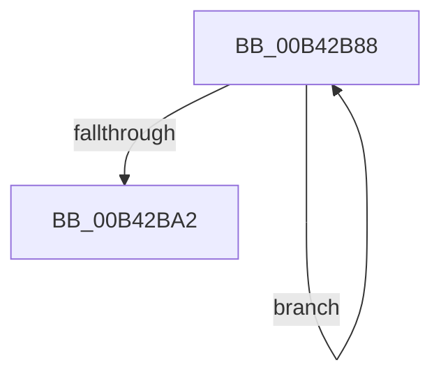

# sub_00B42B88

- RVA: `0x00B42B88`–`0x00B42BA7` (길이 `31` bytes)
- VA: `0x0000000140B42B88`
- 실행 섹션: `PAGE`
- PDB 이름 있음: `아니요`; PDB Function 태그: `아니요`
- unwind 정보 RVA: `0x000B6D6C`
- 디코드: `8`개 명령, `31/31` bytes 표시
- 미해석 바이트: `0` (있으면 어셈블리에 `.byte`로 보존)

> 이 문서는 커널 이미지의 기계어와 PDB 기호를 분석해 생성했습니다. 4번과 5번은 함수 원형과 자료형을 바이너리 사용 방식에서 추정한 C 해석이며 원본 소스 복구 결과는 아닙니다.

## 1. Dependencies

- 직접 호출 지점: **1**; 고유 호출 대상: **1**
- 직접 호출자로 확인된 함수: **0**
- RIP 상대 이미지 참조: **0**

### Outgoing calls
- `0x00B42B91` → [PpmConvertTimeTo](../../text/43/PpmConvertTimeTo_function_0043B3CC.md) (function, `0x0043B3CC`)

### Direct callers
- 이 함수 시작 RVA로 연결되는 직접 call은 확인되지 않았습니다. 간접 호출은 완전히 역산할 수 없습니다.

### Static image references
- 디코드된 RIP-relative 메모리 참조가 없습니다.

## 2. Other-region calls and transfers

- 다른 실행 섹션으로 향하는 call: **1**
  - `0x00B42B91` → [PpmConvertTimeTo](../../text/43/PpmConvertTimeTo_function_0043B3CC.md) (`PAGE` → `.text`)
- call이 아닌 외부 분기/꼬리 이동: **1**
  - `0x00B42BA2` → [PpmIdleGetPackageIdleIntervalStats + 0x8B](../A7/PpmIdleGetPackageIdleIntervalStats_function_00A7EE4C.md) (`tail-transfer`)

## 3. Assembly (complete function range)

```asm
00B42B88  4B 8B 0C 2F                     mov rcx, qword ptr [r15 + r13]
00B42B8C  BA 80 96 98 00                  mov edx, 0x989680
00B42B91  E8 36 88 8F FF                  call 0x14043b3cc
00B42B96  49 89 07                        mov qword ptr [r15], rax
00B42B99  4D 8D 7F 08                     lea r15, [r15 + 8]
00B42B9D  49 2B FC                        sub rdi, r12
00B42BA0  75 E6                           jne 0x140b42b88
00B42BA2  E9 30 C3 F3 FF                  jmp 0x140a7eed7
```

## 4. C-style interpretation (structured pseudocode)

```c
__int64 __fastcall sub_00B42B88(void)
{
    __int64 result;
    __int64 v_rdi;

    result = PpmConvertTimeTo(*(unsigned __int64 *)(v_r15 + v_r13 * 1), (unsigned int)(0x989680ULL), a3, a4);
    *(unsigned __int64 *)(v_r15) = result;
    v_rdi = (v_rdi) - (v_r12);
    if (condition_is_not_equal) goto loc_00B42B88;
}
```

## 5. (Beta) C Style

```c
void sub_00B42B88(void)
{
    int64_t result;
    int64_t local_rdi;

    result = PpmConvertTimeTo(*(uint64_t *)(local_r15 + local_r13 * 1), (uint32_t)(0x989680ULL), a3, a4);
    *(uint64_t *)(local_r15) = result;
    local_rdi = (local_rdi) - (local_r12);
    if (condition_is_not_equal) goto loc_00B42B88;
}
```

## 6. Execution-region graph

[열기: 2D/3D 그래프와 함수 탐색 컨트롤 패널](../../../control-panel.html?section=page&rva=0x00B42B88&view=graph)

- 2D 그래프는 위에서 아래로 흐르고, 3D 그래프는 빈 공간을 드래그해 회전합니다. Shift+드래그는 이동, 휠은 확대·축소, 함수 노드 선택은 대상 보고서 이동입니다.

### Static fallback


