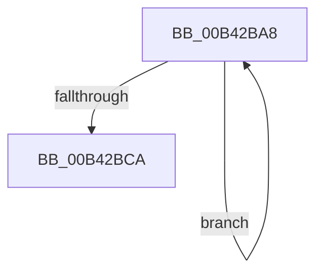

# sub_00B42BA8

- RVA: `0x00B42BA8`–`0x00B42BDE` (길이 `54` bytes)
- VA: `0x0000000140B42BA8`
- 실행 섹션: `PAGE`
- PDB 이름 있음: `아니요`; PDB Function 태그: `아니요`
- unwind 정보 RVA: `0x000B6D98`
- 디코드: `14`개 명령, `54/54` bytes 표시
- 미해석 바이트: `0` (있으면 어셈블리에 `.byte`로 보존)

> 이 문서는 커널 이미지의 기계어와 PDB 기호를 분석해 생성했습니다. 4번과 5번은 함수 원형과 자료형을 바이너리 사용 방식에서 추정한 C 해석이며 원본 소스 복구 결과는 아닙니다.

## 1. Dependencies

- 직접 호출 지점: **2**; 고유 호출 대상: **2**
- 직접 호출자로 확인된 함수: **0**
- RIP 상대 이미지 참조: **0**

### Outgoing calls
- `0x00B42BC1` → [MmDeleteKernelStack](../../text/33/MmDeleteKernelStack_function_0033A960.md) (function, `0x0033A960`)
- `0x00B42BCF` → [ExFreePoolWithTag](../../poolcode/B8/ExFreePoolWithTag_function_00B82870.md) (function, `0x00B82870`)

### Direct callers
- 이 함수 시작 RVA로 연결되는 직접 call은 확인되지 않았습니다. 간접 호출은 완전히 역산할 수 없습니다.

### Static image references
- 디코드된 RIP-relative 메모리 참조가 없습니다.

## 2. Other-region calls and transfers

- 다른 실행 섹션으로 향하는 call: **2**
  - `0x00B42BC1` → [MmDeleteKernelStack](../../text/33/MmDeleteKernelStack_function_0033A960.md) (`PAGE` → `.text`)
  - `0x00B42BCF` → [ExFreePoolWithTag](../../poolcode/B8/ExFreePoolWithTag_function_00B82870.md) (`PAGE` → `POOLCODE`)
- call이 아닌 외부 분기/꼬리 이동: **1**
  - `0x00B42BD9` → [KeAllocateCalloutStackEx + 0xB3](../A7/KeAllocateCalloutStackEx_function_00A7F030.md) (`tail-transfer`)

## 3. Assembly (complete function range)

```asm
00B42BA8  89 75 D0                        mov dword ptr [rbp - 0x30], esi
00B42BAB  FF CF                           dec edi
00B42BAD  C7 45 D4 05 00 00 00            mov dword ptr [rbp - 0x2c], 5
00B42BB4  48 8B 4C FB 40                  mov rcx, qword ptr [rbx + rdi*8 + 0x40]
00B42BB9  48 89 4D E8                     mov qword ptr [rbp - 0x18], rcx
00B42BBD  48 8D 4D D0                     lea rcx, [rbp - 0x30]
00B42BC1  E8 9A 7D 7F FF                  call 0x14033a960
00B42BC6  85 FF                           test edi, edi
00B42BC8  75 DE                           jne 0x140b42ba8
00B42BCA  33 D2                           xor edx, edx
00B42BCC  48 8B CB                        mov rcx, rbx
00B42BCF  E8 9C FC 03 00                  call 0x140b82870
00B42BD4  B8 9A 00 00 C0                  mov eax, 0xc000009a
00B42BD9  E9 05 C5 F3 FF                  jmp 0x140a7f0e3
```

## 4. C-style interpretation (structured pseudocode)

```c
__int64 __fastcall sub_00B42BA8(__int64 a1, int a2)
{
    __int64 result;
    __int64 v_rdi;

    *(unsigned int *)(v_rbp - 48) = (unsigned int)(v_rsi);
    v_rdi = (unsigned int)((v_rdi) - 1);
    *(unsigned int *)(v_rbp - 44) = 5;
    *(unsigned __int64 *)(v_rbp - 24) = *(unsigned __int64 *)(v_rbx + v_rdi * 8 + 64);
    result = MmDeleteKernelStack(v_rbp - 48, a2, a3, a4);
    if ((unsigned int)(v_rdi) != 0) goto loc_00B42BA8;
    a2 = 0;
    result = ExFreePoolWithTag(v_rbx, a2, a3, a4);
}
```

## 5. (Beta) C Style

```c
int64_t sub_00B42BA8(int64_t Arg1, int32_t Arg2)
{
    int64_t result;
    int64_t local_rdi;

    *(uint32_t *)(local_rbp - 0x30) = (uint32_t)(local_rsi);
    local_rdi = (uint32_t)((local_rdi) - 1);
    *(uint32_t *)(local_rbp - 0x2C) = 5;
    *(uint64_t *)(local_rbp - 0x18) = *(uint64_t *)(local_rbx + local_rdi * 8 + 0x40);
    result = MmDeleteKernelStack(local_rbp - 48, Arg2, a3, a4);
    if ((uint32_t)(local_rdi) != 0) goto loc_00B42BA8;
    Arg2 = 0;
    result = ExFreePoolWithTag(local_rbx, Arg2, a3, a4);
}
```

## 6. Execution-region graph

[열기: 2D/3D 그래프와 함수 탐색 컨트롤 패널](../../../control-panel.html?section=page&rva=0x00B42BA8&view=graph)

- 2D 그래프는 위에서 아래로 흐르고, 3D 그래프는 빈 공간을 드래그해 회전합니다. Shift+드래그는 이동, 휠은 확대·축소, 함수 노드 선택은 대상 보고서 이동입니다.

### Static fallback


