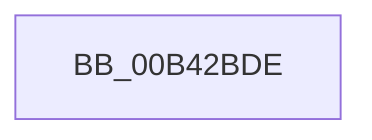

# sub_00B42BDE

- RVA: `0x00B42BDE`–`0x00B42C0F` (길이 `49` bytes)
- VA: `0x0000000140B42BDE`
- 실행 섹션: `PAGE`
- PDB 이름 있음: `아니요`; PDB Function 태그: `아니요`
- unwind 정보 RVA: `0x000B6DC8`
- 디코드: `14`개 명령, `49/49` bytes 표시
- 미해석 바이트: `0` (있으면 어셈블리에 `.byte`로 보존)

> 이 문서는 커널 이미지의 기계어와 PDB 기호를 분석해 생성했습니다. 4번과 5번은 함수 원형과 자료형을 바이너리 사용 방식에서 추정한 C 해석이며 원본 소스 복구 결과는 아닙니다.

## 1. Dependencies

- 직접 호출 지점: **3**; 고유 호출 대상: **3**
- 직접 호출자로 확인된 함수: **0**
- RIP 상대 이미지 참조: **0**

### Outgoing calls
- `0x00B42BE4` → [MiUnlockDriverMappings](../../text/4B/MiUnlockDriverMappings_function_004B4E54.md) (function, `0x004B4E54`)
- `0x00B42BFA` → [MiReturnSystemVa](../../text/23/MiReturnSystemVa_function_002394C4.md) (function, `0x002394C4`)
- `0x00B42C04` → [ExFreePoolWithTag](../../poolcode/B8/ExFreePoolWithTag_function_00B82870.md) (function, `0x00B82870`)

### Direct callers
- 이 함수 시작 RVA로 연결되는 직접 call은 확인되지 않았습니다. 간접 호출은 완전히 역산할 수 없습니다.

### Static image references
- 디코드된 RIP-relative 메모리 참조가 없습니다.

## 2. Other-region calls and transfers

- 다른 실행 섹션으로 향하는 call: **3**
  - `0x00B42BE4` → [MiUnlockDriverMappings](../../text/4B/MiUnlockDriverMappings_function_004B4E54.md) (`PAGE` → `.text`)
  - `0x00B42BFA` → [MiReturnSystemVa](../../text/23/MiReturnSystemVa_function_002394C4.md) (`PAGE` → `.text`)
  - `0x00B42C04` → [ExFreePoolWithTag](../../poolcode/B8/ExFreePoolWithTag_function_00B82870.md) (`PAGE` → `POOLCODE`)
- call이 아닌 외부 분기/꼬리 이동: **1**
  - `0x00B42C0A` → [MiReleaseDriverPtes + 0x163](../A7/MiReleaseDriverPtes_function_00A7F1B4.md) (`tail-transfer`)

## 3. Assembly (complete function range)

```asm
00B42BDE  49 89 07                        mov qword ptr [r15], rax
00B42BE1  49 8B CD                        mov rcx, r13
00B42BE4  E8 6B 22 97 FF                  call 0x1404b4e54
00B42BE9  C1 E6 10                        shl esi, 0x10
00B42BEC  41 B8 0B 00 00 00               mov r8d, 0xb
00B42BF2  8B D6                           mov edx, esi
00B42BF4  48 8B CF                        mov rcx, rdi
00B42BF7  48 03 D7                        add rdx, rdi
00B42BFA  E8 C5 68 6F FF                  call 0x1402394c4
00B42BFF  33 D2                           xor edx, edx
00B42C01  48 8B CB                        mov rcx, rbx
00B42C04  E8 67 FC 03 00                  call 0x140b82870
00B42C09  90                              nop
00B42C0A  E9 08 C7 F3 FF                  jmp 0x140a7f317
```

## 4. C-style interpretation (structured pseudocode)

```c
__int64 __fastcall sub_00B42BDE(void)
{
    __int64 result;
    __int64 v_rsi;

    *(unsigned __int64 *)(v_r15) = result;
    result = MiUnlockDriverMappings(v_r13, a2, a3, a4);
    v_rsi = (unsigned int)((v_rsi) << (16));
    a2 = ((unsigned int)((unsigned int)(v_rsi))) + (v_rdi);
    result = MiReturnSystemVa(v_rdi, a2, 11, a4);
    a2 = 0;
    result = ExFreePoolWithTag(v_rbx, a2, 11, a4);
}
```

## 5. (Beta) C Style

```c
void sub_00B42BDE(void)
{
    int64_t result;
    int64_t local_rsi;

    *(uint64_t *)(local_r15) = result;
    result = MiUnlockDriverMappings(local_r13, a2, a3, a4);
    local_rsi = (uint32_t)((local_rsi) << (16));
    a2 = ((uint32_t)((uint32_t)(local_rsi))) + (local_rdi);
    result = MiReturnSystemVa(local_rdi, a2, 11, a4);
    a2 = 0;
    result = ExFreePoolWithTag(local_rbx, a2, 11, a4);
}
```

## 6. Execution-region graph

[열기: 2D/3D 그래프와 함수 탐색 컨트롤 패널](../../../control-panel.html?section=page&rva=0x00B42BDE&view=graph)

- 2D 그래프는 위에서 아래로 흐르고, 3D 그래프는 빈 공간을 드래그해 회전합니다. Shift+드래그는 이동, 휠은 확대·축소, 함수 노드 선택은 대상 보고서 이동입니다.

### Static fallback


