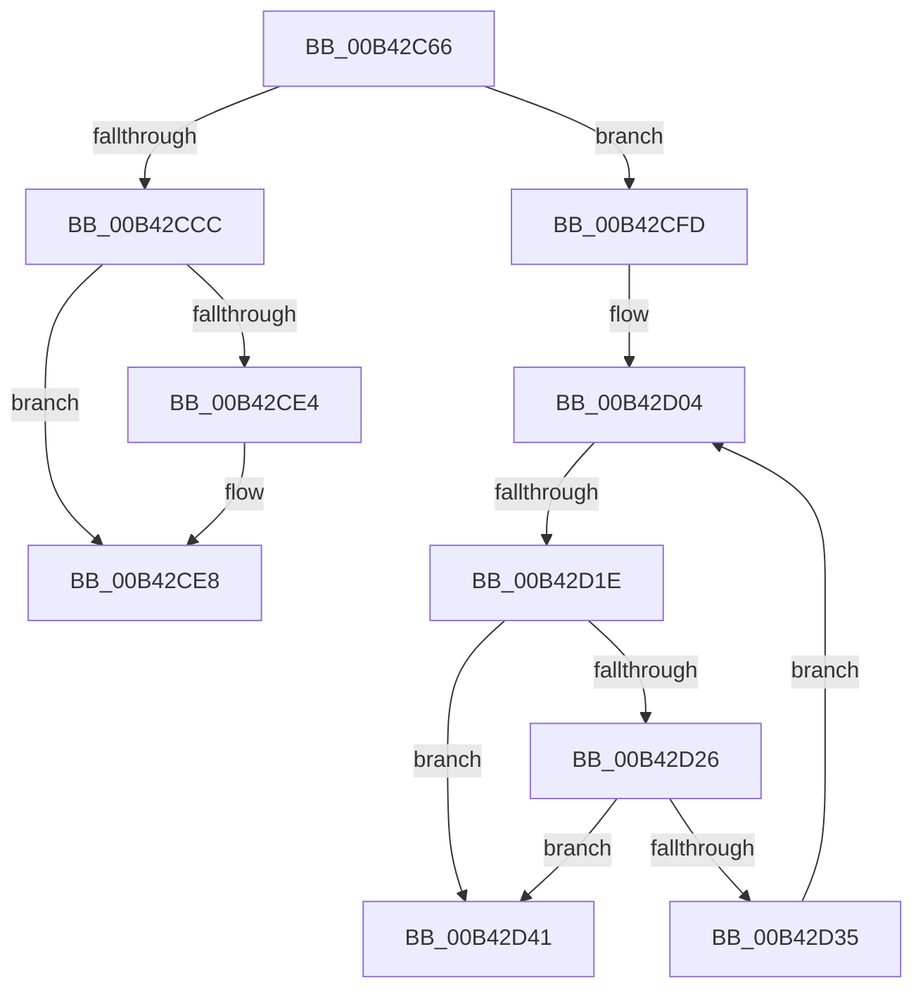

# sub_00B42C66

- RVA: `0x00B42C66`–`0x00B42D49` (길이 `227` bytes)
- VA: `0x0000000140B42C66`
- 실행 섹션: `PAGE`
- PDB 이름 있음: `아니요`; PDB Function 태그: `아니요`
- unwind 정보 RVA: `0x000B6F64`
- 디코드: `48`개 명령, `227/227` bytes 표시
- 미해석 바이트: `0` (있으면 어셈블리에 `.byte`로 보존)

> 이 문서는 커널 이미지의 기계어와 PDB 기호를 분석해 생성했습니다. 4번과 5번은 함수 원형과 자료형을 바이너리 사용 방식에서 추정한 C 해석이며 원본 소스 복구 결과는 아닙니다.

## 1. Dependencies

- 직접 호출 지점: **4**; 고유 호출 대상: **4**
- 직접 호출자로 확인된 함수: **0**
- RIP 상대 이미지 참조: **0**

### Outgoing calls
- `0x00B42CC3` → [MiFindContiguousPagesEx](../../text/28/MiFindContiguousPagesEx_function_0028BDE0.md) (function, `0x0028BDE0`)
- `0x00B42CEF` → [MiPreInitializeSystemImagePage](../../text/4D/MiPreInitializeSystemImagePage_function_004D621C.md) (function, `0x004D621C`)
- `0x00B42D0C` → [MiGetPage](../../text/28/MiGetPage_function_002884C0.md) (function, `0x002884C0`)
- `0x00B42D3A` → [MiWaitForFreePage](../../text/2A/MiWaitForFreePage_function_002A3324.md) (function, `0x002A3324`)

### Direct callers
- 이 함수 시작 RVA로 연결되는 직접 call은 확인되지 않았습니다. 간접 호출은 완전히 역산할 수 없습니다.

### Static image references
- 디코드된 RIP-relative 메모리 참조가 없습니다.

## 2. Other-region calls and transfers

- 다른 실행 섹션으로 향하는 call: **4**
  - `0x00B42CC3` → [MiFindContiguousPagesEx](../../text/28/MiFindContiguousPagesEx_function_0028BDE0.md) (`PAGE` → `.text`)
  - `0x00B42CEF` → [MiPreInitializeSystemImagePage](../../text/4D/MiPreInitializeSystemImagePage_function_004D621C.md) (`PAGE` → `.text`)
  - `0x00B42D0C` → [MiGetPage](../../text/28/MiGetPage_function_002884C0.md) (`PAGE` → `.text`)
  - `0x00B42D3A` → [MiWaitForFreePage](../../text/2A/MiWaitForFreePage_function_002A3324.md) (`PAGE` → `.text`)
- call이 아닌 외부 분기/꼬리 이동: **3**
  - `0x00B42CF8` → [MiAllocateDriverPage + 0x85](../A8/MiAllocateDriverPage_function_00A80128.md) (`tail-transfer`)
  - `0x00B42D18` → [MiAllocateDriverPage + 0x85](../A8/MiAllocateDriverPage_function_00A80128.md) (`tail-transfer`)
  - `0x00B42D44` → [MiAllocateDriverPage + 0x85](../A8/MiAllocateDriverPage_function_00A80128.md) (`tail-transfer`)

## 3. Assembly (complete function range)

```asm
00B42C66  F0 48 FF 86 30 41 00 00         lock inc qword ptr [rsi + 0x4130]
00B42C6E  4C 8B 86 28 41 00 00            mov r8, qword ptr [rsi + 0x4128]
00B42C75  48 8D 45 27                     lea rax, [rbp + 0x27]
00B42C79  48 89 44 24 68                  mov qword ptr [rsp + 0x68], rax
00B42C7E  45 33 C9                        xor r9d, r9d
00B42C81  48 83 64 24 60 00               and qword ptr [rsp + 0x60], 0
00B42C87  33 D2                           xor edx, edx
00B42C89  48 83 64 24 58 00               and qword ptr [rsp + 0x58], 0
00B42C8F  48 8B CE                        mov rcx, rsi
00B42C92  83 64 24 50 00                  and dword ptr [rsp + 0x50], 0
00B42C97  C7 44 24 48 01 00 00 60         mov dword ptr [rsp + 0x48], 0x60000001
00B42C9F  C6 44 24 40 FF                  mov byte ptr [rsp + 0x40], 0xff
00B42CA4  C7 44 24 38 00 00 00 80         mov dword ptr [rsp + 0x38], 0x80000000
00B42CAC  C7 44 24 30 01 00 00 00         mov dword ptr [rsp + 0x30], 1
00B42CB4  48 C7 44 24 28 01 00 00 00      mov qword ptr [rsp + 0x28], 1
00B42CBD  48 83 64 24 20 00               and qword ptr [rsp + 0x20], 0
00B42CC3  E8 18 91 74 FF                  call 0x14028bde0
00B42CC8  85 C0                           test eax, eax
00B42CCA  78 31                           js 0x140b42cfd
00B42CCC  48 FF 86 20 41 00 00            inc qword ptr [rsi + 0x4120]
00B42CD3  48 F7 86 20 41 00 00 FF 01 00 00  test qword ptr [rsi + 0x4120], 0x1ff
00B42CDE  48 8B 4D 27                     mov rcx, qword ptr [rbp + 0x27]
00B42CE2  74 04                           je 0x140b42ce8
00B42CE4  48 8D 79 FF                     lea rdi, [rcx - 1]
00B42CE8  48 89 BE 28 41 00 00            mov qword ptr [rsi + 0x4128], rdi
00B42CEF  E8 28 35 99 FF                  call 0x1404d621c
00B42CF4  48 8B 45 27                     mov rax, qword ptr [rbp + 0x27]
00B42CF8  E9 B0 D4 F3 FF                  jmp 0x140a801ad
00B42CFD  48 89 BE 28 41 00 00            mov qword ptr [rsi + 0x4128], rdi
00B42D04  45 33 C0                        xor r8d, r8d
00B42D07  8B D3                           mov edx, ebx
00B42D09  48 8B CE                        mov rcx, rsi
00B42D0C  E8 AF 57 74 FF                  call 0x1402884c0
00B42D11  48 89 45 27                     mov qword ptr [rbp + 0x27], rax
00B42D15  48 3B C7                        cmp rax, rdi
00B42D18  0F 85 8F D4 F3 FF               jne 0x140a801ad
00B42D1E  44 0F 20 C0                     mov rax, cr8
00B42D22  3C 02                           cmp al, 2
00B42D24  74 1B                           je 0x140b42d41
00B42D26  65 8B 04 25 3C 3A 00 00         mov eax, dword ptr gs:[0x3a3c]
00B42D2E  A9 01 00 01 00                  test eax, 0x10001
00B42D33  75 0C                           jne 0x140b42d41
00B42D35  33 D2                           xor edx, edx
00B42D37  48 8B CE                        mov rcx, rsi
00B42D3A  E8 E5 05 76 FF                  call 0x1402a3324
00B42D3F  EB C3                           jmp 0x140b42d04
00B42D41  48 8B C7                        mov rax, rdi
00B42D44  E9 64 D4 F3 FF                  jmp 0x140a801ad
```

## 4. C-style interpretation (structured pseudocode)

```c
__int64 __fastcall sub_00B42C66(__int64 a1, int a2, __int64 a3, int a4, __int64 a5, __int64 a6, __int64 a7, __int64 a8, __int64 a9, unsigned int a10, __int64 a11, __int64 a12)
{
    __int64 result;
    __int64 v_rdi;
    unsigned __int64 v_stack_p20;
    unsigned __int64 v_stack_p28;
    unsigned int v_stack_p30;
    unsigned int v_stack_p38;
    unsigned __int8 v_stack_p40;
    unsigned int v_stack_p48;
    unsigned __int64 v_stack_p68;

    v_stack_p68 = v_rbp + 39;
    a4 = 0;
    a2 = 0;
    v_stack_p48 = 0x60000001ULL;
    v_stack_p40 = 255;
    v_stack_p38 = 0x80000000ULL;
    v_stack_p30 = 1;
    v_stack_p28 = 1;
    result = MiFindContiguousPagesEx(v_rsi, a2, *(unsigned __int64 *)(v_rsi + 16680), a4);
    if (sign_flag) goto loc_00B42CFD;
    if (((*(unsigned __int64 *)(v_rsi + 16672)) & (511)) != 0) {
        v_rdi = *(unsigned __int64 *)(v_rbp + 39) - 1;
    }
    *(unsigned __int64 *)(v_rsi + 16680) = v_rdi;
    result = MiPreInitializeSystemImagePage(*(unsigned __int64 *)(v_rbp + 39), a2, *(unsigned __int64 *)(v_rsi + 16680), a4);
loc_00B42CFD:
    *(unsigned __int64 *)(v_rsi + 16680) = v_rdi;
loc_00B42D04:
    a3 = 0;
    result = MiGetPage(v_rsi, (unsigned int)((unsigned int)(v_rbx)), a3, a4);
    *(unsigned __int64 *)(v_rbp + 39) = result;
    if (((unsigned __int8)(v_cr8)) == 2) goto loc_00B42D41;
    if ((((unsigned int)((unsigned int)(*(unsigned int *)(gs_base + (0 + 14908))))) & (0x10001ULL)) != 0) goto loc_00B42D41;
    a2 = 0;
    result = MiWaitForFreePage(v_rsi, a2, a3, a4);
    goto loc_00B42D04;
loc_00B42D41:
}
```

## 5. (Beta) C Style

```c
int64_t sub_00B42C66(int64_t Arg1, int32_t Arg2, int64_t Arg3, int32_t Arg4, uint64_t Arg5, uint64_t Arg6, uint64_t Arg7, uint64_t Arg8, uint64_t Arg9, uint32_t Arg10, int64_t Arg11, int64_t Arg12)
{
    int64_t result;
    int64_t local_rdi;
    uint64_t v_stack_p20;
    uint64_t v_stack_p28;
    uint32_t v_stack_p30;
    uint32_t v_stack_p38;
    uint8_t v_stack_p40;
    uint32_t v_stack_p48;
    uint64_t v_stack_p68;

    v_stack_p68 = local_rbp + 39;
    Arg4 = 0;
    Arg2 = 0;
    v_stack_p48 = 0x60000001ULL;
    v_stack_p40 = 255;
    v_stack_p38 = 0x80000000ULL;
    v_stack_p30 = 1;
    v_stack_p28 = 1;
    result = MiFindContiguousPagesEx(local_rsi, Arg2, *(uint64_t *)(local_rsi + 0x4128), Arg4);
    if (sign_flag) goto loc_00B42CFD;
    if (((*(uint64_t *)(local_rsi + 0x4120)) & (511)) != 0) {
        local_rdi = *(uint64_t *)(local_rbp + 0x27) - 1;
    }
    *(uint64_t *)(local_rsi + 0x4128) = local_rdi;
    result = MiPreInitializeSystemImagePage(*(uint64_t *)(local_rbp + 0x27), Arg2, *(uint64_t *)(local_rsi + 0x4128), Arg4);
loc_00B42CFD:
    *(uint64_t *)(local_rsi + 0x4128) = local_rdi;
loc_00B42D04:
    Arg3 = 0;
    result = MiGetPage(local_rsi, (uint32_t)((uint32_t)(local_rbx)), Arg3, Arg4);
    *(uint64_t *)(local_rbp + 0x27) = result;
    if (((uint8_t)(v_cr8)) == 2) goto loc_00B42D41;
    if ((((uint32_t)((uint32_t)(*(uint32_t *)(gs_base + (0 + 0x3A3C))))) & (0x10001ULL)) != 0) goto loc_00B42D41;
    Arg2 = 0;
    result = MiWaitForFreePage(local_rsi, Arg2, Arg3, Arg4);
    goto loc_00B42D04;
loc_00B42D41:
}
```

## 6. Execution-region graph

[열기: 2D/3D 그래프와 함수 탐색 컨트롤 패널](../../../control-panel.html?section=page&rva=0x00B42C66&view=graph)

- 2D 그래프는 위에서 아래로 흐르고, 3D 그래프는 빈 공간을 드래그해 회전합니다. Shift+드래그는 이동, 휠은 확대·축소, 함수 노드 선택은 대상 보고서 이동입니다.

### Static fallback


