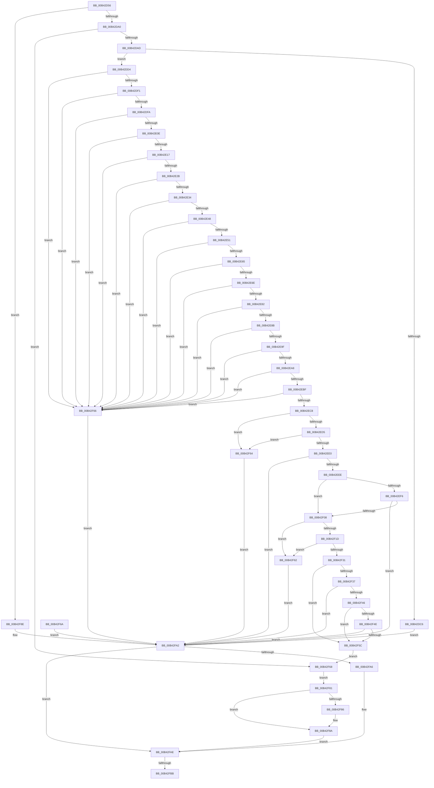

# sub_00B42D56

- RVA: `0x00B42D56`–`0x00B42FF2` (길이 `668` bytes)
- VA: `0x0000000140B42D56`
- 실행 섹션: `PAGE`
- PDB 이름 있음: `아니요`; PDB Function 태그: `아니요`
- unwind 정보 RVA: `0x000B7028`
- 디코드: `170`개 명령, `668/668` bytes 표시
- 미해석 바이트: `0` (있으면 어셈블리에 `.byte`로 보존)

> 이 문서는 커널 이미지의 기계어와 PDB 기호를 분석해 생성했습니다. 4번과 5번은 함수 원형과 자료형을 바이너리 사용 방식에서 추정한 C 해석이며 원본 소스 복구 결과는 아닙니다.

## 1. Dependencies

- 직접 호출 지점: **7**; 고유 호출 대상: **3**
- 직접 호출자로 확인된 함수: **0**
- RIP 상대 이미지 참조: **0**

### Outgoing calls
- `0x00B42D91` → [LdrpResSearchResourceMappedFile](../../text/45/LdrpResSearchResourceMappedFile_function_00454C98.md) (function, `0x00454C98`)
- `0x00B42EFB` → [CheckOneBitValidFlag](../../text/5E/CheckOneBitValidFlag_function_005E6EB8.md) (function, `0x005E6EB8`)
- `0x00B42F14` → [CheckOneBitValidFlag](../../text/5E/CheckOneBitValidFlag_function_005E6EB8.md) (function, `0x005E6EB8`)
- `0x00B42F28` → [CheckOneBitValidFlag](../../text/5E/CheckOneBitValidFlag_function_005E6EB8.md) (function, `0x005E6EB8`)
- `0x00B42F3D` → [CheckOneBitValidFlag](../../text/5E/CheckOneBitValidFlag_function_005E6EB8.md) (function, `0x005E6EB8`)
- `0x00B42F53` → [CheckOneBitValidFlag](../../text/5E/CheckOneBitValidFlag_function_005E6EB8.md) (function, `0x005E6EB8`)
- `0x00B42FE7` → [LdrpSetAlternateResourceModuleHandle](../../text/45/LdrpSetAlternateResourceModuleHandle_function_00455EBC.md) (function, `0x00455EBC`)

### Direct callers
- 이 함수 시작 RVA로 연결되는 직접 call은 확인되지 않았습니다. 간접 호출은 완전히 역산할 수 없습니다.

### Static image references
- 디코드된 RIP-relative 메모리 참조가 없습니다.

## 2. Other-region calls and transfers

- 다른 실행 섹션으로 향하는 call: **7**
  - `0x00B42D91` → [LdrpResSearchResourceMappedFile](../../text/45/LdrpResSearchResourceMappedFile_function_00454C98.md) (`PAGE` → `.text`)
  - `0x00B42EFB` → [CheckOneBitValidFlag](../../text/5E/CheckOneBitValidFlag_function_005E6EB8.md) (`PAGE` → `.text`)
  - `0x00B42F14` → [CheckOneBitValidFlag](../../text/5E/CheckOneBitValidFlag_function_005E6EB8.md) (`PAGE` → `.text`)
  - `0x00B42F28` → [CheckOneBitValidFlag](../../text/5E/CheckOneBitValidFlag_function_005E6EB8.md) (`PAGE` → `.text`)
  - `0x00B42F3D` → [CheckOneBitValidFlag](../../text/5E/CheckOneBitValidFlag_function_005E6EB8.md) (`PAGE` → `.text`)
  - `0x00B42F53` → [CheckOneBitValidFlag](../../text/5E/CheckOneBitValidFlag_function_005E6EB8.md) (`PAGE` → `.text`)
  - `0x00B42FE7` → [LdrpSetAlternateResourceModuleHandle](../../text/45/LdrpSetAlternateResourceModuleHandle_function_00455EBC.md) (`PAGE` → `.text`)
- call이 아닌 외부 분기/꼬리 이동: **2**
  - `0x00B42FB5` → [LdrResGetRCConfig + 0xA7](../A8/LdrResGetRCConfig_function_00A8035C.md) (`tail-transfer`)
  - `0x00B42FED` → [LdrResGetRCConfig + 0xA7](../A8/LdrResGetRCConfig_function_00A8035C.md) (`tail-transfer`)

## 3. Assembly (complete function range)

```asm
00B42D56  48 89 5C 24 40                  mov qword ptr [rsp + 0x40], rbx
00B42D5B  48 89 5C 24 38                  mov qword ptr [rsp + 0x38], rbx
00B42D60  48 8D 44 24 68                  lea rax, [rsp + 0x68]
00B42D65  48 89 44 24 30                  mov qword ptr [rsp + 0x30], rax
00B42D6A  48 8D 44 24 58                  lea rax, [rsp + 0x58]
00B42D6F  48 89 44 24 28                  mov qword ptr [rsp + 0x28], rax
00B42D74  BE 03 00 00 00                  mov esi, 3
00B42D79  89 74 24 20                     mov dword ptr [rsp + 0x20], esi
00B42D7D  4C 8D 4C 24 78                  lea r9, [rsp + 0x78]
00B42D82  45 8D 86 30 10 00 00            lea r8d, [r14 + 0x1030]
00B42D89  48 8B 54 24 60                  mov rdx, qword ptr [rsp + 0x60]
00B42D8E  49 8B CD                        mov rcx, r13
00B42D91  E8 02 1F 91 FF                  call 0x140454c98
00B42D96  8B C8                           mov ecx, eax
00B42D98  85 C0                           test eax, eax
00B42D9A  0F 88 EE 01 00 00               js 0x140b42f8e
00B42DA0  4C 8B 44 24 58                  mov r8, qword ptr [rsp + 0x58]
00B42DA5  85 FF                           test edi, edi
00B42DA7  0F 85 BB 01 00 00               jne 0x140b42f68
00B42DAD  41 8B 50 04                     mov edx, dword ptr [r8 + 4]
00B42DB1  49 8B CD                        mov rcx, r13
00B42DB4  48 83 E1 FC                     and rcx, 0xfffffffffffffffc
00B42DB8  48 03 4C 24 60                  add rcx, qword ptr [rsp + 0x60]
00B42DBD  4A 8D 04 02                     lea rax, [rdx + r8]
00B42DC1  48 3B C1                        cmp rax, rcx
00B42DC4  76 0E                           jbe 0x140b42dd4
00B42DC6  BF 7B 00 00 C0                  mov edi, 0xc000007b
00B42DCB  89 7C 24 50                     mov dword ptr [rsp + 0x50], edi
00B42DCF  E9 CE 01 00 00                  jmp 0x140b42fa2
00B42DD4  BF 03 00 0B C0                  mov edi, 0xc00b0003
00B42DD9  89 7C 24 50                     mov dword ptr [rsp + 0x50], edi
00B42DDD  41 8B 48 44                     mov ecx, dword ptr [r8 + 0x44]
00B42DE1  45 8B 48 48                     mov r9d, dword ptr [r8 + 0x48]
00B42DE5  44 03 C9                        add r9d, ecx
00B42DE8  44 3B CA                        cmp r9d, edx
00B42DEB  0F 87 75 01 00 00               ja 0x140b42f66
00B42DF1  44 3B C9                        cmp r9d, ecx
00B42DF4  0F 82 6C 01 00 00               jb 0x140b42f66
00B42DFA  41 8B 48 4C                     mov ecx, dword ptr [r8 + 0x4c]
00B42DFE  45 8B 48 50                     mov r9d, dword ptr [r8 + 0x50]
00B42E02  44 03 C9                        add r9d, ecx
00B42E05  44 3B CA                        cmp r9d, edx
00B42E08  0F 87 58 01 00 00               ja 0x140b42f66
00B42E0E  44 3B C9                        cmp r9d, ecx
00B42E11  0F 82 4F 01 00 00               jb 0x140b42f66
00B42E17  41 8B 48 54                     mov ecx, dword ptr [r8 + 0x54]
00B42E1B  45 8B 48 58                     mov r9d, dword ptr [r8 + 0x58]
00B42E1F  44 03 C9                        add r9d, ecx
00B42E22  44 3B CA                        cmp r9d, edx
00B42E25  0F 87 3B 01 00 00               ja 0x140b42f66
00B42E2B  44 3B C9                        cmp r9d, ecx
00B42E2E  0F 82 32 01 00 00               jb 0x140b42f66
00B42E34  41 8B 48 5C                     mov ecx, dword ptr [r8 + 0x5c]
00B42E38  45 8B 48 60                     mov r9d, dword ptr [r8 + 0x60]
00B42E3C  44 03 C9                        add r9d, ecx
00B42E3F  44 3B CA                        cmp r9d, edx
00B42E42  0F 87 1E 01 00 00               ja 0x140b42f66
00B42E48  44 3B C9                        cmp r9d, ecx
00B42E4B  0F 82 15 01 00 00               jb 0x140b42f66
00B42E51  41 8B 48 64                     mov ecx, dword ptr [r8 + 0x64]
00B42E55  45 8B 48 68                     mov r9d, dword ptr [r8 + 0x68]
00B42E59  44 03 C9                        add r9d, ecx
00B42E5C  44 3B CA                        cmp r9d, edx
00B42E5F  0F 87 01 01 00 00               ja 0x140b42f66
00B42E65  44 3B C9                        cmp r9d, ecx
00B42E68  0F 82 F8 00 00 00               jb 0x140b42f66
00B42E6E  41 8B 48 6C                     mov ecx, dword ptr [r8 + 0x6c]
00B42E72  45 8B 48 70                     mov r9d, dword ptr [r8 + 0x70]
00B42E76  44 03 C9                        add r9d, ecx
00B42E79  44 3B CA                        cmp r9d, edx
00B42E7C  0F 87 E4 00 00 00               ja 0x140b42f66
00B42E82  44 3B C9                        cmp r9d, ecx
00B42E85  0F 82 DB 00 00 00               jb 0x140b42f66
00B42E8B  41 8B 48 74                     mov ecx, dword ptr [r8 + 0x74]
00B42E8F  45 8B 48 78                     mov r9d, dword ptr [r8 + 0x78]
00B42E93  44 03 C9                        add r9d, ecx
00B42E96  44 3B CA                        cmp r9d, edx
00B42E99  0F 87 C7 00 00 00               ja 0x140b42f66
00B42E9F  44 3B C9                        cmp r9d, ecx
00B42EA2  0F 82 BE 00 00 00               jb 0x140b42f66
00B42EA8  41 8B 48 7C                     mov ecx, dword ptr [r8 + 0x7c]
00B42EAC  45 8B 88 80 00 00 00            mov r9d, dword ptr [r8 + 0x80]
00B42EB3  44 03 C9                        add r9d, ecx
00B42EB6  44 3B CA                        cmp r9d, edx
00B42EB9  0F 87 A7 00 00 00               ja 0x140b42f66
00B42EBF  44 3B C9                        cmp r9d, ecx
00B42EC2  0F 82 9E 00 00 00               jb 0x140b42f66
00B42EC8  41 81 38 CD FE CD FE            cmp dword ptr [r8], 0xfecdfecd
00B42ECF  0F 85 8F 00 00 00               jne 0x140b42f64
00B42ED5  48 3B 54 24 68                  cmp rdx, qword ptr [rsp + 0x68]
00B42EDA  0F 85 84 00 00 00               jne 0x140b42f64
00B42EE0  41 81 78 08 00 00 01 00         cmp dword ptr [r8 + 8], 0x10000
00B42EE8  0F 85 B4 00 00 00               jne 0x140b42fa2
00B42EEE  41 8B 48 0C                     mov ecx, dword ptr [r8 + 0xc]
00B42EF2  85 C9                           test ecx, ecx
00B42EF4  74 12                           je 0x140b42f08
00B42EF6  BA 07 00 00 00                  mov edx, 7
00B42EFB  E8 B8 3F AA FF                  call 0x1405e6eb8
00B42F00  84 C0                           test al, al
00B42F02  0F 84 9A 00 00 00               je 0x140b42fa2
00B42F08  45 8B 48 10                     mov r9d, dword ptr [r8 + 0x10]
00B42F0C  41 8B C9                        mov ecx, r9d
00B42F0F  83 E1 CF                        and ecx, 0xffffffcf
00B42F12  8B D6                           mov edx, esi
00B42F14  E8 9F 3F AA FF                  call 0x1405e6eb8
00B42F19  84 C0                           test al, al
00B42F1B  74 45                           je 0x140b42f62
00B42F1D  41 8B C9                        mov ecx, r9d
00B42F20  83 E1 FC                        and ecx, 0xfffffffc
00B42F23  BA 30 00 00 00                  mov edx, 0x30
00B42F28  E8 8B 3F AA FF                  call 0x1405e6eb8
00B42F2D  84 C0                           test al, al
00B42F2F  74 31                           je 0x140b42f62
00B42F31  41 F6 C1 01                     test r9b, 1
00B42F35  74 25                           je 0x140b42f5c
00B42F37  8B D6                           mov edx, esi
00B42F39  41 8B 48 18                     mov ecx, dword ptr [r8 + 0x18]
00B42F3D  E8 76 3F AA FF                  call 0x1405e6eb8
00B42F42  84 C0                           test al, al
00B42F44  74 5C                           je 0x140b42fa2
00B42F46  41 8B 48 14                     mov ecx, dword ptr [r8 + 0x14]
00B42F4A  85 C9                           test ecx, ecx
00B42F4C  74 0E                           je 0x140b42f5c
00B42F4E  BA 00 01 00 00                  mov edx, 0x100
00B42F53  E8 60 3F AA FF                  call 0x1405e6eb8
00B42F58  84 C0                           test al, al
00B42F5A  74 46                           je 0x140b42fa2
00B42F5C  89 5C 24 50                     mov dword ptr [rsp + 0x50], ebx
00B42F60  EB 06                           jmp 0x140b42f68
00B42F62  EB 3E                           jmp 0x140b42fa2
00B42F64  EB 3C                           jmp 0x140b42fa2
00B42F66  EB 3A                           jmp 0x140b42fa2
00B42F68  EB 17                           jmp 0x140b42f81
00B42F6A  8B F8                           mov edi, eax
00B42F6C  89 44 24 50                     mov dword ptr [rsp + 0x50], eax
00B42F70  45 33 C0                        xor r8d, r8d
00B42F73  4C 89 44 24 58                  mov qword ptr [rsp + 0x58], r8
00B42F78  33 DB                           xor ebx, ebx
00B42F7A  4C 8B 6C 24 70                  mov r13, qword ptr [rsp + 0x70]
00B42F7F  EB 21                           jmp 0x140b42fa2
00B42F81  4D 85 E4                        test r12, r12
00B42F84  74 04                           je 0x140b42f8a
00B42F86  4D 89 04 24                     mov qword ptr [r12], r8
00B42F8A  8B FB                           mov edi, ebx
00B42F8C  EB 20                           jmp 0x140b42fae
00B42F8E  B8 8A 00 00 C0                  mov eax, 0xc000008a
00B42F93  8D 78 F1                        lea edi, [rax - 0xf]
00B42F96  3B CF                           cmp ecx, edi
00B42F98  0F 45 C8                        cmovne ecx, eax
00B42F9B  8B F9                           mov edi, ecx
00B42F9D  4C 8B 44 24 58                  mov r8, qword ptr [rsp + 0x58]
00B42FA2  85 FF                           test edi, edi
00B42FA4  79 08                           jns 0x140b42fae
00B42FA6  4C 8B C3                        mov r8, rbx
00B42FA9  48 89 5C 24 58                  mov qword ptr [rsp + 0x58], rbx
00B42FAE  38 9C 24 00 01 00 00            cmp byte ptr [rsp + 0x100], bl
00B42FB5  0F 84 48 D4 F3 FF               je 0x140a80403
00B42FBB  4D 85 C0                        test r8, r8
00B42FBE  49 C7 C1 FF FF FF FF            mov r9, 0xffffffffffffffff
00B42FC5  4D 0F 45 C8                     cmovne r9, r8
00B42FC9  48 89 5C 24 38                  mov qword ptr [rsp + 0x38], rbx
00B42FCE  89 7C 24 30                     mov dword ptr [rsp + 0x30], edi
00B42FD2  C7 44 24 28 02 00 00 00         mov dword ptr [rsp + 0x28], 2
00B42FDA  66 89 5C 24 20                  mov word ptr [rsp + 0x20], bx
00B42FDF  45 33 C0                        xor r8d, r8d
00B42FE2  33 D2                           xor edx, edx
00B42FE4  49 8B CD                        mov rcx, r13
00B42FE7  E8 D0 2E 91 FF                  call 0x140455ebc
00B42FEC  90                              nop
00B42FED  E9 11 D4 F3 FF                  jmp 0x140a80403
```

## 4. C-style interpretation (structured pseudocode)

```c
__int64 __fastcall sub_00B42D56(__int64 a1, __int64 a2, __int64 a3, __int64 a4, __int64 a5, __int64 a6, __int64 a7, __int64 a8, __int64 a9, __int64 a10, __int64 a11, __int64 a12, __int64 a13, __int64 a14, __int64 a15, __int64 a16, __int64 a17, __int64 a18, __int64 a19, __int64 a20, __int64 a21, __int64 a22, __int64 a23, __int64 a24, __int64 a25, __int64 a26, __int64 a27, __int64 a28, __int64 a29, __int64 a30, __int64 a31, unsigned __int8 a32)
{
    __int64 result;
    unsigned int v_stack_p20;
    unsigned __int64 v_stack_p28;
    unsigned __int64 v_stack_p30;
    unsigned __int64 v_stack_p38;
    unsigned __int64 v_stack_p40;
    unsigned int v_stack_p50;
    unsigned __int64 v_stack_p58;
    unsigned __int64 v_stack_p70;

    v_stack_p40 = v_rbx;
    v_stack_p38 = v_rbx;
    v_stack_p30 = a13;
    v_stack_p28 = a11;
    v_stack_p20 = 3;
    result = LdrpResSearchResourceMappedFile(v_r13, a12, v_r14 + 4144, a15);
    if (sign_flag) goto loc_00B42F8E;
    if ((unsigned int)(v_rdi) != 0) goto loc_00B42F68;
    a1 = (v_r13) & (-4);
    a1 = (a1) + (a12);
    if (((unsigned int)(*(unsigned int *)(a11 + 4)) + a11 * 1) <= a1) goto loc_00B42DD4;
    v_stack_p50 = (unsigned int)((unsigned int)(0xC000007BULL));
    goto loc_00B42FA2;
loc_00B42DD4:
    v_stack_p50 = (unsigned int)((unsigned int)(0xC00B0003ULL));
    a4 = (unsigned int)(((unsigned int)(*(unsigned int *)(a11 + 72))) + ((unsigned int)((unsigned int)(*(unsigned int *)(a11 + 68)))));
    if (((unsigned int)(a4)) > ((unsigned int)((unsigned int)(*(unsigned int *)(a11 + 4))))) goto loc_00B42F66;
    if (((unsigned int)(a4)) < ((unsigned int)((unsigned int)(*(unsigned int *)(a11 + 68))))) goto loc_00B42F66;
    a4 = (unsigned int)(((unsigned int)(*(unsigned int *)(a11 + 80))) + ((unsigned int)((unsigned int)(*(unsigned int *)(a11 + 76)))));
    if (((unsigned int)(a4)) > ((unsigned int)((unsigned int)(*(unsigned int *)(a11 + 4))))) goto loc_00B42F66;
    if (((unsigned int)(a4)) < ((unsigned int)((unsigned int)(*(unsigned int *)(a11 + 76))))) goto loc_00B42F66;
    a4 = (unsigned int)(((unsigned int)(*(unsigned int *)(a11 + 88))) + ((unsigned int)((unsigned int)(*(unsigned int *)(a11 + 84)))));
    if (((unsigned int)(a4)) > ((unsigned int)((unsigned int)(*(unsigned int *)(a11 + 4))))) goto loc_00B42F66;
    if (((unsigned int)(a4)) < ((unsigned int)((unsigned int)(*(unsigned int *)(a11 + 84))))) goto loc_00B42F66;
    a4 = (unsigned int)(((unsigned int)(*(unsigned int *)(a11 + 96))) + ((unsigned int)((unsigned int)(*(unsigned int *)(a11 + 92)))));
    if (((unsigned int)(a4)) > ((unsigned int)((unsigned int)(*(unsigned int *)(a11 + 4))))) goto loc_00B42F66;
    if (((unsigned int)(a4)) < ((unsigned int)((unsigned int)(*(unsigned int *)(a11 + 92))))) goto loc_00B42F66;
    a4 = (unsigned int)(((unsigned int)(*(unsigned int *)(a11 + 104))) + ((unsigned int)((unsigned int)(*(unsigned int *)(a11 + 100)))));
    if (((unsigned int)(a4)) > ((unsigned int)((unsigned int)(*(unsigned int *)(a11 + 4))))) goto loc_00B42F66;
    if (((unsigned int)(a4)) < ((unsigned int)((unsigned int)(*(unsigned int *)(a11 + 100))))) goto loc_00B42F66;
    a4 = (unsigned int)(((unsigned int)(*(unsigned int *)(a11 + 112))) + ((unsigned int)((unsigned int)(*(unsigned int *)(a11 + 108)))));
    if (((unsigned int)(a4)) > ((unsigned int)((unsigned int)(*(unsigned int *)(a11 + 4))))) goto loc_00B42F66;
    if (((unsigned int)(a4)) < ((unsigned int)((unsigned int)(*(unsigned int *)(a11 + 108))))) goto loc_00B42F66;
    a4 = (unsigned int)(((unsigned int)(*(unsigned int *)(a11 + 120))) + ((unsigned int)((unsigned int)(*(unsigned int *)(a11 + 116)))));
    if (((unsigned int)(a4)) > ((unsigned int)((unsigned int)(*(unsigned int *)(a11 + 4))))) goto loc_00B42F66;
    if (((unsigned int)(a4)) < ((unsigned int)((unsigned int)(*(unsigned int *)(a11 + 116))))) goto loc_00B42F66;
    a4 = (unsigned int)(((unsigned int)(*(unsigned int *)(a11 + 128))) + ((unsigned int)((unsigned int)(*(unsigned int *)(a11 + 124)))));
    if (((unsigned int)(a4)) > ((unsigned int)((unsigned int)(*(unsigned int *)(a11 + 4))))) goto loc_00B42F66;
    if (((unsigned int)(a4)) < ((unsigned int)((unsigned int)(*(unsigned int *)(a11 + 124))))) goto loc_00B42F66;
    if ((*(unsigned int *)(a11)) != 0xFECDFECDULL) goto loc_00B42F64;
    if (((unsigned int)(*(unsigned int *)(a11 + 4))) != a13) goto loc_00B42F64;
    if ((*(unsigned int *)(a11 + 8)) != 0x10000ULL) goto loc_00B42FA2;
    if ((unsigned int)((unsigned int)(*(unsigned int *)(a11 + 12))) == 0) goto loc_00B42F08;
    result = CheckOneBitValidFlag((unsigned int)(*(unsigned int *)(a11 + 12)), 7, a11, a4);
    if ((unsigned __int8)(result) == 0) goto loc_00B42FA2;
loc_00B42F08:
    a1 = (unsigned int)(((unsigned int)((unsigned int)((unsigned int)(*(unsigned int *)(a11 + 16))))) & (0xFFFFFFCFULL));
    result = CheckOneBitValidFlag(a1, 3, a11, (unsigned int)(*(unsigned int *)(a11 + 16)));
    if ((unsigned __int8)(result) == 0) goto loc_00B42F62;
    a1 = (unsigned int)(((unsigned int)((unsigned int)((unsigned int)(*(unsigned int *)(a11 + 16))))) & (0xFFFFFFFCULL));
    result = CheckOneBitValidFlag(a1, 48, a11, (unsigned int)(*(unsigned int *)(a11 + 16)));
    if ((unsigned __int8)(result) == 0) goto loc_00B42F62;
    if ((((unsigned __int8)((unsigned int)(*(unsigned int *)(a11 + 16)))) & (1)) == 0) goto loc_00B42F5C;
    result = CheckOneBitValidFlag((unsigned int)(*(unsigned int *)(a11 + 24)), 3, a11, (unsigned int)(*(unsigned int *)(a11 + 16)));
    if ((unsigned __int8)(result) == 0) goto loc_00B42FA2;
    if ((unsigned int)((unsigned int)(*(unsigned int *)(a11 + 20))) == 0) goto loc_00B42F5C;
    result = CheckOneBitValidFlag((unsigned int)(*(unsigned int *)(a11 + 20)), 256, a11, (unsigned int)(*(unsigned int *)(a11 + 16)));
    if ((unsigned __int8)(result) == 0) goto loc_00B42FA2;
loc_00B42F5C:
    v_stack_p50 = (unsigned int)(v_rbx);
    goto loc_00B42F68;
loc_00B42F62:
    goto loc_00B42FA2;
loc_00B42F64:
    goto loc_00B42FA2;
loc_00B42F66:
    goto loc_00B42FA2;
loc_00B42F68:
    goto loc_00B42F81;
loc_00B42F81:
    if (v_r12 != 0) {
        *(unsigned __int64 *)(v_r12) = a11;
    }
    goto loc_00B42FAE;
loc_00B42F8E:
    a1 = (unsigned int)(*(unsigned int *)(a11 + 20));
    if (((unsigned int)((unsigned int)(*(unsigned int *)(a11 + 20)))) != ((unsigned int)((unsigned int)(0xC000008AULL) - 15))) { a1 = (unsigned int)((unsigned int)(0xC000008AULL)); }
loc_00B42FA2:
    if (sign_flag) {
        a3 = v_rbx;
        v_stack_p58 = v_rbx;
    }
    a4 = -1;
    if (a3 != 0) { a4 = a3; }
    v_stack_p38 = v_rbx;
    v_stack_p30 = (unsigned int)((unsigned int)((unsigned int)(a1)));
    v_stack_p28 = 2;
    v_stack_p20 = (unsigned __int16)(v_rbx);
    a3 = 0;
    a2 = 0;
    result = LdrpSetAlternateResourceModuleHandle(v_r13, a2, a3, a4);
}
```

## 5. (Beta) C Style

```c
int64_t sub_00B42D56(int64_t Arg1, int64_t Arg2, int64_t Arg3, int64_t Arg4, uint64_t Arg5, uint64_t Arg6, uint64_t Arg7, uint64_t Arg8, uint64_t Arg9, uint64_t Arg10, void *Arg11, int64_t Arg12, int64_t Arg13, uint64_t Arg14, int64_t Arg15, uint64_t Arg16, uint64_t Arg17, uint64_t Arg18, uint64_t Arg19, uint64_t Arg20, uint64_t Arg21, uint64_t Arg22, uint64_t Arg23, uint64_t Arg24, uint64_t Arg25, uint64_t Arg26, uint64_t Arg27, uint64_t Arg28, uint64_t Arg29, uint64_t Arg30, uint64_t Arg31, uint8_t Arg32)
{
    uint8_t *arg11 = (uint8_t *)Arg11;

    int64_t result;
    uint32_t v_stack_p20;
    uint64_t v_stack_p28;
    uint64_t v_stack_p30;
    uint64_t v_stack_p38;
    uint64_t v_stack_p40;
    uint32_t v_stack_p50;
    uint64_t v_stack_p58;
    uint64_t v_stack_p70;

    v_stack_p40 = local_rbx;
    v_stack_p38 = local_rbx;
    v_stack_p30 = Arg13;
    v_stack_p28 = Arg11;
    v_stack_p20 = 3;
    result = LdrpResSearchResourceMappedFile(local_r13, Arg12, local_r14 + 4144, Arg15);
    if (sign_flag) goto loc_00B42F8E;
    if ((uint32_t)(local_rdi) != 0) goto loc_00B42F68;
    Arg1 = (local_r13) & (-4);
    Arg1 = (Arg1) + (Arg12);
    if (((uint32_t)(*(uint32_t *)(arg11 + 0x4)) + Arg11 * 1) <= Arg1) goto loc_00B42DD4;
    v_stack_p50 = (uint32_t)((uint32_t)(0xC000007BULL));
    goto loc_00B42FA2;
loc_00B42DD4:
    v_stack_p50 = (uint32_t)((uint32_t)(0xC00B0003ULL));
    Arg4 = (uint32_t)(((uint32_t)(*(uint32_t *)(arg11 + 0x48))) + ((uint32_t)((uint32_t)(*(uint32_t *)(arg11 + 0x44)))));
    if (((uint32_t)(Arg4)) > ((uint32_t)((uint32_t)(*(uint32_t *)(arg11 + 0x4))))) goto loc_00B42F66;
    if (((uint32_t)(Arg4)) < ((uint32_t)((uint32_t)(*(uint32_t *)(arg11 + 0x44))))) goto loc_00B42F66;
    Arg4 = (uint32_t)(((uint32_t)(*(uint32_t *)(arg11 + 0x50))) + ((uint32_t)((uint32_t)(*(uint32_t *)(arg11 + 0x4C)))));
    if (((uint32_t)(Arg4)) > ((uint32_t)((uint32_t)(*(uint32_t *)(arg11 + 0x4))))) goto loc_00B42F66;
    if (((uint32_t)(Arg4)) < ((uint32_t)((uint32_t)(*(uint32_t *)(arg11 + 0x4C))))) goto loc_00B42F66;
    Arg4 = (uint32_t)(((uint32_t)(*(uint32_t *)(arg11 + 0x58))) + ((uint32_t)((uint32_t)(*(uint32_t *)(arg11 + 0x54)))));
    if (((uint32_t)(Arg4)) > ((uint32_t)((uint32_t)(*(uint32_t *)(arg11 + 0x4))))) goto loc_00B42F66;
    if (((uint32_t)(Arg4)) < ((uint32_t)((uint32_t)(*(uint32_t *)(arg11 + 0x54))))) goto loc_00B42F66;
    Arg4 = (uint32_t)(((uint32_t)(*(uint32_t *)(arg11 + 0x60))) + ((uint32_t)((uint32_t)(*(uint32_t *)(arg11 + 0x5C)))));
    if (((uint32_t)(Arg4)) > ((uint32_t)((uint32_t)(*(uint32_t *)(arg11 + 0x4))))) goto loc_00B42F66;
    if (((uint32_t)(Arg4)) < ((uint32_t)((uint32_t)(*(uint32_t *)(arg11 + 0x5C))))) goto loc_00B42F66;
    Arg4 = (uint32_t)(((uint32_t)(*(uint32_t *)(arg11 + 0x68))) + ((uint32_t)((uint32_t)(*(uint32_t *)(arg11 + 0x64)))));
    if (((uint32_t)(Arg4)) > ((uint32_t)((uint32_t)(*(uint32_t *)(arg11 + 0x4))))) goto loc_00B42F66;
    if (((uint32_t)(Arg4)) < ((uint32_t)((uint32_t)(*(uint32_t *)(arg11 + 0x64))))) goto loc_00B42F66;
    Arg4 = (uint32_t)(((uint32_t)(*(uint32_t *)(arg11 + 0x70))) + ((uint32_t)((uint32_t)(*(uint32_t *)(arg11 + 0x6C)))));
    if (((uint32_t)(Arg4)) > ((uint32_t)((uint32_t)(*(uint32_t *)(arg11 + 0x4))))) goto loc_00B42F66;
    if (((uint32_t)(Arg4)) < ((uint32_t)((uint32_t)(*(uint32_t *)(arg11 + 0x6C))))) goto loc_00B42F66;
    Arg4 = (uint32_t)(((uint32_t)(*(uint32_t *)(arg11 + 0x78))) + ((uint32_t)((uint32_t)(*(uint32_t *)(arg11 + 0x74)))));
    if (((uint32_t)(Arg4)) > ((uint32_t)((uint32_t)(*(uint32_t *)(arg11 + 0x4))))) goto loc_00B42F66;
    if (((uint32_t)(Arg4)) < ((uint32_t)((uint32_t)(*(uint32_t *)(arg11 + 0x74))))) goto loc_00B42F66;
    Arg4 = (uint32_t)(((uint32_t)(*(uint32_t *)(arg11 + 0x80))) + ((uint32_t)((uint32_t)(*(uint32_t *)(arg11 + 0x7C)))));
    if (((uint32_t)(Arg4)) > ((uint32_t)((uint32_t)(*(uint32_t *)(arg11 + 0x4))))) goto loc_00B42F66;
    if (((uint32_t)(Arg4)) < ((uint32_t)((uint32_t)(*(uint32_t *)(arg11 + 0x7C))))) goto loc_00B42F66;
    if ((*(uint32_t *)(arg11)) != 0xFECDFECDULL) goto loc_00B42F64;
    if (((uint32_t)(*(uint32_t *)(arg11 + 0x4))) != Arg13) goto loc_00B42F64;
    if ((*(uint32_t *)(arg11 + 0x8)) != 0x10000ULL) goto loc_00B42FA2;
    if ((uint32_t)((uint32_t)(*(uint32_t *)(arg11 + 0xC))) == 0) goto loc_00B42F08;
    result = CheckOneBitValidFlag((uint32_t)(*(uint32_t *)(arg11 + 0xC)), 7, Arg11, Arg4);
    if ((uint8_t)(result) == 0) goto loc_00B42FA2;
loc_00B42F08:
    Arg1 = (uint32_t)(((uint32_t)((uint32_t)((uint32_t)(*(uint32_t *)(arg11 + 0x10))))) & (0xFFFFFFCFULL));
    result = CheckOneBitValidFlag(Arg1, 3, Arg11, (uint32_t)(*(uint32_t *)(arg11 + 0x10)));
    if ((uint8_t)(result) == 0) goto loc_00B42F62;
    Arg1 = (uint32_t)(((uint32_t)((uint32_t)((uint32_t)(*(uint32_t *)(arg11 + 0x10))))) & (0xFFFFFFFCULL));
    result = CheckOneBitValidFlag(Arg1, 48, Arg11, (uint32_t)(*(uint32_t *)(arg11 + 0x10)));
    if ((uint8_t)(result) == 0) goto loc_00B42F62;
    if ((((uint8_t)((uint32_t)(*(uint32_t *)(arg11 + 0x10)))) & (1)) == 0) goto loc_00B42F5C;
    result = CheckOneBitValidFlag((uint32_t)(*(uint32_t *)(arg11 + 0x18)), 3, Arg11, (uint32_t)(*(uint32_t *)(arg11 + 0x10)));
    if ((uint8_t)(result) == 0) goto loc_00B42FA2;
    if ((uint32_t)((uint32_t)(*(uint32_t *)(arg11 + 0x14))) == 0) goto loc_00B42F5C;
    result = CheckOneBitValidFlag((uint32_t)(*(uint32_t *)(arg11 + 0x14)), 256, Arg11, (uint32_t)(*(uint32_t *)(arg11 + 0x10)));
    if ((uint8_t)(result) == 0) goto loc_00B42FA2;
loc_00B42F5C:
    v_stack_p50 = (uint32_t)(local_rbx);
    goto loc_00B42F68;
loc_00B42F62:
    goto loc_00B42FA2;
loc_00B42F64:
    goto loc_00B42FA2;
loc_00B42F66:
    goto loc_00B42FA2;
loc_00B42F68:
    goto loc_00B42F81;
loc_00B42F81:
    if (local_r12 != 0) {
        *(void **)(local_r12) = Arg11;
    }
    goto loc_00B42FAE;
loc_00B42F8E:
    Arg1 = (uint32_t)(*(uint32_t *)(arg11 + 0x14));
    if (((uint32_t)((uint32_t)(*(uint32_t *)(arg11 + 0x14)))) != ((uint32_t)((uint32_t)(0xC000008AULL) - 15))) { Arg1 = (uint32_t)((uint32_t)(0xC000008AULL)); }
loc_00B42FA2:
    if (sign_flag) {
        Arg3 = local_rbx;
        v_stack_p58 = local_rbx;
    }
    Arg4 = -1;
    if (Arg3 != 0) { Arg4 = Arg3; }
    v_stack_p38 = local_rbx;
    v_stack_p30 = (uint32_t)((uint32_t)((uint32_t)(Arg1)));
    v_stack_p28 = 2;
    v_stack_p20 = (uint16_t)(local_rbx);
    Arg3 = 0;
    Arg2 = 0;
    result = LdrpSetAlternateResourceModuleHandle(local_r13, Arg2, Arg3, Arg4);
}
```

### 관측된 메모리 오프셋

구조체 형식이 확인되지 않은 접근은 인자 기준의 오프셋으로만 기록했습니다.

| 기준 인자 | 오프셋 표현 | 폭 (bit) | 접근 |
|---|---:|---:|---|
| `Arg11` | `+ 0x0` | `32` | `R` |
| `Arg11` | `+ 0x4` | `32` | `R` |
| `Arg11` | `+ 0x8` | `32` | `R` |
| `Arg11` | `+ 0xC` | `32` | `R` |
| `Arg11` | `+ 0x44` | `32` | `R` |
| `Arg11` | `+ 0x48` | `32` | `R` |
| `Arg11` | `+ 0x4C` | `32` | `R` |
| `Arg11` | `+ 0x50` | `32` | `R` |
| `Arg11` | `+ 0x54` | `32` | `R` |
| `Arg11` | `+ 0x58` | `32` | `R` |
| `Arg11` | `+ 0x5C` | `32` | `R` |
| `Arg11` | `+ 0x60` | `32` | `R` |
| `Arg11` | `+ 0x64` | `32` | `R` |
| `Arg11` | `+ 0x68` | `32` | `R` |
| `Arg11` | `+ 0x6C` | `32` | `R` |
| `Arg11` | `+ 0x70` | `32` | `R` |
| `Arg11` | `+ 0x74` | `32` | `R` |
| `Arg11` | `+ 0x78` | `32` | `R` |
| `Arg11` | `+ 0x7C` | `32` | `R` |
| `Arg11` | `+ 0x80` | `32` | `R` |

## 6. Execution-region graph

[열기: 2D/3D 그래프와 함수 탐색 컨트롤 패널](../../../control-panel.html?section=page&rva=0x00B42D56&view=graph)

- 2D 그래프는 위에서 아래로 흐르고, 3D 그래프는 빈 공간을 드래그해 회전합니다. Shift+드래그는 이동, 휠은 확대·축소, 함수 노드 선택은 대상 보고서 이동입니다.

### Static fallback


