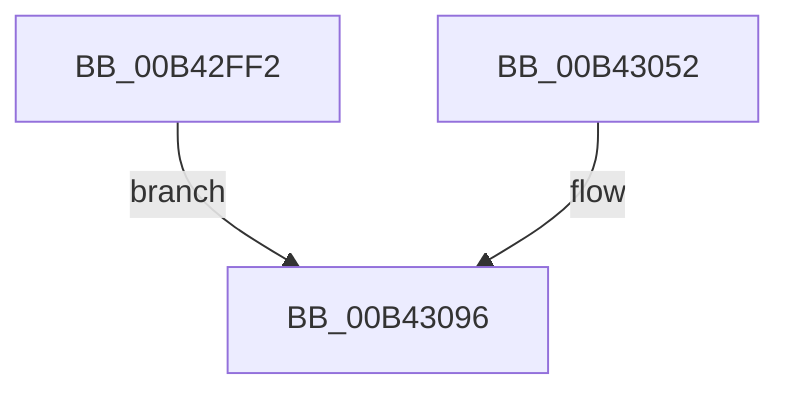

# sub_00B42FF2

- RVA: `0x00B42FF2`–`0x00B4309E` (길이 `172` bytes)
- VA: `0x0000000140B42FF2`
- 실행 섹션: `PAGE`
- PDB 이름 있음: `아니요`; PDB Function 태그: `아니요`
- unwind 정보 RVA: `0x000B7088`
- 디코드: `43`개 명령, `172/172` bytes 표시
- 미해석 바이트: `0` (있으면 어셈블리에 `.byte`로 보존)

> 이 문서는 커널 이미지의 기계어와 PDB 기호를 분석해 생성했습니다. 4번과 5번은 함수 원형과 자료형을 바이너리 사용 방식에서 추정한 C 해석이며 원본 소스 복구 결과는 아닙니다.

## 1. Dependencies

- 직접 호출 지점: **5**; 고유 호출 대상: **1**
- 직접 호출자로 확인된 함수: **0**
- RIP 상대 이미지 참조: **2**

### Outgoing calls
- `0x00B42FFF` → [EtwProviderEnabled](../../text/3B/EtwProviderEnabled_function_003BA250.md) (function, `0x003BA250`)
- `0x00B4301B` → [EtwProviderEnabled](../../text/3B/EtwProviderEnabled_function_003BA250.md) (function, `0x003BA250`)
- `0x00B43040` → [EtwProviderEnabled](../../text/3B/EtwProviderEnabled_function_003BA250.md) (function, `0x003BA250`)
- `0x00B43061` → [EtwProviderEnabled](../../text/3B/EtwProviderEnabled_function_003BA250.md) (function, `0x003BA250`)
- `0x00B43084` → [EtwProviderEnabled](../../text/3B/EtwProviderEnabled_function_003BA250.md) (function, `0x003BA250`)

### Direct callers
- 이 함수 시작 RVA로 연결되는 직접 call은 확인되지 않았습니다. 간접 호출은 완전히 역산할 수 없습니다.

### Static image references
- `0x00B42FF2` → RVA `0x00EFF838` (`.data`; read)
- `0x00B43052` → RVA `0x00EFF848` (`.data`; read)

## 2. Other-region calls and transfers

- 다른 실행 섹션으로 향하는 call: **5**
  - `0x00B42FFF` → [EtwProviderEnabled](../../text/3B/EtwProviderEnabled_function_003BA250.md) (`PAGE` → `.text`)
  - `0x00B4301B` → [EtwProviderEnabled](../../text/3B/EtwProviderEnabled_function_003BA250.md) (`PAGE` → `.text`)
  - `0x00B43040` → [EtwProviderEnabled](../../text/3B/EtwProviderEnabled_function_003BA250.md) (`PAGE` → `.text`)
  - `0x00B43061` → [EtwProviderEnabled](../../text/3B/EtwProviderEnabled_function_003BA250.md) (`PAGE` → `.text`)
  - `0x00B43084` → [EtwProviderEnabled](../../text/3B/EtwProviderEnabled_function_003BA250.md) (`PAGE` → `.text`)
- call이 아닌 외부 분기/꼬리 이동: **1**
  - `0x00B43099` → [EtwpCrimsonProvEnableCallback + 0x84](../A8/EtwpCrimsonProvEnableCallback_function_00A80540.md) (`tail-transfer`)

## 3. Assembly (complete function range)

```asm
00B42FF2  48 8B 0D 3F C8 3B 00            mov rcx, qword ptr [rip + 0x3bc83f]
00B42FF9  33 D2                           xor edx, edx
00B42FFB  44 8D 42 10                     lea r8d, [rdx + 0x10]
00B42FFF  E8 4C 72 87 FF                  call 0x1403ba250
00B43004  48 8B 0D 2D C8 3B 00            mov rcx, qword ptr [rip + 0x3bc82d]
00B4300B  F6 D8                           neg al
00B4300D  1B DB                           sbb ebx, ebx
00B4300F  33 D2                           xor edx, edx
00B43011  81 E3 00 02 00 00               and ebx, 0x200
00B43017  44 8D 42 60                     lea r8d, [rdx + 0x60]
00B4301B  E8 30 72 87 FF                  call 0x1403ba250
00B43020  48 8B 0D 11 C8 3B 00            mov rcx, qword ptr [rip + 0x3bc811]
00B43027  8B FB                           mov edi, ebx
00B43029  41 0B FE                        or edi, r14d
00B4302C  C7 45 B0 00 02 00 06            mov dword ptr [rbp - 0x50], 0x6000200
00B43033  84 C0                           test al, al
00B43035  41 B8 A0 1F 00 00               mov r8d, 0x1fa0
00B4303B  0F 44 FB                        cmove edi, ebx
00B4303E  33 D2                           xor edx, edx
00B43040  E8 0B 72 87 FF                  call 0x1403ba250
00B43045  8B CF                           mov ecx, edi
00B43047  0F BA E9 1A                     bts ecx, 0x1a
00B4304B  84 C0                           test al, al
00B4304D  0F 44 CF                        cmove ecx, edi
00B43050  EB 44                           jmp 0x140b43096
00B43052  48 8B 0D EF C7 3B 00            mov rcx, qword ptr [rip + 0x3bc7ef]
00B43059  33 D2                           xor edx, edx
00B4305B  41 B8 20 04 00 00               mov r8d, 0x420
00B43061  E8 EA 71 87 FF                  call 0x1403ba250
00B43066  48 8B 0D DB C7 3B 00            mov rcx, qword ptr [rip + 0x3bc7db]
00B4306D  F6 D8                           neg al
00B4306F  C7 45 B0 00 00 88 20            mov dword ptr [rbp - 0x50], 0x20880000
00B43076  1B DB                           sbb ebx, ebx
00B43078  33 D2                           xor edx, edx
00B4307A  81 E3 00 00 08 20               and ebx, 0x20080000
00B43080  44 8D 42 40                     lea r8d, [rdx + 0x40]
00B43084  E8 C7 71 87 FF                  call 0x1403ba250
00B43089  8B CB                           mov ecx, ebx
00B4308B  81 C9 00 00 80 20               or ecx, 0x20800000
00B43091  84 C0                           test al, al
00B43093  0F 44 CB                        cmove ecx, ebx
00B43096  89 4D B4                        mov dword ptr [rbp - 0x4c], ecx
00B43099  E9 26 D5 F3 FF                  jmp 0x140a805c4
```

## 4. C-style interpretation (structured pseudocode)

```c
__int64 __fastcall sub_00B42FF2(__int64 a1, int a2)
{
    __int64 result;
    __int64 v_rbx;
    __int64 v_rdi;

    a2 = 0;
    result = EtwProviderEnabled(*(unsigned __int64 *)(v_rip + 3917887), a2, a2 + 16, a4);
    result = (unsigned __int8)(-(result));
    a2 = 0;
    v_rbx = (unsigned int)((v_rbx) & (512));
    result = EtwProviderEnabled(*(unsigned __int64 *)(v_rip + 3917869), a2, a2 + 96, a4);
    v_rdi = (unsigned int)(((unsigned int)((unsigned int)(v_rbx))) | ((unsigned int)(v_r14)));
    *(unsigned int *)(v_rbp - 80) = 0x6000200ULL;
    if ((unsigned __int8)(result) == 0) { v_rdi = (unsigned int)(v_rbx); }
    a2 = 0;
    result = EtwProviderEnabled(*(unsigned __int64 *)(v_rip + 3917841), a2, (unsigned int)(0x1FA0ULL), a4);
    a1 = (unsigned int)((unsigned int)(v_rdi));
    if ((unsigned __int8)(result) == 0) { a1 = (unsigned int)(v_rdi); }
    goto loc_00B43096;
loc_00B43096:
    *(unsigned int *)(v_rbp - 76) = (unsigned int)(a1);
}
```

## 5. (Beta) C Style

```c
int64_t sub_00B42FF2(int64_t Arg1, int32_t Arg2)
{
    int64_t result;
    int64_t local_rbx;
    int64_t local_rdi;

    Arg2 = 0;
    result = EtwProviderEnabled(*(uint64_t *)(v_rip + 0x3BC83F), Arg2, Arg2 + 16, a4);
    result = (uint8_t)(-(result));
    Arg2 = 0;
    local_rbx = (uint32_t)((local_rbx) & (512));
    result = EtwProviderEnabled(*(uint64_t *)(v_rip + 0x3BC82D), Arg2, Arg2 + 96, a4);
    local_rdi = (uint32_t)(((uint32_t)((uint32_t)(local_rbx))) | ((uint32_t)(local_r14)));
    *(uint32_t *)(local_rbp - 0x50) = 0x6000200ULL;
    if ((uint8_t)(result) == 0) { local_rdi = (uint32_t)(local_rbx); }
    Arg2 = 0;
    result = EtwProviderEnabled(*(uint64_t *)(v_rip + 0x3BC811), Arg2, (uint32_t)(0x1FA0ULL), a4);
    Arg1 = (uint32_t)((uint32_t)(local_rdi));
    if ((uint8_t)(result) == 0) { Arg1 = (uint32_t)(local_rdi); }
    goto loc_00B43096;
loc_00B43096:
    *(uint32_t *)(local_rbp - 0x4C) = (uint32_t)(Arg1);
}
```

## 6. Execution-region graph

[열기: 2D/3D 그래프와 함수 탐색 컨트롤 패널](../../../control-panel.html?section=page&rva=0x00B42FF2&view=graph)

- 2D 그래프는 위에서 아래로 흐르고, 3D 그래프는 빈 공간을 드래그해 회전합니다. Shift+드래그는 이동, 휠은 확대·축소, 함수 노드 선택은 대상 보고서 이동입니다.

### Static fallback


