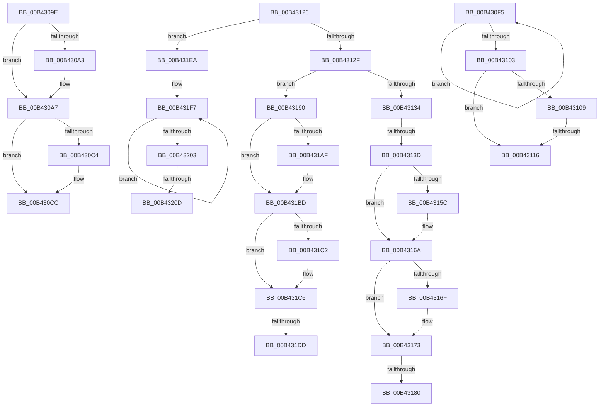

# sub_00B4309E

- RVA: `0x00B4309E`–`0x00B43229` (길이 `395` bytes)
- VA: `0x0000000140B4309E`
- 실행 섹션: `PAGE`
- PDB 이름 있음: `아니요`; PDB Function 태그: `아니요`
- unwind 정보 RVA: `0x000B70C4`
- 디코드: `100`개 명령, `395/395` bytes 표시
- 미해석 바이트: `0` (있으면 어셈블리에 `.byte`로 보존)

> 이 문서는 커널 이미지의 기계어와 PDB 기호를 분석해 생성했습니다. 4번과 5번은 함수 원형과 자료형을 바이너리 사용 방식에서 추정한 C 해석이며 원본 소스 복구 결과는 아닙니다.

## 1. Dependencies

- 직접 호출 지점: **12**; 고유 호출 대상: **10**
- 직접 호출자로 확인된 함수: **0**
- RIP 상대 이미지 참조: **9**

### Outgoing calls
- `0x00B430C7` → [ExfTryToWakePushLock](../../text/26/ExfTryToWakePushLock_function_00265DD0.md) (function, `0x00265DD0`)
- `0x00B430CF` → [KeAbPostRelease](../../text/2E/KeAbPostRelease_function_002E1600.md) (function, `0x002E1600`)
- `0x00B430DE` → [PopDirectedDripsQueryMitigationStatus](../A9/PopDirectedDripsQueryMitigationStatus_function_00A994B8.md) (function, `0x00A994B8`)
- `0x00B430EA` → [PopDirectedDripsDiagNotifySessionStart](../AC/PopDirectedDripsDiagNotifySessionStart_function_00ACE540.md) (function, `0x00ACE540`)
- `0x00B4311B` → [PopQueueDirectedDripsWork](../../text/47/PopQueueDirectedDripsWork_function_00478DC4.md) (function, `0x00478DC4`)
- `0x00B4314C` → [KeAbPreAcquire](../../text/21/KeAbPreAcquire_function_00210230.md) (function, `0x00210230`)
- `0x00B43165` → [ExfAcquirePushLockExclusiveEx](../../text/20/ExfAcquirePushLockExclusiveEx_function_0020FC90.md) (function, `0x0020FC90`)
- `0x00B43185` → [PopDirectedDripsClearDisengageReason](../../text/47/PopDirectedDripsClearDisengageReason_function_00477EA4.md) (function, `0x00477EA4`)
- `0x00B4319F` → [KeAbPreAcquire](../../text/21/KeAbPreAcquire_function_00210230.md) (function, `0x00210230`)
- `0x00B431B8` → [ExfAcquirePushLockExclusiveEx](../../text/20/ExfAcquirePushLockExclusiveEx_function_0020FC90.md) (function, `0x0020FC90`)
- `0x00B431DF` → [PopDirectedDripsSetDisengageReason](../../text/47/PopDirectedDripsSetDisengageReason_function_00478D60.md) (function, `0x00478D60`)
- `0x00B4321E` → [PopDirectedDripsNotifyAppsAndServices](../75/PopDirectedDripsNotifyAppsAndServices_function_0075792C.md) (function, `0x0075792C`)

### Direct callers
- 이 함수 시작 RVA로 연결되는 직접 call은 확인되지 않았습니다. 간접 호출은 완전히 역산할 수 없습니다.

### Static image references
- `0x00B430AA` → RVA `0x00F0ECE8` (`.data`; write)
- `0x00B430B5` → RVA `0x00F0EB60` (`.data`; read/write)
- `0x00B430F9` → RVA `0x00F0EAC0` (`.data`; read)
- `0x00B43109` → RVA `0x00F0EAF4` (`.data`; read)
- `0x00B4313D` → RVA `0x00F0EB60` (`.data`; read)
- `0x00B43173` → RVA `0x00F0EBA0` (`.data`; read/write)
- `0x00B431C6` → RVA `0x00F0EBA0` (`.data`; read)
- `0x00B431CE` → RVA `0x00F0EBA0` (`.data`; write)
- `0x00B43210` → RVA `0x00F0EAF8` (`.data`; read)

## 2. Other-region calls and transfers

- 다른 실행 섹션으로 향하는 call: **9**
  - `0x00B430C7` → [ExfTryToWakePushLock](../../text/26/ExfTryToWakePushLock_function_00265DD0.md) (`PAGE` → `.text`)
  - `0x00B430CF` → [KeAbPostRelease](../../text/2E/KeAbPostRelease_function_002E1600.md) (`PAGE` → `.text`)
  - `0x00B4311B` → [PopQueueDirectedDripsWork](../../text/47/PopQueueDirectedDripsWork_function_00478DC4.md) (`PAGE` → `.text`)
  - `0x00B4314C` → [KeAbPreAcquire](../../text/21/KeAbPreAcquire_function_00210230.md) (`PAGE` → `.text`)
  - `0x00B43165` → [ExfAcquirePushLockExclusiveEx](../../text/20/ExfAcquirePushLockExclusiveEx_function_0020FC90.md) (`PAGE` → `.text`)
  - `0x00B43185` → [PopDirectedDripsClearDisengageReason](../../text/47/PopDirectedDripsClearDisengageReason_function_00477EA4.md) (`PAGE` → `.text`)
  - `0x00B4319F` → [KeAbPreAcquire](../../text/21/KeAbPreAcquire_function_00210230.md) (`PAGE` → `.text`)
  - `0x00B431B8` → [ExfAcquirePushLockExclusiveEx](../../text/20/ExfAcquirePushLockExclusiveEx_function_0020FC90.md) (`PAGE` → `.text`)
  - `0x00B431DF` → [PopDirectedDripsSetDisengageReason](../../text/47/PopDirectedDripsSetDisengageReason_function_00478D60.md) (`PAGE` → `.text`)
- call이 아닌 외부 분기/꼬리 이동: **10**
  - `0x00B430F0` → [PopDirectedDripsNotify + 0xED](../A8/PopDirectedDripsNotify_function_00A80850.md) (`tail-transfer`)
  - `0x00B43110` → [PopDirectedDripsNotify + 0xBC](../A8/PopDirectedDripsNotify_function_00A80850.md) (`tail-transfer`)
  - `0x00B43121` → [PopDirectedDripsNotify + 0xBC](../A8/PopDirectedDripsNotify_function_00A80850.md) (`tail-transfer`)
  - `0x00B43137` → [PopDirectedDripsNotify + 0xED](../A8/PopDirectedDripsNotify_function_00A80850.md) (`tail-transfer`)
  - `0x00B4317A` → [PopDirectedDripsNotify + 0xBC](../A8/PopDirectedDripsNotify_function_00A80850.md) (`tail-transfer`)
  - `0x00B4318B` → [PopDirectedDripsNotify + 0xBC](../A8/PopDirectedDripsNotify_function_00A80850.md) (`tail-transfer`)
  - `0x00B431D7` → [PopDirectedDripsNotify + 0xBC](../A8/PopDirectedDripsNotify_function_00A80850.md) (`tail-transfer`)
  - `0x00B431E5` → [PopDirectedDripsNotify + 0xBC](../A8/PopDirectedDripsNotify_function_00A80850.md) (`tail-transfer`)
  - `0x00B43207` → [PopDirectedDripsNotify + 0xED](../A8/PopDirectedDripsNotify_function_00A80850.md) (`tail-transfer`)
  - `0x00B43224` → [PopDirectedDripsNotify + 0xED](../A8/PopDirectedDripsNotify_function_00A80850.md) (`tail-transfer`)

## 3. Assembly (complete function range)

```asm
00B4309E  48 85 FF                        test rdi, rdi
00B430A1  74 04                           je 0x140b430a7
00B430A3  C6 47 0A 01                     mov byte ptr [rdi + 0xa], 1
00B430A7  48 8B 06                        mov rax, qword ptr [rsi]
00B430AA  48 89 05 37 BC 3C 00            mov qword ptr [rip + 0x3cbc37], rax
00B430B1  48 83 C8 FF                     or rax, 0xffffffffffffffff
00B430B5  F0 48 0F C1 05 A2 BA 3C 00      lock xadd qword ptr [rip + 0x3cbaa2], rax
00B430BE  24 06                           and al, 6
00B430C0  3C 02                           cmp al, 2
00B430C2  75 08                           jne 0x140b430cc
00B430C4  48 8B CB                        mov rcx, rbx
00B430C7  E8 04 2D 72 FF                  call 0x140265dd0
00B430CC  48 8B CB                        mov rcx, rbx
00B430CF  E8 2C E5 79 FF                  call 0x1402e1600
00B430D4  45 33 C0                        xor r8d, r8d
00B430D7  48 8D 4C 24 40                  lea rcx, [rsp + 0x40]
00B430DC  33 D2                           xor edx, edx
00B430DE  E8 D5 63 F5 FF                  call 0x140a994b8
00B430E3  48 8B 0E                        mov rcx, qword ptr [rsi]
00B430E6  8B 54 24 40                     mov edx, dword ptr [rsp + 0x40]
00B430EA  E8 51 B4 F8 FF                  call 0x140ace540
00B430EF  90                              nop
00B430F0  E9 48 D8 F3 FF                  jmp 0x140a8093d
00B430F5  8B C8                           mov ecx, eax
00B430F7  0B CF                           or ecx, edi
00B430F9  F0 0F B1 0D BF B9 3C 00         lock cmpxchg dword ptr [rip + 0x3cb9bf], ecx
00B43101  75 F2                           jne 0x140b430f5
00B43103  23 C7                           and eax, edi
00B43105  3B C7                           cmp eax, edi
00B43107  75 0D                           jne 0x140b43116
00B43109  83 3D E4 B9 3C 00 00            cmp dword ptr [rip + 0x3cb9e4], 0
00B43110  0F 84 F6 D7 F3 FF               je 0x140a8090c
00B43116  BA 00 08 00 00                  mov edx, 0x800
00B4311B  E8 A4 5C 93 FF                  call 0x140478dc4
00B43120  90                              nop
00B43121  E9 E6 D7 F3 FF                  jmp 0x140a8090c
00B43126  83 E9 01                        sub ecx, 1
00B43129  0F 84 BB 00 00 00               je 0x140b431ea
00B4312F  83 E9 01                        sub ecx, 1
00B43132  74 5C                           je 0x140b43190
00B43134  83 F9 01                        cmp ecx, 1
00B43137  0F 85 00 D8 F3 FF               jne 0x140a8093d
00B4313D  48 8D 1D 1C BA 3C 00            lea rbx, [rip + 0x3cba1c]
00B43144  45 33 C0                        xor r8d, r8d
00B43147  48 8B CB                        mov rcx, rbx
00B4314A  33 D2                           xor edx, edx
00B4314C  E8 DF D0 6C FF                  call 0x140210230
00B43151  F0 48 0F BA 2B 00               lock bts qword ptr [rbx], 0
00B43157  48 8B F8                        mov rdi, rax
00B4315A  73 0E                           jae 0x140b4316a
00B4315C  4C 8B C3                        mov r8, rbx
00B4315F  48 8B D0                        mov rdx, rax
00B43162  48 8B CB                        mov rcx, rbx
00B43165  E8 26 CB 6C FF                  call 0x14020fc90
00B4316A  48 85 FF                        test rdi, rdi
00B4316D  74 04                           je 0x140b43173
00B4316F  C6 47 0A 01                     mov byte ptr [rdi + 0xa], 1
00B43173  83 2D 26 BA 3C 00 01            sub dword ptr [rip + 0x3cba26], 1
00B4317A  0F 85 8C D7 F3 FF               jne 0x140a8090c
00B43180  B9 01 00 00 00                  mov ecx, 1
00B43185  E8 1A 4D 93 FF                  call 0x140477ea4
00B4318A  90                              nop
00B4318B  E9 7C D7 F3 FF                  jmp 0x140a8090c
00B43190  48 8D 1D C9 B9 3C 00            lea rbx, [rip + 0x3cb9c9]
00B43197  45 33 C0                        xor r8d, r8d
00B4319A  48 8B CB                        mov rcx, rbx
00B4319D  33 D2                           xor edx, edx
00B4319F  E8 8C D0 6C FF                  call 0x140210230
00B431A4  F0 48 0F BA 2B 00               lock bts qword ptr [rbx], 0
00B431AA  48 8B F8                        mov rdi, rax
00B431AD  73 0E                           jae 0x140b431bd
00B431AF  4C 8B C3                        mov r8, rbx
00B431B2  48 8B D0                        mov rdx, rax
00B431B5  48 8B CB                        mov rcx, rbx
00B431B8  E8 D3 CA 6C FF                  call 0x14020fc90
00B431BD  48 85 FF                        test rdi, rdi
00B431C0  74 04                           je 0x140b431c6
00B431C2  C6 47 0A 01                     mov byte ptr [rdi + 0xa], 1
00B431C6  8B 05 D4 B9 3C 00               mov eax, dword ptr [rip + 0x3cb9d4]
00B431CC  FF C0                           inc eax
00B431CE  89 05 CC B9 3C 00               mov dword ptr [rip + 0x3cb9cc], eax
00B431D4  83 F8 01                        cmp eax, 1
00B431D7  0F 85 2F D7 F3 FF               jne 0x140a8090c
00B431DD  8B C8                           mov ecx, eax
00B431DF  E8 7C 5B 93 FF                  call 0x140478d60
00B431E4  90                              nop
00B431E5  E9 22 D7 F3 FF                  jmp 0x140a8090c
00B431EA  0F 0D 0D CF B8 3C 00            prefetchw byte ptr [rip + 0x3cb8cf]
00B431F1  8B 05 C9 B8 3C 00               mov eax, dword ptr [rip + 0x3cb8c9]
00B431F7  8B C8                           mov ecx, eax
00B431F9  F0 0F B1 0D BF B8 3C 00         lock cmpxchg dword ptr [rip + 0x3cb8bf], ecx
00B43201  75 F4                           jne 0x140b431f7
00B43203  0F BA E0 0B                     bt eax, 0xb
00B43207  0F 83 30 D7 F3 FF               jae 0x140a8093d
00B4320D  45 33 C0                        xor r8d, r8d
00B43210  48 8D 15 E1 B8 3C 00            lea rdx, [rip + 0x3cb8e1]
00B43217  48 8D 0D A2 B8 3C 00            lea rcx, [rip + 0x3cb8a2]
00B4321E  E8 09 47 C1 FF                  call 0x14075792c
00B43223  90                              nop
00B43224  E9 14 D7 F3 FF                  jmp 0x140a8093d
```

## 4. C-style interpretation (structured pseudocode)

```c
__int64 __fastcall sub_00B4309E(__int64 a1, int a2, int a3, __int64 a4, __int64 a5, __int64 a6, __int64 a7, unsigned int a8)
{
    __int64 result;

    if (v_rdi != 0) {
        *(unsigned __int8 *)(v_rdi + 10) = 1;
    }
    *(unsigned __int64 *)(v_rip + 3980343) = *(unsigned __int64 *)(v_rsi);
    result = (*(unsigned __int64 *)(v_rsi)) | (-1);
    result = (unsigned __int8)((result) & (6));
    if (((unsigned __int8)(result)) == 2) {
        a1 = v_rbx;
        result = ExfTryToWakePushLock(a1, a2, a3, a4);
    }
    result = KeAbPostRelease(v_rbx, a2, a3, a4);
    a3 = 0;
    a2 = 0;
    result = PopDirectedDripsQueryMitigationStatus(a8, a2, a3, a4);
    result = PopDirectedDripsDiagNotifySessionStart(*(unsigned __int64 *)(v_rsi), (unsigned int)(a8), a3, a4);
}
```

## 5. (Beta) C Style

```c
int64_t sub_00B4309E(int64_t Arg1, int32_t Arg2, int32_t Arg3, int64_t Arg4, uint64_t Arg5, uint64_t Arg6, uint64_t Arg7, uint32_t Arg8)
{
    int64_t result;

    if (local_rdi != 0) {
        *(uint8_t *)(local_rdi + 0xA) = 1;
    }
    *(uint64_t *)(v_rip + 0x3CBC37) = *(uint64_t *)(local_rsi);
    result = (*(uint64_t *)(local_rsi)) | (-1);
    result = (uint8_t)((result) & (6));
    if (((uint8_t)(result)) == 2) {
        Arg1 = local_rbx;
        result = ExfTryToWakePushLock(Arg1, Arg2, Arg3, Arg4);
    }
    result = KeAbPostRelease(local_rbx, Arg2, Arg3, Arg4);
    Arg3 = 0;
    Arg2 = 0;
    result = PopDirectedDripsQueryMitigationStatus(Arg8, Arg2, Arg3, Arg4);
    result = PopDirectedDripsDiagNotifySessionStart(*(uint64_t *)(local_rsi), (uint32_t)(Arg8), Arg3, Arg4);
}
```

## 6. Execution-region graph

[열기: 2D/3D 그래프와 함수 탐색 컨트롤 패널](../../../control-panel.html?section=page&rva=0x00B4309E&view=graph)

- 2D 그래프는 위에서 아래로 흐르고, 3D 그래프는 빈 공간을 드래그해 회전합니다. Shift+드래그는 이동, 휠은 확대·축소, 함수 노드 선택은 대상 보고서 이동입니다.

### Static fallback


