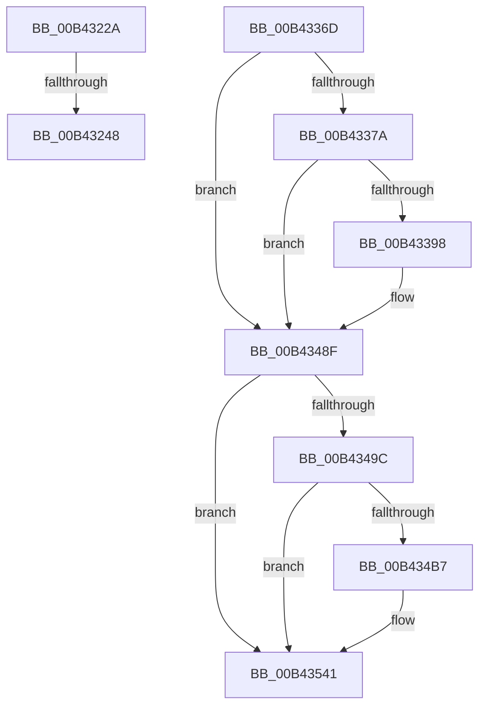

# sub_00B4322A

- RVA: `0x00B4322A`–`0x00B4355B` (길이 `817` bytes)
- VA: `0x0000000140B4322A`
- 실행 섹션: `PAGE`
- PDB 이름 있음: `아니요`; PDB Function 태그: `아니요`
- unwind 정보 RVA: `0x000B712C`
- 디코드: `154`개 명령, `817/817` bytes 표시
- 미해석 바이트: `0` (있으면 어셈블리에 `.byte`로 보존)

> 이 문서는 커널 이미지의 기계어와 PDB 기호를 분석해 생성했습니다. 4번과 5번은 함수 원형과 자료형을 바이너리 사용 방식에서 추정한 C 해석이며 원본 소스 복구 결과는 아닙니다.

## 1. Dependencies

- 직접 호출 지점: **7**; 고유 호출 대상: **5**
- 직접 호출자로 확인된 함수: **0**
- RIP 상대 이미지 참조: **6**

### Outgoing calls
- `0x00B4323B` → [tlgKeywordOn](../../text/42/tlgKeywordOn_function_0042EAA0.md) (function, `0x0042EAA0`)
- `0x00B43362` → [tlgWriteTransfer_EtwWriteTransfer](../../text/42/tlgWriteTransfer_EtwWriteTransfer_function_004260E0.md) (function, `0x004260E0`)
- `0x00B4338B` → [tlgKeywordOn](../../text/42/tlgKeywordOn_function_0042EAA0.md) (function, `0x0042EAA0`)
- `0x00B4348A` → [tlgWriteTransfer_EtwWriteTransfer](../../text/42/tlgWriteTransfer_EtwWriteTransfer_function_004260E0.md) (function, `0x004260E0`)
- `0x00B434AA` → [EtwEventEnabled](../../text/39/EtwEventEnabled_function_00392450.md) (function, `0x00392450`)
- `0x00B4353C` → [EtwWrite](../../text/41/EtwWrite_function_0041C720.md) (function, `0x0041C720`)
- `0x00B43550` → [ExFreePoolWithTag](../../poolcode/B8/ExFreePoolWithTag_function_00B82870.md) (function, `0x00B82870`)

### Direct callers
- 이 함수 시작 RVA로 연결되는 직접 call은 확인되지 않았습니다. 간접 호출은 완전히 역산할 수 없습니다.

### Static image references
- `0x00B43234` → RVA `0x00FD8900` (`PAGEDATA`; read)
- `0x00B4324C` → RVA `0x0005011A` (`.rdata`; read)
- `0x00B4339D` → RVA `0x00050222` (`.rdata`; read)
- `0x00B4348F` → RVA `0x00E67858` (`.data`; read)
- `0x00B4349C` → RVA `0x00F0B408` (`.data`; read)
- `0x00B434A3` → RVA `0x00021EC0` (`.rdata`; read)

## 2. Other-region calls and transfers

- 다른 실행 섹션으로 향하는 call: **7**
  - `0x00B4323B` → [tlgKeywordOn](../../text/42/tlgKeywordOn_function_0042EAA0.md) (`PAGE` → `.text`)
  - `0x00B43362` → [tlgWriteTransfer_EtwWriteTransfer](../../text/42/tlgWriteTransfer_EtwWriteTransfer_function_004260E0.md) (`PAGE` → `.text`)
  - `0x00B4338B` → [tlgKeywordOn](../../text/42/tlgKeywordOn_function_0042EAA0.md) (`PAGE` → `.text`)
  - `0x00B4348A` → [tlgWriteTransfer_EtwWriteTransfer](../../text/42/tlgWriteTransfer_EtwWriteTransfer_function_004260E0.md) (`PAGE` → `.text`)
  - `0x00B434AA` → [EtwEventEnabled](../../text/39/EtwEventEnabled_function_00392450.md) (`PAGE` → `.text`)
  - `0x00B4353C` → [EtwWrite](../../text/41/EtwWrite_function_0041C720.md) (`PAGE` → `.text`)
  - `0x00B43550` → [ExFreePoolWithTag](../../poolcode/B8/ExFreePoolWithTag_function_00B82870.md) (`PAGE` → `POOLCODE`)
- call이 아닌 외부 분기/꼬리 이동: **3**
  - `0x00B43242` → [PopDirectedDripsDiagRundownBroadcastTrees + 0x7F](../A8/PopDirectedDripsDiagRundownBroadcastTrees_function_00A80D2C.md) (`tail-transfer`)
  - `0x00B43368` → [PopDirectedDripsDiagRundownBroadcastTrees + 0x7F](../A8/PopDirectedDripsDiagRundownBroadcastTrees_function_00A80D2C.md) (`tail-transfer`)
  - `0x00B43556` → [PopDirectedDripsDiagRundownBroadcastTrees + 0x7F](../A8/PopDirectedDripsDiagRundownBroadcastTrees_function_00A80D2C.md) (`tail-transfer`)

## 3. Assembly (complete function range)

```asm
00B4322A  48 BA 00 00 00 00 00 40 00 00   movabs rdx, 0x400000000000
00B43234  48 8D 0D C5 56 49 00            lea rcx, [rip + 0x4956c5]
00B4323B  E8 60 B8 8E FF                  call 0x14042eaa0
00B43240  84 C0                           test al, al
00B43242  0F 84 63 DB F3 FF               je 0x140a80dab
00B43248  48 8B 4B 10                     mov rcx, qword ptr [rbx + 0x10]
00B4324C  48 8D 15 C7 CE 50 FF            lea rdx, [rip - 0xaf3139]
00B43253  48 8B 44 24 58                  mov rax, qword ptr [rsp + 0x58]
00B43258  45 33 C9                        xor r9d, r9d
00B4325B  48 89 44 24 60                  mov qword ptr [rsp + 0x60], rax
00B43260  45 33 C0                        xor r8d, r8d
00B43263  48 8D 44 24 60                  lea rax, [rsp + 0x60]
00B43268  48 C7 45 A8 08 00 00 00         mov qword ptr [rbp - 0x58], 8
00B43270  48 89 45 A0                     mov qword ptr [rbp - 0x60], rax
00B43274  8B 41 18                        mov eax, dword ptr [rcx + 0x18]
00B43277  89 44 24 30                     mov dword ptr [rsp + 0x30], eax
00B4327B  48 8D 44 24 30                  lea rax, [rsp + 0x30]
00B43280  48 89 45 B0                     mov qword ptr [rbp - 0x50], rax
00B43284  48 C7 45 B8 04 00 00 00         mov qword ptr [rbp - 0x48], 4
00B4328C  8B 81 90 00 00 00               mov eax, dword ptr [rcx + 0x90]
00B43292  48 8D 0D 67 56 49 00            lea rcx, [rip + 0x495667]
00B43299  89 44 24 34                     mov dword ptr [rsp + 0x34], eax
00B4329D  48 8D 44 24 34                  lea rax, [rsp + 0x34]
00B432A2  48 89 45 C0                     mov qword ptr [rbp - 0x40], rax
00B432A6  8B 43 20                        mov eax, dword ptr [rbx + 0x20]
00B432A9  89 44 24 38                     mov dword ptr [rsp + 0x38], eax
00B432AD  48 8D 44 24 38                  lea rax, [rsp + 0x38]
00B432B2  48 89 45 D0                     mov qword ptr [rbp - 0x30], rax
00B432B6  8B 43 28                        mov eax, dword ptr [rbx + 0x28]
00B432B9  89 44 24 3C                     mov dword ptr [rsp + 0x3c], eax
00B432BD  48 8D 44 24 3C                  lea rax, [rsp + 0x3c]
00B432C2  48 89 45 E0                     mov qword ptr [rbp - 0x20], rax
00B432C6  48 8D 43 38                     lea rax, [rbx + 0x38]
00B432CA  48 89 45 F0                     mov qword ptr [rbp - 0x10], rax
00B432CE  48 8D 43 50                     lea rax, [rbx + 0x50]
00B432D2  48 89 45 00                     mov qword ptr [rbp], rax
00B432D6  48 8D 83 C0 00 00 00            lea rax, [rbx + 0xc0]
00B432DD  48 89 45 10                     mov qword ptr [rbp + 0x10], rax
00B432E1  48 8D 83 80 00 00 00            lea rax, [rbx + 0x80]
00B432E8  48 89 45 20                     mov qword ptr [rbp + 0x20], rax
00B432EC  48 8D 83 98 00 00 00            lea rax, [rbx + 0x98]
00B432F3  48 89 45 30                     mov qword ptr [rbp + 0x30], rax
00B432F7  48 8D 44 24 68                  lea rax, [rsp + 0x68]
00B432FC  48 89 45 40                     mov qword ptr [rbp + 0x40], rax
00B43300  48 8D 45 80                     lea rax, [rbp - 0x80]
00B43304  48 89 44 24 28                  mov qword ptr [rsp + 0x28], rax
00B43309  C7 44 24 20 0D 00 00 00         mov dword ptr [rsp + 0x20], 0xd
00B43311  48 C7 45 C8 04 00 00 00         mov qword ptr [rbp - 0x38], 4
00B43319  48 C7 45 D8 04 00 00 00         mov qword ptr [rbp - 0x28], 4
00B43321  48 C7 45 E8 04 00 00 00         mov qword ptr [rbp - 0x18], 4
00B43329  48 C7 45 F8 14 00 00 00         mov qword ptr [rbp - 8], 0x14
00B43331  48 C7 45 08 28 00 00 00         mov qword ptr [rbp + 8], 0x28
00B43339  48 C7 45 18 28 00 00 00         mov qword ptr [rbp + 0x18], 0x28
00B43341  48 C7 45 28 14 00 00 00         mov qword ptr [rbp + 0x28], 0x14
00B43349  48 C7 45 38 28 00 00 00         mov qword ptr [rbp + 0x38], 0x28
00B43351  48 C7 44 24 68 00 00 00 01      mov qword ptr [rsp + 0x68], 0x1000000
00B4335A  48 C7 45 48 08 00 00 00         mov qword ptr [rbp + 0x48], 8
00B43362  E8 79 2D 8E FF                  call 0x1404260e0
00B43367  90                              nop
00B43368  E9 3E DA F3 FF                  jmp 0x140a80dab
00B4336D  83 3D 8C 55 49 00 05            cmp dword ptr [rip + 0x49558c], 5
00B43374  0F 86 15 01 00 00               jbe 0x140b4348f
00B4337A  48 BA 00 00 00 00 00 40 00 00   movabs rdx, 0x400000000000
00B43384  48 8D 0D 75 55 49 00            lea rcx, [rip + 0x495575]
00B4338B  E8 10 B7 8E FF                  call 0x14042eaa0
00B43390  84 C0                           test al, al
00B43392  0F 84 F7 00 00 00               je 0x140b4348f
00B43398  48 8B 44 24 58                  mov rax, qword ptr [rsp + 0x58]
00B4339D  48 8D 15 7E CE 50 FF            lea rdx, [rip - 0xaf3182]
00B433A4  48 89 44 24 60                  mov qword ptr [rsp + 0x60], rax
00B433A9  45 33 C9                        xor r9d, r9d
00B433AC  48 C7 45 A8 08 00 00 00         mov qword ptr [rbp - 0x58], 8
00B433B4  48 8D 44 24 60                  lea rax, [rsp + 0x60]
00B433B9  48 89 45 A0                     mov qword ptr [rbp - 0x60], rax
00B433BD  45 33 C0                        xor r8d, r8d
00B433C0  48 8B 43 10                     mov rax, qword ptr [rbx + 0x10]
00B433C4  8B 48 18                        mov ecx, dword ptr [rax + 0x18]
00B433C7  48 8D 44 24 40                  lea rax, [rsp + 0x40]
00B433CC  48 89 45 B0                     mov qword ptr [rbp - 0x50], rax
00B433D0  8B 43 20                        mov eax, dword ptr [rbx + 0x20]
00B433D3  89 44 24 44                     mov dword ptr [rsp + 0x44], eax
00B433D7  48 8D 44 24 44                  lea rax, [rsp + 0x44]
00B433DC  48 89 45 C0                     mov qword ptr [rbp - 0x40], rax
00B433E0  8B 43 28                        mov eax, dword ptr [rbx + 0x28]
00B433E3  89 44 24 48                     mov dword ptr [rsp + 0x48], eax
00B433E7  48 8D 44 24 48                  lea rax, [rsp + 0x48]
00B433EC  48 89 45 D0                     mov qword ptr [rbp - 0x30], rax
00B433F0  48 8B 47 08                     mov rax, qword ptr [rdi + 8]
00B433F4  89 4C 24 40                     mov dword ptr [rsp + 0x40], ecx
00B433F8  48 C7 45 B8 04 00 00 00         mov qword ptr [rbp - 0x48], 4
00B43400  48 C7 45 C8 04 00 00 00         mov qword ptr [rbp - 0x38], 4
00B43408  48 C7 45 D8 04 00 00 00         mov qword ptr [rbp - 0x28], 4
00B43410  8B 48 18                        mov ecx, dword ptr [rax + 0x18]
00B43413  48 8D 44 24 4C                  lea rax, [rsp + 0x4c]
00B43418  48 89 45 E0                     mov qword ptr [rbp - 0x20], rax
00B4341C  8B 47 10                        mov eax, dword ptr [rdi + 0x10]
00B4341F  89 44 24 50                     mov dword ptr [rsp + 0x50], eax
00B43423  48 8D 44 24 50                  lea rax, [rsp + 0x50]
00B43428  48 89 45 F0                     mov qword ptr [rbp - 0x10], rax
00B4342C  8B 47 14                        mov eax, dword ptr [rdi + 0x14]
00B4342F  89 44 24 54                     mov dword ptr [rsp + 0x54], eax
00B43433  48 8D 44 24 54                  lea rax, [rsp + 0x54]
00B43438  48 89 45 00                     mov qword ptr [rbp], rax
00B4343C  48 8D 44 24 70                  lea rax, [rsp + 0x70]
00B43441  48 89 45 10                     mov qword ptr [rbp + 0x10], rax
00B43445  48 8D 45 80                     lea rax, [rbp - 0x80]
00B43449  89 4C 24 4C                     mov dword ptr [rsp + 0x4c], ecx
00B4344D  48 8D 0D AC 54 49 00            lea rcx, [rip + 0x4954ac]
00B43454  48 89 44 24 28                  mov qword ptr [rsp + 0x28], rax
00B43459  C7 44 24 20 0A 00 00 00         mov dword ptr [rsp + 0x20], 0xa
00B43461  48 C7 45 E8 04 00 00 00         mov qword ptr [rbp - 0x18], 4
00B43469  48 C7 45 F8 04 00 00 00         mov qword ptr [rbp - 8], 4
00B43471  48 C7 45 08 04 00 00 00         mov qword ptr [rbp + 8], 4
00B43479  48 C7 44 24 70 00 00 00 01      mov qword ptr [rsp + 0x70], 0x1000000
00B43482  48 C7 45 18 08 00 00 00         mov qword ptr [rbp + 0x18], 8
00B4348A  E8 51 2C 8E FF                  call 0x1404260e0
00B4348F  40 38 35 C2 43 32 00            cmp byte ptr [rip + 0x3243c2], sil
00B43496  0F 84 A5 00 00 00               je 0x140b43541
00B4349C  48 8B 0D 65 7F 3C 00            mov rcx, qword ptr [rip + 0x3c7f65]
00B434A3  48 8D 15 16 EA 4D FF            lea rdx, [rip - 0xb215ea]
00B434AA  E8 A1 EF 84 FF                  call 0x140392450
00B434AF  84 C0                           test al, al
00B434B1  0F 84 8A 00 00 00               je 0x140b43541
00B434B7  48 8B 0D 4A 7F 3C 00            mov rcx, qword ptr [rip + 0x3c7f4a]
00B434BE  48 8D 44 24 58                  lea rax, [rsp + 0x58]
00B434C3  48 89 45 50                     mov qword ptr [rbp + 0x50], rax
00B434C7  48 8D 15 F2 E9 4D FF            lea rdx, [rip - 0xb2160e]
00B434CE  48 C7 45 58 08 00 00 00         mov qword ptr [rbp + 0x58], 8
00B434D6  41 B9 05 00 00 00               mov r9d, 5
00B434DC  48 8B 43 10                     mov rax, qword ptr [rbx + 0x10]
00B434E0  45 33 C0                        xor r8d, r8d
00B434E3  48 83 C0 10                     add rax, 0x10
00B434E7  48 C7 45 68 08 00 00 00         mov qword ptr [rbp + 0x68], 8
00B434EF  48 89 45 60                     mov qword ptr [rbp + 0x60], rax
00B434F3  48 8B 47 08                     mov rax, qword ptr [rdi + 8]
00B434F7  48 83 C0 10                     add rax, 0x10
00B434FB  48 C7 45 78 08 00 00 00         mov qword ptr [rbp + 0x78], 8
00B43503  48 89 45 70                     mov qword ptr [rbp + 0x70], rax
00B43507  48 8D 47 10                     lea rax, [rdi + 0x10]
00B4350B  48 89 85 80 00 00 00            mov qword ptr [rbp + 0x80], rax
00B43512  48 8D 47 14                     lea rax, [rdi + 0x14]
00B43516  48 89 85 90 00 00 00            mov qword ptr [rbp + 0x90], rax
00B4351D  48 8D 45 50                     lea rax, [rbp + 0x50]
00B43521  48 89 44 24 20                  mov qword ptr [rsp + 0x20], rax
00B43526  48 C7 85 88 00 00 00 04 00 00 00  mov qword ptr [rbp + 0x88], 4
00B43531  48 C7 85 98 00 00 00 04 00 00 00  mov qword ptr [rbp + 0x98], 4
00B4353C  E8 DF 91 8D FF                  call 0x14041c720
00B43541  48 8B 07                        mov rax, qword ptr [rdi]
00B43544  BA 50 64 69 67                  mov edx, 0x67696450
00B43549  48 8B CF                        mov rcx, rdi
00B4354C  48 89 43 18                     mov qword ptr [rbx + 0x18], rax
00B43550  E8 1B F3 03 00                  call 0x140b82870
00B43555  90                              nop
00B43556  E9 50 D8 F3 FF                  jmp 0x140a80dab
```

## 4. C-style interpretation (structured pseudocode)

```c
__int64 __fastcall sub_00B4322A(__int64 a1, __int64 a2, int a3, int a4, __int64 a5, __int64 a6, __int64 a7, __int64 a8, __int64 a9, __int64 a10, __int64 a11, __int64 a12, __int64 a13)
{
    __int64 result;
    unsigned int v_stack_p20;
    unsigned __int64 v_stack_p28;
    unsigned int v_stack_p30;
    unsigned int v_stack_p34;
    unsigned int v_stack_p38;
    unsigned int v_stack_p3C;
    unsigned __int64 v_stack_p40;
    unsigned int v_stack_p44;
    unsigned int v_stack_p48;
    unsigned __int64 v_stack_p4C;
    unsigned int v_stack_p50;
    unsigned int v_stack_p54;
    unsigned __int64 v_stack_p58;
    unsigned __int64 v_stack_p60;
    unsigned __int64 v_stack_p68;
    unsigned __int64 v_stack_p70;

    result = tlgKeywordOn(v_rip + 4806341, a2, a3, a4);
    a4 = 0;
    v_stack_p60 = a11;
    a3 = 0;
    *(unsigned __int64 *)(v_rbp - 88) = 8;
    *(unsigned __int64 *)(v_rbp - 96) = a12;
    v_stack_p30 = (unsigned int)((unsigned int)(*(unsigned int *)(*(unsigned __int64 *)(v_rbx + 16) + 24)));
    *(unsigned __int64 *)(v_rbp - 80) = a6;
    *(unsigned __int64 *)(v_rbp - 72) = 4;
    v_stack_p34 = (unsigned int)((unsigned int)(*(unsigned int *)(*(unsigned __int64 *)(v_rbx + 16) + 144)));
    *(unsigned __int64 *)(v_rbp - 64) = v_stack_p34;
    v_stack_p38 = (unsigned int)((unsigned int)(*(unsigned int *)(v_rbx + 32)));
    *(unsigned __int64 *)(v_rbp - 48) = a7;
    v_stack_p3C = (unsigned int)((unsigned int)(*(unsigned int *)(v_rbx + 40)));
    *(unsigned __int64 *)(v_rbp - 32) = v_stack_p3C;
    *(unsigned __int64 *)(v_rbp - 16) = v_rbx + 56;
    *(unsigned __int64 *)(v_rbp) = v_rbx + 80;
    *(unsigned __int64 *)(v_rbp + 16) = v_rbx + 192;
    *(unsigned __int64 *)(v_rbp + 32) = v_rbx + 128;
    *(unsigned __int64 *)(v_rbp + 48) = v_rbx + 152;
    *(unsigned __int64 *)(v_rbp + 64) = a13;
    v_stack_p28 = v_rbp - 128;
    v_stack_p20 = 13;
    *(unsigned __int64 *)(v_rbp - 56) = 4;
    *(unsigned __int64 *)(v_rbp - 40) = 4;
    *(unsigned __int64 *)(v_rbp - 24) = 4;
    *(unsigned __int64 *)(v_rbp - 8) = 20;
    *(unsigned __int64 *)(v_rbp + 8) = 40;
    *(unsigned __int64 *)(v_rbp + 24) = 40;
    *(unsigned __int64 *)(v_rbp + 40) = 20;
    *(unsigned __int64 *)(v_rbp + 56) = 40;
    v_stack_p68 = 0x1000000ULL;
    *(unsigned __int64 *)(v_rbp + 72) = 8;
    result = tlgWriteTransfer_EtwWriteTransfer(v_rip + 4806247, v_rip - 11481401, a3, a4);
}
```

## 5. (Beta) C Style

```c
int64_t sub_00B4322A(int64_t Arg1, int64_t Arg2, int32_t Arg3, int32_t Arg4, uint64_t Arg5, int64_t Arg6, int64_t Arg7, uint64_t Arg8, uint64_t Arg9, uint64_t Arg10, int64_t Arg11, int64_t Arg12, int64_t Arg13)
{
    int64_t result;
    uint32_t v_stack_p20;
    uint64_t v_stack_p28;
    uint32_t v_stack_p30;
    uint32_t v_stack_p34;
    uint32_t v_stack_p38;
    uint32_t v_stack_p3C;
    uint64_t v_stack_p40;
    uint32_t v_stack_p44;
    uint32_t v_stack_p48;
    uint64_t v_stack_p4C;
    uint32_t v_stack_p50;
    uint32_t v_stack_p54;
    uint64_t v_stack_p58;
    uint64_t v_stack_p60;
    uint64_t v_stack_p68;
    uint64_t v_stack_p70;

    result = tlgKeywordOn(v_rip + 4806341, Arg2, Arg3, Arg4);
    Arg4 = 0;
    v_stack_p60 = Arg11;
    Arg3 = 0;
    *(uint64_t *)(local_rbp - 0x58) = 8;
    *(uint64_t *)(local_rbp - 0x60) = Arg12;
    v_stack_p30 = (uint32_t)((uint32_t)(*(uint32_t *)(*(uint64_t *)(local_rbx + 0x10) + 0x18)));
    *(uint64_t *)(local_rbp - 0x50) = Arg6;
    *(uint64_t *)(local_rbp - 0x48) = 4;
    v_stack_p34 = (uint32_t)((uint32_t)(*(uint32_t *)(*(uint64_t *)(local_rbx + 0x10) + 0x90)));
    *(uint64_t *)(local_rbp - 0x40) = v_stack_p34;
    v_stack_p38 = (uint32_t)((uint32_t)(*(uint32_t *)(local_rbx + 0x20)));
    *(uint64_t *)(local_rbp - 0x30) = Arg7;
    v_stack_p3C = (uint32_t)((uint32_t)(*(uint32_t *)(local_rbx + 0x28)));
    *(uint64_t *)(local_rbp - 0x20) = v_stack_p3C;
    *(uint64_t *)(local_rbp - 0x10) = local_rbx + 56;
    *(uint64_t *)(local_rbp) = local_rbx + 80;
    *(uint64_t *)(local_rbp + 0x10) = local_rbx + 192;
    *(uint64_t *)(local_rbp + 0x20) = local_rbx + 128;
    *(uint64_t *)(local_rbp + 0x30) = local_rbx + 152;
    *(uint64_t *)(local_rbp + 0x40) = Arg13;
    v_stack_p28 = local_rbp - 128;
    v_stack_p20 = 13;
    *(uint64_t *)(local_rbp - 0x38) = 4;
    *(uint64_t *)(local_rbp - 0x28) = 4;
    *(uint64_t *)(local_rbp - 0x18) = 4;
    *(uint64_t *)(local_rbp - 0x8) = 20;
    *(uint64_t *)(local_rbp + 0x8) = 40;
    *(uint64_t *)(local_rbp + 0x18) = 40;
    *(uint64_t *)(local_rbp + 0x28) = 20;
    *(uint64_t *)(local_rbp + 0x38) = 40;
    v_stack_p68 = 0x1000000ULL;
    *(uint64_t *)(local_rbp + 0x48) = 8;
    result = tlgWriteTransfer_EtwWriteTransfer(v_rip + 4806247, v_rip - 11481401, Arg3, Arg4);
}
```

## 6. Execution-region graph

[열기: 2D/3D 그래프와 함수 탐색 컨트롤 패널](../../../control-panel.html?section=page&rva=0x00B4322A&view=graph)

- 2D 그래프는 위에서 아래로 흐르고, 3D 그래프는 빈 공간을 드래그해 회전합니다. Shift+드래그는 이동, 휠은 확대·축소, 함수 노드 선택은 대상 보고서 이동입니다.

### Static fallback


