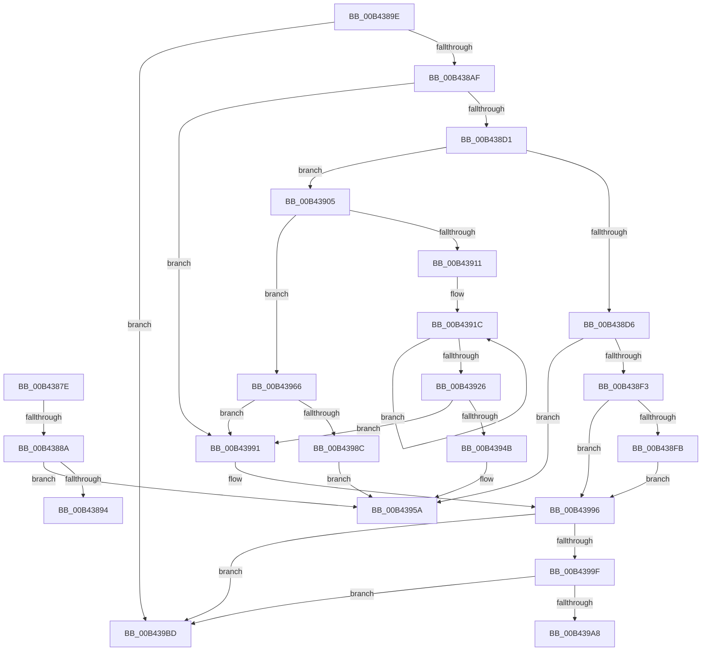

# sub_00B4387E

- RVA: `0x00B4387E`–`0x00B439C4` (길이 `326` bytes)
- VA: `0x0000000140B4387E`
- 실행 섹션: `PAGE`
- PDB 이름 있음: `아니요`; PDB Function 태그: `아니요`
- unwind 정보 RVA: `0x000B71BC`
- 디코드: `87`개 명령, `326/326` bytes 표시
- 미해석 바이트: `0` (있으면 어셈블리에 `.byte`로 보존)

> 이 문서는 커널 이미지의 기계어와 PDB 기호를 분석해 생성했습니다. 4번과 5번은 함수 원형과 자료형을 바이너리 사용 방식에서 추정한 C 해석이며 원본 소스 복구 결과는 아닙니다.

## 1. Dependencies

- 직접 호출 지점: **6**; 고유 호출 대상: **5**
- 직접 호출자로 확인된 함수: **0**
- RIP 상대 이미지 참조: **0**

### Outgoing calls
- `0x00B438C4` → [RtlCreateUnicodeString](../9B/RtlCreateUnicodeString_function_009BD860.md) (function, `0x009BD860`)
- `0x00B438E8` → [guard_dispatch_icall](../../text/6B/guard_dispatch_icall_function_006BAAD0.md) (function, `0x006BAAD0`)
- `0x00B4393D` → [ExAllocatePool2](../../poolcode/B8/ExAllocatePool2_function_00B820F0.md) (function, `0x00B820F0`)
- `0x00B43955` → [memcpy](../../text/6C/memcpy_function_006C6840.md) (function, `0x006C6840`)
- `0x00B4397E` → [ExAllocatePool2](../../poolcode/B8/ExAllocatePool2_function_00B820F0.md) (function, `0x00B820F0`)
- `0x00B439B2` → [PiDevCfgFreeVariable](../96/PiDevCfgFreeVariable_function_00964E80.md) (function, `0x00964E80`)

### Direct callers
- 이 함수 시작 RVA로 연결되는 직접 call은 확인되지 않았습니다. 간접 호출은 완전히 역산할 수 없습니다.

### Static image references
- 디코드된 RIP-relative 메모리 참조가 없습니다.

## 2. Other-region calls and transfers

- 다른 실행 섹션으로 향하는 call: **4**
  - `0x00B438E8` → [guard_dispatch_icall](../../text/6B/guard_dispatch_icall_function_006BAAD0.md) (`PAGE` → `.text`)
  - `0x00B4393D` → [ExAllocatePool2](../../poolcode/B8/ExAllocatePool2_function_00B820F0.md) (`PAGE` → `POOLCODE`)
  - `0x00B43955` → [memcpy](../../text/6C/memcpy_function_006C6840.md) (`PAGE` → `.text`)
  - `0x00B4397E` → [ExAllocatePool2](../../poolcode/B8/ExAllocatePool2_function_00B820F0.md) (`PAGE` → `POOLCODE`)
- call이 아닌 외부 분기/꼬리 이동: **4**
  - `0x00B43884` → [PiDevCfgResolveVariable + 0xDB](../A8/PiDevCfgResolveVariable_function_00A81AB8.md) (`tail-transfer`)
  - `0x00B43899` → [PiDevCfgResolveVariable + 0x14F](../A8/PiDevCfgResolveVariable_function_00A81AB8.md) (`tail-transfer`)
  - `0x00B43961` → [PiDevCfgResolveVariable + 0x146](../A8/PiDevCfgResolveVariable_function_00A81AB8.md) (`tail-transfer`)
  - `0x00B439B8` → [PiDevCfgResolveVariable + 0x146](../A8/PiDevCfgResolveVariable_function_00A81AB8.md) (`tail-transfer`)

## 3. Assembly (complete function range)

```asm
00B4387E  45 33 FF                        xor r15d, r15d
00B43881  48 85 FF                        test rdi, rdi
00B43884  0F 84 09 E3 F3 FF               je 0x140a81b93
00B4388A  83 7F 20 FF                     cmp dword ptr [rdi + 0x20], -1
00B4388E  0F 85 C6 00 00 00               jne 0x140b4395a
00B43894  BB 01 00 00 C0                  mov ebx, 0xc0000001
00B43899  E9 69 E3 F3 FF                  jmp 0x140a81c07
00B4389E  48 8B 4D D7                     mov rcx, qword ptr [rbp - 0x29]
00B438A2  48 8B 41 08                     mov rax, qword ptr [rcx + 8]
00B438A6  48 39 08                        cmp qword ptr [rax], rcx
00B438A9  0F 85 0E 01 00 00               jne 0x140b439bd
00B438AF  48 89 0F                        mov qword ptr [rdi], rcx
00B438B2  49 8B D4                        mov rdx, r12
00B438B5  48 89 47 08                     mov qword ptr [rdi + 8], rax
00B438B9  48 89 38                        mov qword ptr [rax], rdi
00B438BC  48 89 79 08                     mov qword ptr [rcx + 8], rdi
00B438C0  48 8D 4F 10                     lea rcx, [rdi + 0x10]
00B438C4  E8 97 9F E7 FF                  call 0x1409bd860
00B438C9  84 C0                           test al, al
00B438CB  0F 84 C0 00 00 00               je 0x140b43991
00B438D1  4D 85 FF                        test r15, r15
00B438D4  74 2F                           je 0x140b43905
00B438D6  83 4F 20 FF                     or dword ptr [rdi + 0x20], 0xffffffff
00B438DA  4C 8B C7                        mov r8, rdi
00B438DD  48 8B 55 A7                     mov rdx, qword ptr [rbp - 0x59]
00B438E1  49 8B C7                        mov rax, r15
00B438E4  48 8B 4D 67                     mov rcx, qword ptr [rbp + 0x67]
00B438E8  E8 E3 71 B7 FF                  call 0x1406baad0
00B438ED  8B D8                           mov ebx, eax
00B438EF  85 C0                           test eax, eax
00B438F1  79 67                           jns 0x140b4395a
00B438F3  3B C6                           cmp eax, esi
00B438F5  0F 85 9B 00 00 00               jne 0x140b43996
00B438FB  BB 01 00 00 C0                  mov ebx, 0xc0000001
00B43900  E9 91 00 00 00                  jmp 0x140b43996
00B43905  48 8B 75 BF                     mov rsi, qword ptr [rbp - 0x41]
00B43909  45 33 FF                        xor r15d, r15d
00B4390C  48 85 F6                        test rsi, rsi
00B4390F  74 55                           je 0x140b43966
00B43911  C7 47 20 01 00 00 00            mov dword ptr [rdi + 0x20], 1
00B43918  48 83 C8 FF                     or rax, 0xffffffffffffffff
00B4391C  48 FF C0                        inc rax
00B4391F  66 44 39 3C 46                  cmp word ptr [rsi + rax*2], r15w
00B43924  75 F6                           jne 0x140b4391c
00B43926  8D 04 45 02 00 00 00            lea eax, [rax*2 + 2]
00B4392D  B9 00 01 00 00                  mov ecx, 0x100
00B43932  8B D0                           mov edx, eax
00B43934  41 B8 50 70 64 63               mov r8d, 0x63647050
00B4393A  89 47 24                        mov dword ptr [rdi + 0x24], eax
00B4393D  E8 AE E7 03 00                  call 0x140b820f0
00B43942  48 89 47 28                     mov qword ptr [rdi + 0x28], rax
00B43946  48 85 C0                        test rax, rax
00B43949  74 46                           je 0x140b43991
00B4394B  44 8B 47 24                     mov r8d, dword ptr [rdi + 0x24]
00B4394F  48 8B D6                        mov rdx, rsi
00B43952  48 8B C8                        mov rcx, rax
00B43955  E8 E6 2E B8 FF                  call 0x1406c6840
00B4395A  48 8B 45 77                     mov rax, qword ptr [rbp + 0x77]
00B4395E  48 89 38                        mov qword ptr [rax], rdi
00B43961  E9 98 E2 F3 FF                  jmp 0x140a81bfe
00B43966  B8 04 00 00 00                  mov eax, 4
00B4396B  41 B8 50 70 64 63               mov r8d, 0x63647050
00B43971  8B D0                           mov edx, eax
00B43973  89 47 20                        mov dword ptr [rdi + 0x20], eax
00B43976  B9 00 01 00 00                  mov ecx, 0x100
00B4397B  89 47 24                        mov dword ptr [rdi + 0x24], eax
00B4397E  E8 6D E7 03 00                  call 0x140b820f0
00B43983  48 89 47 28                     mov qword ptr [rdi + 0x28], rax
00B43987  48 85 C0                        test rax, rax
00B4398A  74 05                           je 0x140b43991
00B4398C  44 89 28                        mov dword ptr [rax], r13d
00B4398F  EB C9                           jmp 0x140b4395a
00B43991  BB 9A 00 00 C0                  mov ebx, 0xc000009a
00B43996  48 8B 0F                        mov rcx, qword ptr [rdi]
00B43999  48 39 79 08                     cmp qword ptr [rcx + 8], rdi
00B4399D  75 1E                           jne 0x140b439bd
00B4399F  48 8B 47 08                     mov rax, qword ptr [rdi + 8]
00B439A3  48 39 38                        cmp qword ptr [rax], rdi
00B439A6  75 15                           jne 0x140b439bd
00B439A8  48 89 08                        mov qword ptr [rax], rcx
00B439AB  48 89 41 08                     mov qword ptr [rcx + 8], rax
00B439AF  48 8B CF                        mov rcx, rdi
00B439B2  E8 C9 14 E2 FF                  call 0x140964e80
00B439B7  90                              nop
00B439B8  E9 41 E2 F3 FF                  jmp 0x140a81bfe
00B439BD  B9 03 00 00 00                  mov ecx, 3
00B439C2  CD 29                           int 0x29
```

## 4. C-style interpretation (structured pseudocode)

```c
__int64 __fastcall sub_00B4387E(void)
{
    __int64 v_r15;

    v_r15 = 0;
    if ((*(unsigned int *)(v_rdi + 32)) != -1) goto loc_00B4395A;
loc_00B4395A:
    *(unsigned __int64 *)(*(unsigned __int64 *)(v_rbp + 119)) = v_rdi;
}
```

## 5. (Beta) C Style

```c
void sub_00B4387E(void)
{
    int64_t local_r15;

    local_r15 = 0;
    if ((*(uint32_t *)(local_rdi + 0x20)) != -1) goto loc_00B4395A;
loc_00B4395A:
    *(uint64_t *)(*(uint64_t *)(local_rbp + 0x77)) = local_rdi;
}
```

## 6. Execution-region graph

[열기: 2D/3D 그래프와 함수 탐색 컨트롤 패널](../../../control-panel.html?section=page&rva=0x00B4387E&view=graph)

- 2D 그래프는 위에서 아래로 흐르고, 3D 그래프는 빈 공간을 드래그해 회전합니다. Shift+드래그는 이동, 휠은 확대·축소, 함수 노드 선택은 대상 보고서 이동입니다.

### Static fallback


