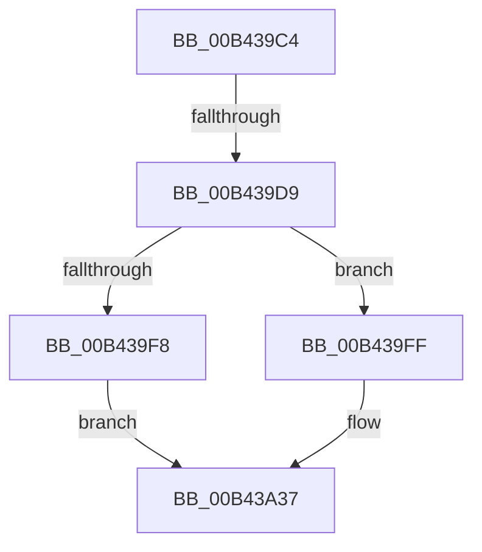

# sub_00B439C4

- RVA: `0x00B439C4`–`0x00B43A45` (길이 `129` bytes)
- VA: `0x0000000140B439C4`
- 실행 섹션: `PAGE`
- PDB 이름 있음: `아니요`; PDB Function 태그: `아니요`
- unwind 정보 RVA: `0x000B72BC`
- 디코드: `31`개 명령, `129/129` bytes 표시
- 미해석 바이트: `0` (있으면 어셈블리에 `.byte`로 보존)

> 이 문서는 커널 이미지의 기계어와 PDB 기호를 분석해 생성했습니다. 4번과 5번은 함수 원형과 자료형을 바이너리 사용 방식에서 추정한 C 해석이며 원본 소스 복구 결과는 아닙니다.

## 1. Dependencies

- 직접 호출 지점: **4**; 고유 호출 대상: **4**
- 직접 호출자로 확인된 함수: **0**
- RIP 상대 이미지 참조: **2**

### Outgoing calls
- `0x00B439CB` → [ExReleaseFastMutex](../../text/25/ExReleaseFastMutex_function_002519C0.md) (function, `0x002519C0`)
- `0x00B439EF` → [PsTestProtectedProcessIncompatibility](../A1/PsTestProtectedProcessIncompatibility_function_00A1003C.md) (function, `0x00A1003C`)
- `0x00B43A30` → [ObOpenObjectByPointer](../8B/ObOpenObjectByPointer_function_008B7420.md) (function, `0x008B7420`)
- `0x00B43A3A` → [ObfDereferenceObject](../../text/2F/ObfDereferenceObject_function_002F9350.md) (function, `0x002F9350`)

### Direct callers
- 이 함수 시작 RVA로 연결되는 직접 call은 확인되지 않았습니다. 간접 호출은 완전히 역산할 수 없습니다.

### Static image references
- `0x00B439C4` → RVA `0x00F8F220` (`.data`; read)
- `0x00B43A0E` → RVA `0x00FC5140` (`ALMOSTRO`; read)

## 2. Other-region calls and transfers

- 다른 실행 섹션으로 향하는 call: **2**
  - `0x00B439CB` → [ExReleaseFastMutex](../../text/25/ExReleaseFastMutex_function_002519C0.md) (`PAGE` → `.text`)
  - `0x00B43A3A` → [ObfDereferenceObject](../../text/2F/ObfDereferenceObject_function_002F9350.md) (`PAGE` → `.text`)
- call이 아닌 외부 분기/꼬리 이동: **2**
  - `0x00B439D3` → [DbgkOpenProcessDebugPort + 0x27](../A8/DbgkOpenProcessDebugPort_function_00A82414.md) (`tail-transfer`)
  - `0x00B43A40` → [DbgkOpenProcessDebugPort + 0x2C](../A8/DbgkOpenProcessDebugPort_function_00A82414.md) (`tail-transfer`)

## 3. Assembly (complete function range)

```asm
00B439C4  48 8D 0D 55 B8 44 00            lea rcx, [rip + 0x44b855]
00B439CB  E8 F0 DF 70 FF                  call 0x1402519c0
00B439D0  48 85 FF                        test rdi, rdi
00B439D3  0F 84 62 EA F3 FF               je 0x140a8243b
00B439D9  65 48 8B 04 25 88 01 00 00      mov rax, qword ptr gs:[0x188]
00B439E2  4C 8B C3                        mov r8, rbx
00B439E5  40 8A CE                        mov cl, sil
00B439E8  48 8B 90 B8 00 00 00            mov rdx, qword ptr [rax + 0xb8]
00B439EF  E8 48 C6 EC FF                  call 0x140a1003c
00B439F4  84 C0                           test al, al
00B439F6  74 07                           je 0x140b439ff
00B439F8  BB 12 07 00 C0                  mov ebx, 0xc0000712
00B439FD  EB 38                           jmp 0x140b43a37
00B439FF  40 8A C6                        mov al, sil
00B43A02  48 89 6C 24 30                  mov qword ptr [rsp + 0x30], rbp
00B43A07  F6 D8                           neg al
00B43A09  40 88 74 24 28                  mov byte ptr [rsp + 0x28], sil
00B43A0E  48 8B 05 2B 17 48 00            mov rax, qword ptr [rip + 0x48172b]
00B43A15  41 B9 00 00 00 02               mov r9d, 0x2000000
00B43A1B  1B D2                           sbb edx, edx
00B43A1D  48 89 44 24 20                  mov qword ptr [rsp + 0x20], rax
00B43A22  F7 D2                           not edx
00B43A24  45 33 C0                        xor r8d, r8d
00B43A27  81 E2 00 02 00 00               and edx, 0x200
00B43A2D  48 8B CF                        mov rcx, rdi
00B43A30  E8 EB 39 D7 FF                  call 0x1408b7420
00B43A35  8B D8                           mov ebx, eax
00B43A37  48 8B CF                        mov rcx, rdi
00B43A3A  E8 11 59 7B FF                  call 0x1402f9350
00B43A3F  90                              nop
00B43A40  E9 FB E9 F3 FF                  jmp 0x140a82440
```

## 4. C-style interpretation (structured pseudocode)

```c
__int64 __fastcall sub_00B439C4(void)
{
    __int64 result;
    unsigned __int64 v_stack_p20;
    unsigned __int8 v_stack_p28;
    unsigned __int64 v_stack_p30;

    result = ExReleaseFastMutex(v_rip + 4503637, a2, a3, a4);
    result = PsTestProtectedProcessIncompatibility((unsigned __int8)(v_rsi), *(unsigned __int64 *)(*(unsigned __int64 *)(gs_base + (0 + 392)) + 184), v_rbx, a4);
    if ((unsigned __int8)(result) == 0) goto loc_00B439FF;
    goto loc_00B43A37;
loc_00B439FF:
    v_stack_p30 = v_rbp;
    result = (unsigned __int8)(-((unsigned __int8)(v_rsi)));
    v_stack_p28 = (unsigned __int8)(v_rsi);
    v_stack_p20 = *(unsigned __int64 *)(v_rip + 4724523);
    a2 = (unsigned int)(~(*(unsigned __int64 *)(*(unsigned __int64 *)(gs_base + (0 + 392)) + 184)));
    a3 = 0;
    a2 = (unsigned int)((a2) & (512));
    result = ObOpenObjectByPointer(v_rdi, a2, a3, (unsigned int)(0x2000000ULL));
loc_00B43A37:
    result = ObfDereferenceObject(v_rdi, a2, a3, (unsigned int)(0x2000000ULL));
}
```

## 5. (Beta) C Style

```c
void sub_00B439C4(void)
{
    int64_t result;
    uint64_t v_stack_p20;
    uint8_t v_stack_p28;
    uint64_t v_stack_p30;

    result = ExReleaseFastMutex(v_rip + 4503637, a2, a3, a4);
    result = PsTestProtectedProcessIncompatibility((uint8_t)(local_rsi), *(uint64_t *)(*(uint64_t *)(gs_base + (0 + 0x188)) + 0xB8), local_rbx, a4);
    if ((uint8_t)(result) == 0) goto loc_00B439FF;
    goto loc_00B43A37;
loc_00B439FF:
    v_stack_p30 = local_rbp;
    result = (uint8_t)(-((uint8_t)(local_rsi)));
    v_stack_p28 = (uint8_t)(local_rsi);
    v_stack_p20 = *(uint64_t *)(v_rip + 0x48172B);
    a2 = (uint32_t)(~(*(uint64_t *)(*(uint64_t *)(gs_base + (0 + 0x188)) + 0xB8)));
    a3 = 0;
    a2 = (uint32_t)((a2) & (512));
    result = ObOpenObjectByPointer(local_rdi, a2, a3, (uint32_t)(0x2000000ULL));
loc_00B43A37:
    result = ObfDereferenceObject(local_rdi, a2, a3, (uint32_t)(0x2000000ULL));
}
```

## 6. Execution-region graph

[열기: 2D/3D 그래프와 함수 탐색 컨트롤 패널](../../../control-panel.html?section=page&rva=0x00B439C4&view=graph)

- 2D 그래프는 위에서 아래로 흐르고, 3D 그래프는 빈 공간을 드래그해 회전합니다. Shift+드래그는 이동, 휠은 확대·축소, 함수 노드 선택은 대상 보고서 이동입니다.

### Static fallback


