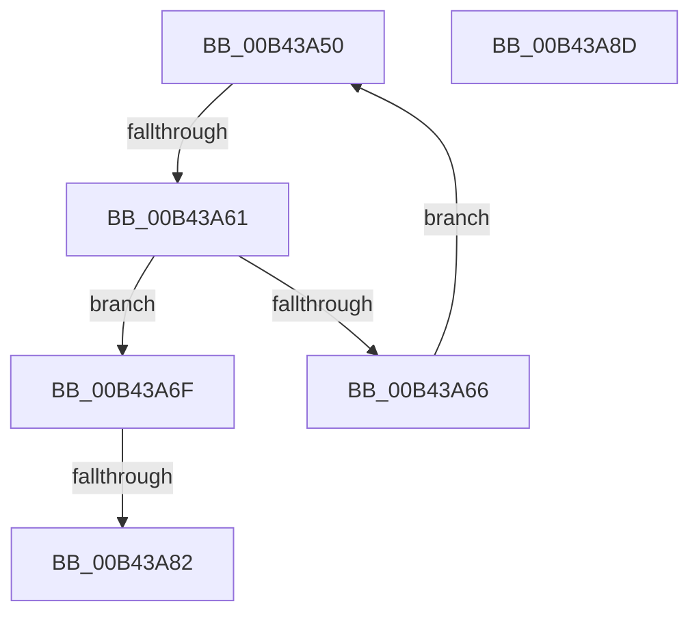

# sub_00B43A50

- RVA: `0x00B43A50`–`0x00B43A94` (길이 `68` bytes)
- VA: `0x0000000140B43A50`
- 실행 섹션: `PAGE`
- PDB 이름 있음: `아니요`; PDB Function 태그: `아니요`
- unwind 정보 RVA: `0x000B7324`
- 디코드: `19`개 명령, `68/68` bytes 표시
- 미해석 바이트: `0` (있으면 어셈블리에 `.byte`로 보존)

> 이 문서는 커널 이미지의 기계어와 PDB 기호를 분석해 생성했습니다. 4번과 5번은 함수 원형과 자료형을 바이너리 사용 방식에서 추정한 C 해석이며 원본 소스 복구 결과는 아닙니다.

## 1. Dependencies

- 직접 호출 지점: **1**; 고유 호출 대상: **1**
- 직접 호출자로 확인된 함수: **0**
- RIP 상대 이미지 참조: **0**

### Outgoing calls
- `0x00B43A72` → [RtlpDeleteFromMergedRange](../78/RtlpDeleteFromMergedRange_function_0078AE98.md) (function, `0x0078AE98`)

### Direct callers
- 이 함수 시작 RVA로 연결되는 직접 call은 확인되지 않았습니다. 간접 호출은 완전히 역산할 수 없습니다.

### Static image references
- 디코드된 RIP-relative 메모리 참조가 없습니다.

## 2. Other-region calls and transfers

- 다른 실행 섹션으로 향하는 call: **0**
- call이 아닌 외부 분기/꼬리 이동: **3**
  - `0x00B43A5B` → [RtlDeleteOwnersRanges + 0x3B](../A8/RtlDeleteOwnersRanges_function_00A828B0.md) (`tail-transfer`)
  - `0x00B43A7C` → [RtlDeleteOwnersRanges + 0x44](../A8/RtlDeleteOwnersRanges_function_00A828B0.md) (`tail-transfer`)
  - `0x00B43A88` → [RtlDeleteOwnersRanges + 0x18](../A8/RtlDeleteOwnersRanges_function_00A828B0.md) (`tail-transfer`)

## 3. Assembly (complete function range)

```asm
00B43A50  48 83 E9 28                     sub rcx, 0x28
00B43A54  49 8D 41 18                     lea rax, [r9 + 0x18]
00B43A58  48 3B D0                        cmp rdx, rax
00B43A5B  0F 84 8A EE F3 FF               je 0x140a828eb
00B43A61  48 39 30                        cmp qword ptr [rax], rsi
00B43A64  74 09                           je 0x140b43a6f
00B43A66  4C 8B C9                        mov r9, rcx
00B43A69  48 8B 49 28                     mov rcx, qword ptr [rcx + 0x28]
00B43A6D  EB E1                           jmp 0x140b43a50
00B43A6F  49 8B C9                        mov rcx, r9
00B43A72  E8 21 74 C4 FF                  call 0x14078ae98
00B43A77  44 8B C0                        mov r8d, eax
00B43A7A  85 C0                           test eax, eax
00B43A7C  0F 88 72 EE F3 FF               js 0x140a828f4
00B43A82  FF 4B 14                        dec dword ptr [rbx + 0x14]
00B43A85  FF 43 18                        inc dword ptr [rbx + 0x18]
00B43A88  E9 3B EE F3 FF                  jmp 0x140a828c8
00B43A8D  B9 03 00 00 00                  mov ecx, 3
00B43A92  CD 29                           int 0x29
```

## 4. C-style interpretation (structured pseudocode)

```c
__int64 __fastcall sub_00B43A50(__int64 a1, __int64 a2, __int64 a3, __int64 a4)
{
    __int64 result;

    a1 = (a1) - (40);
    if ((*(unsigned __int64 *)(a4 + 24)) == v_rsi) goto loc_00B43A6F;
    goto loc_00B43A50;
loc_00B43A6F:
    result = RtlpDeleteFromMergedRange(a1, a2, a3, a1);
}
```

## 5. (Beta) C Style

```c
int64_t sub_00B43A50(int64_t Arg1, int64_t Arg2, int64_t Arg3, int64_t Arg4)
{
    int64_t result;

    Arg1 = (Arg1) - (40);
    if ((*(uint64_t *)(Arg4 + 0x18)) == local_rsi) goto loc_00B43A6F;
    goto loc_00B43A50;
loc_00B43A6F:
    result = RtlpDeleteFromMergedRange(Arg1, Arg2, Arg3, Arg1);
}
```

## 6. Execution-region graph

[열기: 2D/3D 그래프와 함수 탐색 컨트롤 패널](../../../control-panel.html?section=page&rva=0x00B43A50&view=graph)

- 2D 그래프는 위에서 아래로 흐르고, 3D 그래프는 빈 공간을 드래그해 회전합니다. Shift+드래그는 이동, 휠은 확대·축소, 함수 노드 선택은 대상 보고서 이동입니다.

### Static fallback


