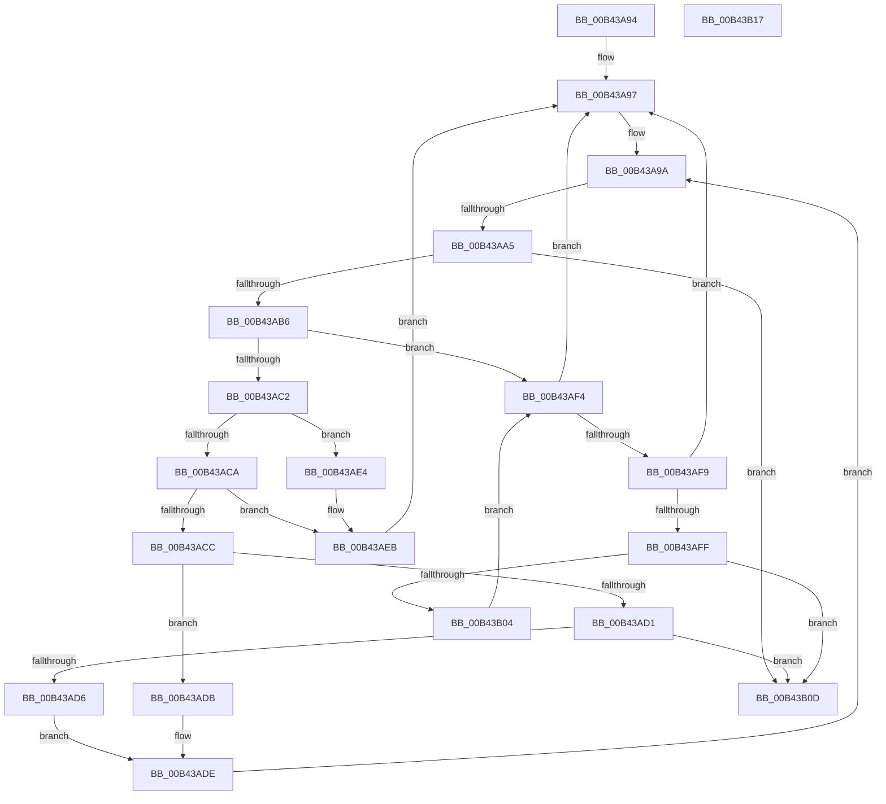

# sub_00B43A94

- RVA: `0x00B43A94`–`0x00B43B25` (길이 `145` bytes)
- VA: `0x0000000140B43A94`
- 실행 섹션: `PAGE`
- PDB 이름 있음: `아니요`; PDB Function 태그: `아니요`
- unwind 정보 RVA: `0x000B7350`
- 디코드: `45`개 명령, `145/145` bytes 표시
- 미해석 바이트: `0` (있으면 어셈블리에 `.byte`로 보존)

> 이 문서는 커널 이미지의 기계어와 PDB 기호를 분석해 생성했습니다. 4번과 5번은 함수 원형과 자료형을 바이너리 사용 방식에서 추정한 C 해석이며 원본 소스 복구 결과는 아닙니다.

## 1. Dependencies

- 직접 호출 지점: **1**; 고유 호출 대상: **1**
- 직접 호출자로 확인된 함수: **0**
- RIP 상대 이미지 참조: **0**

### Outgoing calls
- `0x00B43B1A` → [IopFreeReqList](../72/IopFreeReqList_function_0072ADAC.md) (function, `0x0072ADAC`)

### Direct callers
- 이 함수 시작 RVA로 연결되는 직접 call은 확인되지 않았습니다. 간접 호출은 완전히 역산할 수 없습니다.

### Static image references
- 디코드된 RIP-relative 메모리 참조가 없습니다.

## 2. Other-region calls and transfers

- 다른 실행 섹션으로 향하는 call: **0**
- call이 아닌 외부 분기/꼬리 이동: **3**
  - `0x00B43A9F` → [IopResourceRequirementsListToReqList + 0x49](../A8/IopResourceRequirementsListToReqList_function_00A82954.md) (`tail-transfer`)
  - `0x00B43B12` → [IopResourceRequirementsListToReqList + 0xBB](../A8/IopResourceRequirementsListToReqList_function_00A82954.md) (`tail-transfer`)
  - `0x00B43B20` → [IopResourceRequirementsListToReqList + 0x412](../A8/IopResourceRequirementsListToReqList_function_00A82954.md) (`tail-transfer`)

## 3. Assembly (complete function range)

```asm
00B43A94  4C 8B F1                        mov r14, rcx
00B43A97  45 8A DA                        mov r11b, r10b
00B43A9A  8B EA                           mov ebp, edx
00B43A9C  49 3B C8                        cmp rcx, r8
00B43A9F  0F 83 F8 EE F3 FF               jae 0x140a8299d
00B43AA5  44 0F B6 49 01                  movzx r9d, byte ptr [rcx + 1]
00B43AAA  45 8B D1                        mov r10d, r9d
00B43AAD  41 81 EA 80 00 00 00            sub r10d, 0x80
00B43AB4  74 57                           je 0x140b43b0d
00B43AB6  41 83 FA 01                     cmp r10d, 1
00B43ABA  41 BA 01 00 00 00               mov r10d, 1
00B43AC0  74 32                           je 0x140b43af4
00B43AC2  41 03 D2                        add edx, r10d
00B43AC5  45 84 C9                        test r9b, r9b
00B43AC8  78 1A                           js 0x140b43ae4
00B43ACA  74 1F                           je 0x140b43aeb
00B43ACC  F6 01 08                        test byte ptr [rcx], 8
00B43ACF  74 0A                           je 0x140b43adb
00B43AD1  45 84 DB                        test r11b, r11b
00B43AD4  75 37                           jne 0x140b43b0d
00B43AD6  41 03 F2                        add esi, r10d
00B43AD9  EB 03                           jmp 0x140b43ade
00B43ADB  45 32 DB                        xor r11b, r11b
00B43ADE  48 83 C1 20                     add rcx, 0x20
00B43AE2  EB B6                           jmp 0x140b43a9a
00B43AE4  41 80 F9 F0                     cmp r9b, 0xf0
00B43AE8  0F 44 D5                        cmove edx, ebp
00B43AEB  44 88 11                        mov byte ptr [rcx], r10b
00B43AEE  48 83 C1 20                     add rcx, 0x20
00B43AF2  EB A3                           jmp 0x140b43a97
00B43AF4  49 3B C8                        cmp rcx, r8
00B43AF7  73 9E                           jae 0x140b43a97
00B43AF9  80 79 01 81                     cmp byte ptr [rcx + 1], 0x81
00B43AFD  75 98                           jne 0x140b43a97
00B43AFF  49 3B CE                        cmp rcx, r14
00B43B02  74 09                           je 0x140b43b0d
00B43B04  41 03 D2                        add edx, r10d
00B43B07  48 83 C1 20                     add rcx, 0x20
00B43B0B  EB E7                           jmp 0x140b43af4
00B43B0D  B8 0D 00 00 C0                  mov eax, 0xc000000d
00B43B12  E9 F8 EE F3 FF                  jmp 0x140a82a0f
00B43B17  48 8B CF                        mov rcx, rdi
00B43B1A  E8 8D 72 BE FF                  call 0x14072adac
00B43B1F  90                              nop
00B43B20  E9 41 F2 F3 FF                  jmp 0x140a82d66
```

## 4. C-style interpretation (structured pseudocode)

```c
__int64 __fastcall sub_00B43A94(__int64 a1, int a2, __int64 a3)
{
    __int64 v_r10;
    __int64 v_r11;
    __int64 v_rsi;

loc_00B43A97:
loc_00B43A9A:
    v_r10 = (unsigned int)(((unsigned int)((unsigned int)(*(unsigned __int8 *)(a1 + 1)))) - (128));
    if (condition_is_equal) goto loc_00B43B0D;
    if (((unsigned int)(v_r10)) == 1) goto loc_00B43AF4;
    a2 = (unsigned int)((a2) + (1));
    if (sign_flag) goto loc_00B43AE4;
    if ((unsigned __int8)(*(unsigned __int8 *)(a1 + 1)) == 0) goto loc_00B43AEB;
    if (((*(unsigned __int8 *)(a1)) & (8)) == 0) goto loc_00B43ADB;
    if ((unsigned __int8)((unsigned __int8)(v_r10)) != 0) goto loc_00B43B0D;
    v_rsi = (unsigned int)((v_rsi) + (1));
    goto loc_00B43ADE;
loc_00B43ADB:
    v_r11 = 0;
loc_00B43ADE:
    a1 = (a1) + (32);
    goto loc_00B43A9A;
loc_00B43AE4:
    if (((unsigned __int8)(*(unsigned __int8 *)(a1 + 1))) == 240) { a2 = (unsigned int)((unsigned int)(a2)); }
loc_00B43AEB:
    *(unsigned __int8 *)(a1) = 1;
    a1 = (a1) + (32);
    goto loc_00B43A97;
loc_00B43AF4:
    if (a1 >= a3) goto loc_00B43A97;
    if ((*(unsigned __int8 *)(a1 + 1)) != 129) goto loc_00B43A97;
    if (a1 == a1) goto loc_00B43B0D;
    a2 = (unsigned int)((a2) + (1));
    a1 = (a1) + (32);
    goto loc_00B43AF4;
loc_00B43B0D:
}
```

## 5. (Beta) C Style

```c
int64_t sub_00B43A94(int64_t Arg1, int32_t Arg2, int64_t Arg3)
{
    int64_t local_r10;
    int64_t local_r11;
    int64_t local_rsi;

loc_00B43A97:
loc_00B43A9A:
    local_r10 = (uint32_t)(((uint32_t)((uint32_t)(*(uint8_t *)(Arg1 + 0x1)))) - (128));
    if (condition_is_equal) goto loc_00B43B0D;
    if (((uint32_t)(local_r10)) == 1) goto loc_00B43AF4;
    Arg2 = (uint32_t)((Arg2) + (1));
    if (sign_flag) goto loc_00B43AE4;
    if ((uint8_t)(*(uint8_t *)(Arg1 + 0x1)) == 0) goto loc_00B43AEB;
    if (((*(uint8_t *)(Arg1)) & (8)) == 0) goto loc_00B43ADB;
    if ((uint8_t)((uint8_t)(local_r10)) != 0) goto loc_00B43B0D;
    local_rsi = (uint32_t)((local_rsi) + (1));
    goto loc_00B43ADE;
loc_00B43ADB:
    local_r11 = 0;
loc_00B43ADE:
    Arg1 = (Arg1) + (32);
    goto loc_00B43A9A;
loc_00B43AE4:
    if (((uint8_t)(*(uint8_t *)(Arg1 + 0x1))) == 240) { Arg2 = (uint32_t)((uint32_t)(Arg2)); }
loc_00B43AEB:
    *(uint8_t *)(Arg1) = 1;
    Arg1 = (Arg1) + (32);
    goto loc_00B43A97;
loc_00B43AF4:
    if (Arg1 >= Arg3) goto loc_00B43A97;
    if ((*(uint8_t *)(Arg1 + 0x1)) != 129) goto loc_00B43A97;
    if (Arg1 == Arg1) goto loc_00B43B0D;
    Arg2 = (uint32_t)((Arg2) + (1));
    Arg1 = (Arg1) + (32);
    goto loc_00B43AF4;
loc_00B43B0D:
}
```

## 6. Execution-region graph

[열기: 2D/3D 그래프와 함수 탐색 컨트롤 패널](../../../control-panel.html?section=page&rva=0x00B43A94&view=graph)

- 2D 그래프는 위에서 아래로 흐르고, 3D 그래프는 빈 공간을 드래그해 회전합니다. Shift+드래그는 이동, 휠은 확대·축소, 함수 노드 선택은 대상 보고서 이동입니다.

### Static fallback


