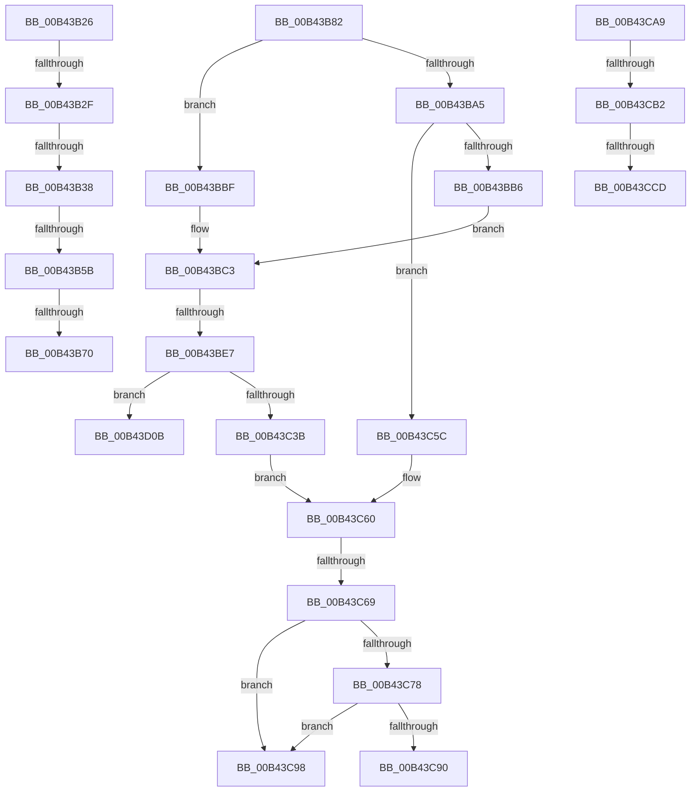

# sub_00B43B26

- RVA: `0x00B43B26`–`0x00B43D12` (길이 `492` bytes)
- VA: `0x0000000140B43B26`
- 실행 섹션: `PAGE`
- PDB 이름 있음: `아니요`; PDB Function 태그: `아니요`
- unwind 정보 RVA: `0x000B737C`
- 디코드: `125`개 명령, `492/492` bytes 표시
- 미해석 바이트: `0` (있으면 어셈블리에 `.byte`로 보존)

> 이 문서는 커널 이미지의 기계어와 PDB 기호를 분석해 생성했습니다. 4번과 5번은 함수 원형과 자료형을 바이너리 사용 방식에서 추정한 C 해석이며 원본 소스 복구 결과는 아닙니다.

## 1. Dependencies

- 직접 호출 지점: **6**; 고유 호출 대상: **5**
- 직접 호출자로 확인된 함수: **0**
- RIP 상대 이미지 참조: **0**

### Outgoing calls
- `0x00B43B42` → [IopFindLegacyBusDeviceNode](../AA/IopFindLegacyBusDeviceNode_function_00AAB698.md) (function, `0x00AAB698`)
- `0x00B43B75` → [IopFindLegacyBusDeviceNode](../AA/IopFindLegacyBusDeviceNode_function_00AAB698.md) (function, `0x00AAB698`)
- `0x00B43B92` → [IopQueryResourceHandlerInterface](../A8/IopQueryResourceHandlerInterface_function_00A830E4.md) (function, `0x00A830E4`)
- `0x00B43BD3` → [ExAllocatePool2](../../poolcode/B8/ExAllocatePool2_function_00B820F0.md) (function, `0x00B820F0`)
- `0x00B43C84` → [IopCallArbiter](../AA/IopCallArbiter_function_00AA5394.md) (function, `0x00AA5394`)
- `0x00B43CBD` → [IopTranslateAndAdjustReqDesc](../72/IopTranslateAndAdjustReqDesc_function_0072B2AC.md) (function, `0x0072B2AC`)

### Direct callers
- 이 함수 시작 RVA로 연결되는 직접 call은 확인되지 않았습니다. 간접 호출은 완전히 역산할 수 없습니다.

### Static image references
- 디코드된 RIP-relative 메모리 참조가 없습니다.

## 2. Other-region calls and transfers

- 다른 실행 섹션으로 향하는 call: **1**
  - `0x00B43BD3` → [ExAllocatePool2](../../poolcode/B8/ExAllocatePool2_function_00B820F0.md) (`PAGE` → `POOLCODE`)
- call이 아닌 외부 분기/꼬리 이동: **12**
  - `0x00B43B29` → [IopSetupArbiterAndTranslators + 0x99](../A8/IopSetupArbiterAndTranslators_function_00A82E68.md) (`tail-transfer`)
  - `0x00B43B32` → [IopSetupArbiterAndTranslators + 0x99](../A8/IopSetupArbiterAndTranslators_function_00A82E68.md) (`tail-transfer`)
  - `0x00B43B55` → [IopSetupArbiterAndTranslators + 0x80](../A8/IopSetupArbiterAndTranslators_function_00A82E68.md) (`tail-transfer`)
  - `0x00B43B6A` → [IopSetupArbiterAndTranslators + 0x80](../A8/IopSetupArbiterAndTranslators_function_00A82E68.md) (`tail-transfer`)
  - `0x00B43B7D` → [IopSetupArbiterAndTranslators + 0x118](../A8/IopSetupArbiterAndTranslators_function_00A82E68.md) (`tail-transfer`)
  - `0x00B43BE1` → [IopSetupArbiterAndTranslators + 0x187](../A8/IopSetupArbiterAndTranslators_function_00A82E68.md) (`tail-transfer`)
  - `0x00B43C63` → [IopSetupArbiterAndTranslators + 0xAB](../A8/IopSetupArbiterAndTranslators_function_00A82E68.md) (`tail-transfer`)
  - `0x00B43C93` → [IopSetupArbiterAndTranslators + 0xAB](../A8/IopSetupArbiterAndTranslators_function_00A82E68.md) (`tail-transfer`)
  - `0x00B43CA4` → [IopSetupArbiterAndTranslators + 0xAB](../A8/IopSetupArbiterAndTranslators_function_00A82E68.md) (`tail-transfer`)
  - `0x00B43CAC` → [IopSetupArbiterAndTranslators + 0x114](../A8/IopSetupArbiterAndTranslators_function_00A82E68.md) (`tail-transfer`)
  - `0x00B43CC7` → [IopSetupArbiterAndTranslators + 0x18C](../A8/IopSetupArbiterAndTranslators_function_00A82E68.md) (`tail-transfer`)
  - `0x00B43D06` → [IopSetupArbiterAndTranslators + 0x114](../A8/IopSetupArbiterAndTranslators_function_00A82E68.md) (`tail-transfer`)

## 3. Assembly (complete function range)

```asm
00B43B26  45 84 C0                        test r8b, r8b
00B43B29  0F 85 D2 F3 F3 FF               jne 0x140a82f01
00B43B2F  45 84 ED                        test r13b, r13b
00B43B32  0F 85 C9 F3 F3 FF               jne 0x140a82f01
00B43B38  41 8B 0F                        mov ecx, dword ptr [r15]
00B43B3B  41 B5 01                        mov r13b, 1
00B43B3E  41 8B 57 04                     mov edx, dword ptr [r15 + 4]
00B43B42  E8 51 7B F6 FF                  call 0x140aab698
00B43B47  48 8B 4D 60                     mov rcx, qword ptr [rbp + 0x60]
00B43B4B  48 8B D8                        mov rbx, rax
00B43B4E  44 8A 45 48                     mov r8b, byte ptr [rbp + 0x48]
00B43B52  49 3B C1                        cmp rax, r9
00B43B55  0F 85 8D F3 F3 FF               jne 0x140a82ee8
00B43B5B  49 8B 4F 10                     mov rcx, qword ptr [r15 + 0x10]
00B43B5F  48 8B 51 08                     mov rdx, qword ptr [rcx + 8]
00B43B63  48 8B 4D 60                     mov rcx, qword ptr [rbp + 0x60]
00B43B67  44 39 1A                        cmp dword ptr [rdx], r11d
00B43B6A  0F 85 78 F3 F3 FF               jne 0x140a82ee8
00B43B70  33 D2                           xor edx, edx
00B43B72  8D 4A 01                        lea ecx, [rdx + 1]
00B43B75  E8 1E 7B F6 FF                  call 0x140aab698
00B43B7A  48 8B D8                        mov rbx, rax
00B43B7D  E9 FE F3 F3 FF                  jmp 0x140a82f80
00B43B82  41 0F B7 FB                     movzx edi, r11w
00B43B86  4C 8D 4D 58                     lea r9, [rbp + 0x58]
00B43B8A  49 8B D6                        mov rdx, r14
00B43B8D  B9 02 00 00 00                  mov ecx, 2
00B43B92  E8 4D F5 F3 FF                  call 0x140a830e4
00B43B97  66 09 BB 0E 02 00 00            or word ptr [rbx + 0x20e], di
00B43B9E  45 33 DB                        xor r11d, r11d
00B43BA1  85 C0                           test eax, eax
00B43BA3  79 1A                           jns 0x140b43bbf
00B43BA5  66 09 BB 0C 02 00 00            or word ptr [rbx + 0x20c], di
00B43BAC  40 80 FE 0F                     cmp sil, 0xf
00B43BB0  0F 86 A6 00 00 00               jbe 0x140b43c5c
00B43BB6  41 8B FB                        mov edi, r11d
00B43BB9  4C 89 5D 58                     mov qword ptr [rbp + 0x58], r11
00B43BBD  EB 04                           jmp 0x140b43bc3
00B43BBF  48 8B 7D 58                     mov rdi, qword ptr [rbp + 0x58]
00B43BC3  BA 70 00 00 00                  mov edx, 0x70
00B43BC8  B9 00 01 00 00                  mov ecx, 0x100
00B43BCD  41 B8 50 70 20 20               mov r8d, 0x20207050
00B43BD3  E8 18 E5 03 00                  call 0x140b820f0
00B43BD8  45 33 DB                        xor r11d, r11d
00B43BDB  48 8B D0                        mov rdx, rax
00B43BDE  48 85 C0                        test rax, rax
00B43BE1  0F 84 08 F4 F3 FF               je 0x140a82fef
00B43BE7  66 44 89 58 68                  mov word ptr [rax + 0x68], r11w
00B43BEC  48 8D 48 58                     lea rcx, [rax + 0x58]
00B43BF0  48 89 49 08                     mov qword ptr [rcx + 8], rcx
00B43BF4  48 89 09                        mov qword ptr [rcx], rcx
00B43BF7  48 8D 48 48                     lea rcx, [rax + 0x48]
00B43BFB  48 89 49 08                     mov qword ptr [rcx + 8], rcx
00B43BFF  48 89 09                        mov qword ptr [rcx], rcx
00B43C02  48 8D 48 28                     lea rcx, [rax + 0x28]
00B43C06  48 89 49 08                     mov qword ptr [rcx + 8], rcx
00B43C0A  48 83 C0 38                     add rax, 0x38
00B43C0E  48 89 09                        mov qword ptr [rcx], rcx
00B43C11  48 89 40 08                     mov qword ptr [rax + 8], rax
00B43C15  48 89 00                        mov qword ptr [rax], rax
00B43C18  48 8D 83 E8 01 00 00            lea rax, [rbx + 0x1e8]
00B43C1F  48 89 52 08                     mov qword ptr [rdx + 8], rdx
00B43C23  48 89 12                        mov qword ptr [rdx], rdx
00B43C26  40 88 72 10                     mov byte ptr [rdx + 0x10], sil
00B43C2A  48 89 5A 20                     mov qword ptr [rdx + 0x20], rbx
00B43C2E  48 8B 48 08                     mov rcx, qword ptr [rax + 8]
00B43C32  48 39 01                        cmp qword ptr [rcx], rax
00B43C35  0F 85 D0 00 00 00               jne 0x140b43d0b
00B43C3B  48 89 02                        mov qword ptr [rdx], rax
00B43C3E  48 89 4A 08                     mov qword ptr [rdx + 8], rcx
00B43C42  48 89 11                        mov qword ptr [rcx], rdx
00B43C45  48 89 50 08                     mov qword ptr [rax + 8], rdx
00B43C49  48 89 7A 18                     mov qword ptr [rdx + 0x18], rdi
00B43C4D  48 F7 DF                        neg rdi
00B43C50  48 1B FF                        sbb rdi, rdi
00B43C53  48 23 FA                        and rdi, rdx
00B43C56  48 89 7D D8                     mov qword ptr [rbp - 0x28], rdi
00B43C5A  EB 04                           jmp 0x140b43c60
00B43C5C  48 8B 7D D8                     mov rdi, qword ptr [rbp - 0x28]
00B43C60  48 85 FF                        test rdi, rdi
00B43C63  0F 84 AA F2 F3 FF               je 0x140a82f13
00B43C69  48 8B 47 18                     mov rax, qword ptr [rdi + 0x18]
00B43C6D  41 B4 01                        mov r12b, 1
00B43C70  8B 48 28                        mov ecx, dword ptr [rax + 0x28]
00B43C73  41 84 CC                        test r12b, cl
00B43C76  74 20                           je 0x140b43c98
00B43C78  4D 8B 47 20                     mov r8, qword ptr [r15 + 0x20]
00B43C7C  BA 07 00 00 00                  mov edx, 7
00B43C81  48 8B CF                        mov rcx, rdi
00B43C84  E8 0B 17 F6 FF                  call 0x140aa5394
00B43C89  45 33 DB                        xor r11d, r11d
00B43C8C  85 C0                           test eax, eax
00B43C8E  79 08                           jns 0x140b43c98
00B43C90  45 8A E3                        mov r12b, r11b
00B43C93  E9 7B F2 F3 FF                  jmp 0x140a82f13
00B43C98  49 89 BF 20 01 00 00            mov qword ptr [r15 + 0x120], rdi
00B43C9F  66 83 67 68 00                  and word ptr [rdi + 0x68], 0
00B43CA4  E9 6A F2 F3 FF                  jmp 0x140a82f13
00B43CA9  48 85 FF                        test rdi, rdi
00B43CAC  0F 84 CA F2 F3 FF               je 0x140a82f7c
00B43CB2  49 8B 4F 20                     mov rcx, qword ptr [r15 + 0x20]
00B43CB6  4C 8D 45 E0                     lea r8, [rbp - 0x20]
00B43CBA  48 8B D7                        mov rdx, rdi
00B43CBD  E8 EA 75 BE FF                  call 0x14072b2ac
00B43CC2  45 33 DB                        xor r11d, r11d
00B43CC5  85 C0                           test eax, eax
00B43CC7  0F 88 27 F3 F3 FF               js 0x140a82ff4
00B43CCD  4C 8B 45 E0                     mov r8, qword ptr [rbp - 0x20]
00B43CD1  44 8B 4D 50                     mov r9d, dword ptr [rbp + 0x50]
00B43CD5  45 0F B6 C9                     movzx r9d, r9b
00B43CD9  49 8B 48 40                     mov rcx, qword ptr [r8 + 0x40]
00B43CDD  0F B6 51 01                     movzx edx, byte ptr [rcx + 1]
00B43CE1  49 8B 4F 20                     mov rcx, qword ptr [r15 + 0x20]
00B43CE5  80 FA 07                        cmp dl, 7
00B43CE8  8B F2                           mov esi, edx
00B43CEA  49 89 48 20                     mov qword ptr [r8 + 0x20], rcx
00B43CEE  41 8D 53 03                     lea edx, [r11 + 3]
00B43CF2  4D 89 47 20                     mov qword ptr [r15 + 0x20], r8
00B43CF6  0F 44 F2                        cmove esi, edx
00B43CF9  3D 20 01 00 00                  cmp eax, 0x120
00B43CFE  45 0F 44 CB                     cmove r9d, r11d
00B43D02  44 89 4D 50                     mov dword ptr [rbp + 0x50], r9d
00B43D06  E9 71 F2 F3 FF                  jmp 0x140a82f7c
00B43D0B  B9 03 00 00 00                  mov ecx, 3
00B43D10  CD 29                           int 0x29
```

## 4. C-style interpretation (structured pseudocode)

```c
__int64 __fastcall sub_00B43B26(__int64 a1, __int64 a2, unsigned __int8 a3, __int64 a4)
{
    __int64 result;

    result = IopFindLegacyBusDeviceNode((unsigned int)(*(unsigned int *)(v_r15)), (unsigned int)(*(unsigned int *)(v_r15 + 4)), a3, a4);
    a2 = 0;
    result = IopFindLegacyBusDeviceNode(a2 + 1, a2, *(unsigned __int8 *)(v_rbp + 72), a4);
}
```

## 5. (Beta) C Style

```c
int64_t sub_00B43B26(int64_t Arg1, int64_t Arg2, uint8_t Arg3, int64_t Arg4)
{
    int64_t result;

    result = IopFindLegacyBusDeviceNode((uint32_t)(*(uint32_t *)(local_r15)), (uint32_t)(*(uint32_t *)(local_r15 + 0x4)), Arg3, Arg4);
    Arg2 = 0;
    result = IopFindLegacyBusDeviceNode(Arg2 + 1, Arg2, *(uint8_t *)(local_rbp + 0x48), Arg4);
}
```

## 6. Execution-region graph

[열기: 2D/3D 그래프와 함수 탐색 컨트롤 패널](../../../control-panel.html?section=page&rva=0x00B43B26&view=graph)

- 2D 그래프는 위에서 아래로 흐르고, 3D 그래프는 빈 공간을 드래그해 회전합니다. Shift+드래그는 이동, 휠은 확대·축소, 함수 노드 선택은 대상 보고서 이동입니다.

### Static fallback


