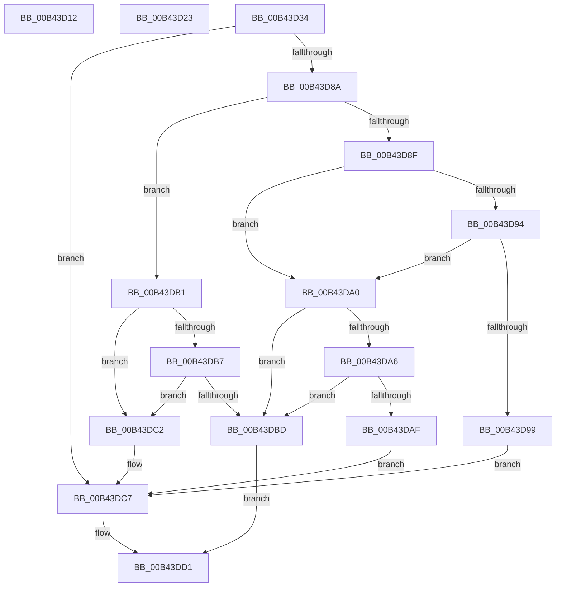

# sub_00B43D12

- RVA: `0x00B43D12`–`0x00B43DD8` (길이 `198` bytes)
- VA: `0x0000000140B43D12`
- 실행 섹션: `PAGE`
- PDB 이름 있음: `아니요`; PDB Function 태그: `아니요`
- unwind 정보 RVA: `0x000B73B4`
- 디코드: `54`개 명령, `198/198` bytes 표시
- 미해석 바이트: `0` (있으면 어셈블리에 `.byte`로 보존)

> 이 문서는 커널 이미지의 기계어와 PDB 기호를 분석해 생성했습니다. 4번과 5번은 함수 원형과 자료형을 바이너리 사용 방식에서 추정한 C 해석이며 원본 소스 복구 결과는 아닙니다.

## 1. Dependencies

- 직접 호출 지점: **3**; 고유 호출 대상: **3**
- 직접 호출자로 확인된 함수: **0**
- RIP 상대 이미지 참조: **2**

### Outgoing calls
- `0x00B43D41` → [memset](../../text/6C/memset_function_006C6C40.md) (function, `0x006C6C40`)
- `0x00B43D7F` → [IopSynchronousCall](../8F/IopSynchronousCall_function_008FB018.md) (function, `0x008FB018`)
- `0x00B43DCC` → [ExFreePoolWithTag](../../poolcode/B8/ExFreePoolWithTag_function_00B82870.md) (function, `0x00B82870`)

### Direct callers
- 이 함수 시작 RVA로 연결되는 직접 call은 확인되지 않았습니다. 간접 호출은 완전히 역산할 수 없습니다.

### Static image references
- `0x00B43D12` → RVA `0x00024128` (`.rdata`; read)
- `0x00B43D23` → RVA `0x00024038` (`.rdata`; read)

## 2. Other-region calls and transfers

- 다른 실행 섹션으로 향하는 call: **2**
  - `0x00B43D41` → [memset](../../text/6C/memset_function_006C6C40.md) (`PAGE` → `.text`)
  - `0x00B43DCC` → [ExFreePoolWithTag](../../poolcode/B8/ExFreePoolWithTag_function_00B82870.md) (`PAGE` → `POOLCODE`)
- call이 아닌 외부 분기/꼬리 이동: **3**
  - `0x00B43D1E` → [IopQueryResourceHandlerInterface + 0x6E](../A8/IopQueryResourceHandlerInterface_function_00A830E4.md) (`tail-transfer`)
  - `0x00B43D2F` → [IopQueryResourceHandlerInterface + 0x6E](../A8/IopQueryResourceHandlerInterface_function_00A830E4.md) (`tail-transfer`)
  - `0x00B43DD3` → [IopQueryResourceHandlerInterface + 0x9A](../A8/IopQueryResourceHandlerInterface_function_00A830E4.md) (`tail-transfer`)

## 3. Assembly (complete function range)

```asm
00B43D12  0F 10 05 0F 04 4E FF            movups xmm0, xmmword ptr [rip - 0xb1fbf1]
00B43D19  BB 28 00 00 00                  mov ebx, 0x28
00B43D1E  E9 2F F4 F3 FF                  jmp 0x140a83152
00B43D23  0F 10 05 0E 03 4E FF            movups xmm0, xmmword ptr [rip - 0xb1fcf2]
00B43D2A  BB 30 00 00 00                  mov ebx, 0x30
00B43D2F  E9 1E F4 F3 FF                  jmp 0x140a83152
00B43D34  33 D2                           xor edx, edx
00B43D36  66 89 18                        mov word ptr [rax], bx
00B43D39  48 8D 4D C7                     lea rcx, [rbp - 0x39]
00B43D3D  44 8D 42 48                     lea r8d, [rdx + 0x48]
00B43D41  E8 FA 2E B8 FF                  call 0x1406c6c40
00B43D46  48 8D 45 0F                     lea rax, [rbp + 0xf]
00B43D4A  66 C7 45 C7 1B 08               mov word ptr [rbp - 0x39], 0x81b
00B43D50  45 33 C9                        xor r9d, r9d
00B43D53  48 89 45 CF                     mov qword ptr [rbp - 0x31], rax
00B43D57  41 B8 BB 00 00 C0               mov r8d, 0xc00000bb
00B43D5D  66 89 5D D7                     mov word ptr [rbp - 0x29], bx
00B43D61  48 8D 55 C7                     lea rdx, [rbp - 0x39]
00B43D65  66 44 89 6E 02                  mov word ptr [rsi + 2], r13w
00B43D6A  49 8B CE                        mov rcx, r14
00B43D6D  66 44 89 6D D9                  mov word ptr [rbp - 0x27], r13w
00B43D72  48 89 75 DF                     mov qword ptr [rbp - 0x21], rsi
00B43D76  4C 89 65 E7                     mov qword ptr [rbp - 0x19], r12
00B43D7A  4C 89 6C 24 20                  mov qword ptr [rsp + 0x20], r13
00B43D7F  E8 94 72 DB FF                  call 0x1408fb018
00B43D84  8B D8                           mov ebx, eax
00B43D86  85 C0                           test eax, eax
00B43D88  78 3D                           js 0x140b43dc7
00B43D8A  83 EF 01                        sub edi, 1
00B43D8D  74 22                           je 0x140b43db1
00B43D8F  83 EF 01                        sub edi, 1
00B43D92  74 0C                           je 0x140b43da0
00B43D94  83 FF 01                        cmp edi, 1
00B43D97  74 07                           je 0x140b43da0
00B43D99  BB 0D 00 00 C0                  mov ebx, 0xc000000d
00B43D9E  EB 27                           jmp 0x140b43dc7
00B43DA0  4C 39 6E 20                     cmp qword ptr [rsi + 0x20], r13
00B43DA4  75 17                           jne 0x140b43dbd
00B43DA6  BB 01 00 00 C0                  mov ebx, 0xc0000001
00B43DAB  85 DB                           test ebx, ebx
00B43DAD  79 0E                           jns 0x140b43dbd
00B43DAF  EB 16                           jmp 0x140b43dc7
00B43DB1  4C 39 6E 20                     cmp qword ptr [rsi + 0x20], r13
00B43DB5  74 0B                           je 0x140b43dc2
00B43DB7  4C 39 6E 28                     cmp qword ptr [rsi + 0x28], r13
00B43DBB  74 05                           je 0x140b43dc2
00B43DBD  49 89 37                        mov qword ptr [r15], rsi
00B43DC0  EB 0F                           jmp 0x140b43dd1
00B43DC2  BB 01 00 00 C0                  mov ebx, 0xc0000001
00B43DC7  33 D2                           xor edx, edx
00B43DC9  48 8B CE                        mov rcx, rsi
00B43DCC  E8 9F EA 03 00                  call 0x140b82870
00B43DD1  8B C3                           mov eax, ebx
00B43DD3  E9 A6 F3 F3 FF                  jmp 0x140a8317e
```

## 4. C-style interpretation (structured pseudocode)

```c
__int64 __fastcall sub_00B43D12(__int64 a1, int a2, __int64 a3, int a4)
{
    unsigned __int64 v_stack_p20;
}
```

## 5. (Beta) C Style

```c
int64_t sub_00B43D12(int64_t Arg1, int32_t Arg2, int64_t Arg3, int32_t Arg4)
{
    uint64_t v_stack_p20;
}
```

## 6. Execution-region graph

[열기: 2D/3D 그래프와 함수 탐색 컨트롤 패널](../../../control-panel.html?section=page&rva=0x00B43D12&view=graph)

- 2D 그래프는 위에서 아래로 흐르고, 3D 그래프는 빈 공간을 드래그해 회전합니다. Shift+드래그는 이동, 휠은 확대·축소, 함수 노드 선택은 대상 보고서 이동입니다.

### Static fallback


