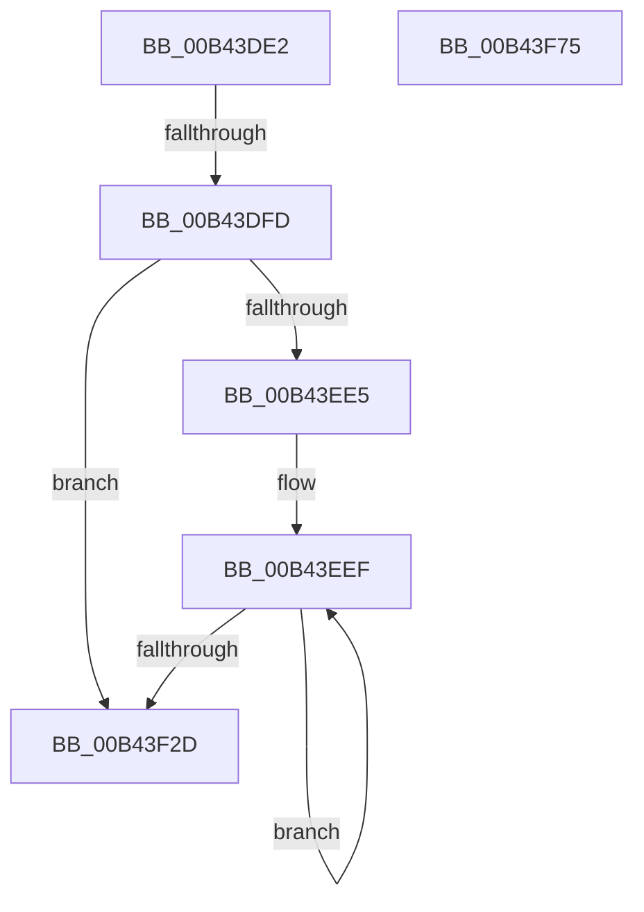

# sub_00B43DE2

- RVA: `0x00B43DE2`–`0x00B43FF9` (길이 `535` bytes)
- VA: `0x0000000140B43DE2`
- 실행 섹션: `PAGE`
- PDB 이름 있음: `아니요`; PDB Function 태그: `아니요`
- unwind 정보 RVA: `0x000B74B4`
- 디코드: `97`개 명령, `535/535` bytes 표시
- 미해석 바이트: `0` (있으면 어셈블리에 `.byte`로 보존)

> 이 문서는 커널 이미지의 기계어와 PDB 기호를 분석해 생성했습니다. 4번과 5번은 함수 원형과 자료형을 바이너리 사용 방식에서 추정한 C 해석이며 원본 소스 복구 결과는 아닙니다.

## 1. Dependencies

- 직접 호출 지점: **4**; 고유 호출 대상: **3**
- 직접 호출자로 확인된 함수: **0**
- RIP 상대 이미지 참조: **5**

### Outgoing calls
- `0x00B43DF0` → [EtwEventEnabled](../../text/39/EtwEventEnabled_function_00392450.md) (function, `0x00392450`)
- `0x00B43E05` → [PopIdleWakeCalculateConvergedBuckets](../76/PopIdleWakeCalculateConvergedBuckets_function_0076AFD4.md) (function, `0x0076AFD4`)
- `0x00B43F6A` → [EtwWrite](../../text/41/EtwWrite_function_0041C720.md) (function, `0x0041C720`)
- `0x00B43FEE` → [EtwWrite](../../text/41/EtwWrite_function_0041C720.md) (function, `0x0041C720`)

### Direct callers
- 이 함수 시작 RVA로 연결되는 직접 call은 확인되지 않았습니다. 간접 호출은 완전히 역산할 수 없습니다.

### Static image references
- `0x00B43DE2` → RVA `0x00F0B6B8` (`.data`; read)
- `0x00B43DE9` → RVA `0x00029848` (`.rdata`; read)
- `0x00B43E17` → RVA `0x00F0B6B0` (`.data`; read)
- `0x00B43F87` → RVA `0x0001BCF8` (`.rdata`; read)
- `0x00B43F96` → RVA `0x00F0B408` (`.data`; read)

## 2. Other-region calls and transfers

- 다른 실행 섹션으로 향하는 call: **3**
  - `0x00B43DF0` → [EtwEventEnabled](../../text/39/EtwEventEnabled_function_00392450.md) (`PAGE` → `.text`)
  - `0x00B43F6A` → [EtwWrite](../../text/41/EtwWrite_function_0041C720.md) (`PAGE` → `.text`)
  - `0x00B43FEE` → [EtwWrite](../../text/41/EtwWrite_function_0041C720.md) (`PAGE` → `.text`)
- call이 아닌 외부 분기/꼬리 이동: **3**
  - `0x00B43DF7` → [PopIdleWakeTraceWakeSourceDiagnostic + 0x7A](../A8/PopIdleWakeTraceWakeSourceDiagnostic_function_00A8357C.md) (`tail-transfer`)
  - `0x00B43F70` → [PopIdleWakeTraceWakeSourceDiagnostic + 0x7A](../A8/PopIdleWakeTraceWakeSourceDiagnostic_function_00A8357C.md) (`tail-transfer`)
  - `0x00B43FF4` → [PopIdleWakeTraceWakeSourceDiagnostic + 0x9E](../A8/PopIdleWakeTraceWakeSourceDiagnostic_function_00A8357C.md) (`tail-transfer`)

## 3. Assembly (complete function range)

```asm
00B43DE2  48 8B 0D CF 78 3C 00            mov rcx, qword ptr [rip + 0x3c78cf]
00B43DE9  48 8D 15 58 5A 4E FF            lea rdx, [rip - 0xb1a5a8]
00B43DF0  E8 5B E6 84 FF                  call 0x140392450
00B43DF5  84 C0                           test al, al
00B43DF7  0F 84 F9 F7 F3 FF               je 0x140a835f6
00B43DFD  48 8D 54 24 40                  lea rdx, [rsp + 0x40]
00B43E02  48 8B CF                        mov rcx, rdi
00B43E05  E8 CA 71 C2 FF                  call 0x14076afd4
00B43E0A  0F B7 8F 00 03 00 00            movzx ecx, word ptr [rdi + 0x300]
00B43E11  41 BA 08 00 00 00               mov r10d, 8
00B43E17  8A 05 93 78 3C 00               mov al, byte ptr [rip + 0x3c7893]
00B43E1D  45 8B CA                        mov r9d, r10d
00B43E20  88 44 24 30                     mov byte ptr [rsp + 0x30], al
00B43E24  48 8D 44 24 30                  lea rax, [rsp + 0x30]
00B43E29  48 89 85 C0 00 00 00            mov qword ptr [rbp + 0xc0], rax
00B43E30  48 8D 44 24 40                  lea rax, [rsp + 0x40]
00B43E35  48 89 85 D0 00 00 00            mov qword ptr [rbp + 0xd0], rax
00B43E3C  45 8D 5A FA                     lea r11d, [r10 - 6]
00B43E40  48 8D 44 24 48                  lea rax, [rsp + 0x48]
00B43E45  89 8D 28 01 00 00               mov dword ptr [rbp + 0x128], ecx
00B43E4B  48 89 85 E0 00 00 00            mov qword ptr [rbp + 0xe0], rax
00B43E52  48 8D 44 24 50                  lea rax, [rsp + 0x50]
00B43E57  48 89 85 F0 00 00 00            mov qword ptr [rbp + 0xf0], rax
00B43E5E  48 8D 44 24 58                  lea rax, [rsp + 0x58]
00B43E63  48 89 85 00 01 00 00            mov qword ptr [rbp + 0x100], rax
00B43E6A  8B C1                           mov eax, ecx
00B43E6C  D1 E8                           shr eax, 1
00B43E6E  89 44 24 34                     mov dword ptr [rsp + 0x34], eax
00B43E72  48 8D 44 24 34                  lea rax, [rsp + 0x34]
00B43E77  48 89 85 10 01 00 00            mov qword ptr [rbp + 0x110], rax
00B43E7E  48 8B 87 08 03 00 00            mov rax, qword ptr [rdi + 0x308]
00B43E85  48 89 85 20 01 00 00            mov qword ptr [rbp + 0x120], rax
00B43E8C  48 8D 87 50 03 00 00            lea rax, [rdi + 0x350]
00B43E93  0F B7 08                        movzx ecx, word ptr [rax]
00B43E96  48 C7 85 C8 00 00 00 01 00 00 00  mov qword ptr [rbp + 0xc8], 1
00B43EA1  48 C7 85 D8 00 00 00 04 00 00 00  mov qword ptr [rbp + 0xd8], 4
00B43EAC  4C 89 95 E8 00 00 00            mov qword ptr [rbp + 0xe8], r10
00B43EB3  4C 89 95 F8 00 00 00            mov qword ptr [rbp + 0xf8], r10
00B43EBA  4C 89 95 08 01 00 00            mov qword ptr [rbp + 0x108], r10
00B43EC1  48 C7 85 18 01 00 00 04 00 00 00  mov qword ptr [rbp + 0x118], 4
00B43ECC  89 B5 2C 01 00 00               mov dword ptr [rbp + 0x12c], esi
00B43ED2  48 89 85 30 01 00 00            mov qword ptr [rbp + 0x130], rax
00B43ED9  4C 89 9D 38 01 00 00            mov qword ptr [rbp + 0x138], r11
00B43EE0  66 3B F1                        cmp si, cx
00B43EE3  73 48                           jae 0x140b43f2d
00B43EE5  48 8D 97 54 03 00 00            lea rdx, [rdi + 0x354]
00B43EEC  44 8B C1                        mov r8d, ecx
00B43EEF  41 8B C9                        mov ecx, r9d
00B43EF2  48 8D 42 FE                     lea rax, [rdx - 2]
00B43EF6  48 03 C9                        add rcx, rcx
00B43EF9  48 89 84 CD C0 00 00 00         mov qword ptr [rbp + rcx*8 + 0xc0], rax
00B43F01  4C 89 9C CD C8 00 00 00         mov qword ptr [rbp + rcx*8 + 0xc8], r11
00B43F09  41 8D 49 01                     lea ecx, [r9 + 1]
00B43F0D  48 03 C9                        add rcx, rcx
00B43F10  45 03 CB                        add r9d, r11d
00B43F13  48 89 94 CD C0 00 00 00         mov qword ptr [rbp + rcx*8 + 0xc0], rdx
00B43F1B  48 83 C2 0A                     add rdx, 0xa
00B43F1F  4C 89 94 CD C8 00 00 00         mov qword ptr [rbp + rcx*8 + 0xc8], r10
00B43F27  49 83 E8 01                     sub r8, 1
00B43F2B  75 C2                           jne 0x140b43eef
00B43F2D  41 8B C1                        mov eax, r9d
00B43F30  48 8D 0D 79 77 3C 00            lea rcx, [rip + 0x3c7779]
00B43F37  48 03 C0                        add rax, rax
00B43F3A  48 8D 15 07 59 4E FF            lea rdx, [rip - 0xb1a6f9]
00B43F41  41 FF C1                        inc r9d
00B43F44  45 33 C0                        xor r8d, r8d
00B43F47  48 89 8C C5 C0 00 00 00         mov qword ptr [rbp + rax*8 + 0xc0], rcx
00B43F4F  48 8B 0D 62 77 3C 00            mov rcx, qword ptr [rip + 0x3c7762]
00B43F56  4C 89 94 C5 C8 00 00 00         mov qword ptr [rbp + rax*8 + 0xc8], r10
00B43F5E  48 8D 85 C0 00 00 00            lea rax, [rbp + 0xc0]
00B43F65  48 89 44 24 20                  mov qword ptr [rsp + 0x20], rax
00B43F6A  E8 B1 87 8D FF                  call 0x14041c720
00B43F6F  90                              nop
00B43F70  E9 81 F6 F3 FF                  jmp 0x140a835f6
00B43F75  0F B7 8F 00 03 00 00            movzx ecx, word ptr [rdi + 0x300]
00B43F7C  48 8D 47 04                     lea rax, [rdi + 4]
00B43F80  48 89 85 C0 00 00 00            mov qword ptr [rbp + 0xc0], rax
00B43F87  48 8D 15 6A 7D 4D FF            lea rdx, [rip - 0xb28296]
00B43F8E  8B C1                           mov eax, ecx
00B43F90  89 8D E8 00 00 00               mov dword ptr [rbp + 0xe8], ecx
00B43F96  48 8B 0D 6B 74 3C 00            mov rcx, qword ptr [rip + 0x3c746b]
00B43F9D  41 B9 03 00 00 00               mov r9d, 3
00B43FA3  D1 E8                           shr eax, 1
00B43FA5  45 33 C0                        xor r8d, r8d
00B43FA8  89 44 24 34                     mov dword ptr [rsp + 0x34], eax
00B43FAC  48 8D 44 24 34                  lea rax, [rsp + 0x34]
00B43FB1  48 89 85 D0 00 00 00            mov qword ptr [rbp + 0xd0], rax
00B43FB8  48 8B 87 08 03 00 00            mov rax, qword ptr [rdi + 0x308]
00B43FBF  48 89 85 E0 00 00 00            mov qword ptr [rbp + 0xe0], rax
00B43FC6  48 8D 85 C0 00 00 00            lea rax, [rbp + 0xc0]
00B43FCD  48 89 44 24 20                  mov qword ptr [rsp + 0x20], rax
00B43FD2  48 C7 85 C8 00 00 00 04 00 00 00  mov qword ptr [rbp + 0xc8], 4
00B43FDD  48 C7 85 D8 00 00 00 04 00 00 00  mov qword ptr [rbp + 0xd8], 4
00B43FE8  89 B5 EC 00 00 00               mov dword ptr [rbp + 0xec], esi
00B43FEE  E8 2D 87 8D FF                  call 0x14041c720
00B43FF3  90                              nop
00B43FF4  E9 21 F6 F3 FF                  jmp 0x140a8361a
```

## 4. C-style interpretation (structured pseudocode)

```c
__int64 __fastcall sub_00B43DE2(__int64 a1, __int64 a2, __int64 a3, __int64 a4, __int64 a5, __int64 a6, __int64 a7, __int64 a8, __int64 a9, __int64 a10, __int64 a11)
{
    __int64 result;
    unsigned __int64 v_stack_p20;
    unsigned __int8 v_stack_p30;
    unsigned int v_stack_p34;

    result = EtwEventEnabled(*(unsigned __int64 *)(v_rip + 3963087), v_rip - 11642280, a3, a4);
    result = PopIdleWakeCalculateConvergedBuckets(v_rdi, a8, a3, a4);
    v_stack_p30 = (unsigned __int8)(*(unsigned __int8 *)(v_rip + 3963027));
    *(unsigned __int64 *)(v_rbp + 192) = a6;
    *(unsigned __int64 *)(v_rbp + 208) = a8;
    *(unsigned int *)(v_rbp + 296) = (unsigned int)(*(unsigned __int16 *)(v_rdi + 768));
    *(unsigned __int64 *)(v_rbp + 224) = a9;
    *(unsigned __int64 *)(v_rbp + 240) = a10;
    *(unsigned __int64 *)(v_rbp + 256) = a11;
    result = (unsigned int)(((unsigned int)((unsigned int)(*(unsigned __int16 *)(v_rdi + 768)))) >> (1));
    v_stack_p34 = (unsigned int)(result);
    *(unsigned __int64 *)(v_rbp + 272) = v_stack_p34;
    *(unsigned __int64 *)(v_rbp + 288) = *(unsigned __int64 *)(v_rdi + 776);
    *(unsigned __int64 *)(v_rbp + 200) = 1;
    *(unsigned __int64 *)(v_rbp + 216) = 4;
    *(unsigned __int64 *)(v_rbp + 232) = 8;
    *(unsigned __int64 *)(v_rbp + 248) = 8;
    *(unsigned __int64 *)(v_rbp + 264) = 8;
    *(unsigned __int64 *)(v_rbp + 280) = 4;
    *(unsigned int *)(v_rbp + 300) = (unsigned int)(v_rsi);
    *(unsigned __int64 *)(v_rbp + 304) = v_rdi + 848;
    *(unsigned __int64 *)(v_rbp + 312) = 8 - 6;
    if (((unsigned __int16)(v_rsi)) >= ((unsigned __int16)(*(unsigned __int16 *)(v_rdi + 848)))) goto loc_00B43F2D;
loc_00B43EEF:
    a1 = (8) + (8);
    *(unsigned __int64 *)(v_rbp + a1 * 8 + 192) = v_rdi + 852 - 2;
    *(unsigned __int64 *)(v_rbp + a1 * 8 + 200) = 8 - 6;
    a1 = (8 + 1) + (8 + 1);
    a4 = (unsigned int)((8) + ((unsigned int)(8 - 6)));
    *(unsigned __int64 *)(v_rbp + a1 * 8 + 192) = v_rdi + 852;
    a2 = (v_rdi + 852) + (10);
    *(unsigned __int64 *)(v_rbp + a1 * 8 + 200) = 8;
    a3 = ((unsigned int)((unsigned int)(*(unsigned __int16 *)(v_rdi + 848)))) - (1);
    if (condition_is_not_equal) goto loc_00B43EEF;
loc_00B43F2D:
    result = ((unsigned int)((unsigned int)(a4))) + ((unsigned int)((unsigned int)(a4)));
    a4 = (unsigned int)((a4) + 1);
    a3 = 0;
    *(unsigned __int64 *)(v_rbp + result * 8 + 192) = v_rip + 3962745;
    *(unsigned __int64 *)(v_rbp + result * 8 + 200) = 8;
    v_stack_p20 = v_rbp + 192;
    result = EtwWrite(*(unsigned __int64 *)(v_rip + 3962722), v_rip - 11642617, a3, a4);
}
```

## 5. (Beta) C Style

```c
int64_t sub_00B43DE2(int64_t Arg1, int64_t Arg2, int64_t Arg3, int64_t Arg4, uint64_t Arg5, int64_t Arg6, uint64_t Arg7, int64_t Arg8, int64_t Arg9, int64_t Arg10, int64_t Arg11)
{
    int64_t result;
    uint64_t v_stack_p20;
    uint8_t v_stack_p30;
    uint32_t v_stack_p34;

    result = EtwEventEnabled(*(uint64_t *)(v_rip + 0x3C78CF), v_rip - 11642280, Arg3, Arg4);
    result = PopIdleWakeCalculateConvergedBuckets(local_rdi, Arg8, Arg3, Arg4);
    v_stack_p30 = (uint8_t)(*(uint8_t *)(v_rip + 0x3C7893));
    *(uint64_t *)(local_rbp + 0xC0) = Arg6;
    *(uint64_t *)(local_rbp + 0xD0) = Arg8;
    *(uint32_t *)(local_rbp + 0x128) = (uint32_t)(*(uint16_t *)(local_rdi + 0x300));
    *(uint64_t *)(local_rbp + 0xE0) = Arg9;
    *(uint64_t *)(local_rbp + 0xF0) = Arg10;
    *(uint64_t *)(local_rbp + 0x100) = Arg11;
    result = (uint32_t)(((uint32_t)((uint32_t)(*(uint16_t *)(local_rdi + 0x300)))) >> (1));
    v_stack_p34 = (uint32_t)(result);
    *(uint64_t *)(local_rbp + 0x110) = v_stack_p34;
    *(uint64_t *)(local_rbp + 0x120) = *(uint64_t *)(local_rdi + 0x308);
    *(uint64_t *)(local_rbp + 0xC8) = 1;
    *(uint64_t *)(local_rbp + 0xD8) = 4;
    *(uint64_t *)(local_rbp + 0xE8) = 8;
    *(uint64_t *)(local_rbp + 0xF8) = 8;
    *(uint64_t *)(local_rbp + 0x108) = 8;
    *(uint64_t *)(local_rbp + 0x118) = 4;
    *(uint32_t *)(local_rbp + 0x12C) = (uint32_t)(local_rsi);
    *(uint64_t *)(local_rbp + 0x130) = local_rdi + 848;
    *(uint64_t *)(local_rbp + 0x138) = 8 - 6;
    if (((uint16_t)(local_rsi)) >= ((uint16_t)(*(uint16_t *)(local_rdi + 0x350)))) goto loc_00B43F2D;
loc_00B43EEF:
    Arg1 = (8) + (8);
    *(uint64_t *)(local_rbp + Arg1 * 8 + 0xC0) = local_rdi + 852 - 2;
    *(uint64_t *)(local_rbp + Arg1 * 8 + 0xC8) = 8 - 6;
    Arg1 = (8 + 1) + (8 + 1);
    Arg4 = (uint32_t)((8) + ((uint32_t)(8 - 6)));
    *(uint64_t *)(local_rbp + Arg1 * 8 + 0xC0) = local_rdi + 852;
    Arg2 = (local_rdi + 852) + (10);
    *(uint64_t *)(local_rbp + Arg1 * 8 + 0xC8) = 8;
    Arg3 = ((uint32_t)((uint32_t)(*(uint16_t *)(local_rdi + 0x350)))) - (1);
    if (condition_is_not_equal) goto loc_00B43EEF;
loc_00B43F2D:
    result = ((uint32_t)((uint32_t)(Arg4))) + ((uint32_t)((uint32_t)(Arg4)));
    Arg4 = (uint32_t)((Arg4) + 1);
    Arg3 = 0;
    *(uint64_t *)(local_rbp + result * 8 + 0xC0) = v_rip + 3962745;
    *(uint64_t *)(local_rbp + result * 8 + 0xC8) = 8;
    v_stack_p20 = local_rbp + 192;
    result = EtwWrite(*(uint64_t *)(v_rip + 0x3C7762), v_rip - 11642617, Arg3, Arg4);
}
```

## 6. Execution-region graph

[열기: 2D/3D 그래프와 함수 탐색 컨트롤 패널](../../../control-panel.html?section=page&rva=0x00B43DE2&view=graph)

- 2D 그래프는 위에서 아래로 흐르고, 3D 그래프는 빈 공간을 드래그해 회전합니다. Shift+드래그는 이동, 휠은 확대·축소, 함수 노드 선택은 대상 보고서 이동입니다.

### Static fallback


