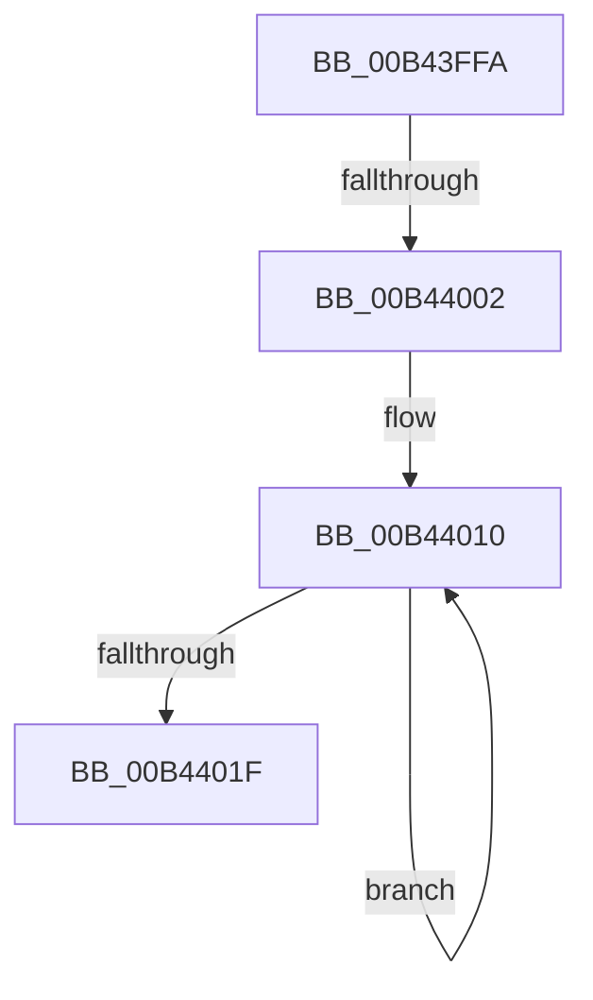

# sub_00B43FFA

- RVA: `0x00B43FFA`–`0x00B44028` (길이 `46` bytes)
- VA: `0x0000000140B43FFA`
- 실행 섹션: `PAGE`
- PDB 이름 있음: `아니요`; PDB Function 태그: `아니요`
- unwind 정보 RVA: `0x000B74F0`
- 디코드: `12`개 명령, `46/46` bytes 표시
- 미해석 바이트: `0` (있으면 어셈블리에 `.byte`로 보존)

> 이 문서는 커널 이미지의 기계어와 PDB 기호를 분석해 생성했습니다. 4번과 5번은 함수 원형과 자료형을 바이너리 사용 방식에서 추정한 C 해석이며 원본 소스 복구 결과는 아닙니다.

## 1. Dependencies

- 직접 호출 지점: **0**; 고유 호출 대상: **0**
- 직접 호출자로 확인된 함수: **0**
- RIP 상대 이미지 참조: **0**

### Outgoing calls
- 직접 디코드된 call 명령이 없습니다.

### Direct callers
- 이 함수 시작 RVA로 연결되는 직접 call은 확인되지 않았습니다. 간접 호출은 완전히 역산할 수 없습니다.

### Static image references
- 디코드된 RIP-relative 메모리 참조가 없습니다.

## 2. Other-region calls and transfers

- 다른 실행 섹션으로 향하는 call: **0**
- call이 아닌 외부 분기/꼬리 이동: **2**
  - `0x00B43FFC` → [PopIdleWakeSendDripsWakeSourceTelemetry + 0xCB](../A8/PopIdleWakeSendDripsWakeSourceTelemetry_function_00A83644.md) (`tail-transfer`)
  - `0x00B44023` → [PopIdleWakeSendDripsWakeSourceTelemetry + 0xCB](../A8/PopIdleWakeSendDripsWakeSourceTelemetry_function_00A83644.md) (`tail-transfer`)

## 3. Assembly (complete function range)

```asm
00B43FFA  85 D2                           test edx, edx
00B43FFC  0F 84 0D F7 F3 FF               je 0x140a8370f
00B44002  48 8D 45 90                     lea rax, [rbp - 0x70]
00B44006  44 8B CA                        mov r9d, edx
00B44009  48 8D BE 18 03 00 00            lea rdi, [rsi + 0x318]
00B44010  48 89 38                        mov qword ptr [rax], rdi
00B44013  48 83 C7 10                     add rdi, 0x10
00B44017  49 03 C5                        add rax, r13
00B4401A  4D 2B C8                        sub r9, r8
00B4401D  75 F1                           jne 0x140b44010
00B4401F  48 8B 7D A0                     mov rdi, qword ptr [rbp - 0x60]
00B44023  E9 E7 F6 F3 FF                  jmp 0x140a8370f
```

## 4. C-style interpretation (structured pseudocode)

```c
__int64 __fastcall sub_00B43FFA(__int64 a1, int a2, __int64 a3)
{
    __int64 result;
    __int64 v_rdi;

loc_00B44010:
    *(unsigned __int64 *)(v_rbp - 112) = v_rsi + 792;
    v_rdi = (v_rsi + 792) + (16);
    result = (v_rbp - 112) + (v_r13);
    a4 = ((unsigned int)(a2)) - (a3);
    if (condition_is_not_equal) goto loc_00B44010;
}
```

## 5. (Beta) C Style

```c
int64_t sub_00B43FFA(int64_t Arg1, int32_t Arg2, int64_t Arg3)
{
    int64_t result;
    int64_t local_rdi;

loc_00B44010:
    *(uint64_t *)(local_rbp - 0x70) = local_rsi + 792;
    local_rdi = (local_rsi + 792) + (16);
    result = (local_rbp - 112) + (local_r13);
    a4 = ((uint32_t)(Arg2)) - (Arg3);
    if (condition_is_not_equal) goto loc_00B44010;
}
```

## 6. Execution-region graph

[열기: 2D/3D 그래프와 함수 탐색 컨트롤 패널](../../../control-panel.html?section=page&rva=0x00B43FFA&view=graph)

- 2D 그래프는 위에서 아래로 흐르고, 3D 그래프는 빈 공간을 드래그해 회전합니다. Shift+드래그는 이동, 휠은 확대·축소, 함수 노드 선택은 대상 보고서 이동입니다.

### Static fallback


