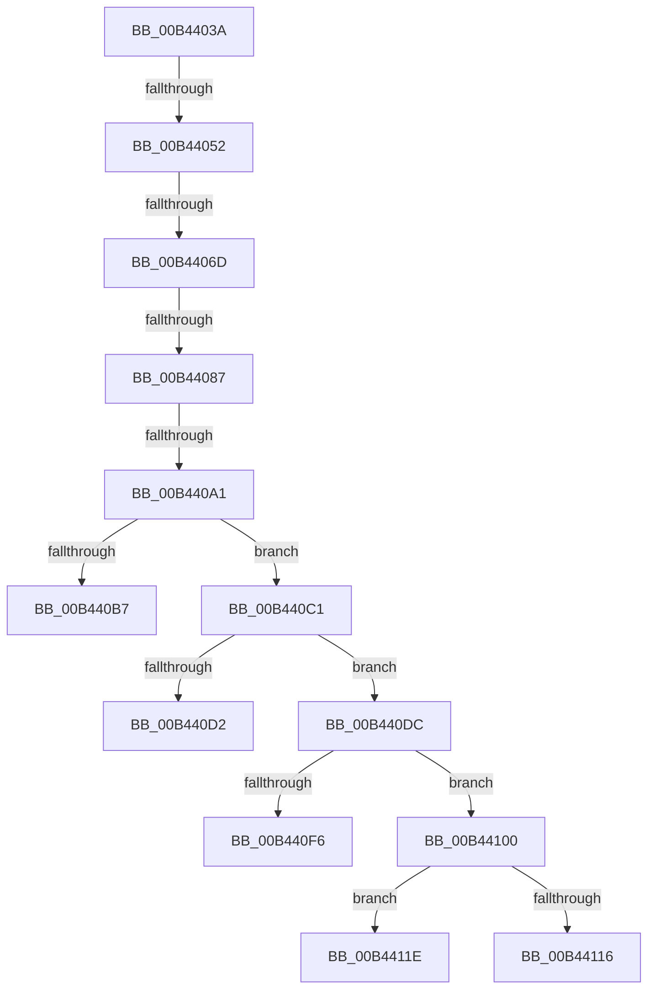

# sub_00B4403A

- RVA: `0x00B4403A`–`0x00B4412E` (길이 `244` bytes)
- VA: `0x0000000140B4403A`
- 실행 섹션: `PAGE`
- PDB 이름 있음: `아니요`; PDB Function 태그: `아니요`
- unwind 정보 RVA: `0x000B75D0`
- 디코드: `66`개 명령, `244/244` bytes 표시
- 미해석 바이트: `0` (있으면 어셈블리에 `.byte`로 보존)

> 이 문서는 커널 이미지의 기계어와 PDB 기호를 분석해 생성했습니다. 4번과 5번은 함수 원형과 자료형을 바이너리 사용 방식에서 추정한 C 해석이며 원본 소스 복구 결과는 아닙니다.

## 1. Dependencies

- 직접 호출 지점: **9**; 고유 호출 대상: **9**
- 직접 호출자로 확인된 함수: **0**
- RIP 상대 이미지 참조: **0**

### Outgoing calls
- `0x00B44043` → [RtlCreateSecurityDescriptor](../9F/RtlCreateSecurityDescriptor_function_009F1DF0.md) (function, `0x009F1DF0`)
- `0x00B4405E` → [RtlSetDaclSecurityDescriptor](../9E/RtlSetDaclSecurityDescriptor_function_009EC210.md) (function, `0x009EC210`)
- `0x00B44078` → [RtlSetOwnerSecurityDescriptor](../91/RtlSetOwnerSecurityDescriptor_function_00916F90.md) (function, `0x00916F90`)
- `0x00B44092` → [RtlSetGroupSecurityDescriptor](../A2/RtlSetGroupSecurityDescriptor_function_00A2EB10.md) (function, `0x00A2EB10`)
- `0x00B440AE` → [RtlValidSecurityDescriptor](../8B/RtlValidSecurityDescriptor_function_008BD3F0.md) (function, `0x008BD3F0`)
- `0x00B440C5` → [RtlLengthSecurityDescriptor](../8B/RtlLengthSecurityDescriptor_function_008BC870.md) (function, `0x008BC870`)
- `0x00B440E9` → [ExAllocatePool2](../../poolcode/B8/ExAllocatePool2_function_00B820F0.md) (function, `0x00B820F0`)
- `0x00B4410B` → [RtlAbsoluteToSelfRelativeSD](../A1/RtlAbsoluteToSelfRelativeSD_function_00A119B0.md) (function, `0x00A119B0`)
- `0x00B44123` → [ExFreePoolWithTag](../../poolcode/B8/ExFreePoolWithTag_function_00B82870.md) (function, `0x00B82870`)

### Direct callers
- 이 함수 시작 RVA로 연결되는 직접 call은 확인되지 않았습니다. 간접 호출은 완전히 역산할 수 없습니다.

### Static image references
- 디코드된 RIP-relative 메모리 참조가 없습니다.

## 2. Other-region calls and transfers

- 다른 실행 섹션으로 향하는 call: **2**
  - `0x00B440E9` → [ExAllocatePool2](../../poolcode/B8/ExAllocatePool2_function_00B820F0.md) (`PAGE` → `POOLCODE`)
  - `0x00B44123` → [ExFreePoolWithTag](../../poolcode/B8/ExFreePoolWithTag_function_00B82870.md) (`PAGE` → `POOLCODE`)
- call이 아닌 외부 분기/꼬리 이동: **9**
  - `0x00B4404C` → [_CmGetRegKeySecurityDescriptor + 0x24B](../A8/_CmGetRegKeySecurityDescriptor_function_00A83F34.md) (`tail-transfer`)
  - `0x00B44067` → [_CmGetRegKeySecurityDescriptor + 0x24B](../A8/_CmGetRegKeySecurityDescriptor_function_00A83F34.md) (`tail-transfer`)
  - `0x00B44081` → [_CmGetRegKeySecurityDescriptor + 0x24B](../A8/_CmGetRegKeySecurityDescriptor_function_00A83F34.md) (`tail-transfer`)
  - `0x00B4409B` → [_CmGetRegKeySecurityDescriptor + 0x24B](../A8/_CmGetRegKeySecurityDescriptor_function_00A83F34.md) (`tail-transfer`)
  - `0x00B440BC` → [_CmGetRegKeySecurityDescriptor + 0x24B](../A8/_CmGetRegKeySecurityDescriptor_function_00A83F34.md) (`tail-transfer`)
  - `0x00B440D7` → [_CmGetRegKeySecurityDescriptor + 0x24B](../A8/_CmGetRegKeySecurityDescriptor_function_00A83F34.md) (`tail-transfer`)
  - `0x00B440FB` → [_CmGetRegKeySecurityDescriptor + 0x24B](../A8/_CmGetRegKeySecurityDescriptor_function_00A83F34.md) (`tail-transfer`)
  - `0x00B44119` → [_CmGetRegKeySecurityDescriptor + 0x24B](../A8/_CmGetRegKeySecurityDescriptor_function_00A83F34.md) (`tail-transfer`)
  - `0x00B44129` → [_CmGetRegKeySecurityDescriptor + 0x24B](../A8/_CmGetRegKeySecurityDescriptor_function_00A83F34.md) (`tail-transfer`)

## 3. Assembly (complete function range)

```asm
00B4403A  BA 01 00 00 00                  mov edx, 1
00B4403F  48 8D 4D CF                     lea rcx, [rbp - 0x31]
00B44043  E8 A8 DD EA FF                  call 0x1409f1df0
00B44048  8B D8                           mov ebx, eax
00B4404A  85 C0                           test eax, eax
00B4404C  0F 88 2D 01 F4 FF               js 0x140a8417f
00B44052  45 33 C9                        xor r9d, r9d
00B44055  48 8D 4D CF                     lea rcx, [rbp - 0x31]
00B44059  4C 8B C6                        mov r8, rsi
00B4405C  B2 01                           mov dl, 1
00B4405E  E8 AD 81 EA FF                  call 0x1409ec210
00B44063  8B D8                           mov ebx, eax
00B44065  85 C0                           test eax, eax
00B44067  0F 88 12 01 F4 FF               js 0x140a8417f
00B4406D  41 B0 01                        mov r8b, 1
00B44070  48 8D 55 03                     lea rdx, [rbp + 3]
00B44074  48 8D 4D CF                     lea rcx, [rbp - 0x31]
00B44078  E8 13 2F DD FF                  call 0x140916f90
00B4407D  8B D8                           mov ebx, eax
00B4407F  85 C0                           test eax, eax
00B44081  0F 88 F8 00 F4 FF               js 0x140a8417f
00B44087  41 B0 01                        mov r8b, 1
00B4408A  48 8D 55 03                     lea rdx, [rbp + 3]
00B4408E  48 8D 4D CF                     lea rcx, [rbp - 0x31]
00B44092  E8 79 AA EE FF                  call 0x140a2eb10
00B44097  8B D8                           mov ebx, eax
00B44099  85 C0                           test eax, eax
00B4409B  0F 88 DE 00 F4 FF               js 0x140a8417f
00B440A1  B8 00 15 00 00                  mov eax, 0x1500
00B440A6  48 8D 4D CF                     lea rcx, [rbp - 0x31]
00B440AA  66 09 45 D1                     or word ptr [rbp - 0x2f], ax
00B440AE  E8 3D 93 D7 FF                  call 0x1408bd3f0
00B440B3  84 C0                           test al, al
00B440B5  75 0A                           jne 0x140b440c1
00B440B7  BB E5 00 00 C0                  mov ebx, 0xc00000e5
00B440BC  E9 BE 00 F4 FF                  jmp 0x140a8417f
00B440C1  48 8D 4D CF                     lea rcx, [rbp - 0x31]
00B440C5  E8 A6 87 D7 FF                  call 0x1408bc870
00B440CA  89 45 B7                        mov dword ptr [rbp - 0x49], eax
00B440CD  83 F8 28                        cmp eax, 0x28
00B440D0  73 0A                           jae 0x140b440dc
00B440D2  BB 3E 00 00 C0                  mov ebx, 0xc000003e
00B440D7  E9 A3 00 F4 FF                  jmp 0x140a8417f
00B440DC  8B D0                           mov edx, eax
00B440DE  B9 00 01 00 00                  mov ecx, 0x100
00B440E3  41 B8 50 4E 50 52               mov r8d, 0x52504e50
00B440E9  E8 02 E0 03 00                  call 0x140b820f0
00B440EE  48 8B F8                        mov rdi, rax
00B440F1  48 85 C0                        test rax, rax
00B440F4  75 0A                           jne 0x140b44100
00B440F6  BB 17 00 00 C0                  mov ebx, 0xc0000017
00B440FB  E9 7F 00 F4 FF                  jmp 0x140a8417f
00B44100  4C 8D 45 B7                     lea r8, [rbp - 0x49]
00B44104  48 8B D7                        mov rdx, rdi
00B44107  48 8D 4D CF                     lea rcx, [rbp - 0x31]
00B4410B  E8 A0 D8 EC FF                  call 0x140a119b0
00B44110  8B D8                           mov ebx, eax
00B44112  85 C0                           test eax, eax
00B44114  78 08                           js 0x140b4411e
00B44116  49 89 3F                        mov qword ptr [r15], rdi
00B44119  E9 61 00 F4 FF                  jmp 0x140a8417f
00B4411E  33 D2                           xor edx, edx
00B44120  48 8B CF                        mov rcx, rdi
00B44123  E8 48 E7 03 00                  call 0x140b82870
00B44128  90                              nop
00B44129  E9 51 00 F4 FF                  jmp 0x140a8417f
```

## 4. C-style interpretation (structured pseudocode)

```c
__int64 __fastcall sub_00B4403A(__int64 a1, __int64 a2, __int64 a3, int a4)
{
    __int64 result;

    result = RtlCreateSecurityDescriptor(v_rbp - 49, 1, a3, a4);
    a4 = 0;
    result = RtlSetDaclSecurityDescriptor(v_rbp - 49, 1, v_rsi, a4);
    result = RtlSetOwnerSecurityDescriptor(v_rbp - 49, v_rbp + 3, 1, a4);
    result = RtlSetGroupSecurityDescriptor(v_rbp - 49, v_rbp + 3, 1, a4);
    result = RtlValidSecurityDescriptor(v_rbp - 49, v_rbp + 3, 1, a4);
    if ((unsigned __int8)(result) != 0) goto loc_00B440C1;
loc_00B440C1:
    result = RtlLengthSecurityDescriptor(v_rbp - 49, v_rbp + 3, 1, a4);
    *(unsigned int *)(v_rbp - 73) = (unsigned int)(result);
    if (((unsigned int)(result)) >= 40) goto loc_00B440DC;
loc_00B440DC:
    result = ExAllocatePool2(256, (unsigned int)((unsigned int)(result)), (unsigned int)(0x52504E50ULL), a4);
    if (result != 0) goto loc_00B44100;
loc_00B44100:
    result = RtlAbsoluteToSelfRelativeSD(v_rbp - 49, result, v_rbp - 73, a4);
    if (sign_flag) goto loc_00B4411E;
    *(unsigned __int64 *)(v_r15) = result;
loc_00B4411E:
    a2 = 0;
    result = ExFreePoolWithTag(result, a2, v_rbp - 73, a4);
}
```

## 5. (Beta) C Style

```c
int64_t sub_00B4403A(int64_t Arg1, int64_t Arg2, int64_t Arg3, int32_t Arg4)
{
    int64_t result;

    result = RtlCreateSecurityDescriptor(local_rbp - 49, 1, Arg3, Arg4);
    Arg4 = 0;
    result = RtlSetDaclSecurityDescriptor(local_rbp - 49, 1, local_rsi, Arg4);
    result = RtlSetOwnerSecurityDescriptor(local_rbp - 49, local_rbp + 3, 1, Arg4);
    result = RtlSetGroupSecurityDescriptor(local_rbp - 49, local_rbp + 3, 1, Arg4);
    result = RtlValidSecurityDescriptor(local_rbp - 49, local_rbp + 3, 1, Arg4);
    if ((uint8_t)(result) != 0) goto loc_00B440C1;
loc_00B440C1:
    result = RtlLengthSecurityDescriptor(local_rbp - 49, local_rbp + 3, 1, Arg4);
    *(uint32_t *)(local_rbp - 0x49) = (uint32_t)(result);
    if (((uint32_t)(result)) >= 40) goto loc_00B440DC;
loc_00B440DC:
    result = ExAllocatePool2(256, (uint32_t)((uint32_t)(result)), (uint32_t)(0x52504E50ULL), Arg4);
    if (result != 0) goto loc_00B44100;
loc_00B44100:
    result = RtlAbsoluteToSelfRelativeSD(local_rbp - 49, result, local_rbp - 73, Arg4);
    if (sign_flag) goto loc_00B4411E;
    *(uint64_t *)(local_r15) = result;
loc_00B4411E:
    Arg2 = 0;
    result = ExFreePoolWithTag(result, Arg2, local_rbp - 73, Arg4);
}
```

## 6. Execution-region graph

[열기: 2D/3D 그래프와 함수 탐색 컨트롤 패널](../../../control-panel.html?section=page&rva=0x00B4403A&view=graph)

- 2D 그래프는 위에서 아래로 흐르고, 3D 그래프는 빈 공간을 드래그해 회전합니다. Shift+드래그는 이동, 휠은 확대·축소, 함수 노드 선택은 대상 보고서 이동입니다.

### Static fallback


