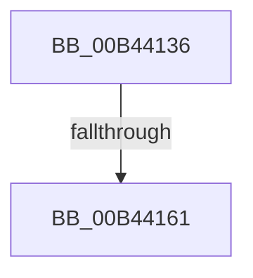

# sub_00B44136

- RVA: `0x00B44136`–`0x00B441F0` (길이 `186` bytes)
- VA: `0x0000000140B44136`
- 실행 섹션: `PAGE`
- PDB 이름 있음: `아니요`; PDB Function 태그: `아니요`
- unwind 정보 RVA: `0x000B7690`
- 디코드: `43`개 명령, `186/186` bytes 표시
- 미해석 바이트: `0` (있으면 어셈블리에 `.byte`로 보존)

> 이 문서는 커널 이미지의 기계어와 PDB 기호를 분석해 생성했습니다. 4번과 5번은 함수 원형과 자료형을 바이너리 사용 방식에서 추정한 C 해석이며 원본 소스 복구 결과는 아닙니다.

## 1. Dependencies

- 직접 호출 지점: **2**; 고유 호출 대상: **2**
- 직접 호출자로 확인된 함수: **0**
- RIP 상대 이미지 참조: **2**

### Outgoing calls
- `0x00B44168` → [tlgCreate1Sz_char](../../text/42/tlgCreate1Sz_char_function_00427304.md) (function, `0x00427304`)
- `0x00B441E5` → [tlgWriteTransfer_EtwWriteTransfer](../../text/42/tlgWriteTransfer_EtwWriteTransfer_function_004260E0.md) (function, `0x004260E0`)

### Direct callers
- 이 함수 시작 RVA로 연결되는 직접 call은 확인되지 않았습니다. 간접 호출은 완전히 역산할 수 없습니다.

### Static image references
- `0x00B44154` → RVA `0x00E07748` (`.data`; read)
- `0x00B44179` → RVA `0x000498B1` (`.rdata`; read)

## 2. Other-region calls and transfers

- 다른 실행 섹션으로 향하는 call: **2**
  - `0x00B44168` → [tlgCreate1Sz_char](../../text/42/tlgCreate1Sz_char_function_00427304.md) (`PAGE` → `.text`)
  - `0x00B441E5` → [tlgWriteTransfer_EtwWriteTransfer](../../text/42/tlgWriteTransfer_EtwWriteTransfer_function_004260E0.md) (`PAGE` → `.text`)
- call이 아닌 외부 분기/꼬리 이동: **2**
  - `0x00B4415B` → [PopDiagTraceBatteryTriggerFlags + 0x58](../A8/PopDiagTraceBatteryTriggerFlags_function_00A84A50.md) (`tail-transfer`)
  - `0x00B441EB` → [PopDiagTraceBatteryTriggerFlags + 0x58](../A8/PopDiagTraceBatteryTriggerFlags_function_00A84A50.md) (`tail-transfer`)

## 3. Assembly (complete function range)

```asm
00B44136  45 89 84 81 80 B5 E0 00         mov dword ptr [r9 + rax*4 + 0xe0b580], r8d
00B4413E  45 8B D0                        mov r10d, r8d
00B44141  45 8B C8                        mov r9d, r8d
00B44144  41 D1 EA                        shr r10d, 1
00B44147  41 C1 E9 07                     shr r9d, 7
00B4414B  44 22 D6                        and r10b, sil
00B4414E  44 22 CE                        and r9b, sil
00B44151  44 22 C6                        and r8b, sil
00B44154  83 3D ED 35 2C 00 05            cmp dword ptr [rip + 0x2c35ed], 5
00B4415B  0F 86 47 09 F4 FF               jbe 0x140a84aa8
00B44161  48 8B D3                        mov rdx, rbx
00B44164  48 8D 4D E7                     lea rcx, [rbp - 0x19]
00B44168  E8 97 31 8E FF                  call 0x140427304
00B4416D  48 8D 45 B7                     lea rax, [rbp - 0x49]
00B44171  44 88 4D B7                     mov byte ptr [rbp - 0x49], r9b
00B44175  48 89 45 F7                     mov qword ptr [rbp - 9], rax
00B44179  48 8D 15 31 57 50 FF            lea rdx, [rip - 0xafa8cf]
00B44180  48 8D 45 B8                     lea rax, [rbp - 0x48]
00B44184  44 88 45 B9                     mov byte ptr [rbp - 0x47], r8b
00B44188  48 89 45 07                     mov qword ptr [rbp + 7], rax
00B4418C  48 8D 0D B5 35 2C 00            lea rcx, [rip + 0x2c35b5]
00B44193  48 8D 45 B9                     lea rax, [rbp - 0x47]
00B44197  48 89 75 FF                     mov qword ptr [rbp - 1], rsi
00B4419B  48 89 45 17                     mov qword ptr [rbp + 0x17], rax
00B4419F  45 33 C9                        xor r9d, r9d
00B441A2  48 8D 45 BA                     lea rax, [rbp - 0x46]
00B441A6  44 88 55 B8                     mov byte ptr [rbp - 0x48], r10b
00B441AA  48 89 45 27                     mov qword ptr [rbp + 0x27], rax
00B441AE  45 33 C0                        xor r8d, r8d
00B441B1  48 8D 45 BB                     lea rax, [rbp - 0x45]
00B441B5  48 89 75 0F                     mov qword ptr [rbp + 0xf], rsi
00B441B9  48 89 45 37                     mov qword ptr [rbp + 0x37], rax
00B441BD  48 8D 45 C7                     lea rax, [rbp - 0x39]
00B441C1  48 89 44 24 28                  mov qword ptr [rsp + 0x28], rax
00B441C6  C7 44 24 20 08 00 00 00         mov dword ptr [rsp + 0x20], 8
00B441CE  48 89 75 1F                     mov qword ptr [rbp + 0x1f], rsi
00B441D2  44 88 5D BA                     mov byte ptr [rbp - 0x46], r11b
00B441D6  48 89 75 2F                     mov qword ptr [rbp + 0x2f], rsi
00B441DA  89 7D BB                        mov dword ptr [rbp - 0x45], edi
00B441DD  48 C7 45 3F 04 00 00 00         mov qword ptr [rbp + 0x3f], 4
00B441E5  E8 F6 1E 8E FF                  call 0x1404260e0
00B441EA  90                              nop
00B441EB  E9 B8 08 F4 FF                  jmp 0x140a84aa8
```

## 4. C-style interpretation (structured pseudocode)

```c
__int64 __fastcall sub_00B44136(__int64 a1, __int64 a2, int a3, __int64 a4)
{
    __int64 result;
    __int64 v_r10;
    unsigned int v_stack_p20;
    unsigned __int64 v_stack_p28;

    *(unsigned int *)(a4 + result * 4 + 14726528) = a3;
    v_r10 = (unsigned int)(((unsigned int)(a3)) >> (1));
    a4 = (unsigned int)(((unsigned int)(a3)) >> (7));
    v_r10 = (unsigned __int8)((v_r10) & ((unsigned __int8)(v_rsi)));
    a4 = (unsigned __int8)((a4) & ((unsigned __int8)(v_rsi)));
    a3 = (unsigned __int8)((a3) & ((unsigned __int8)(v_rsi)));
    result = tlgCreate1Sz_char(v_rbp - 25, v_rbx, a3, a4);
    *(unsigned __int8 *)(v_rbp - 73) = (unsigned __int8)(a4);
    *(unsigned __int64 *)(v_rbp - 9) = v_rbp - 73;
    *(unsigned __int8 *)(v_rbp - 71) = (unsigned __int8)(a3);
    *(unsigned __int64 *)(v_rbp + 7) = v_rbp - 72;
    *(unsigned __int64 *)(v_rbp - 1) = v_rsi;
    *(unsigned __int64 *)(v_rbp + 23) = v_rbp - 71;
    a4 = 0;
    *(unsigned __int8 *)(v_rbp - 72) = (unsigned __int8)(v_r10);
    *(unsigned __int64 *)(v_rbp + 39) = v_rbp - 70;
    a3 = 0;
    *(unsigned __int64 *)(v_rbp + 15) = v_rsi;
    *(unsigned __int64 *)(v_rbp + 55) = v_rbp - 69;
    v_stack_p28 = v_rbp - 57;
    v_stack_p20 = 8;
    *(unsigned __int64 *)(v_rbp + 31) = v_rsi;
    *(unsigned __int8 *)(v_rbp - 70) = (unsigned __int8)(v_r11);
    *(unsigned __int64 *)(v_rbp + 47) = v_rsi;
    *(unsigned int *)(v_rbp - 69) = (unsigned int)(v_rdi);
    *(unsigned __int64 *)(v_rbp + 63) = 4;
    result = tlgWriteTransfer_EtwWriteTransfer(v_rip + 2897333, v_rip - 11512015, a3, a4);
}
```

## 5. (Beta) C Style

```c
int64_t sub_00B44136(int64_t Arg1, int64_t Arg2, int32_t Arg3, void *Arg4)
{
    uint8_t *arg4 = (uint8_t *)Arg4;

    int64_t result;
    int64_t local_r10;
    uint32_t v_stack_p20;
    uint64_t v_stack_p28;

    *(uint32_t *)(arg4 + result * 4 + 0xE0B580) = Arg3;
    local_r10 = (uint32_t)(((uint32_t)(Arg3)) >> (1));
    Arg4 = (uint32_t)(((uint32_t)(Arg3)) >> (7));
    local_r10 = (uint8_t)((local_r10) & ((uint8_t)(local_rsi)));
    Arg4 = (uint8_t)((Arg4) & ((uint8_t)(local_rsi)));
    Arg3 = (uint8_t)((Arg3) & ((uint8_t)(local_rsi)));
    result = tlgCreate1Sz_char(local_rbp - 25, local_rbx, Arg3, Arg4);
    *(uint8_t *)(local_rbp - 0x49) = (uint8_t)(Arg4);
    *(uint64_t *)(local_rbp - 0x9) = local_rbp - 73;
    *(uint8_t *)(local_rbp - 0x47) = (uint8_t)(Arg3);
    *(uint64_t *)(local_rbp + 0x7) = local_rbp - 72;
    *(uint64_t *)(local_rbp - 0x1) = local_rsi;
    *(uint64_t *)(local_rbp + 0x17) = local_rbp - 71;
    Arg4 = 0;
    *(uint8_t *)(local_rbp - 0x48) = (uint8_t)(local_r10);
    *(uint64_t *)(local_rbp + 0x27) = local_rbp - 70;
    Arg3 = 0;
    *(uint64_t *)(local_rbp + 0xF) = local_rsi;
    *(uint64_t *)(local_rbp + 0x37) = local_rbp - 69;
    v_stack_p28 = local_rbp - 57;
    v_stack_p20 = 8;
    *(uint64_t *)(local_rbp + 0x1F) = local_rsi;
    *(uint8_t *)(local_rbp - 0x46) = (uint8_t)(local_r11);
    *(uint64_t *)(local_rbp + 0x2F) = local_rsi;
    *(uint32_t *)(local_rbp - 0x45) = (uint32_t)(local_rdi);
    *(uint64_t *)(local_rbp + 0x3F) = 4;
    result = tlgWriteTransfer_EtwWriteTransfer(v_rip + 2897333, v_rip - 11512015, Arg3, Arg4);
}
```

### 관측된 메모리 오프셋

구조체 형식이 확인되지 않은 접근은 인자 기준의 오프셋으로만 기록했습니다.

| 기준 인자 | 오프셋 표현 | 폭 (bit) | 접근 |
|---|---:|---:|---|
| `Arg4` | `+ 0xE0B580 + rax*4` | `32` | `W` |

## 6. Execution-region graph

[열기: 2D/3D 그래프와 함수 탐색 컨트롤 패널](../../../control-panel.html?section=page&rva=0x00B44136&view=graph)

- 2D 그래프는 위에서 아래로 흐르고, 3D 그래프는 빈 공간을 드래그해 회전합니다. Shift+드래그는 이동, 휠은 확대·축소, 함수 노드 선택은 대상 보고서 이동입니다.

### Static fallback


