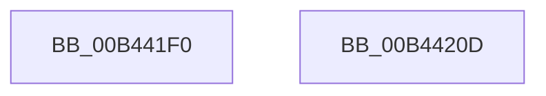

# sub_00B441F0

- RVA: `0x00B441F0`–`0x00B44215` (길이 `37` bytes)
- VA: `0x0000000140B441F0`
- 실행 섹션: `PAGE`
- PDB 이름 있음: `아니요`; PDB Function 태그: `아니요`
- unwind 정보 RVA: `0x000B7828`
- 디코드: `9`개 명령, `37/37` bytes 표시
- 미해석 바이트: `0` (있으면 어셈블리에 `.byte`로 보존)

> 이 문서는 커널 이미지의 기계어와 PDB 기호를 분석해 생성했습니다. 4번과 5번은 함수 원형과 자료형을 바이너리 사용 방식에서 추정한 C 해석이며 원본 소스 복구 결과는 아닙니다.

## 1. Dependencies

- 직접 호출 지점: **1**; 고유 호출 대상: **1**
- 직접 호출자로 확인된 함수: **0**
- RIP 상대 이미지 참조: **0**

### Outgoing calls
- `0x00B441F7` → [KeIsEmptyAffinityEx](../../text/2D/KeIsEmptyAffinityEx_function_002D1580.md) (function, `0x002D1580`)

### Direct callers
- 이 함수 시작 RVA로 연결되는 직접 call은 확인되지 않았습니다. 간접 호출은 완전히 역산할 수 없습니다.

### Static image references
- 디코드된 RIP-relative 메모리 참조가 없습니다.

## 2. Other-region calls and transfers

- 다른 실행 섹션으로 향하는 call: **1**
  - `0x00B441F7` → [KeIsEmptyAffinityEx](../../text/2D/KeIsEmptyAffinityEx_function_002D1580.md) (`PAGE` → `.text`)
- call이 아닌 외부 분기/꼬리 이동: **2**
  - `0x00B44208` → [PpmParkParkingAvailable + 0x9D](../A8/PpmParkParkingAvailable_function_00A84F58.md) (`tail-transfer`)
  - `0x00B44210` → [PpmParkParkingAvailable + 0xA6](../A8/PpmParkParkingAvailable_function_00A84F58.md) (`tail-transfer`)

## 3. Assembly (complete function range)

```asm
00B441F0  48 8D 8E 30 01 00 00            lea rcx, [rsi + 0x130]
00B441F7  E8 84 D3 78 FF                  call 0x1402d1580
00B441FC  85 C0                           test eax, eax
00B441FE  0F B6 DB                        movzx ebx, bl
00B44201  41 0F 44 DC                     cmove ebx, r12d
00B44205  45 03 F4                        add r14d, r12d
00B44208  E9 E8 0D F4 FF                  jmp 0x140a84ff5
00B4420D  41 8A DC                        mov bl, r12b
00B44210  E9 E9 0D F4 FF                  jmp 0x140a84ffe
```

## 4. C-style interpretation (structured pseudocode)

```c
__int64 __fastcall sub_00B441F0(void)
{
    __int64 result;
    __int64 v_r14;
    __int64 v_rbx;

    result = KeIsEmptyAffinityEx(v_rsi + 304, a2, a3, a4);
    v_rbx = (unsigned __int8)(v_rbx);
    if ((unsigned int)(result) == 0) { v_rbx = (unsigned int)(v_r12); }
    v_r14 = (unsigned int)((v_r14) + ((unsigned int)(v_r12)));
}
```

## 5. (Beta) C Style

```c
void sub_00B441F0(void)
{
    int64_t result;
    int64_t local_r14;
    int64_t local_rbx;

    result = KeIsEmptyAffinityEx(local_rsi + 304, a2, a3, a4);
    local_rbx = (uint8_t)(local_rbx);
    if ((uint32_t)(result) == 0) { local_rbx = (uint32_t)(local_r12); }
    local_r14 = (uint32_t)((local_r14) + ((uint32_t)(local_r12)));
}
```

## 6. Execution-region graph

[열기: 2D/3D 그래프와 함수 탐색 컨트롤 패널](../../../control-panel.html?section=page&rva=0x00B441F0&view=graph)

- 2D 그래프는 위에서 아래로 흐르고, 3D 그래프는 빈 공간을 드래그해 회전합니다. Shift+드래그는 이동, 휠은 확대·축소, 함수 노드 선택은 대상 보고서 이동입니다.

### Static fallback


