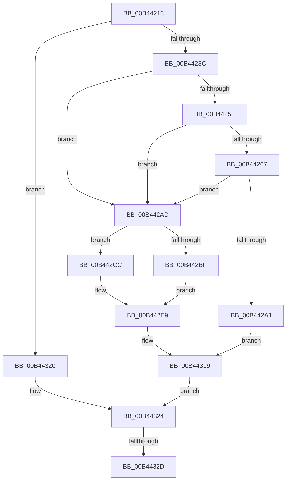

# sub_00B44216

- RVA: `0x00B44216`–`0x00B4433B` (길이 `293` bytes)
- VA: `0x0000000140B44216`
- 실행 섹션: `PAGE`
- PDB 이름 있음: `아니요`; PDB Function 태그: `아니요`
- unwind 정보 RVA: `0x000B79C0`
- 디코드: `75`개 명령, `293/293` bytes 표시
- 미해석 바이트: `0` (있으면 어셈블리에 `.byte`로 보존)

> 이 문서는 커널 이미지의 기계어와 PDB 기호를 분석해 생성했습니다. 4번과 5번은 함수 원형과 자료형을 바이너리 사용 방식에서 추정한 C 해석이며 원본 소스 복구 결과는 아닙니다.

## 1. Dependencies

- 직접 호출 지점: **10**; 고유 호출 대상: **10**
- 직접 호출자로 확인된 함수: **0**
- RIP 상대 이미지 참조: **1**

### Outgoing calls
- `0x00B4422D` → [CmObReferenceObjectByHandle](../../pagecmrc/BC/CmObReferenceObjectByHandle_function_00BC9350.md) (function, `0x00BC9350`)
- `0x00B4425E` → [CmpIsRegistryLockAcquired](../../text/45/CmpIsRegistryLockAcquired_function_00456A7C.md) (function, `0x00456A7C`)
- `0x00B44298` → [CmpCallCallBacksEx](../86/CmpCallCallBacksEx_function_00865F40.md) (function, `0x00865F40`)
- `0x00B442B1` → [CmpAttachToRegistryProcess](../../pagecmrc/BC/CmpAttachToRegistryProcess_function_00BC98E0.md) (function, `0x00BC98E0`)
- `0x00B442C5` → [CmDumpKeyToFile](../7D/CmDumpKeyToFile_function_007DCD64.md) (function, `0x007DCD64`)
- `0x00B442E4` → [CmSaveKey](../7D/CmSaveKey_function_007DDBDC.md) (function, `0x007DDBDC`)
- `0x00B442EF` → [CmpDetachFromRegistryProcess](../../pagecmrc/BC/CmpDetachFromRegistryProcess_function_00BC9920.md) (function, `0x00BC9920`)
- `0x00B44312` → [CmPostCallbackNotificationEx](../86/CmPostCallbackNotificationEx_function_00865E50.md) (function, `0x00865E50`)
- `0x00B44319` → [KeLeaveCriticalRegion](../../text/25/KeLeaveCriticalRegion_function_0025D8B0.md) (function, `0x0025D8B0`)
- `0x00B44330` → [ObfDereferenceObject](../../text/2F/ObfDereferenceObject_function_002F9350.md) (function, `0x002F9350`)

### Direct callers
- 이 함수 시작 RVA로 연결되는 직접 call은 확인되지 않았습니다. 간접 호출은 완전히 역산할 수 없습니다.

### Static image references
- `0x00B44255` → RVA `0x00EEFB88` (`.data`; read)

## 2. Other-region calls and transfers

- 다른 실행 섹션으로 향하는 call: **6**
  - `0x00B4422D` → [CmObReferenceObjectByHandle](../../pagecmrc/BC/CmObReferenceObjectByHandle_function_00BC9350.md) (`PAGE` → `PAGECMRC`)
  - `0x00B4425E` → [CmpIsRegistryLockAcquired](../../text/45/CmpIsRegistryLockAcquired_function_00456A7C.md) (`PAGE` → `.text`)
  - `0x00B442B1` → [CmpAttachToRegistryProcess](../../pagecmrc/BC/CmpAttachToRegistryProcess_function_00BC98E0.md) (`PAGE` → `PAGECMRC`)
  - `0x00B442EF` → [CmpDetachFromRegistryProcess](../../pagecmrc/BC/CmpDetachFromRegistryProcess_function_00BC9920.md) (`PAGE` → `PAGECMRC`)
  - `0x00B44319` → [KeLeaveCriticalRegion](../../text/25/KeLeaveCriticalRegion_function_0025D8B0.md) (`PAGE` → `.text`)
  - `0x00B44330` → [ObfDereferenceObject](../../text/2F/ObfDereferenceObject_function_002F9350.md) (`PAGE` → `.text`)
- call이 아닌 외부 분기/꼬리 이동: **2**
  - `0x00B44327` → [NtSaveKeyEx + 0x102](../A8/NtSaveKeyEx_function_00A853C0.md) (`tail-transfer`)
  - `0x00B44336` → [NtSaveKeyEx + 0x102](../A8/NtSaveKeyEx_function_00A853C0.md) (`tail-transfer`)

## 3. Assembly (complete function range)

```asm
00B44216  48 83 64 24 28 00               and qword ptr [rsp + 0x28], 0
00B4421C  48 8D 45 8F                     lea rax, [rbp - 0x71]
00B44220  45 8A CF                        mov r9b, r15b
00B44223  48 89 44 24 20                  mov qword ptr [rsp + 0x20], rax
00B44228  33 D2                           xor edx, edx
00B4422A  48 8B CE                        mov rcx, rsi
00B4422D  E8 1E 51 08 00                  call 0x140bc9350
00B44232  8B D8                           mov ebx, eax
00B44234  85 C0                           test eax, eax
00B44236  0F 88 E4 00 00 00               js 0x140b44320
00B4423C  65 48 8B 04 25 88 01 00 00      mov rax, qword ptr gs:[0x188]
00B44245  48 8B 75 8F                     mov rsi, qword ptr [rbp - 0x71]
00B44249  48 8B 7D 87                     mov rdi, qword ptr [rbp - 0x79]
00B4424D  66 FF 88 E4 01 00 00            dec word ptr [rax + 0x1e4]
00B44254  90                              nop
00B44255  83 3D 2C B9 3A 00 00            cmp dword ptr [rip + 0x3ab92c], 0
00B4425C  74 4F                           je 0x140b442ad
00B4425E  E8 19 28 91 FF                  call 0x140456a7c
00B44263  85 C0                           test eax, eax
00B44265  75 46                           jne 0x140b442ad
00B44267  45 33 C0                        xor r8d, r8d
00B4426A  48 89 75 BF                     mov qword ptr [rbp - 0x41], rsi
00B4426E  48 8D 45 97                     lea rax, [rbp - 0x69]
00B44272  48 89 7D C7                     mov qword ptr [rbp - 0x39], rdi
00B44276  48 89 44 24 30                  mov qword ptr [rsp + 0x30], rax
00B4427B  48 8D 55 BF                     lea rdx, [rbp - 0x41]
00B4427F  48 83 64 24 28 00               and qword ptr [rsp + 0x28], 0
00B44285  41 B1 01                        mov r9b, 1
00B44288  41 8D 48 2B                     lea ecx, [r8 + 0x2b]
00B4428C  44 89 75 CF                     mov dword ptr [rbp - 0x31], r14d
00B44290  C7 44 24 20 2C 00 00 00         mov dword ptr [rsp + 0x20], 0x2c
00B44298  E8 A3 1C D2 FF                  call 0x140865f40
00B4429D  85 C0                           test eax, eax
00B4429F  79 0C                           jns 0x140b442ad
00B442A1  33 DB                           xor ebx, ebx
00B442A3  3D 03 05 00 C0                  cmp eax, 0xc0000503
00B442A8  0F 45 D8                        cmovne ebx, eax
00B442AB  EB 6C                           jmp 0x140b44319
00B442AD  48 8D 4D EF                     lea rcx, [rbp - 0x11]
00B442B1  E8 2A 56 08 00                  call 0x140bc98e0
00B442B6  48 8B CE                        mov rcx, rsi
00B442B9  41 83 FE 04                     cmp r14d, 4
00B442BD  75 0D                           jne 0x140b442cc
00B442BF  4C 8B C7                        mov r8, rdi
00B442C2  41 8A D7                        mov dl, r15b
00B442C5  E8 9A 8A C9 FF                  call 0x1407dcd64
00B442CA  EB 1D                           jmp 0x140b442e9
00B442CC  41 B8 05 00 00 00               mov r8d, 5
00B442D2  41 83 FE 02                     cmp r14d, 2
00B442D6  45 8A CF                        mov r9b, r15b
00B442D9  48 8B D7                        mov rdx, rdi
00B442DC  41 8D 40 FE                     lea eax, [r8 - 2]
00B442E0  44 0F 45 C0                     cmovne r8d, eax
00B442E4  E8 F3 98 C9 FF                  call 0x1407ddbdc
00B442E9  48 8D 4D EF                     lea rcx, [rbp - 0x11]
00B442ED  8B D8                           mov ebx, eax
00B442EF  E8 2C 56 08 00                  call 0x140bc9920
00B442F4  48 8D 45 97                     lea rax, [rbp - 0x69]
00B442F8  44 8B C3                        mov r8d, ebx
00B442FB  48 89 44 24 28                  mov qword ptr [rsp + 0x28], rax
00B44300  4C 8D 4D BF                     lea r9, [rbp - 0x41]
00B44304  48 83 64 24 20 00               and qword ptr [rsp + 0x20], 0
00B4430A  48 8B D6                        mov rdx, rsi
00B4430D  B9 2C 00 00 00                  mov ecx, 0x2c
00B44312  E8 39 1B D2 FF                  call 0x140865e50
00B44317  8B D8                           mov ebx, eax
00B44319  E8 92 95 71 FF                  call 0x14025d8b0
00B4431E  EB 04                           jmp 0x140b44324
00B44320  48 8B 75 8F                     mov rsi, qword ptr [rbp - 0x71]
00B44324  48 85 F6                        test rsi, rsi
00B44327  0F 84 95 11 F4 FF               je 0x140a854c2
00B4432D  48 8B CE                        mov rcx, rsi
00B44330  E8 1B 50 7B FF                  call 0x1402f9350
00B44335  90                              nop
00B44336  E9 87 11 F4 FF                  jmp 0x140a854c2
```

## 4. C-style interpretation (structured pseudocode)

```c
__int64 __fastcall sub_00B44216(__int64 a1, int a2, int a3, __int64 a4, __int64 a5)
{
    __int64 result;
    __int64 v_rbx;
    unsigned __int64 v_stack_p20;
    unsigned __int64 v_stack_p28;
    unsigned __int64 v_stack_p30;

    v_stack_p20 = v_rbp - 113;
    a2 = 0;
    result = CmObReferenceObjectByHandle(v_rsi, a2, a3, (unsigned __int8)(v_r15));
    if (sign_flag) goto loc_00B44320;
    if ((*(unsigned int *)(v_rip + 3848492)) == 0) goto loc_00B442AD;
    result = CmpIsRegistryLockAcquired(v_rsi, a2, a3, (unsigned __int8)(v_r15));
    if ((unsigned int)(result) != 0) goto loc_00B442AD;
    a3 = 0;
    *(unsigned __int64 *)(v_rbp - 65) = *(unsigned __int64 *)(v_rbp - 113);
    *(unsigned __int64 *)(v_rbp - 57) = *(unsigned __int64 *)(v_rbp - 121);
    v_stack_p30 = v_rbp - 105;
    *(unsigned int *)(v_rbp - 49) = (unsigned int)(v_r14);
    v_stack_p20 = 44;
    result = CmpCallCallBacksEx(a3 + 43, v_rbp - 65, a3, 1);
    if (!sign_flag) goto loc_00B442AD;
    v_rbx = 0;
    if (((unsigned int)(result)) != 0xC0000503ULL) { v_rbx = (unsigned int)(result); }
    goto loc_00B44319;
loc_00B442AD:
    result = CmpAttachToRegistryProcess(v_rbp - 17, v_rbp - 65, a3, 1);
    if (((unsigned int)(v_r14)) != 4) goto loc_00B442CC;
    result = CmDumpKeyToFile(*(unsigned __int64 *)(v_rbp - 113), (unsigned __int8)(v_r15), *(unsigned __int64 *)(v_rbp - 121), 1);
    goto loc_00B442E9;
loc_00B442CC:
    a3 = 5;
    if (((unsigned int)(v_r14)) != 2) { a3 = (unsigned int)(5 - 2); }
    result = CmSaveKey(*(unsigned __int64 *)(v_rbp - 113), *(unsigned __int64 *)(v_rbp - 121), a3, (unsigned __int8)(v_r15));
loc_00B442E9:
    result = CmpDetachFromRegistryProcess(v_rbp - 17, *(unsigned __int64 *)(v_rbp - 121), a3, (unsigned __int8)(v_r15));
    v_stack_p28 = v_rbp - 105;
    result = CmPostCallbackNotificationEx(44, *(unsigned __int64 *)(v_rbp - 113), (unsigned int)((unsigned int)((unsigned int)((unsigned int)(result)))), v_rbp - 65);
loc_00B44319:
    result = KeLeaveCriticalRegion(44, *(unsigned __int64 *)(v_rbp - 113), (unsigned int)((unsigned int)((unsigned int)((unsigned int)(result)))), v_rbp - 65);
    goto loc_00B44324;
loc_00B44320:
loc_00B44324:
    result = ObfDereferenceObject(*(unsigned __int64 *)(v_rbp - 113), *(unsigned __int64 *)(v_rbp - 113), (unsigned int)((unsigned int)((unsigned int)((unsigned int)(result)))), v_rbp - 65);
}
```

## 5. (Beta) C Style

```c
int64_t sub_00B44216(int64_t Arg1, int32_t Arg2, int32_t Arg3, int64_t Arg4, int64_t Arg5)
{
    int64_t result;
    int64_t local_rbx;
    uint64_t v_stack_p20;
    uint64_t v_stack_p28;
    uint64_t v_stack_p30;

    v_stack_p20 = local_rbp - 113;
    Arg2 = 0;
    result = CmObReferenceObjectByHandle(local_rsi, Arg2, Arg3, (uint8_t)(local_r15));
    if (sign_flag) goto loc_00B44320;
    if ((*(uint32_t *)(v_rip + 0x3AB92C)) == 0) goto loc_00B442AD;
    result = CmpIsRegistryLockAcquired(local_rsi, Arg2, Arg3, (uint8_t)(local_r15));
    if ((uint32_t)(result) != 0) goto loc_00B442AD;
    Arg3 = 0;
    *(uint64_t *)(local_rbp - 0x41) = *(uint64_t *)(local_rbp - 0x71);
    *(uint64_t *)(local_rbp - 0x39) = *(uint64_t *)(local_rbp - 0x79);
    v_stack_p30 = local_rbp - 105;
    *(uint32_t *)(local_rbp - 0x31) = (uint32_t)(local_r14);
    v_stack_p20 = 44;
    result = CmpCallCallBacksEx(Arg3 + 43, local_rbp - 65, Arg3, 1);
    if (!sign_flag) goto loc_00B442AD;
    local_rbx = 0;
    if (((uint32_t)(result)) != 0xC0000503ULL) { local_rbx = (uint32_t)(result); }
    goto loc_00B44319;
loc_00B442AD:
    result = CmpAttachToRegistryProcess(local_rbp - 17, local_rbp - 65, Arg3, 1);
    if (((uint32_t)(local_r14)) != 4) goto loc_00B442CC;
    result = CmDumpKeyToFile(*(uint64_t *)(local_rbp - 0x71), (uint8_t)(local_r15), *(uint64_t *)(local_rbp - 0x79), 1);
    goto loc_00B442E9;
loc_00B442CC:
    Arg3 = 5;
    if (((uint32_t)(local_r14)) != 2) { Arg3 = (uint32_t)(5 - 2); }
    result = CmSaveKey(*(uint64_t *)(local_rbp - 0x71), *(uint64_t *)(local_rbp - 0x79), Arg3, (uint8_t)(local_r15));
loc_00B442E9:
    result = CmpDetachFromRegistryProcess(local_rbp - 17, *(uint64_t *)(local_rbp - 0x79), Arg3, (uint8_t)(local_r15));
    v_stack_p28 = local_rbp - 105;
    result = CmPostCallbackNotificationEx(44, *(uint64_t *)(local_rbp - 0x71), (uint32_t)((uint32_t)((uint32_t)((uint32_t)(result)))), local_rbp - 65);
loc_00B44319:
    result = KeLeaveCriticalRegion(44, *(uint64_t *)(local_rbp - 0x71), (uint32_t)((uint32_t)((uint32_t)((uint32_t)(result)))), local_rbp - 65);
    goto loc_00B44324;
loc_00B44320:
loc_00B44324:
    result = ObfDereferenceObject(*(uint64_t *)(local_rbp - 0x71), *(uint64_t *)(local_rbp - 0x71), (uint32_t)((uint32_t)((uint32_t)((uint32_t)(result)))), local_rbp - 65);
}
```

## 6. Execution-region graph

[열기: 2D/3D 그래프와 함수 탐색 컨트롤 패널](../../../control-panel.html?section=page&rva=0x00B44216&view=graph)

- 2D 그래프는 위에서 아래로 흐르고, 3D 그래프는 빈 공간을 드래그해 회전합니다. Shift+드래그는 이동, 휠은 확대·축소, 함수 노드 선택은 대상 보고서 이동입니다.

### Static fallback


