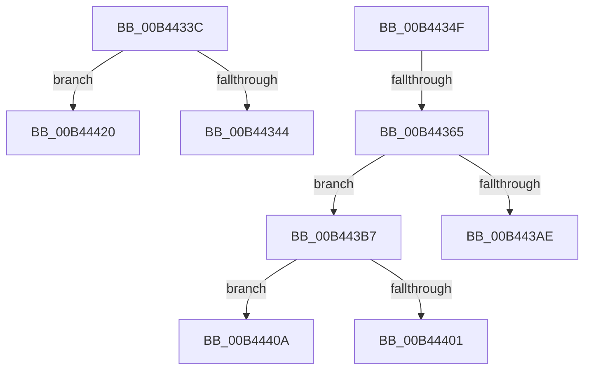

# sub_00B4433C

- RVA: `0x00B4433C`–`0x00B4442A` (길이 `238` bytes)
- VA: `0x0000000140B4433C`
- 실행 섹션: `PAGE`
- PDB 이름 있음: `아니요`; PDB Function 태그: `아니요`
- unwind 정보 RVA: `0x000B79F0`
- 디코드: `56`개 명령, `238/238` bytes 표시
- 미해석 바이트: `0` (있으면 어셈블리에 `.byte`로 보존)

> 이 문서는 커널 이미지의 기계어와 PDB 기호를 분석해 생성했습니다. 4번과 5번은 함수 원형과 자료형을 바이너리 사용 방식에서 추정한 C 해석이며 원본 소스 복구 결과는 아닙니다.

## 1. Dependencies

- 직접 호출 지점: **4**; 고유 호출 대상: **4**
- 직접 호출자로 확인된 함수: **0**
- RIP 상대 이미지 참조: **0**

### Outgoing calls
- `0x00B44356` → [FsRtlGetFileSize](../98/FsRtlGetFileSize_function_00985150.md) (function, `0x00985150`)
- `0x00B443A3` → [ZwCreateSection](../../text/6A/ZwCreateSection_function_006ADA10.md) (function, `0x006ADA10`)
- `0x00B443F6` → [ZwMapViewOfSection](../../text/6A/ZwMapViewOfSection_function_006AD5D0.md) (function, `0x006AD5D0`)
- `0x00B44414` → [SeValidateFileAsImageType](../79/SeValidateFileAsImageType_function_0079BA0C.md) (function, `0x0079BA0C`)

### Direct callers
- 이 함수 시작 RVA로 연결되는 직접 call은 확인되지 않았습니다. 간접 호출은 완전히 역산할 수 없습니다.

### Static image references
- 디코드된 RIP-relative 메모리 참조가 없습니다.

## 2. Other-region calls and transfers

- 다른 실행 섹션으로 향하는 call: **2**
  - `0x00B443A3` → [ZwCreateSection](../../text/6A/ZwCreateSection_function_006ADA10.md) (`PAGE` → `.text`)
  - `0x00B443F6` → [ZwMapViewOfSection](../../text/6A/ZwMapViewOfSection_function_006AD5D0.md) (`PAGE` → `.text`)
- call이 아닌 외부 분기/꼬리 이동: **6**
  - `0x00B4434A` → [ExpQueryCodeIntegrityCertificateInfo + 0x5E](../A8/ExpQueryCodeIntegrityCertificateInfo_function_00A8552C.md) (`tail-transfer`)
  - `0x00B4435F` → [ExpQueryCodeIntegrityCertificateInfo + 0xD3](../A8/ExpQueryCodeIntegrityCertificateInfo_function_00A8552C.md) (`tail-transfer`)
  - `0x00B443B2` → [ExpQueryCodeIntegrityCertificateInfo + 0xD3](../A8/ExpQueryCodeIntegrityCertificateInfo_function_00A8552C.md) (`tail-transfer`)
  - `0x00B44405` → [ExpQueryCodeIntegrityCertificateInfo + 0xDC](../A8/ExpQueryCodeIntegrityCertificateInfo_function_00A8552C.md) (`tail-transfer`)
  - `0x00B4441B` → [ExpQueryCodeIntegrityCertificateInfo + 0xD3](../A8/ExpQueryCodeIntegrityCertificateInfo_function_00A8552C.md) (`tail-transfer`)
  - `0x00B44425` → [ExpQueryCodeIntegrityCertificateInfo + 0xD3](../A8/ExpQueryCodeIntegrityCertificateInfo_function_00A8552C.md) (`tail-transfer`)

## 3. Assembly (complete function range)

```asm
00B4433C  3B D3                           cmp edx, ebx
00B4433E  0F 85 DC 00 00 00               jne 0x140b44420
00B44344  41 BC 03 00 00 00               mov r12d, 3
00B4434A  E9 3B 12 F4 FF                  jmp 0x140a8558a
00B4434F  48 8D 55 F7                     lea rdx, [rbp - 9]
00B44353  48 8B CE                        mov rcx, rsi
00B44356  E8 F5 0D E4 FF                  call 0x140985150
00B4435B  8B F8                           mov edi, eax
00B4435D  85 C0                           test eax, eax
00B4435F  0F 88 9A 12 F4 FF               js 0x140a855ff
00B44365  45 33 C9                        xor r9d, r9d
00B44368  4C 89 74 24 30                  mov qword ptr [rsp + 0x30], r14
00B4436D  0F 57 C0                        xorps xmm0, xmm0
00B44370  C7 44 24 28 00 00 00 08         mov dword ptr [rsp + 0x28], 0x8000000
00B44378  4C 8D 45 07                     lea r8, [rbp + 7]
00B4437C  C7 45 07 30 00 00 00            mov dword ptr [rbp + 7], 0x30
00B44383  48 8D 4D 7F                     lea rcx, [rbp + 0x7f]
00B44387  4C 89 6D 0F                     mov qword ptr [rbp + 0xf], r13
00B4438B  41 8D 51 04                     lea edx, [r9 + 4]
00B4438F  C7 45 1F 40 02 00 00            mov dword ptr [rbp + 0x1f], 0x240
00B44396  4C 89 6D 17                     mov qword ptr [rbp + 0x17], r13
00B4439A  F3 0F 7F 45 27                  movdqu xmmword ptr [rbp + 0x27], xmm0
00B4439F  89 5C 24 20                     mov dword ptr [rsp + 0x20], ebx
00B443A3  E8 68 96 B6 FF                  call 0x1406ada10
00B443A8  8B F8                           mov edi, eax
00B443AA  85 C0                           test eax, eax
00B443AC  79 09                           jns 0x140b443b7
00B443AE  4C 89 6D 7F                     mov qword ptr [rbp + 0x7f], r13
00B443B2  E9 48 12 F4 FF                  jmp 0x140a855ff
00B443B7  48 8B 5D F7                     mov rbx, qword ptr [rbp - 9]
00B443BB  48 8D 45 FF                     lea rax, [rbp - 1]
00B443BF  48 8B 4D 7F                     mov rcx, qword ptr [rbp + 0x7f]
00B443C3  4C 8D 45 77                     lea r8, [rbp + 0x77]
00B443C7  C7 44 24 48 02 00 00 00         mov dword ptr [rsp + 0x48], 2
00B443CF  45 33 C9                        xor r9d, r9d
00B443D2  44 89 6C 24 40                  mov dword ptr [rsp + 0x40], r13d
00B443D7  48 83 CA FF                     or rdx, 0xffffffffffffffff
00B443DB  C7 44 24 38 01 00 00 00         mov dword ptr [rsp + 0x38], 1
00B443E3  48 89 44 24 30                  mov qword ptr [rsp + 0x30], rax
00B443E8  4C 89 6C 24 28                  mov qword ptr [rsp + 0x28], r13
00B443ED  4C 89 6C 24 20                  mov qword ptr [rsp + 0x20], r13
00B443F2  48 89 5D FF                     mov qword ptr [rbp - 1], rbx
00B443F6  E8 D5 91 B6 FF                  call 0x1406ad5d0
00B443FB  8B F8                           mov edi, eax
00B443FD  85 C0                           test eax, eax
00B443FF  79 09                           jns 0x140b4440a
00B44401  4C 89 6D 77                     mov qword ptr [rbp + 0x77], r13
00B44405  E9 FE 11 F4 FF                  jmp 0x140a85608
00B4440A  48 8B 55 77                     mov rdx, qword ptr [rbp + 0x77]
00B4440E  4C 8B C3                        mov r8, rbx
00B44411  41 8B CC                        mov ecx, r12d
00B44414  E8 F3 75 C5 FF                  call 0x14079ba0c
00B44419  8B F8                           mov edi, eax
00B4441B  E9 DF 11 F4 FF                  jmp 0x140a855ff
00B44420  BF 0D 00 00 C0                  mov edi, 0xc000000d
00B44425  E9 D5 11 F4 FF                  jmp 0x140a855ff
```

## 4. C-style interpretation (structured pseudocode)

```c
__int64 __fastcall sub_00B4433C(__int64 a1, int a2, __int64 a3, int a4)
{
    unsigned int v_stack_p20;
    unsigned int v_stack_p28;
    unsigned __int64 v_stack_p30;
    unsigned int v_stack_p38;
    unsigned int v_stack_p40;
    unsigned int v_stack_p48;

    if (a2 != ((unsigned int)(v_rbx))) goto loc_00B44420;
loc_00B44420:
}
```

## 5. (Beta) C Style

```c
int64_t sub_00B4433C(int64_t Arg1, int32_t Arg2, int64_t Arg3, int32_t Arg4)
{
    uint32_t v_stack_p20;
    uint32_t v_stack_p28;
    uint64_t v_stack_p30;
    uint32_t v_stack_p38;
    uint32_t v_stack_p40;
    uint32_t v_stack_p48;

    if (Arg2 != ((uint32_t)(local_rbx))) goto loc_00B44420;
loc_00B44420:
}
```

## 6. Execution-region graph

[열기: 2D/3D 그래프와 함수 탐색 컨트롤 패널](../../../control-panel.html?section=page&rva=0x00B4433C&view=graph)

- 2D 그래프는 위에서 아래로 흐르고, 3D 그래프는 빈 공간을 드래그해 회전합니다. Shift+드래그는 이동, 휠은 확대·축소, 함수 노드 선택은 대상 보고서 이동입니다.

### Static fallback


