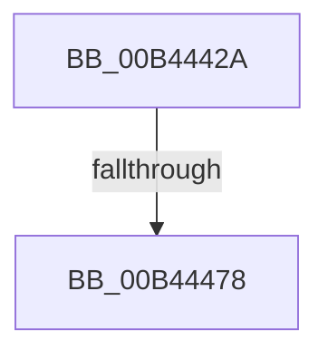

# sub_00B4442A

- RVA: `0x00B4442A`–`0x00B444B9` (길이 `143` bytes)
- VA: `0x0000000140B4442A`
- 실행 섹션: `PAGE`
- PDB 이름 있음: `아니요`; PDB Function 태그: `아니요`
- unwind 정보 RVA: `0x000B7AA8`
- 디코드: `30`개 명령, `143/143` bytes 표시
- 미해석 바이트: `0` (있으면 어셈블리에 `.byte`로 보존)

> 이 문서는 커널 이미지의 기계어와 PDB 기호를 분석해 생성했습니다. 4번과 5번은 함수 원형과 자료형을 바이너리 사용 방식에서 추정한 C 해석이며 원본 소스 복구 결과는 아닙니다.

## 1. Dependencies

- 직접 호출 지점: **4**; 고유 호출 대상: **4**
- 직접 호출자로 확인된 함수: **0**
- RIP 상대 이미지 참조: **1**

### Outgoing calls
- `0x00B44435` → [RtlInitUnicodeString](../../text/42/RtlInitUnicodeString_function_0042A780.md) (function, `0x0042A780`)
- `0x00B4445F` → [ZwQueryValueKey](../../text/6A/ZwQueryValueKey_function_006AD3B0.md) (function, `0x006AD3B0`)
- `0x00B4446B` → [ZwClose](../../text/6A/ZwClose_function_006AD2B0.md) (function, `0x006AD2B0`)
- `0x00B444AE` → [EtwTraceSiloDcEvent](../../text/48/EtwTraceSiloDcEvent_function_0048B28C.md) (function, `0x0048B28C`)

### Direct callers
- 이 함수 시작 RVA로 연결되는 직접 call은 확인되지 않았습니다. 간접 호출은 완전히 역산할 수 없습니다.

### Static image references
- `0x00B4442A` → RVA `0x00AFD370` (` ?? ::NNGAKEGL::`string'`; read)

## 2. Other-region calls and transfers

- 다른 실행 섹션으로 향하는 call: **4**
  - `0x00B44435` → [RtlInitUnicodeString](../../text/42/RtlInitUnicodeString_function_0042A780.md) (`PAGE` → `.text`)
  - `0x00B4445F` → [ZwQueryValueKey](../../text/6A/ZwQueryValueKey_function_006AD3B0.md) (`PAGE` → `.text`)
  - `0x00B4446B` → [ZwClose](../../text/6A/ZwClose_function_006AD2B0.md) (`PAGE` → `.text`)
  - `0x00B444AE` → [EtwTraceSiloDcEvent](../../text/48/EtwTraceSiloDcEvent_function_0048B28C.md) (`PAGE` → `.text`)
- call이 아닌 외부 분기/꼬리 이동: **2**
  - `0x00B44472` → [CmEtwRunDown + 0x20D](../A8/CmEtwRunDown_function_00A85AC0.md) (`tail-transfer`)
  - `0x00B444B4` → [CmEtwRunDown + 0x20D](../A8/CmEtwRunDown_function_00A85AC0.md) (`tail-transfer`)

## 3. Assembly (complete function range)

```asm
00B4442A  48 8D 15 3F 8F FB FF            lea rdx, [rip - 0x470c1]
00B44431  48 8D 4D 90                     lea rcx, [rbp - 0x70]
00B44435  E8 46 63 8E FF                  call 0x14042a780
00B4443A  48 8B 4C 24 40                  mov rcx, qword ptr [rsp + 0x40]
00B4443F  48 8D 44 24 3C                  lea rax, [rsp + 0x3c]
00B44444  48 89 44 24 28                  mov qword ptr [rsp + 0x28], rax
00B44449  4C 8D 4D D8                     lea r9, [rbp - 0x28]
00B4444D  41 B8 02 00 00 00               mov r8d, 2
00B44453  C7 44 24 20 10 00 00 00         mov dword ptr [rsp + 0x20], 0x10
00B4445B  48 8D 55 90                     lea rdx, [rbp - 0x70]
00B4445F  E8 4C 8F B6 FF                  call 0x1406ad3b0
00B44464  48 8B 4C 24 40                  mov rcx, qword ptr [rsp + 0x40]
00B44469  8B D8                           mov ebx, eax
00B4446B  E8 40 8E B6 FF                  call 0x1406ad2b0
00B44470  85 DB                           test ebx, ebx
00B44472  0F 88 55 18 F4 FF               js 0x140a85ccd
00B44478  8B 45 E4                        mov eax, dword ptr [rbp - 0x1c]
00B4447B  48 8D 4D 18                     lea rcx, [rbp + 0x18]
00B4447F  89 44 24 38                     mov dword ptr [rsp + 0x38], eax
00B44483  45 8B CD                        mov r9d, r13d
00B44486  48 8D 44 24 38                  lea rax, [rsp + 0x38]
00B4448B  C7 44 24 28 02 18 50 00         mov dword ptr [rsp + 0x28], 0x501802
00B44493  4D 8B C4                        mov r8, r12
00B44496  48 89 45 18                     mov qword ptr [rbp + 0x18], rax
00B4449A  BA 01 00 00 00                  mov edx, 1
00B4449F  48 C7 45 20 04 00 00 00         mov qword ptr [rbp + 0x20], 4
00B444A7  66 C7 44 24 20 23 09            mov word ptr [rsp + 0x20], 0x923
00B444AE  E8 D9 6D 94 FF                  call 0x14048b28c
00B444B3  90                              nop
00B444B4  E9 14 18 F4 FF                  jmp 0x140a85ccd
```

## 4. C-style interpretation (structured pseudocode)

```c
__int64 __fastcall sub_00B4442A(__int64 a1, __int64 a2, __int64 a3, __int64 a4, __int64 a5, __int64 a6, __int64 a7, __int64 a8)
{
    __int64 result;
    unsigned int v_stack_p20;
    unsigned __int64 v_stack_p28;
    unsigned int v_stack_p38;
    unsigned __int64 v_stack_p3C;

    result = RtlInitUnicodeString(v_rbp - 112, v_rip - 291009, a3, a4);
    v_stack_p28 = v_stack_p3C;
    v_stack_p20 = 16;
    result = ZwQueryValueKey(a8, v_rbp - 112, 2, v_rbp - 40);
    result = ZwClose(a8, v_rbp - 112, 2, v_rbp - 40);
    v_stack_p38 = (unsigned int)((unsigned int)(*(unsigned int *)(v_rbp - 28)));
    v_stack_p28 = 0x501802ULL;
    *(unsigned __int64 *)(v_rbp + 24) = a7;
    *(unsigned __int64 *)(v_rbp + 32) = 4;
    v_stack_p20 = 0x923ULL;
    result = EtwTraceSiloDcEvent(v_rbp + 24, 1, v_r12, (unsigned int)((unsigned int)(v_r13)));
}
```

## 5. (Beta) C Style

```c
int64_t sub_00B4442A(int64_t Arg1, int64_t Arg2, int64_t Arg3, int64_t Arg4, uint64_t Arg5, uint64_t Arg6, int64_t Arg7, int64_t Arg8)
{
    int64_t result;
    uint32_t v_stack_p20;
    uint64_t v_stack_p28;
    uint32_t v_stack_p38;
    uint64_t v_stack_p3C;

    result = RtlInitUnicodeString(local_rbp - 112, v_rip - 291009, Arg3, Arg4);
    v_stack_p28 = v_stack_p3C;
    v_stack_p20 = 16;
    result = ZwQueryValueKey(Arg8, local_rbp - 112, 2, local_rbp - 40);
    result = ZwClose(Arg8, local_rbp - 112, 2, local_rbp - 40);
    v_stack_p38 = (uint32_t)((uint32_t)(*(uint32_t *)(local_rbp - 0x1C)));
    v_stack_p28 = 0x501802ULL;
    *(uint64_t *)(local_rbp + 0x18) = Arg7;
    *(uint64_t *)(local_rbp + 0x20) = 4;
    v_stack_p20 = 0x923ULL;
    result = EtwTraceSiloDcEvent(local_rbp + 24, 1, local_r12, (uint32_t)((uint32_t)(local_r13)));
}
```

## 6. Execution-region graph

[열기: 2D/3D 그래프와 함수 탐색 컨트롤 패널](../../../control-panel.html?section=page&rva=0x00B4442A&view=graph)

- 2D 그래프는 위에서 아래로 흐르고, 3D 그래프는 빈 공간을 드래그해 회전합니다. Shift+드래그는 이동, 휠은 확대·축소, 함수 노드 선택은 대상 보고서 이동입니다.

### Static fallback


