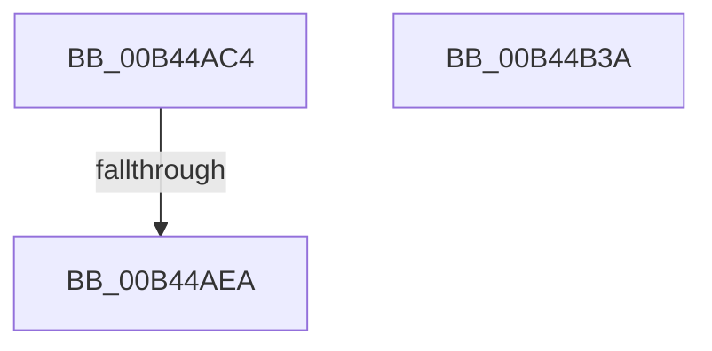

# sub_00B44AC4

- RVA: `0x00B44AC4`–`0x00B44B48` (길이 `132` bytes)
- VA: `0x0000000140B44AC4`
- 실행 섹션: `PAGE`
- PDB 이름 있음: `아니요`; PDB Function 태그: `아니요`
- unwind 정보 RVA: `0x000B7D4C`
- 디코드: `32`개 명령, `132/132` bytes 표시
- 미해석 바이트: `0` (있으면 어셈블리에 `.byte`로 보존)

> 이 문서는 커널 이미지의 기계어와 PDB 기호를 분석해 생성했습니다. 4번과 5번은 함수 원형과 자료형을 바이너리 사용 방식에서 추정한 C 해석이며 원본 소스 복구 결과는 아닙니다.

## 1. Dependencies

- 직접 호출 지점: **3**; 고유 호출 대상: **3**
- 직접 호출자로 확인된 함수: **0**
- RIP 상대 이미지 참조: **2**

### Outgoing calls
- `0x00B44AC9` → [ExFreePoolWithTag](../../poolcode/B8/ExFreePoolWithTag_function_00B82870.md) (function, `0x00B82870`)
- `0x00B44AD9` → [ExAllocatePool2](../../poolcode/B8/ExAllocatePool2_function_00B820F0.md) (function, `0x00B820F0`)
- `0x00B44B2F` → [PnpGetObjectProperty](../8E/PnpGetObjectProperty_function_008E2180.md) (function, `0x008E2180`)

### Direct callers
- 이 함수 시작 RVA로 연결되는 직접 call은 확인되지 않았습니다. 간접 호출은 완전히 역산할 수 없습니다.

### Static image references
- `0x00B44AF2` → RVA `0x00E66398` (`.data`; read)
- `0x00B44B1E` → RVA `0x00011670` (`.rdata`; read)

## 2. Other-region calls and transfers

- 다른 실행 섹션으로 향하는 call: **2**
  - `0x00B44AC9` → [ExFreePoolWithTag](../../poolcode/B8/ExFreePoolWithTag_function_00B82870.md) (`PAGE` → `POOLCODE`)
  - `0x00B44AD9` → [ExAllocatePool2](../../poolcode/B8/ExAllocatePool2_function_00B820F0.md) (`PAGE` → `POOLCODE`)
- call이 아닌 외부 분기/꼬리 이동: **3**
  - `0x00B44AE4` → [PiAuditDeviceOperation + 0x5E9](../A8/PiAuditDeviceOperation_function_00A864DC.md) (`tail-transfer`)
  - `0x00B44B35` → [PiAuditDeviceOperation + 0x1F7](../A8/PiAuditDeviceOperation_function_00A864DC.md) (`tail-transfer`)
  - `0x00B44B43` → [PiAuditDeviceOperation + 0x571](../A8/PiAuditDeviceOperation_function_00A864DC.md) (`tail-transfer`)

## 3. Assembly (complete function range)

```asm
00B44AC4  33 D2                           xor edx, edx
00B44AC6  49 8B CF                        mov rcx, r15
00B44AC9  E8 A2 DD 03 00                  call 0x140b82870
00B44ACE  8B 55 9B                        mov edx, dword ptr [rbp - 0x65]
00B44AD1  44 8B C6                        mov r8d, esi
00B44AD4  B9 00 01 00 00                  mov ecx, 0x100
00B44AD9  E8 12 D6 03 00                  call 0x140b820f0
00B44ADE  4C 8B F8                        mov r15, rax
00B44AE1  48 85 C0                        test rax, rax
00B44AE4  0F 84 DB 1F F4 FF               je 0x140a86ac5
00B44AEA  48 8B 53 08                     mov rdx, qword ptr [rbx + 8]
00B44AEE  48 8D 45 9B                     lea rax, [rbp - 0x65]
00B44AF2  48 8B 0D 9F 18 32 00            mov rcx, qword ptr [rip + 0x32189f]
00B44AF9  45 33 C9                        xor r9d, r9d
00B44AFC  89 7C 24 50                     mov dword ptr [rsp + 0x50], edi
00B44B00  48 89 44 24 48                  mov qword ptr [rsp + 0x48], rax
00B44B05  8B 45 9B                        mov eax, dword ptr [rbp - 0x65]
00B44B08  89 44 24 40                     mov dword ptr [rsp + 0x40], eax
00B44B0C  45 8D 41 01                     lea r8d, [r9 + 1]
00B44B10  4C 89 7C 24 38                  mov qword ptr [rsp + 0x38], r15
00B44B15  48 8D 45 97                     lea rax, [rbp - 0x69]
00B44B19  48 89 44 24 30                  mov qword ptr [rsp + 0x30], rax
00B44B1E  48 8D 05 4B CB 4C FF            lea rax, [rip - 0xb334b5]
00B44B25  48 89 44 24 28                  mov qword ptr [rsp + 0x28], rax
00B44B2A  48 89 7C 24 20                  mov qword ptr [rsp + 0x20], rdi
00B44B2F  E8 4C D6 D9 FF                  call 0x1408e2180
00B44B34  90                              nop
00B44B35  E9 99 1B F4 FF                  jmp 0x140a866d3
00B44B3A  33 D2                           xor edx, edx
00B44B3C  83 F8 12                        cmp eax, 0x12
00B44B3F  48 0F 44 D7                     cmove rdx, rdi
00B44B43  E9 05 1F F4 FF                  jmp 0x140a86a4d
```

## 4. C-style interpretation (structured pseudocode)

```c
__int64 __fastcall sub_00B44AC4(__int64 a1, int a2, __int64 a3, int a4)
{
    __int64 result;
    unsigned __int64 v_stack_p20;
    unsigned __int64 v_stack_p28;
    unsigned __int64 v_stack_p30;
    unsigned __int64 v_stack_p38;
    unsigned int v_stack_p40;
    unsigned __int64 v_stack_p48;
    unsigned int v_stack_p50;

    a2 = 0;
    result = ExFreePoolWithTag(v_r15, a2, a3, a4);
    result = ExAllocatePool2(256, (unsigned int)(*(unsigned int *)(v_rbp - 101)), (unsigned int)((unsigned int)(v_rsi)), a4);
    a4 = 0;
    v_stack_p50 = (unsigned int)(v_rdi);
    v_stack_p48 = v_rbp - 101;
    v_stack_p40 = (unsigned int)((unsigned int)(*(unsigned int *)(v_rbp - 101)));
    v_stack_p38 = result;
    v_stack_p30 = v_rbp - 105;
    v_stack_p28 = v_rip - 11744437;
    v_stack_p20 = v_rdi;
    result = PnpGetObjectProperty(*(unsigned __int64 *)(v_rip + 3283103), *(unsigned __int64 *)(v_rbx + 8), a4 + 1, a4);
}
```

## 5. (Beta) C Style

```c
int64_t sub_00B44AC4(int64_t Arg1, int32_t Arg2, int64_t Arg3, int32_t Arg4)
{
    int64_t result;
    uint64_t v_stack_p20;
    uint64_t v_stack_p28;
    uint64_t v_stack_p30;
    uint64_t v_stack_p38;
    uint32_t v_stack_p40;
    uint64_t v_stack_p48;
    uint32_t v_stack_p50;

    Arg2 = 0;
    result = ExFreePoolWithTag(local_r15, Arg2, Arg3, Arg4);
    result = ExAllocatePool2(256, (uint32_t)(*(uint32_t *)(local_rbp - 0x65)), (uint32_t)((uint32_t)(local_rsi)), Arg4);
    Arg4 = 0;
    v_stack_p50 = (uint32_t)(local_rdi);
    v_stack_p48 = local_rbp - 101;
    v_stack_p40 = (uint32_t)((uint32_t)(*(uint32_t *)(local_rbp - 0x65)));
    v_stack_p38 = result;
    v_stack_p30 = local_rbp - 105;
    v_stack_p28 = v_rip - 11744437;
    v_stack_p20 = local_rdi;
    result = PnpGetObjectProperty(*(uint64_t *)(v_rip + 0x32189F), *(uint64_t *)(local_rbx + 0x8), Arg4 + 1, Arg4);
}
```

## 6. Execution-region graph

[열기: 2D/3D 그래프와 함수 탐색 컨트롤 패널](../../../control-panel.html?section=page&rva=0x00B44AC4&view=graph)

- 2D 그래프는 위에서 아래로 흐르고, 3D 그래프는 빈 공간을 드래그해 회전합니다. Shift+드래그는 이동, 휠은 확대·축소, 함수 노드 선택은 대상 보고서 이동입니다.

### Static fallback


