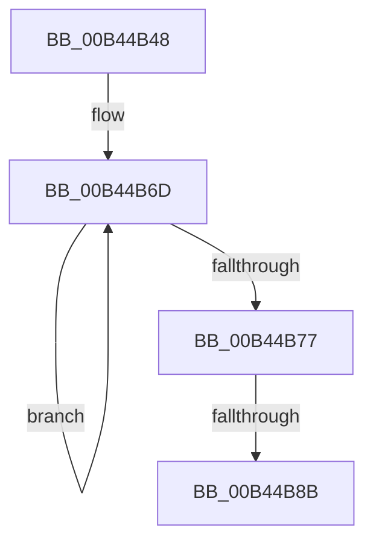

# sub_00B44B48

- RVA: `0x00B44B48`–`0x00B44B9B` (길이 `83` bytes)
- VA: `0x0000000140B44B48`
- 실행 섹션: `PAGE`
- PDB 이름 있음: `아니요`; PDB Function 태그: `아니요`
- unwind 정보 RVA: `0x000B7DBC`
- 디코드: `20`개 명령, `83/83` bytes 표시
- 미해석 바이트: `0` (있으면 어셈블리에 `.byte`로 보존)

> 이 문서는 커널 이미지의 기계어와 PDB 기호를 분석해 생성했습니다. 4번과 5번은 함수 원형과 자료형을 바이너리 사용 방식에서 추정한 C 해석이며 원본 소스 복구 결과는 아닙니다.

## 1. Dependencies

- 직접 호출 지점: **2**; 고유 호출 대상: **2**
- 직접 호출자로 확인된 함수: **0**
- RIP 상대 이미지 참조: **1**

### Outgoing calls
- `0x00B44B60` → [RtlStringCbPrintfW](../../text/40/RtlStringCbPrintfW_function_0040FB40.md) (function, `0x0040FB40`)
- `0x00B44B90` → [RtlFreeAnsiString](../9C/RtlFreeAnsiString_function_009C0800.md) (function, `0x009C0800`)

### Direct callers
- 이 함수 시작 RVA로 연결되는 직접 call은 확인되지 않았습니다. 간접 호출은 완전히 역산할 수 없습니다.

### Static image references
- `0x00B44B4C` → RVA `0x00B06ED0` (` ?? ::NNGAKEGL::`string'`; read)

## 2. Other-region calls and transfers

- 다른 실행 섹션으로 향하는 call: **1**
  - `0x00B44B60` → [RtlStringCbPrintfW](../../text/40/RtlStringCbPrintfW_function_0040FB40.md) (`PAGE` → `.text`)
- call이 아닌 외부 분기/꼬리 이동: **2**
  - `0x00B44B85` → [IoWMIDeviceObjectToInstanceName + 0x4F](../A8/IoWMIDeviceObjectToInstanceName_function_00A873C0.md) (`tail-transfer`)
  - `0x00B44B96` → [IoWMIDeviceObjectToInstanceName + 0x4F](../A8/IoWMIDeviceObjectToInstanceName_function_00A873C0.md) (`tail-transfer`)

## 3. Assembly (complete function range)

```asm
00B44B48  8B 44 24 68                     mov eax, dword ptr [rsp + 0x68]
00B44B4C  4C 8D 05 7D 23 FC FF            lea r8, [rip - 0x3dc83]
00B44B53  0F B7 57 02                     movzx edx, word ptr [rdi + 2]
00B44B57  4C 8B 4C 24 38                  mov r9, qword ptr [rsp + 0x38]
00B44B5C  89 44 24 20                     mov dword ptr [rsp + 0x20], eax
00B44B60  E8 DB AF 8C FF                  call 0x14040fb40
00B44B65  48 8B 4F 08                     mov rcx, qword ptr [rdi + 8]
00B44B69  48 83 C8 FF                     or rax, 0xffffffffffffffff
00B44B6D  48 FF C0                        inc rax
00B44B70  66 44 39 34 41                  cmp word ptr [rcx + rax*2], r14w
00B44B75  75 F6                           jne 0x140b44b6d
00B44B77  66 03 C0                        add ax, ax
00B44B7A  41 8B DE                        mov ebx, r14d
00B44B7D  66 89 07                        mov word ptr [rdi], ax
00B44B80  4C 39 74 24 38                  cmp qword ptr [rsp + 0x38], r14
00B44B85  0F 84 84 28 F4 FF               je 0x140a8740f
00B44B8B  48 8D 4C 24 30                  lea rcx, [rsp + 0x30]
00B44B90  E8 6B BC E7 FF                  call 0x1409c0800
00B44B95  90                              nop
00B44B96  E9 74 28 F4 FF                  jmp 0x140a8740f
```

## 4. C-style interpretation (structured pseudocode)

```c
__int64 __fastcall sub_00B44B48(__int64 a1, __int64 a2, __int64 a3, __int64 a4, __int64 a5, __int64 a6, __int64 a7, __int64 a8, __int64 a9, __int64 a10, __int64 a11, __int64 a12, unsigned int a13)
{
    __int64 result;
    unsigned int v_stack_p20;

    v_stack_p20 = (unsigned int)((unsigned int)(a13));
    result = RtlStringCbPrintfW(a1, *(unsigned __int16 *)(v_rdi + 2), v_rip - 253059, a7);
    result = (result) | (-1);
loc_00B44B6D:
    result = (result) + 1;
    if ((*(unsigned __int16 *)(*(unsigned __int64 *)(v_rdi + 8) + result * 2)) != ((unsigned __int16)(v_r14))) goto loc_00B44B6D;
    result = (unsigned __int16)((result) + ((unsigned __int16)(result)));
    *(unsigned __int16 *)(v_rdi) = (unsigned __int16)(result);
    result = RtlFreeAnsiString(a6, *(unsigned __int16 *)(v_rdi + 2), v_rip - 253059, a7);
}
```

## 5. (Beta) C Style

```c
int64_t sub_00B44B48(int64_t Arg1, int64_t Arg2, int64_t Arg3, int64_t Arg4, uint64_t Arg5, int64_t Arg6, int64_t Arg7, uint64_t Arg8, uint64_t Arg9, uint64_t Arg10, uint64_t Arg11, uint64_t Arg12, uint32_t Arg13)
{
    int64_t result;
    uint32_t v_stack_p20;

    v_stack_p20 = (uint32_t)((uint32_t)(Arg13));
    result = RtlStringCbPrintfW(Arg1, *(uint16_t *)(local_rdi + 0x2), v_rip - 253059, Arg7);
    result = (result) | (-1);
loc_00B44B6D:
    result = (result) + 1;
    if ((*(uint16_t *)(*(uint64_t *)(local_rdi + 0x8) + result * 2)) != ((uint16_t)(local_r14))) goto loc_00B44B6D;
    result = (uint16_t)((result) + ((uint16_t)(result)));
    *(uint16_t *)(local_rdi) = (uint16_t)(result);
    result = RtlFreeAnsiString(Arg6, *(uint16_t *)(local_rdi + 0x2), v_rip - 253059, Arg7);
}
```

## 6. Execution-region graph

[열기: 2D/3D 그래프와 함수 탐색 컨트롤 패널](../../../control-panel.html?section=page&rva=0x00B44B48&view=graph)

- 2D 그래프는 위에서 아래로 흐르고, 3D 그래프는 빈 공간을 드래그해 회전합니다. Shift+드래그는 이동, 휠은 확대·축소, 함수 노드 선택은 대상 보고서 이동입니다.

### Static fallback


