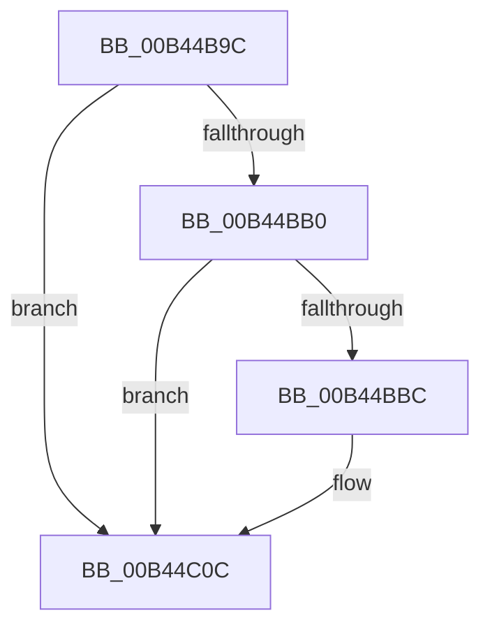

# sub_00B44B9C

- RVA: `0x00B44B9C`–`0x00B44C1A` (길이 `126` bytes)
- VA: `0x0000000140B44B9C`
- 실행 섹션: `PAGE`
- PDB 이름 있음: `아니요`; PDB Function 태그: `아니요`
- unwind 정보 RVA: `0x000B7DE8`
- 디코드: `32`개 명령, `126/126` bytes 표시
- 미해석 바이트: `0` (있으면 어셈블리에 `.byte`로 보존)

> 이 문서는 커널 이미지의 기계어와 PDB 기호를 분석해 생성했습니다. 4번과 5번은 함수 원형과 자료형을 바이너리 사용 방식에서 추정한 C 해석이며 원본 소스 복구 결과는 아닙니다.

## 1. Dependencies

- 직접 호출 지점: **5**; 고유 호출 대상: **5**
- 직접 호출자로 확인된 함수: **0**
- RIP 상대 이미지 참조: **1**

### Outgoing calls
- `0x00B44B9F` → [MiLockVadShared](../../text/31/MiLockVadShared_function_00316DE0.md) (function, `0x00316DE0`)
- `0x00B44BA7` → [MiVadDeleted](../../text/43/MiVadDeleted_function_00431350.md) (function, `0x00431350`)
- `0x00B44BBF` → [MiGetProcessPartition](../../text/44/MiGetProcessPartition_function_00443B10.md) (function, `0x00443B10`)
- `0x00B44C07` → [PerfInfoLogVirtualAlloc](../A4/PerfInfoLogVirtualAlloc_function_00A45754.md) (function, `0x00A45754`)
- `0x00B44C0F` → [MiUnlockAndDereferenceVadShared](../../text/2A/MiUnlockAndDereferenceVadShared_function_002AEF10.md) (function, `0x002AEF10`)

### Direct callers
- 이 함수 시작 RVA로 연결되는 직접 call은 확인되지 않았습니다. 간접 호출은 완전히 역산할 수 없습니다.

### Static image references
- `0x00B44BB0` → RVA `0x00FC6B04` (`ALMOSTRO`; read)

## 2. Other-region calls and transfers

- 다른 실행 섹션으로 향하는 call: **4**
  - `0x00B44B9F` → [MiLockVadShared](../../text/31/MiLockVadShared_function_00316DE0.md) (`PAGE` → `.text`)
  - `0x00B44BA7` → [MiVadDeleted](../../text/43/MiVadDeleted_function_00431350.md) (`PAGE` → `.text`)
  - `0x00B44BBF` → [MiGetProcessPartition](../../text/44/MiGetProcessPartition_function_00443B10.md) (`PAGE` → `.text`)
  - `0x00B44C0F` → [MiUnlockAndDereferenceVadShared](../../text/2A/MiUnlockAndDereferenceVadShared_function_002AEF10.md) (`PAGE` → `.text`)
- call이 아닌 외부 분기/꼬리 이동: **1**
  - `0x00B44C15` → [MiFinishPlaceholderVadReplacement + 0x43](../A8/MiFinishPlaceholderVadReplacement_function_00A87630.md) (`tail-transfer`)

## 3. Assembly (complete function range)

```asm
00B44B9C  48 8B D3                        mov rdx, rbx
00B44B9F  E8 3C 22 7D FF                  call 0x140316de0
00B44BA4  48 8B CB                        mov rcx, rbx
00B44BA7  E8 A4 C7 8E FF                  call 0x140431350
00B44BAC  85 C0                           test eax, eax
00B44BAE  75 5C                           jne 0x140b44c0c
00B44BB0  F7 05 4A 1F 48 00 00 80 00 00   test dword ptr [rip + 0x481f4a], 0x8000
00B44BBA  74 50                           je 0x140b44c0c
00B44BBC  48 8B CE                        mov rcx, rsi
00B44BBF  E8 4C EF 8F FF                  call 0x140443b10
00B44BC4  0F B6 4B 20                     movzx ecx, byte ptr [rbx + 0x20]
00B44BC8  4C 8B C6                        mov r8, rsi
00B44BCB  0F B6 53 21                     movzx edx, byte ptr [rbx + 0x21]
00B44BCF  48 C1 E2 20                     shl rdx, 0x20
00B44BD3  44 0F B7 08                     movzx r9d, word ptr [rax]
00B44BD7  8B 43 18                        mov eax, dword ptr [rbx + 0x18]
00B44BDA  48 C1 E1 20                     shl rcx, 0x20
00B44BDE  48 0B C8                        or rcx, rax
00B44BE1  66 44 89 4C 24 28               mov word ptr [rsp + 0x28], r9w
00B44BE7  8B 43 1C                        mov eax, dword ptr [rbx + 0x1c]
00B44BEA  48 0B D0                        or rdx, rax
00B44BED  66 44 89 4C 24 20               mov word ptr [rsp + 0x20], r9w
00B44BF3  48 2B D1                        sub rdx, rcx
00B44BF6  41 B9 00 20 00 00               mov r9d, 0x2000
00B44BFC  48 FF C2                        inc rdx
00B44BFF  48 C1 E1 0C                     shl rcx, 0xc
00B44C03  48 C1 E2 0C                     shl rdx, 0xc
00B44C07  E8 48 0B F0 FF                  call 0x140a45754
00B44C0C  48 8B CB                        mov rcx, rbx
00B44C0F  E8 FC A2 76 FF                  call 0x1402aef10
00B44C14  90                              nop
00B44C15  E9 59 2A F4 FF                  jmp 0x140a87673
```

## 4. C-style interpretation (structured pseudocode)

```c
__int64 __fastcall sub_00B44B9C(void)
{
    __int64 result;
    unsigned __int16 v_stack_p20;
    unsigned __int16 v_stack_p28;

    result = MiLockVadShared(a1, v_rbx, a3, a4);
    result = MiVadDeleted(v_rbx, v_rbx, a3, a4);
    if ((unsigned int)(result) != 0) goto loc_00B44C0C;
    if (((*(unsigned int *)(v_rip + 4726602)) & (0x8000ULL)) != 0) {
        a1 = v_rsi;
        result = MiGetProcessPartition(a1, v_rbx, a3, a4);
        a1 = *(unsigned __int8 *)(v_rbx + 32);
        a3 = v_rsi;
        a2 = *(unsigned __int8 *)(v_rbx + 33);
        a2 = (a2) << (32);
        a4 = *(unsigned __int16 *)(result);
        result = *(unsigned int *)(v_rbx + 24);
        a1 = (a1) << (32);
        a1 = (a1) | (result);
        v_stack_p28 = (unsigned __int16)(a4);
        result = *(unsigned int *)(v_rbx + 28);
        a2 = (a2) | (result);
        v_stack_p20 = (unsigned __int16)(a4);
        a2 = (a2) - (a1);
        a4 = 0x2000ULL;
        a2 = (a2) + 1;
        a1 = (a1) << (12);
        a2 = (a2) << (12);
        result = PerfInfoLogVirtualAlloc(a1, a2, a3, a4);
    }
    result = MiUnlockAndDereferenceVadShared(v_rbx, a2, a3, a4);
}
```

## 5. (Beta) C Style

```c
void sub_00B44B9C(void)
{
    int64_t result;
    uint16_t v_stack_p20;
    uint16_t v_stack_p28;

    result = MiLockVadShared(a1, local_rbx, a3, a4);
    result = MiVadDeleted(local_rbx, local_rbx, a3, a4);
    if ((uint32_t)(result) != 0) goto loc_00B44C0C;
    if (((*(uint32_t *)(v_rip + 0x481F4A)) & (0x8000ULL)) != 0) {
        a1 = local_rsi;
        result = MiGetProcessPartition(a1, local_rbx, a3, a4);
        a1 = *(uint8_t *)(local_rbx + 0x20);
        a3 = local_rsi;
        a2 = *(uint8_t *)(local_rbx + 0x21);
        a2 = (a2) << (32);
        a4 = *(uint16_t *)(result);
        result = *(uint32_t *)(local_rbx + 0x18);
        a1 = (a1) << (32);
        a1 = (a1) | (result);
        v_stack_p28 = (uint16_t)(a4);
        result = *(uint32_t *)(local_rbx + 0x1C);
        a2 = (a2) | (result);
        v_stack_p20 = (uint16_t)(a4);
        a2 = (a2) - (a1);
        a4 = 0x2000ULL;
        a2 = (a2) + 1;
        a1 = (a1) << (12);
        a2 = (a2) << (12);
        result = PerfInfoLogVirtualAlloc(a1, a2, a3, a4);
    }
    result = MiUnlockAndDereferenceVadShared(local_rbx, a2, a3, a4);
}
```

## 6. Execution-region graph

[열기: 2D/3D 그래프와 함수 탐색 컨트롤 패널](../../../control-panel.html?section=page&rva=0x00B44B9C&view=graph)

- 2D 그래프는 위에서 아래로 흐르고, 3D 그래프는 빈 공간을 드래그해 회전합니다. Shift+드래그는 이동, 휠은 확대·축소, 함수 노드 선택은 대상 보고서 이동입니다.

### Static fallback


