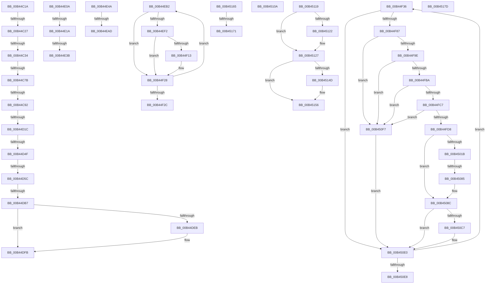

# sub_00B44C1A

- RVA: `0x00B44C1A`–`0x00B45185` (길이 `1,387` bytes)
- VA: `0x0000000140B44C1A`
- 실행 섹션: `PAGE`
- PDB 이름 있음: `아니요`; PDB Function 태그: `아니요`
- unwind 정보 RVA: `0x000B7FA8`
- 디코드: `307`개 명령, `1,387/1,387` bytes 표시
- 미해석 바이트: `0` (있으면 어셈블리에 `.byte`로 보존)

> 이 문서는 커널 이미지의 기계어와 PDB 기호를 분석해 생성했습니다. 4번과 5번은 함수 원형과 자료형을 바이너리 사용 방식에서 추정한 C 해석이며 원본 소스 복구 결과는 아닙니다.

## 1. Dependencies

- 직접 호출 지점: **38**; 고유 호출 대상: **13**
- 직접 호출자로 확인된 함수: **0**
- RIP 상대 이미지 참조: **10**

### Outgoing calls
- `0x00B44C3F` → [RtlInitUnicodeString](../../text/42/RtlInitUnicodeString_function_0042A780.md) (function, `0x0042A780`)
- `0x00B44C6E` → [ZwSetValueKey](../../text/6A/ZwSetValueKey_function_006ADCD0.md) (function, `0x006ADCD0`)
- `0x00B44CAB` → [RtlInitUnicodeString](../../text/42/RtlInitUnicodeString_function_0042A780.md) (function, `0x0042A780`)
- `0x00B44CBB` → [ZwDeleteValueKey](../../text/6A/ZwDeleteValueKey_function_006AECB0.md) (function, `0x006AECB0`)
- `0x00B44CCE` → [RtlInitUnicodeString](../../text/42/RtlInitUnicodeString_function_0042A780.md) (function, `0x0042A780`)
- `0x00B44CDE` → [RtlInitUnicodeString](../../text/42/RtlInitUnicodeString_function_0042A780.md) (function, `0x0042A780`)
- `0x00B44D0F` → [ZwOpenKey](../../text/6A/ZwOpenKey_function_006AD310.md) (function, `0x006AD310`)
- `0x00B44D42` → [ZwQueryValueKey](../../text/6A/ZwQueryValueKey_function_006AD3B0.md) (function, `0x006AD3B0`)
- `0x00B44D67` → [RtlInitUnicodeString](../../text/42/RtlInitUnicodeString_function_0042A780.md) (function, `0x0042A780`)
- `0x00B44DAA` → [ZwCreateKey](../../text/6A/ZwCreateKey_function_006AD470.md) (function, `0x006AD470`)
- `0x00B44DE2` → [ZwSetValueKey](../../text/6A/ZwSetValueKey_function_006ADCD0.md) (function, `0x006ADCD0`)
- `0x00B44DF6` → [ZwDeleteValueKey](../../text/6A/ZwDeleteValueKey_function_006AECB0.md) (function, `0x006AECB0`)
- `0x00B44DFF` → [ZwClose](../../text/6A/ZwClose_function_006AD2B0.md) (function, `0x006AD2B0`)
- `0x00B44E29` → [DbgPrintEx](../../text/35/DbgPrintEx_function_00359290.md) (function, `0x00359290`)
- `0x00B44E3F` → [ZwDeleteValueKey](../../text/6A/ZwDeleteValueKey_function_006AECB0.md) (function, `0x006AECB0`)
- `0x00B44E55` → [RtlInitUnicodeString](../../text/42/RtlInitUnicodeString_function_0042A780.md) (function, `0x0042A780`)
- `0x00B44E9B` → [ZwCreateKey](../../text/6A/ZwCreateKey_function_006AD470.md) (function, `0x006AD470`)
- `0x00B44EC1` → [memset](../../text/6C/memset_function_006C6C40.md) (function, `0x006C6C40`)
- `0x00B44EE7` → [ZwEnumerateValueKey](../../text/6A/ZwEnumerateValueKey_function_006AD330.md) (function, `0x006AD330`)
- `0x00B44EFD` → [RtlInitUnicodeString](../../text/42/RtlInitUnicodeString_function_0042A780.md) (function, `0x0042A780`)
- `0x00B44F0A` → [ZwDeleteValueKey](../../text/6A/ZwDeleteValueKey_function_006AECB0.md) (function, `0x006AECB0`)
- `0x00B44F21` → [DbgPrint](../../text/35/DbgPrint_function_00358CB0.md) (function, `0x00358CB0`)
- `0x00B44F48` → [memset](../../text/6C/memset_function_006C6C40.md) (function, `0x006C6C40`)
- `0x00B44F75` → [ZwEnumerateValueKey](../../text/6A/ZwEnumerateValueKey_function_006AD330.md) (function, `0x006AD330`)
- `0x00B44FE4` → [memset](../../text/6C/memset_function_006C6C40.md) (function, `0x006C6C40`)
- `0x00B44FFA` → [memcpy](../../text/6C/memcpy_function_006C6840.md) (function, `0x006C6840`)
- `0x00B4500A` → [RtlInitUnicodeString](../../text/42/RtlInitUnicodeString_function_0042A780.md) (function, `0x0042A780`)
- `0x00B45026` → [RtlInitUnicodeString](../../text/42/RtlInitUnicodeString_function_0042A780.md) (function, `0x0042A780`)
- `0x00B45073` → [ZwCreateKey](../../text/6A/ZwCreateKey_function_006AD470.md) (function, `0x006AD470`)
- `0x00B450B9` → [ZwSetValueKey](../../text/6A/ZwSetValueKey_function_006ADCD0.md) (function, `0x006ADCD0`)
- `0x00B450D5` → [DbgPrint](../../text/35/DbgPrint_function_00358CB0.md) (function, `0x00358CB0`)
- `0x00B450EC` → [ZwClose](../../text/6A/ZwClose_function_006AD2B0.md) (function, `0x006AD2B0`)
- `0x00B45100` → [DbgPrint](../../text/35/DbgPrint_function_00358CB0.md) (function, `0x00358CB0`)
- `0x00B4510E` → [ZwClose](../../text/6A/ZwClose_function_006AD2B0.md) (function, `0x006AD2B0`)
- `0x00B45122` → [ZwDeleteKey](../../text/6A/ZwDeleteKey_function_006AEC50.md) (function, `0x006AEC50`)
- `0x00B45141` → [ZwEnumerateValueKey](../../text/6A/ZwEnumerateValueKey_function_006AD330.md) (function, `0x006AD330`)
- `0x00B45151` → [ZwDeleteKey](../../text/6A/ZwDeleteKey_function_006AEC50.md) (function, `0x006AEC50`)
- `0x00B4515A` → [ZwClose](../../text/6A/ZwClose_function_006AD2B0.md) (function, `0x006AD2B0`)

### Direct callers
- 이 함수 시작 RVA로 연결되는 직접 call은 확인되지 않았습니다. 간접 호출은 완전히 역산할 수 없습니다.

### Static image references
- `0x00B44C34` → RVA `0x00B08330` (` ?? ::NNGAKEGL::`string'`; read)
- `0x00B44CA0` → RVA `0x00B08360` (` ?? ::NNGAKEGL::`string'`; read)
- `0x00B44CD3` → RVA `0x00B08150` (` ?? ::NNGAKEGL::`string'`; read)
- `0x00B44D5C` → RVA `0x00B080F0` (` ?? ::NNGAKEGL::`string'`; read)
- `0x00B44E1D` → RVA `0x00B08000` (` ?? ::NNGAKEGL::`string'`; read)
- `0x00B44E4A` → RVA `0x00B08240` (` ?? ::NNGAKEGL::`string'`; read)
- `0x00B44F1A` → RVA `0x00B08530` (` ?? ::NNGAKEGL::`string'`; read)
- `0x00B4501B` → RVA `0x00B08080` (` ?? ::NNGAKEGL::`string'`; read)
- `0x00B450CE` → RVA `0x00B08580` (` ?? ::NNGAKEGL::`string'`; read)
- `0x00B450F9` → RVA `0x00B085C0` (` ?? ::NNGAKEGL::`string'`; read)

## 2. Other-region calls and transfers

- 다른 실행 섹션으로 향하는 call: **38**
  - `0x00B44C3F` → [RtlInitUnicodeString](../../text/42/RtlInitUnicodeString_function_0042A780.md) (`PAGE` → `.text`)
  - `0x00B44C6E` → [ZwSetValueKey](../../text/6A/ZwSetValueKey_function_006ADCD0.md) (`PAGE` → `.text`)
  - `0x00B44CAB` → [RtlInitUnicodeString](../../text/42/RtlInitUnicodeString_function_0042A780.md) (`PAGE` → `.text`)
  - `0x00B44CBB` → [ZwDeleteValueKey](../../text/6A/ZwDeleteValueKey_function_006AECB0.md) (`PAGE` → `.text`)
  - `0x00B44CCE` → [RtlInitUnicodeString](../../text/42/RtlInitUnicodeString_function_0042A780.md) (`PAGE` → `.text`)
  - `0x00B44CDE` → [RtlInitUnicodeString](../../text/42/RtlInitUnicodeString_function_0042A780.md) (`PAGE` → `.text`)
  - `0x00B44D0F` → [ZwOpenKey](../../text/6A/ZwOpenKey_function_006AD310.md) (`PAGE` → `.text`)
  - `0x00B44D42` → [ZwQueryValueKey](../../text/6A/ZwQueryValueKey_function_006AD3B0.md) (`PAGE` → `.text`)
  - `0x00B44D67` → [RtlInitUnicodeString](../../text/42/RtlInitUnicodeString_function_0042A780.md) (`PAGE` → `.text`)
  - `0x00B44DAA` → [ZwCreateKey](../../text/6A/ZwCreateKey_function_006AD470.md) (`PAGE` → `.text`)
  - `0x00B44DE2` → [ZwSetValueKey](../../text/6A/ZwSetValueKey_function_006ADCD0.md) (`PAGE` → `.text`)
  - `0x00B44DF6` → [ZwDeleteValueKey](../../text/6A/ZwDeleteValueKey_function_006AECB0.md) (`PAGE` → `.text`)
  - `0x00B44DFF` → [ZwClose](../../text/6A/ZwClose_function_006AD2B0.md) (`PAGE` → `.text`)
  - `0x00B44E29` → [DbgPrintEx](../../text/35/DbgPrintEx_function_00359290.md) (`PAGE` → `.text`)
  - `0x00B44E3F` → [ZwDeleteValueKey](../../text/6A/ZwDeleteValueKey_function_006AECB0.md) (`PAGE` → `.text`)
  - `0x00B44E55` → [RtlInitUnicodeString](../../text/42/RtlInitUnicodeString_function_0042A780.md) (`PAGE` → `.text`)
  - `0x00B44E9B` → [ZwCreateKey](../../text/6A/ZwCreateKey_function_006AD470.md) (`PAGE` → `.text`)
  - `0x00B44EC1` → [memset](../../text/6C/memset_function_006C6C40.md) (`PAGE` → `.text`)
  - `0x00B44EE7` → [ZwEnumerateValueKey](../../text/6A/ZwEnumerateValueKey_function_006AD330.md) (`PAGE` → `.text`)
  - `0x00B44EFD` → [RtlInitUnicodeString](../../text/42/RtlInitUnicodeString_function_0042A780.md) (`PAGE` → `.text`)
  - `0x00B44F0A` → [ZwDeleteValueKey](../../text/6A/ZwDeleteValueKey_function_006AECB0.md) (`PAGE` → `.text`)
  - `0x00B44F21` → [DbgPrint](../../text/35/DbgPrint_function_00358CB0.md) (`PAGE` → `.text`)
  - `0x00B44F48` → [memset](../../text/6C/memset_function_006C6C40.md) (`PAGE` → `.text`)
  - `0x00B44F75` → [ZwEnumerateValueKey](../../text/6A/ZwEnumerateValueKey_function_006AD330.md) (`PAGE` → `.text`)
  - `0x00B44FE4` → [memset](../../text/6C/memset_function_006C6C40.md) (`PAGE` → `.text`)
  - `0x00B44FFA` → [memcpy](../../text/6C/memcpy_function_006C6840.md) (`PAGE` → `.text`)
  - `0x00B4500A` → [RtlInitUnicodeString](../../text/42/RtlInitUnicodeString_function_0042A780.md) (`PAGE` → `.text`)
  - `0x00B45026` → [RtlInitUnicodeString](../../text/42/RtlInitUnicodeString_function_0042A780.md) (`PAGE` → `.text`)
  - `0x00B45073` → [ZwCreateKey](../../text/6A/ZwCreateKey_function_006AD470.md) (`PAGE` → `.text`)
  - `0x00B450B9` → [ZwSetValueKey](../../text/6A/ZwSetValueKey_function_006ADCD0.md) (`PAGE` → `.text`)
  - `0x00B450D5` → [DbgPrint](../../text/35/DbgPrint_function_00358CB0.md) (`PAGE` → `.text`)
  - `0x00B450EC` → [ZwClose](../../text/6A/ZwClose_function_006AD2B0.md) (`PAGE` → `.text`)
  - `0x00B45100` → [DbgPrint](../../text/35/DbgPrint_function_00358CB0.md) (`PAGE` → `.text`)
  - `0x00B4510E` → [ZwClose](../../text/6A/ZwClose_function_006AD2B0.md) (`PAGE` → `.text`)
  - `0x00B45122` → [ZwDeleteKey](../../text/6A/ZwDeleteKey_function_006AEC50.md) (`PAGE` → `.text`)
  - `0x00B45141` → [ZwEnumerateValueKey](../../text/6A/ZwEnumerateValueKey_function_006AD330.md) (`PAGE` → `.text`)
  - `0x00B45151` → [ZwDeleteKey](../../text/6A/ZwDeleteKey_function_006AEC50.md) (`PAGE` → `.text`)
  - `0x00B4515A` → [ZwClose](../../text/6A/ZwClose_function_006AD2B0.md) (`PAGE` → `.text`)
- call이 아닌 외부 분기/꼬리 이동: **22**
  - `0x00B44C21` → [ExpSetPendingUILanguage + 0x144](../A8/ExpSetPendingUILanguage_function_00A87E70.md) (`tail-transfer`)
  - `0x00B44C2E` → [ExpSetPendingUILanguage + 0x144](../A8/ExpSetPendingUILanguage_function_00A87E70.md) (`tail-transfer`)
  - `0x00B44C75` → [ExpSetPendingUILanguage + 0x144](../A8/ExpSetPendingUILanguage_function_00A87E70.md) (`tail-transfer`)
  - `0x00B44C8C` → [ExpSetPendingUILanguage + 0x144](../A8/ExpSetPendingUILanguage_function_00A87E70.md) (`tail-transfer`)
  - `0x00B44D16` → [ExpSetPendingUILanguage + 0x144](../A8/ExpSetPendingUILanguage_function_00A87E70.md) (`tail-transfer`)
  - `0x00B44D49` → [ExpSetPendingUILanguage + 0x144](../A8/ExpSetPendingUILanguage_function_00A87E70.md) (`tail-transfer`)
  - `0x00B44D56` → [ExpSetPendingUILanguage + 0x144](../A8/ExpSetPendingUILanguage_function_00A87E70.md) (`tail-transfer`)
  - `0x00B44DB1` → [ExpSetPendingUILanguage + 0x144](../A8/ExpSetPendingUILanguage_function_00A87E70.md) (`tail-transfer`)
  - `0x00B44E05` → [ExpSetPendingUILanguage + 0x144](../A8/ExpSetPendingUILanguage_function_00A87E70.md) (`tail-transfer`)
  - `0x00B44E14` → [ExpSetPendingUILanguage + 0x224](../A8/ExpSetPendingUILanguage_function_00A87E70.md) (`tail-transfer`)
  - `0x00B44E35` → [ExpSetPendingUILanguage + 0x272](../A8/ExpSetPendingUILanguage_function_00A87E70.md) (`tail-transfer`)
  - `0x00B44E45` → [ExpSetPendingUILanguage + 0x272](../A8/ExpSetPendingUILanguage_function_00A87E70.md) (`tail-transfer`)
  - `0x00B44EA7` → [ExpSetPendingUILanguage + 0x30F](../A8/ExpSetPendingUILanguage_function_00A87E70.md) (`tail-transfer`)
  - `0x00B44EAD` → [ExpSetPendingUILanguage + 0x22E](../A8/ExpSetPendingUILanguage_function_00A87E70.md) (`tail-transfer`)
  - `0x00B44F31` → [ExpSetPendingUILanguage + 0x2C4](../A8/ExpSetPendingUILanguage_function_00A87E70.md) (`tail-transfer`)
  - `0x00B4507F` → [ExpSetPendingUILanguage + 0x30F](../A8/ExpSetPendingUILanguage_function_00A87E70.md) (`tail-transfer`)
  - `0x00B450F2` → [ExpSetPendingUILanguage + 0x30F](../A8/ExpSetPendingUILanguage_function_00A87E70.md) (`tail-transfer`)
  - `0x00B45114` → [ExpSetPendingUILanguage + 0x32C](../A8/ExpSetPendingUILanguage_function_00A87E70.md) (`tail-transfer`)
  - `0x00B45160` → [ExpSetPendingUILanguage + 0x336](../A8/ExpSetPendingUILanguage_function_00A87E70.md) (`tail-transfer`)
  - `0x00B4516B` → [ExpSetPendingUILanguage + 0x356](../A8/ExpSetPendingUILanguage_function_00A87E70.md) (`tail-transfer`)
  - `0x00B45178` → [ExpSetPendingUILanguage + 0x356](../A8/ExpSetPendingUILanguage_function_00A87E70.md) (`tail-transfer`)
  - `0x00B45180` → [ExpSetPendingUILanguage + 0x356](../A8/ExpSetPendingUILanguage_function_00A87E70.md) (`tail-transfer`)

## 3. Assembly (complete function range)

```asm
00B44C1A  83 BD A8 00 00 00 04            cmp dword ptr [rbp + 0xa8], 4
00B44C21  0F 82 8D 33 F4 FF               jb 0x140a87fb4
00B44C27  83 BD A4 00 00 00 07            cmp dword ptr [rbp + 0xa4], 7
00B44C2E  0F 85 80 33 F4 FF               jne 0x140a87fb4
00B44C34  48 8D 15 F5 36 FC FF            lea rdx, [rip - 0x3c90b]
00B44C3B  48 8D 4D 60                     lea rcx, [rbp + 0x60]
00B44C3F  E8 3C 5B 8E FF                  call 0x14042a780
00B44C44  8B 85 A8 00 00 00               mov eax, dword ptr [rbp + 0xa8]
00B44C4A  89 44 24 28                     mov dword ptr [rsp + 0x28], eax
00B44C4E  48 8D 85 AC 00 00 00            lea rax, [rbp + 0xac]
00B44C55  48 89 44 24 20                  mov qword ptr [rsp + 0x20], rax
00B44C5A  41 B9 07 00 00 00               mov r9d, 7
00B44C60  45 33 C0                        xor r8d, r8d
00B44C63  48 8D 55 60                     lea rdx, [rbp + 0x60]
00B44C67  48 8B 8D 80 00 00 00            mov rcx, qword ptr [rbp + 0x80]
00B44C6E  E8 5D 90 B6 FF                  call 0x1406adcd0
00B44C73  85 C0                           test eax, eax
00B44C75  0F 88 39 33 F4 FF               js 0x140a87fb4
00B44C7B  45 8A EC                        mov r13b, r12b
00B44C7E  8B 8D A8 00 00 00               mov ecx, dword ptr [rbp + 0xa8]
00B44C84  8D 41 0C                        lea eax, [rcx + 0xc]
00B44C87  3D 00 01 00 00                  cmp eax, 0x100
00B44C8C  0F 83 22 33 F4 FF               jae 0x140a87fb4
00B44C92  8B C1                           mov eax, ecx
00B44C94  48 D1 E8                        shr rax, 1
00B44C97  66 44 89 B4 45 AA 00 00 00      mov word ptr [rbp + rax*2 + 0xaa], r14w
00B44CA0  48 8D 15 B9 36 FC FF            lea rdx, [rip - 0x3c947]
00B44CA7  48 8D 4D 60                     lea rcx, [rbp + 0x60]
00B44CAB  E8 D0 5A 8E FF                  call 0x14042a780
00B44CB0  48 8D 55 60                     lea rdx, [rbp + 0x60]
00B44CB4  48 8B 8D 80 00 00 00            mov rcx, qword ptr [rbp + 0x80]
00B44CBB  E8 F0 9F B6 FF                  call 0x1406aecb0
00B44CC0  48 8D 95 AC 00 00 00            lea rdx, [rbp + 0xac]
00B44CC7  48 8D 8D 88 00 00 00            lea rcx, [rbp + 0x88]
00B44CCE  E8 AD 5A 8E FF                  call 0x14042a780
00B44CD3  48 8D 15 76 34 FC FF            lea rdx, [rip - 0x3cb8a]
00B44CDA  48 8D 4D 20                     lea rcx, [rbp + 0x20]
00B44CDE  E8 9D 5A 8E FF                  call 0x14042a780
00B44CE3  44 89 7D 30                     mov dword ptr [rbp + 0x30], r15d
00B44CE7  48 8B 45 70                     mov rax, qword ptr [rbp + 0x70]
00B44CEB  48 89 45 38                     mov qword ptr [rbp + 0x38], rax
00B44CEF  89 75 48                        mov dword ptr [rbp + 0x48], esi
00B44CF2  48 8D 45 20                     lea rax, [rbp + 0x20]
00B44CF6  48 89 45 40                     mov qword ptr [rbp + 0x40], rax
00B44CFA  0F 57 C0                        xorps xmm0, xmm0
00B44CFD  F3 0F 7F 45 50                  movdqu xmmword ptr [rbp + 0x50], xmm0
00B44D02  4C 8D 45 30                     lea r8, [rbp + 0x30]
00B44D06  BA 00 00 00 40                  mov edx, 0x40000000
00B44D0B  48 8D 4D 78                     lea rcx, [rbp + 0x78]
00B44D0F  E8 FC 85 B6 FF                  call 0x1406ad310
00B44D14  85 C0                           test eax, eax
00B44D16  0F 88 98 32 F4 FF               js 0x140a87fb4
00B44D1C  48 8D 45 04                     lea rax, [rbp + 4]
00B44D20  48 89 44 24 28                  mov qword ptr [rsp + 0x28], rax
00B44D25  C7 44 24 20 10 02 00 00         mov dword ptr [rsp + 0x20], 0x210
00B44D2D  4C 8D 8D 60 02 00 00            lea r9, [rbp + 0x260]
00B44D34  44 8B C3                        mov r8d, ebx
00B44D37  48 8D 95 88 00 00 00            lea rdx, [rbp + 0x88]
00B44D3E  48 8B 4D 78                     mov rcx, qword ptr [rbp + 0x78]
00B44D42  E8 69 86 B6 FF                  call 0x1406ad3b0
00B44D47  85 C0                           test eax, eax
00B44D49  0F 88 65 32 F4 FF               js 0x140a87fb4
00B44D4F  83 BD 64 02 00 00 07            cmp dword ptr [rbp + 0x264], 7
00B44D56  0F 85 58 32 F4 FF               jne 0x140a87fb4
00B44D5C  48 8D 15 8D 33 FC FF            lea rdx, [rip - 0x3cc73]
00B44D63  48 8D 4D 20                     lea rcx, [rbp + 0x20]
00B44D67  E8 14 5A 8E FF                  call 0x14042a780
00B44D6C  44 89 7D 30                     mov dword ptr [rbp + 0x30], r15d
00B44D70  48 8B 45 70                     mov rax, qword ptr [rbp + 0x70]
00B44D74  48 89 45 38                     mov qword ptr [rbp + 0x38], rax
00B44D78  89 75 48                        mov dword ptr [rbp + 0x48], esi
00B44D7B  48 8D 45 20                     lea rax, [rbp + 0x20]
00B44D7F  48 89 45 40                     mov qword ptr [rbp + 0x40], rax
00B44D83  0F 57 C0                        xorps xmm0, xmm0
00B44D86  F3 0F 7F 45 50                  movdqu xmmword ptr [rbp + 0x50], xmm0
00B44D8B  4C 89 74 24 30                  mov qword ptr [rsp + 0x30], r14
00B44D90  44 89 74 24 28                  mov dword ptr [rsp + 0x28], r14d
00B44D95  4C 89 74 24 20                  mov qword ptr [rsp + 0x20], r14
00B44D9A  45 33 C9                        xor r9d, r9d
00B44D9D  4C 8D 45 30                     lea r8, [rbp + 0x30]
00B44DA1  BA 00 00 00 40                  mov edx, 0x40000000
00B44DA6  48 8D 4D 10                     lea rcx, [rbp + 0x10]
00B44DAA  E8 C1 86 B6 FF                  call 0x1406ad470
00B44DAF  85 C0                           test eax, eax
00B44DB1  0F 88 FD 31 F4 FF               js 0x140a87fb4
00B44DB7  48 8B 85 68 02 00 00            mov rax, qword ptr [rbp + 0x268]
00B44DBE  89 44 24 28                     mov dword ptr [rsp + 0x28], eax
00B44DC2  48 8D 85 6C 02 00 00            lea rax, [rbp + 0x26c]
00B44DC9  48 89 44 24 20                  mov qword ptr [rsp + 0x20], rax
00B44DCE  41 B9 07 00 00 00               mov r9d, 7
00B44DD4  45 33 C0                        xor r8d, r8d
00B44DD7  48 8D 95 88 00 00 00            lea rdx, [rbp + 0x88]
00B44DDE  48 8B 4D 10                     mov rcx, qword ptr [rbp + 0x10]
00B44DE2  E8 E9 8E B6 FF                  call 0x1406adcd0
00B44DE7  85 C0                           test eax, eax
00B44DE9  78 10                           js 0x140b44dfb
00B44DEB  48 8D 95 88 00 00 00            lea rdx, [rbp + 0x88]
00B44DF2  48 8B 4D 78                     mov rcx, qword ptr [rbp + 0x78]
00B44DF6  E8 B5 9E B6 FF                  call 0x1406aecb0
00B44DFB  48 8B 4D 10                     mov rcx, qword ptr [rbp + 0x10]
00B44DFF  E8 AC 84 B6 FF                  call 0x1406ad2b0
00B44E04  90                              nop
00B44E05  E9 AA 31 F4 FF                  jmp 0x140a87fb4
00B44E0A  03 C0                           add eax, eax
00B44E0C  89 85 A8 00 00 00               mov dword ptr [rbp + 0xa8], eax
00B44E12  85 DB                           test ebx, ebx
00B44E14  0F 89 7A 32 F4 FF               jns 0x140a88094
00B44E1A  44 8B CB                        mov r9d, ebx
00B44E1D  4C 8D 05 DC 31 FC FF            lea r8, [rip - 0x3ce24]
00B44E24  33 D2                           xor edx, edx
00B44E26  83 C9 FF                        or ecx, 0xffffffff
00B44E29  E8 62 44 81 FF                  call 0x140359290
00B44E2E  48 8B 4D 08                     mov rcx, qword ptr [rbp + 8]
00B44E32  48 85 C9                        test rcx, rcx
00B44E35  0F 84 A7 32 F4 FF               je 0x140a880e2
00B44E3B  48 8D 55 60                     lea rdx, [rbp + 0x60]
00B44E3F  E8 6C 9E B6 FF                  call 0x1406aecb0
00B44E44  90                              nop
00B44E45  E9 98 32 F4 FF                  jmp 0x140a880e2
00B44E4A  48 8D 15 EF 33 FC FF            lea rdx, [rip - 0x3cc11]
00B44E51  48 8D 4D 20                     lea rcx, [rbp + 0x20]
00B44E55  E8 26 59 8E FF                  call 0x14042a780
00B44E5A  44 89 7D 30                     mov dword ptr [rbp + 0x30], r15d
00B44E5E  48 8B 45 70                     mov rax, qword ptr [rbp + 0x70]
00B44E62  48 89 45 38                     mov qword ptr [rbp + 0x38], rax
00B44E66  89 75 48                        mov dword ptr [rbp + 0x48], esi
00B44E69  48 8D 45 20                     lea rax, [rbp + 0x20]
00B44E6D  48 89 45 40                     mov qword ptr [rbp + 0x40], rax
00B44E71  0F 57 C0                        xorps xmm0, xmm0
00B44E74  F3 0F 7F 45 50                  movdqu xmmword ptr [rbp + 0x50], xmm0
00B44E79  4C 89 74 24 30                  mov qword ptr [rsp + 0x30], r14
00B44E7E  C7 44 24 28 01 00 00 00         mov dword ptr [rsp + 0x28], 1
00B44E86  4C 89 74 24 20                  mov qword ptr [rsp + 0x20], r14
00B44E8B  45 33 C9                        xor r9d, r9d
00B44E8E  4C 8D 45 30                     lea r8, [rbp + 0x30]
00B44E92  BA 00 00 00 40                  mov edx, 0x40000000
00B44E97  48 8D 4D 08                     lea rcx, [rbp + 8]
00B44E9B  E8 D0 85 B6 FF                  call 0x1406ad470
00B44EA0  8B D8                           mov ebx, eax
00B44EA2  89 45 00                        mov dword ptr [rbp], eax
00B44EA5  85 C0                           test eax, eax
00B44EA7  0F 88 D2 32 F4 FF               js 0x140a8817f
00B44EAD  E9 EC 31 F4 FF                  jmp 0x140a8809e
00B44EB2  33 D2                           xor edx, edx
00B44EB4  41 B8 00 01 00 00               mov r8d, 0x100
00B44EBA  48 8D 8D A0 00 00 00            lea rcx, [rbp + 0xa0]
00B44EC1  E8 7A 1D B8 FF                  call 0x1406c6c40
00B44EC6  48 8D 45 04                     lea rax, [rbp + 4]
00B44ECA  48 89 44 24 28                  mov qword ptr [rsp + 0x28], rax
00B44ECF  C7 44 24 20 FE 00 00 00         mov dword ptr [rsp + 0x20], 0xfe
00B44ED7  4C 8D 8D A0 00 00 00            lea r9, [rbp + 0xa0]
00B44EDE  45 33 C0                        xor r8d, r8d
00B44EE1  8B D3                           mov edx, ebx
00B44EE3  48 8B 4D 18                     mov rcx, qword ptr [rbp + 0x18]
00B44EE7  E8 44 84 B6 FF                  call 0x1406ad330
00B44EEC  8B F0                           mov esi, eax
00B44EEE  85 C0                           test eax, eax
00B44EF0  78 36                           js 0x140b44f28
00B44EF2  48 8D 95 AC 00 00 00            lea rdx, [rbp + 0xac]
00B44EF9  48 8D 4D 60                     lea rcx, [rbp + 0x60]
00B44EFD  E8 7E 58 8E FF                  call 0x14042a780
00B44F02  48 8D 55 60                     lea rdx, [rbp + 0x60]
00B44F06  48 8B 4D 18                     mov rcx, qword ptr [rbp + 0x18]
00B44F0A  E8 A1 9D B6 FF                  call 0x1406aecb0
00B44F0F  85 C0                           test eax, eax
00B44F11  79 15                           jns 0x140b44f28
00B44F13  48 8D 95 AC 00 00 00            lea rdx, [rbp + 0xac]
00B44F1A  48 8D 0D 0F 36 FC FF            lea rcx, [rip - 0x3c9f1]
00B44F21  E8 8A 3D 81 FF                  call 0x140358cb0
00B44F26  FF C3                           inc ebx
00B44F28  85 F6                           test esi, esi
00B44F2A  79 86                           jns 0x140b44eb2
00B44F2C  BE 40 06 00 00                  mov esi, 0x640
00B44F31  E9 FE 31 F4 FF                  jmp 0x140a88134
00B44F36  41 8B F7                        mov esi, r15d
00B44F39  33 D2                           xor edx, edx
00B44F3B  41 B8 10 02 00 00               mov r8d, 0x210
00B44F41  48 8D 8D 60 02 00 00            lea rcx, [rbp + 0x260]
00B44F48  E8 F3 1C B8 FF                  call 0x1406c6c40
00B44F4D  41 8B D7                        mov edx, r15d
00B44F50  41 FF C7                        inc r15d
00B44F53  48 8D 45 04                     lea rax, [rbp + 4]
00B44F57  48 89 44 24 28                  mov qword ptr [rsp + 0x28], rax
00B44F5C  C7 44 24 20 0E 02 00 00         mov dword ptr [rsp + 0x20], 0x20e
00B44F64  4C 8D 8D 60 02 00 00            lea r9, [rbp + 0x260]
00B44F6B  41 B8 01 00 00 00               mov r8d, 1
00B44F71  48 8B 4D 10                     mov rcx, qword ptr [rbp + 0x10]
00B44F75  E8 B6 83 B6 FF                  call 0x1406ad330
00B44F7A  8B D8                           mov ebx, eax
00B44F7C  89 45 00                        mov dword ptr [rbp], eax
00B44F7F  85 C0                           test eax, eax
00B44F81  0F 88 59 01 00 00               js 0x140b450e0
00B44F87  44 8B B5 70 02 00 00            mov r14d, dword ptr [rbp + 0x270]
00B44F8E  49 8D 46 18                     lea rax, [r14 + 0x18]
00B44F92  48 3D 10 02 00 00               cmp rax, 0x210
00B44F98  0F 87 59 01 00 00               ja 0x140b450f7
00B44F9E  48 8B 8D 68 02 00 00            mov rcx, qword ptr [rbp + 0x268]
00B44FA5  48 8B 85 6C 02 00 00            mov rax, qword ptr [rbp + 0x26c]
00B44FAC  03 C8                           add ecx, eax
00B44FAE  81 F9 10 02 00 00               cmp ecx, 0x210
00B44FB4  0F 87 3D 01 00 00               ja 0x140b450f7
00B44FBA  83 BD 64 02 00 00 07            cmp dword ptr [rbp + 0x264], 7
00B44FC1  0F 85 30 01 00 00               jne 0x140b450f7
00B44FC7  B8 AA 00 00 00                  mov eax, 0xaa
00B44FCC  39 85 70 02 00 00               cmp dword ptr [rbp + 0x270], eax
00B44FD2  0F 83 1F 01 00 00               jae 0x140b450f7
00B44FD8  44 8B C0                        mov r8d, eax
00B44FDB  33 D2                           xor edx, edx
00B44FDD  48 8D 8D A0 01 00 00            lea rcx, [rbp + 0x1a0]
00B44FE4  E8 57 1C B8 FF                  call 0x1406c6c40
00B44FE9  45 8B C6                        mov r8d, r14d
00B44FEC  48 8D 95 74 02 00 00            lea rdx, [rbp + 0x274]
00B44FF3  48 8D 8D A0 01 00 00            lea rcx, [rbp + 0x1a0]
00B44FFA  E8 41 18 B8 FF                  call 0x1406c6840
00B44FFF  48 8D 95 A0 01 00 00            lea rdx, [rbp + 0x1a0]
00B45006  48 8D 4D 60                     lea rcx, [rbp + 0x60]
00B4500A  E8 71 57 8E FF                  call 0x14042a780
00B4500F  48 8B 4D 18                     mov rcx, qword ptr [rbp + 0x18]
00B45013  45 33 F6                        xor r14d, r14d
00B45016  48 85 C9                        test rcx, rcx
00B45019  75 71                           jne 0x140b4508c
00B4501B  48 8D 15 5E 30 FC FF            lea rdx, [rip - 0x3cfa2]
00B45022  48 8D 4D 20                     lea rcx, [rbp + 0x20]
00B45026  E8 55 57 8E FF                  call 0x14042a780
00B4502B  C7 45 30 30 00 00 00            mov dword ptr [rbp + 0x30], 0x30
00B45032  48 8B 45 08                     mov rax, qword ptr [rbp + 8]
00B45036  48 89 45 38                     mov qword ptr [rbp + 0x38], rax
00B4503A  C7 45 48 40 06 00 00            mov dword ptr [rbp + 0x48], 0x640
00B45041  48 8D 45 20                     lea rax, [rbp + 0x20]
00B45045  48 89 45 40                     mov qword ptr [rbp + 0x40], rax
00B45049  0F 57 C0                        xorps xmm0, xmm0
00B4504C  F3 0F 7F 45 50                  movdqu xmmword ptr [rbp + 0x50], xmm0
00B45051  4C 89 74 24 30                  mov qword ptr [rsp + 0x30], r14
00B45056  C7 44 24 28 01 00 00 00         mov dword ptr [rsp + 0x28], 1
00B4505E  4C 89 74 24 20                  mov qword ptr [rsp + 0x20], r14
00B45063  45 33 C9                        xor r9d, r9d
00B45066  4C 8D 45 30                     lea r8, [rbp + 0x30]
00B4506A  BA 00 00 00 40                  mov edx, 0x40000000
00B4506F  48 8D 4D 18                     lea rcx, [rbp + 0x18]
00B45073  E8 F8 83 B6 FF                  call 0x1406ad470
00B45078  8B D8                           mov ebx, eax
00B4507A  89 45 00                        mov dword ptr [rbp], eax
00B4507D  85 C0                           test eax, eax
00B4507F  0F 88 FA 30 F4 FF               js 0x140a8817f
00B45085  45 8A E6                        mov r12b, r14b
00B45088  48 8B 4D 18                     mov rcx, qword ptr [rbp + 0x18]
00B4508C  8B 85 68 02 00 00               mov eax, dword ptr [rbp + 0x268]
00B45092  48 8D 95 60 02 00 00            lea rdx, [rbp + 0x260]
00B45099  48 03 D0                        add rdx, rax
00B4509C  48 8B 85 6C 02 00 00            mov rax, qword ptr [rbp + 0x26c]
00B450A3  89 44 24 28                     mov dword ptr [rsp + 0x28], eax
00B450A7  48 89 54 24 20                  mov qword ptr [rsp + 0x20], rdx
00B450AC  41 B9 07 00 00 00               mov r9d, 7
00B450B2  45 33 C0                        xor r8d, r8d
00B450B5  48 8D 55 60                     lea rdx, [rbp + 0x60]
00B450B9  E8 12 8C B6 FF                  call 0x1406adcd0
00B450BE  8B D8                           mov ebx, eax
00B450C0  89 45 00                        mov dword ptr [rbp], eax
00B450C3  85 C0                           test eax, eax
00B450C5  79 19                           jns 0x140b450e0
00B450C7  48 8D 95 A0 01 00 00            lea rdx, [rbp + 0x1a0]
00B450CE  48 8D 0D AB 34 FC FF            lea rcx, [rip - 0x3cb55]
00B450D5  E8 D6 3B 81 FF                  call 0x140358cb0
00B450DA  41 8B DE                        mov ebx, r14d
00B450DD  89 5D 00                        mov dword ptr [rbp], ebx
00B450E0  85 DB                           test ebx, ebx
00B450E2  0F 89 4E FE FF FF               jns 0x140b44f36
00B450E8  48 8B 4D 10                     mov rcx, qword ptr [rbp + 0x10]
00B450EC  E8 BF 81 B6 FF                  call 0x1406ad2b0
00B450F1  90                              nop
00B450F2  E9 88 30 F4 FF                  jmp 0x140a8817f
00B450F7  8B D6                           mov edx, esi
00B450F9  48 8D 0D C0 34 FC FF            lea rcx, [rip - 0x3cb40]
00B45100  E8 AB 3B 81 FF                  call 0x140358cb0
00B45105  45 33 F6                        xor r14d, r14d
00B45108  EB D6                           jmp 0x140b450e0
00B4510A  48 8B 4D 78                     mov rcx, qword ptr [rbp + 0x78]
00B4510E  E8 9D 81 B6 FF                  call 0x1406ad2b0
00B45113  90                              nop
00B45114  E9 83 30 F4 FF                  jmp 0x140a8819c
00B45119  48 8B 4D 18                     mov rcx, qword ptr [rbp + 0x18]
00B4511D  48 85 C9                        test rcx, rcx
00B45120  74 05                           je 0x140b45127
00B45122  E8 29 9B B6 FF                  call 0x1406aec50
00B45127  48 8D 45 04                     lea rax, [rbp + 4]
00B4512B  48 89 44 24 28                  mov qword ptr [rsp + 0x28], rax
00B45130  44 89 74 24 20                  mov dword ptr [rsp + 0x20], r14d
00B45135  45 33 C9                        xor r9d, r9d
00B45138  45 33 C0                        xor r8d, r8d
00B4513B  33 D2                           xor edx, edx
00B4513D  48 8B 4D 08                     mov rcx, qword ptr [rbp + 8]
00B45141  E8 EA 81 B6 FF                  call 0x1406ad330
00B45146  3D 1A 00 00 80                  cmp eax, 0x8000001a
00B4514B  75 09                           jne 0x140b45156
00B4514D  48 8B 4D 08                     mov rcx, qword ptr [rbp + 8]
00B45151  E8 FA 9A B6 FF                  call 0x1406aec50
00B45156  48 8B 4D 08                     mov rcx, qword ptr [rbp + 8]
00B4515A  E8 51 81 B6 FF                  call 0x1406ad2b0
00B4515F  90                              nop
00B45160  E9 41 30 F4 FF                  jmp 0x140a881a6
00B45165  49 8B C6                        mov rax, r14
00B45168  48 85 C0                        test rax, rax
00B4516B  0F 84 55 30 F4 FF               je 0x140a881c6
00B45171  44 89 B0 E8 17 00 00            mov dword ptr [rax + 0x17e8], r14d
00B45178  E9 49 30 F4 FF                  jmp 0x140a881c6
00B4517D  8B 5D 00                        mov ebx, dword ptr [rbp]
00B45180  E9 41 30 F4 FF                  jmp 0x140a881c6
```

## 4. C-style interpretation (structured pseudocode)

```c
__int64 __fastcall sub_00B44C1A(__int64 a1, __int64 a2, int a3)
{
    __int64 result;
    unsigned __int64 v_stack_p20;
    unsigned int v_stack_p28;
    unsigned __int64 v_stack_p30;

    result = RtlInitUnicodeString(v_rbp + 96, v_rip - 248075, a3, a4);
    v_stack_p28 = (unsigned int)((unsigned int)(*(unsigned int *)(v_rbp + 168)));
    v_stack_p20 = v_rbp + 172;
    a3 = 0;
    result = ZwSetValueKey(*(unsigned __int64 *)(v_rbp + 128), v_rbp + 96, a3, 7);
    result = ((unsigned int)((unsigned int)((unsigned int)(*(unsigned int *)(v_rbp + 168))))) >> (1);
    *(unsigned __int16 *)(v_rbp + result * 2 + 170) = (unsigned __int16)(v_r14);
    result = RtlInitUnicodeString(v_rbp + 96, v_rip - 248135, a3, 7);
    result = ZwDeleteValueKey(*(unsigned __int64 *)(v_rbp + 128), v_rbp + 96, a3, 7);
    result = RtlInitUnicodeString(v_rbp + 136, v_rbp + 172, a3, 7);
    result = RtlInitUnicodeString(v_rbp + 32, v_rip - 248714, a3, 7);
    *(unsigned int *)(v_rbp + 48) = (unsigned int)(v_r15);
    *(unsigned __int64 *)(v_rbp + 56) = *(unsigned __int64 *)(v_rbp + 112);
    *(unsigned int *)(v_rbp + 72) = (unsigned int)(v_rsi);
    *(unsigned __int64 *)(v_rbp + 64) = v_rbp + 32;
    *(unsigned __int64 *)(v_rbp + 80) = v_xmm0;
    result = ZwOpenKey(v_rbp + 120, (unsigned int)(0x40000000ULL), v_rbp + 48, 7);
    v_stack_p28 = v_rbp + 4;
    v_stack_p20 = 528;
    result = ZwQueryValueKey(*(unsigned __int64 *)(v_rbp + 120), v_rbp + 136, (unsigned int)((unsigned int)(v_rbx)), v_rbp + 608);
    result = RtlInitUnicodeString(v_rbp + 32, v_rip - 248947, (unsigned int)((unsigned int)(v_rbx)), v_rbp + 608);
    *(unsigned int *)(v_rbp + 48) = (unsigned int)(v_r15);
    *(unsigned __int64 *)(v_rbp + 56) = *(unsigned __int64 *)(v_rbp + 112);
    *(unsigned int *)(v_rbp + 72) = (unsigned int)(v_rsi);
    *(unsigned __int64 *)(v_rbp + 64) = v_rbp + 32;
    *(unsigned __int64 *)(v_rbp + 80) = v_xmm0;
    v_stack_p30 = v_r14;
    v_stack_p28 = (unsigned int)(v_r14);
    v_stack_p20 = v_r14;
    a4 = 0;
    result = ZwCreateKey(v_rbp + 16, (unsigned int)(0x40000000ULL), v_rbp + 48, a4);
    v_stack_p28 = (unsigned int)(*(unsigned __int64 *)(v_rbp + 616));
    v_stack_p20 = v_rbp + 620;
    a3 = 0;
    result = ZwSetValueKey(*(unsigned __int64 *)(v_rbp + 16), v_rbp + 136, a3, 7);
    if (!(sign_flag)) {
        a2 = v_rbp + 136;
        a1 = *(unsigned __int64 *)(v_rbp + 120);
        result = ZwDeleteValueKey(a1, a2, a3, 7);
    }
    result = ZwClose(*(unsigned __int64 *)(v_rbp + 16), a2, a3, 7);
}
```

## 5. (Beta) C Style

```c
int64_t sub_00B44C1A(int64_t Arg1, int64_t Arg2, int32_t Arg3)
{
    int64_t result;
    uint64_t v_stack_p20;
    uint32_t v_stack_p28;
    uint64_t v_stack_p30;

    result = RtlInitUnicodeString(local_rbp + 96, v_rip - 248075, Arg3, a4);
    v_stack_p28 = (uint32_t)((uint32_t)(*(uint32_t *)(local_rbp + 0xA8)));
    v_stack_p20 = local_rbp + 172;
    Arg3 = 0;
    result = ZwSetValueKey(*(uint64_t *)(local_rbp + 0x80), local_rbp + 96, Arg3, 7);
    result = ((uint32_t)((uint32_t)((uint32_t)(*(uint32_t *)(local_rbp + 0xA8))))) >> (1);
    *(uint16_t *)(local_rbp + result * 2 + 0xAA) = (uint16_t)(local_r14);
    result = RtlInitUnicodeString(local_rbp + 96, v_rip - 248135, Arg3, 7);
    result = ZwDeleteValueKey(*(uint64_t *)(local_rbp + 0x80), local_rbp + 96, Arg3, 7);
    result = RtlInitUnicodeString(local_rbp + 136, local_rbp + 172, Arg3, 7);
    result = RtlInitUnicodeString(local_rbp + 32, v_rip - 248714, Arg3, 7);
    *(uint32_t *)(local_rbp + 0x30) = (uint32_t)(local_r15);
    *(uint64_t *)(local_rbp + 0x38) = *(uint64_t *)(local_rbp + 0x70);
    *(uint32_t *)(local_rbp + 0x48) = (uint32_t)(local_rsi);
    *(uint64_t *)(local_rbp + 0x40) = local_rbp + 32;
    *(uint64_t *)(local_rbp + 0x50) = v_xmm0;
    result = ZwOpenKey(local_rbp + 120, (uint32_t)(0x40000000ULL), local_rbp + 48, 7);
    v_stack_p28 = local_rbp + 4;
    v_stack_p20 = 528;
    result = ZwQueryValueKey(*(uint64_t *)(local_rbp + 0x78), local_rbp + 136, (uint32_t)((uint32_t)(local_rbx)), local_rbp + 608);
    result = RtlInitUnicodeString(local_rbp + 32, v_rip - 248947, (uint32_t)((uint32_t)(local_rbx)), local_rbp + 608);
    *(uint32_t *)(local_rbp + 0x30) = (uint32_t)(local_r15);
    *(uint64_t *)(local_rbp + 0x38) = *(uint64_t *)(local_rbp + 0x70);
    *(uint32_t *)(local_rbp + 0x48) = (uint32_t)(local_rsi);
    *(uint64_t *)(local_rbp + 0x40) = local_rbp + 32;
    *(uint64_t *)(local_rbp + 0x50) = v_xmm0;
    v_stack_p30 = local_r14;
    v_stack_p28 = (uint32_t)(local_r14);
    v_stack_p20 = local_r14;
    a4 = 0;
    result = ZwCreateKey(local_rbp + 16, (uint32_t)(0x40000000ULL), local_rbp + 48, a4);
    v_stack_p28 = (uint32_t)(*(uint64_t *)(local_rbp + 0x268));
    v_stack_p20 = local_rbp + 620;
    Arg3 = 0;
    result = ZwSetValueKey(*(uint64_t *)(local_rbp + 0x10), local_rbp + 136, Arg3, 7);
    if (!(sign_flag)) {
        Arg2 = local_rbp + 136;
        Arg1 = *(uint64_t *)(local_rbp + 0x78);
        result = ZwDeleteValueKey(Arg1, Arg2, Arg3, 7);
    }
    result = ZwClose(*(uint64_t *)(local_rbp + 0x10), Arg2, Arg3, 7);
}
```

## 6. Execution-region graph

[열기: 2D/3D 그래프와 함수 탐색 컨트롤 패널](../../../control-panel.html?section=page&rva=0x00B44C1A&view=graph)

- 2D 그래프는 위에서 아래로 흐르고, 3D 그래프는 빈 공간을 드래그해 회전합니다. Shift+드래그는 이동, 휠은 확대·축소, 함수 노드 선택은 대상 보고서 이동입니다.

### Static fallback


