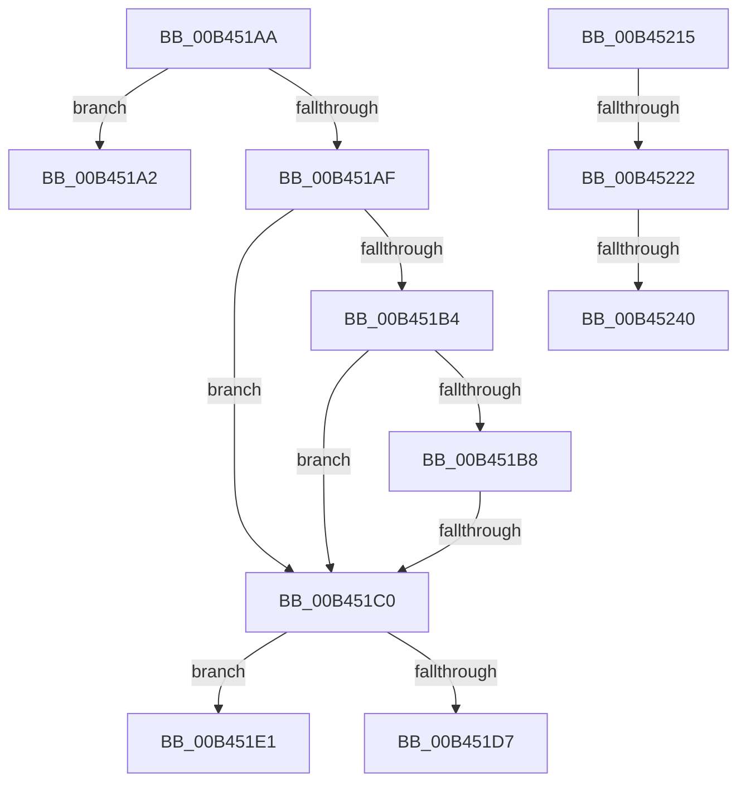

# sub_00B451A2

- RVA: `0x00B451A2`–`0x00B452D1` (길이 `303` bytes)
- VA: `0x0000000140B451A2`
- 실행 섹션: `PAGE`
- PDB 이름 있음: `아니요`; PDB Function 태그: `아니요`
- unwind 정보 RVA: `0x000B81C0`
- 디코드: `68`개 명령, `303/303` bytes 표시
- 미해석 바이트: `0` (있으면 어셈블리에 `.byte`로 보존)

> 이 문서는 커널 이미지의 기계어와 PDB 기호를 분석해 생성했습니다. 4번과 5번은 함수 원형과 자료형을 바이너리 사용 방식에서 추정한 C 해석이며 원본 소스 복구 결과는 아닙니다.

## 1. Dependencies

- 직접 호출 지점: **4**; 고유 호출 대상: **4**
- 직접 호출자로 확인된 함수: **0**
- RIP 상대 이미지 참조: **3**

### Outgoing calls
- `0x00B451CD` → [ExAllocatePool2](../../poolcode/B8/ExAllocatePool2_function_00B820F0.md) (function, `0x00B820F0`)
- `0x00B4520A` → [ExQueueWorkItem](../../text/2F/ExQueueWorkItem_function_002F9520.md) (function, `0x002F9520`)
- `0x00B45233` → [tlgKeywordOn](../../text/42/tlgKeywordOn_function_0042EAA0.md) (function, `0x0042EAA0`)
- `0x00B452C6` → [tlgWriteTransfer_EtwWriteTransfer](../../text/42/tlgWriteTransfer_EtwWriteTransfer_function_004260E0.md) (function, `0x004260E0`)

### Direct callers
- 이 함수 시작 RVA로 연결되는 직접 call은 확인되지 않았습니다. 간접 호출은 완전히 역산할 수 없습니다.

### Static image references
- `0x00B451EC` → RVA `0x00AB2800` (`PopFxUpdateVetoMaskWork`; read)
- `0x00B45215` → RVA `0x00E07748` (`.data`; read)
- `0x00B45250` → RVA `0x00048FD5` (`.rdata`; read)

## 2. Other-region calls and transfers

- 다른 실행 섹션으로 향하는 call: **4**
  - `0x00B451CD` → [ExAllocatePool2](../../poolcode/B8/ExAllocatePool2_function_00B820F0.md) (`PAGE` → `POOLCODE`)
  - `0x00B4520A` → [ExQueueWorkItem](../../text/2F/ExQueueWorkItem_function_002F9520.md) (`PAGE` → `.text`)
  - `0x00B45233` → [tlgKeywordOn](../../text/42/tlgKeywordOn_function_0042EAA0.md) (`PAGE` → `.text`)
  - `0x00B452C6` → [tlgWriteTransfer_EtwWriteTransfer](../../text/42/tlgWriteTransfer_EtwWriteTransfer_function_004260E0.md) (`PAGE` → `.text`)
- call이 아닌 외부 분기/꼬리 이동: **7**
  - `0x00B451A5` → [PoFxSetTargetDripsDevicePowerState + 0x134](../A8/PoFxSetTargetDripsDevicePowerState_function_00A88EB0.md) (`tail-transfer`)
  - `0x00B451BA` → [PoFxSetTargetDripsDevicePowerState + 0x17A](../A8/PoFxSetTargetDripsDevicePowerState_function_00A88EB0.md) (`tail-transfer`)
  - `0x00B451DC` → [PoFxSetTargetDripsDevicePowerState + 0x134](../A8/PoFxSetTargetDripsDevicePowerState_function_00A88EB0.md) (`tail-transfer`)
  - `0x00B45210` → [PoFxSetTargetDripsDevicePowerState + 0x145](../A8/PoFxSetTargetDripsDevicePowerState_function_00A88EB0.md) (`tail-transfer`)
  - `0x00B4521C` → [PoFxSetTargetDripsDevicePowerState + 0x145](../A8/PoFxSetTargetDripsDevicePowerState_function_00A88EB0.md) (`tail-transfer`)
  - `0x00B4523A` → [PoFxSetTargetDripsDevicePowerState + 0x145](../A8/PoFxSetTargetDripsDevicePowerState_function_00A88EB0.md) (`tail-transfer`)
  - `0x00B452CC` → [PoFxSetTargetDripsDevicePowerState + 0x145](../A8/PoFxSetTargetDripsDevicePowerState_function_00A88EB0.md) (`tail-transfer`)

## 3. Assembly (complete function range)

```asm
00B451A2  41 8B DC                        mov ebx, r12d
00B451A5  E9 3A 3E F4 FF                  jmp 0x140a88fe4
00B451AA  3B 75 87                        cmp esi, dword ptr [rbp - 0x79]
00B451AD  74 F3                           je 0x140b451a2
00B451AF  83 F8 01                        cmp eax, 1
00B451B2  7E 0C                           jle 0x140b451c0
00B451B4  85 F6                           test esi, esi
00B451B6  74 08                           je 0x140b451c0
00B451B8  3B F0                           cmp esi, eax
00B451BA  0F 8E 6A 3E F4 FF               jle 0x140a8902a
00B451C0  B9 40 00 00 00                  mov ecx, 0x40
00B451C5  41 B8 50 46 58 4D               mov r8d, 0x4d584650
00B451CB  8B D1                           mov edx, ecx
00B451CD  E8 1E CF 03 00                  call 0x140b820f0
00B451D2  48 85 C0                        test rax, rax
00B451D5  75 0A                           jne 0x140b451e1
00B451D7  BB 9A 00 00 C0                  mov ebx, 0xc000009a
00B451DC  E9 03 3E F4 FF                  jmp 0x140a88fe4
00B451E1  48 89 40 08                     mov qword ptr [rax + 8], rax
00B451E5  48 8D 48 20                     lea rcx, [rax + 0x20]
00B451E9  48 89 00                        mov qword ptr [rax], rax
00B451EC  4C 8D 05 0D D6 F6 FF            lea r8, [rip - 0x929f3]
00B451F3  48 89 78 10                     mov qword ptr [rax + 0x10], rdi
00B451F7  BA 01 00 00 00                  mov edx, 1
00B451FC  89 70 18                        mov dword ptr [rax + 0x18], esi
00B451FF  4C 89 41 10                     mov qword ptr [rcx + 0x10], r8
00B45203  48 89 41 18                     mov qword ptr [rcx + 0x18], rax
00B45207  4C 89 21                        mov qword ptr [rcx], r12
00B4520A  E8 11 43 7B FF                  call 0x1402f9520
00B4520F  90                              nop
00B45210  E9 E0 3D F4 FF                  jmp 0x140a88ff5
00B45215  83 3D 2C 25 2C 00 05            cmp dword ptr [rip + 0x2c252c], 5
00B4521C  0F 86 D3 3D F4 FF               jbe 0x140a88ff5
00B45222  48 BA 00 00 00 00 00 40 00 00   movabs rdx, 0x400000000000
00B4522C  48 8D 0D 15 25 2C 00            lea rcx, [rip + 0x2c2515]
00B45233  E8 68 98 8E FF                  call 0x14042eaa0
00B45238  84 C0                           test al, al
00B4523A  0F 84 B5 3D F4 FF               je 0x140a88ff5
00B45240  48 8D 45 EF                     lea rax, [rbp - 0x11]
00B45244  48 C7 45 DF 02 00 00 00         mov qword ptr [rbp - 0x21], 2
00B4524C  48 89 45 D7                     mov qword ptr [rbp - 0x29], rax
00B45250  48 8D 15 7E 3D 50 FF            lea rdx, [rip - 0xafc282]
00B45257  49 8B 40 08                     mov rax, qword ptr [r8 + 8]
00B4525B  48 8D 0D E6 24 2C 00            lea rcx, [rip + 0x2c24e6]
00B45262  48 89 45 E7                     mov qword ptr [rbp - 0x19], rax
00B45266  45 33 C9                        xor r9d, r9d
00B45269  41 0F B7 00                     movzx eax, word ptr [r8]
00B4526D  45 33 C0                        xor r8d, r8d
00B45270  89 45 EF                        mov dword ptr [rbp - 0x11], eax
00B45273  48 8D 45 93                     lea rax, [rbp - 0x6d]
00B45277  48 89 45 F7                     mov qword ptr [rbp - 9], rax
00B4527B  48 8D 45 8F                     lea rax, [rbp - 0x71]
00B4527F  48 89 45 07                     mov qword ptr [rbp + 7], rax
00B45283  48 8D 45 97                     lea rax, [rbp - 0x69]
00B45287  48 89 45 17                     mov qword ptr [rbp + 0x17], rax
00B4528B  48 8D 45 B7                     lea rax, [rbp - 0x49]
00B4528F  48 89 44 24 28                  mov qword ptr [rsp + 0x28], rax
00B45294  C7 44 24 20 07 00 00 00         mov dword ptr [rsp + 0x20], 7
00B4529C  44 89 65 F3                     mov dword ptr [rbp - 0xd], r12d
00B452A0  89 75 93                        mov dword ptr [rbp - 0x6d], esi
00B452A3  48 C7 45 FF 04 00 00 00         mov qword ptr [rbp - 1], 4
00B452AB  89 5D 8F                        mov dword ptr [rbp - 0x71], ebx
00B452AE  48 C7 45 0F 04 00 00 00         mov qword ptr [rbp + 0xf], 4
00B452B6  48 C7 45 97 00 00 00 01         mov qword ptr [rbp - 0x69], 0x1000000
00B452BE  48 C7 45 1F 08 00 00 00         mov qword ptr [rbp + 0x1f], 8
00B452C6  E8 15 0E 8E FF                  call 0x1404260e0
00B452CB  90                              nop
00B452CC  E9 24 3D F4 FF                  jmp 0x140a88ff5
```

## 4. C-style interpretation (structured pseudocode)

```c
__int64 __fastcall sub_00B451A2(__int64 a1, __int64 a2, __int64 a3, int a4)
{
    unsigned int v_stack_p20;
    unsigned __int64 v_stack_p28;
}
```

## 5. (Beta) C Style

```c
int64_t sub_00B451A2(int64_t Arg1, int64_t Arg2, int64_t Arg3, int32_t Arg4)
{
    uint32_t v_stack_p20;
    uint64_t v_stack_p28;
}
```

## 6. Execution-region graph

[열기: 2D/3D 그래프와 함수 탐색 컨트롤 패널](../../../control-panel.html?section=page&rva=0x00B451A2&view=graph)

- 2D 그래프는 위에서 아래로 흐르고, 3D 그래프는 빈 공간을 드래그해 회전합니다. Shift+드래그는 이동, 휠은 확대·축소, 함수 노드 선택은 대상 보고서 이동입니다.

### Static fallback


