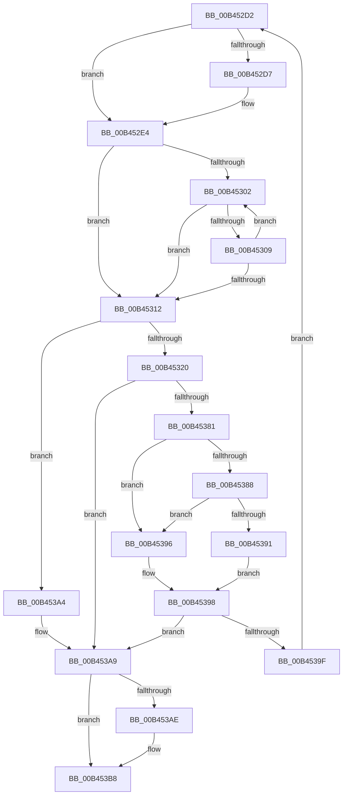

# sub_00B452D2

- RVA: `0x00B452D2`–`0x00B453C1` (길이 `239` bytes)
- VA: `0x0000000140B452D2`
- 실행 섹션: `PAGE`
- PDB 이름 있음: `아니요`; PDB Function 태그: `아니요`
- unwind 정보 RVA: `0x000B8220`
- 디코드: `67`개 명령, `239/239` bytes 표시
- 미해석 바이트: `0` (있으면 어셈블리에 `.byte`로 보존)

> 이 문서는 커널 이미지의 기계어와 PDB 기호를 분석해 생성했습니다. 4번과 5번은 함수 원형과 자료형을 바이너리 사용 방식에서 추정한 C 해석이며 원본 소스 복구 결과는 아닙니다.

## 1. Dependencies

- 직접 호출 지점: **3**; 고유 호출 대상: **2**
- 직접 호출자로 확인된 함수: **0**
- RIP 상대 이미지 참조: **0**

### Outgoing calls
- `0x00B452DF` → [ZwClose](../../text/6A/ZwClose_function_006AD2B0.md) (function, `0x006AD2B0`)
- `0x00B45376` → [ZwCreateKey](../../text/6A/ZwCreateKey_function_006AD470.md) (function, `0x006AD470`)
- `0x00B453B3` → [ZwClose](../../text/6A/ZwClose_function_006AD2B0.md) (function, `0x006AD2B0`)

### Direct callers
- 이 함수 시작 RVA로 연결되는 직접 call은 확인되지 않았습니다. 간접 호출은 완전히 역산할 수 없습니다.

### Static image references
- 디코드된 RIP-relative 메모리 참조가 없습니다.

## 2. Other-region calls and transfers

- 다른 실행 섹션으로 향하는 call: **3**
  - `0x00B452DF` → [ZwClose](../../text/6A/ZwClose_function_006AD2B0.md) (`PAGE` → `.text`)
  - `0x00B45376` → [ZwCreateKey](../../text/6A/ZwCreateKey_function_006AD470.md) (`PAGE` → `.text`)
  - `0x00B453B3` → [ZwClose](../../text/6A/ZwClose_function_006AD2B0.md) (`PAGE` → `.text`)
- call이 아닌 외부 분기/꼬리 이동: **1**
  - `0x00B453BC` → [IopCreateRegistryKeyEx + 0x9E](../A8/IopCreateRegistryKeyEx_function_00A89038.md) (`tail-transfer`)

## 3. Assembly (complete function range)

```asm
00B452D2  83 FB 01                        cmp ebx, 1
00B452D5  76 0D                           jbe 0x140b452e4
00B452D7  41 8B CF                        mov ecx, r15d
00B452DA  48 8B 4C CD AF                  mov rcx, qword ptr [rbp + rcx*8 - 0x51]
00B452DF  E8 CC 7F B6 FF                  call 0x1406ad2b0
00B452E4  41 8B CD                        mov ecx, r13d
00B452E7  4C 8D 55 AF                     lea r10, [rbp - 0x51]
00B452EB  41 FF CD                        dec r13d
00B452EE  4C 8B F7                        mov r14, rdi
00B452F1  41 83 E5 01                     and r13d, 1
00B452F5  4F 8D 14 EA                     lea r10, [r10 + r13*8]
00B452F9  49 83 22 00                     and qword ptr [r10], 0
00B452FD  49 3B FC                        cmp rdi, r12
00B45300  73 10                           jae 0x140b45312
00B45302  66 41 83 3E 5C                  cmp word ptr [r14], 0x5c
00B45307  74 09                           je 0x140b45312
00B45309  49 83 C6 02                     add r14, 2
00B4530D  4D 3B F4                        cmp r14, r12
00B45310  72 F0                           jb 0x140b45302
00B45312  41 8B C6                        mov eax, r14d
00B45315  4C 8B F9                        mov r15, rcx
00B45318  2B C7                           sub eax, edi
00B4531A  0F 84 84 00 00 00               je 0x140b453a4
00B45320  8B 55 6F                        mov edx, dword ptr [rbp + 0x6f]
00B45323  4C 8D 45 CF                     lea r8, [rbp - 0x31]
00B45327  66 89 45 C1                     mov word ptr [rbp - 0x3f], ax
00B4532B  0F 57 C0                        xorps xmm0, xmm0
00B4532E  66 89 45 BF                     mov word ptr [rbp - 0x41], ax
00B45332  45 33 C9                        xor r9d, r9d
00B45335  48 8B 44 CD AF                  mov rax, qword ptr [rbp + rcx*8 - 0x51]
00B4533A  49 8B CA                        mov rcx, r10
00B4533D  48 89 45 D7                     mov qword ptr [rbp - 0x29], rax
00B45341  48 8D 45 BF                     lea rax, [rbp - 0x41]
00B45345  48 89 45 DF                     mov qword ptr [rbp - 0x21], rax
00B45349  48 8D 45 67                     lea rax, [rbp + 0x67]
00B4534D  48 89 44 24 30                  mov qword ptr [rsp + 0x30], rax
00B45352  8B 45 77                        mov eax, dword ptr [rbp + 0x77]
00B45355  89 44 24 28                     mov dword ptr [rsp + 0x28], eax
00B45359  48 83 64 24 20 00               and qword ptr [rsp + 0x20], 0
00B4535F  48 89 7D C7                     mov qword ptr [rbp - 0x39], rdi
00B45363  C7 45 CF 30 00 00 00            mov dword ptr [rbp - 0x31], 0x30
00B4536A  C7 45 E7 40 02 00 00            mov dword ptr [rbp - 0x19], 0x240
00B45371  F3 0F 7F 45 EF                  movdqu xmmword ptr [rbp - 0x11], xmm0
00B45376  E8 F5 80 B6 FF                  call 0x1406ad470
00B4537B  8B F0                           mov esi, eax
00B4537D  85 C0                           test eax, eax
00B4537F  78 28                           js 0x140b453a9
00B45381  FF C3                           inc ebx
00B45383  4D 3B F4                        cmp r14, r12
00B45386  74 0E                           je 0x140b45396
00B45388  49 8D 7E 02                     lea rdi, [r14 + 2]
00B4538C  49 3B FC                        cmp rdi, r12
00B4538F  74 05                           je 0x140b45396
00B45391  8A 45 5F                        mov al, byte ptr [rbp + 0x5f]
00B45394  EB 02                           jmp 0x140b45398
00B45396  32 C0                           xor al, al
00B45398  88 45 5F                        mov byte ptr [rbp + 0x5f], al
00B4539B  84 C0                           test al, al
00B4539D  74 0A                           je 0x140b453a9
00B4539F  E9 2E FF FF FF                  jmp 0x140b452d2
00B453A4  BE 0D 00 00 C0                  mov esi, 0xc000000d
00B453A9  83 FB 01                        cmp ebx, 1
00B453AC  76 0A                           jbe 0x140b453b8
00B453AE  4A 8B 4C FD AF                  mov rcx, qword ptr [rbp + r15*8 - 0x51]
00B453B3  E8 F8 7E B6 FF                  call 0x1406ad2b0
00B453B8  48 8B 7D 57                     mov rdi, qword ptr [rbp + 0x57]
00B453BC  E9 15 3D F4 FF                  jmp 0x140a890d6
```

## 4. C-style interpretation (structured pseudocode)

```c
__int64 __fastcall sub_00B452D2(__int64 a1, __int64 a2, __int64 a3, int a4)
{
    __int64 result;
    __int64 v_r13;
    __int64 v_r14;
    __int64 v_rbx;
    unsigned __int64 v_stack_p20;
    unsigned int v_stack_p28;
    unsigned __int64 v_stack_p30;

    if (((unsigned int)(v_rbx)) >= = 1) {
        a1 = (unsigned int)(v_r15);
        a1 = *(unsigned __int64 *)(v_rbp + a1 * 8 - 81);
        result = ZwClose(a1, a2, a3, a4);
    }
    v_r13 = (unsigned int)((v_r13) - 1);
    v_r13 = (unsigned int)((v_r13) & (1));
    if (v_rdi >= v_r12) goto loc_00B45312;
loc_00B45302:
    if ((*(unsigned __int16 *)(v_rdi)) == 92) goto loc_00B45312;
    v_r14 = (v_rdi) + (2);
    if (v_r14 < v_r12) goto loc_00B45302;
loc_00B45312:
    result = (unsigned int)(((unsigned int)((unsigned int)(v_r14))) - ((unsigned int)(v_rdi)));
    if (condition_is_equal) goto loc_00B453A4;
    *(unsigned __int16 *)(v_rbp - 63) = (unsigned __int16)(result);
    *(unsigned __int16 *)(v_rbp - 65) = (unsigned __int16)(result);
    a4 = 0;
    *(unsigned __int64 *)(v_rbp - 41) = *(unsigned __int64 *)(v_rbp + (unsigned int)((unsigned int)(v_r13)) * 8 - 81);
    *(unsigned __int64 *)(v_rbp - 33) = v_rbp - 65;
    v_stack_p30 = v_rbp + 103;
    v_stack_p28 = (unsigned int)((unsigned int)(*(unsigned int *)(v_rbp + 119)));
    *(unsigned __int64 *)(v_rbp - 57) = v_rdi;
    *(unsigned int *)(v_rbp - 49) = 48;
    *(unsigned int *)(v_rbp - 25) = 576;
    *(unsigned __int64 *)(v_rbp - 17) = v_xmm0;
    result = ZwCreateKey(v_rbp - 81 + v_r13 * 8, (unsigned int)(*(unsigned int *)(v_rbp + 111)), v_rbp - 49, a4);
    if (sign_flag) goto loc_00B453A9;
    v_rbx = (unsigned int)((v_rbx) + 1);
    if (v_r14 == v_r12) goto loc_00B45396;
    if ((v_r14 + 2) == v_r12) goto loc_00B45396;
    goto loc_00B45398;
loc_00B45396:
    result = 0;
loc_00B45398:
    *(unsigned __int8 *)(v_rbp + 95) = 0;
    if (0 == 0) goto loc_00B453A9;
    goto loc_00B452D2;
loc_00B453A4:
loc_00B453A9:
    if (((unsigned int)(v_rbx)) >= = 1) {
        a1 = *(unsigned __int64 *)(v_rbp + (unsigned int)((unsigned int)(v_r13)) * 8 - 81);
        result = ZwClose(a1, (unsigned int)(*(unsigned int *)(v_rbp + 111)), v_rbp - 49, a4);
    }
}
```

## 5. (Beta) C Style

```c
int64_t sub_00B452D2(int64_t Arg1, int64_t Arg2, int64_t Arg3, int32_t Arg4)
{
    int64_t result;
    int64_t local_r13;
    int64_t local_r14;
    int64_t local_rbx;
    uint64_t v_stack_p20;
    uint32_t v_stack_p28;
    uint64_t v_stack_p30;

    if (((uint32_t)(local_rbx)) >= = 1) {
        Arg1 = (uint32_t)(local_r15);
        Arg1 = *(uint64_t *)(local_rbp + Arg1 * 8 - 0x51);
        result = ZwClose(Arg1, Arg2, Arg3, Arg4);
    }
    local_r13 = (uint32_t)((local_r13) - 1);
    local_r13 = (uint32_t)((local_r13) & (1));
    if (local_rdi >= local_r12) goto loc_00B45312;
loc_00B45302:
    if ((*(uint16_t *)(local_rdi)) == 92) goto loc_00B45312;
    local_r14 = (local_rdi) + (2);
    if (local_r14 < local_r12) goto loc_00B45302;
loc_00B45312:
    result = (uint32_t)(((uint32_t)((uint32_t)(local_r14))) - ((uint32_t)(local_rdi)));
    if (condition_is_equal) goto loc_00B453A4;
    *(uint16_t *)(local_rbp - 0x3F) = (uint16_t)(result);
    *(uint16_t *)(local_rbp - 0x41) = (uint16_t)(result);
    Arg4 = 0;
    *(uint64_t *)(local_rbp - 0x29) = *(uint64_t *)(local_rbp + (uint32_t)((uint32_t)(local_r13)) * 8 - 0x51);
    *(uint64_t *)(local_rbp - 0x21) = local_rbp - 65;
    v_stack_p30 = local_rbp + 103;
    v_stack_p28 = (uint32_t)((uint32_t)(*(uint32_t *)(local_rbp + 0x77)));
    *(uint64_t *)(local_rbp - 0x39) = local_rdi;
    *(uint32_t *)(local_rbp - 0x31) = 48;
    *(uint32_t *)(local_rbp - 0x19) = 576;
    *(uint64_t *)(local_rbp - 0x11) = v_xmm0;
    result = ZwCreateKey(local_rbp - 81 + local_r13 * 8, (uint32_t)(*(uint32_t *)(local_rbp + 0x6F)), local_rbp - 49, Arg4);
    if (sign_flag) goto loc_00B453A9;
    local_rbx = (uint32_t)((local_rbx) + 1);
    if (local_r14 == local_r12) goto loc_00B45396;
    if ((local_r14 + 2) == local_r12) goto loc_00B45396;
    goto loc_00B45398;
loc_00B45396:
    result = 0;
loc_00B45398:
    *(uint8_t *)(local_rbp + 0x5F) = 0;
    if (0 == 0) goto loc_00B453A9;
    goto loc_00B452D2;
loc_00B453A4:
loc_00B453A9:
    if (((uint32_t)(local_rbx)) >= = 1) {
        Arg1 = *(uint64_t *)(local_rbp + (uint32_t)((uint32_t)(local_r13)) * 8 - 0x51);
        result = ZwClose(Arg1, (uint32_t)(*(uint32_t *)(local_rbp + 0x6F)), local_rbp - 49, Arg4);
    }
}
```

## 6. Execution-region graph

[열기: 2D/3D 그래프와 함수 탐색 컨트롤 패널](../../../control-panel.html?section=page&rva=0x00B452D2&view=graph)

- 2D 그래프는 위에서 아래로 흐르고, 3D 그래프는 빈 공간을 드래그해 회전합니다. Shift+드래그는 이동, 휠은 확대·축소, 함수 노드 선택은 대상 보고서 이동입니다.

### Static fallback


