# sub_00B4588A

- RVA: `0x00B4588A`–`0x00B4604E` (길이 `1,988` bytes)
- VA: `0x0000000140B4588A`
- 실행 섹션: `PAGE`
- PDB 이름 있음: `아니요`; PDB Function 태그: `아니요`
- unwind 정보 RVA: `0x000B8584`
- 디코드: `383`개 명령, `1,988/1,988` bytes 표시
- 미해석 바이트: `0` (있으면 어셈블리에 `.byte`로 보존)

> 이 문서는 커널 이미지의 기계어와 PDB 기호를 분석해 생성했습니다. 4번과 5번은 함수 원형과 자료형을 바이너리 사용 방식에서 추정한 C 해석이며 원본 소스 복구 결과는 아닙니다.

## 1. Dependencies

- 직접 호출 지점: **31**; 고유 호출 대상: **18**
- 직접 호출자로 확인된 함수: **0**
- RIP 상대 이미지 참조: **15**

### Outgoing calls
- `0x00B458F8` → [tlgWriteTransfer_EtwWriteTransfer](../../text/42/tlgWriteTransfer_EtwWriteTransfer_function_004260E0.md) (function, `0x004260E0`)
- `0x00B4592A` → [VrpGetNextToken](../93/VrpGetNextToken_function_009357F0.md) (function, `0x009357F0`)
- `0x00B45941` → [RtlEqualUnicodeString](../93/RtlEqualUnicodeString_function_00932A20.md) (function, `0x00932A20`)
- `0x00B45960` → [RtlEqualUnicodeString](../93/RtlEqualUnicodeString_function_00932A20.md) (function, `0x00932A20`)
- `0x00B45996` → [RtlEqualUnicodeString](../93/RtlEqualUnicodeString_function_00932A20.md) (function, `0x00932A20`)
- `0x00B459B4` → [RtlEqualUnicodeString](../93/RtlEqualUnicodeString_function_00932A20.md) (function, `0x00932A20`)
- `0x00B45A03` → [VrpStripTrailingCharacters](../93/VrpStripTrailingCharacters_function_009358B0.md) (function, `0x009358B0`)
- `0x00B45A48` → [RtlStringFromGUIDEx](../91/RtlStringFromGUIDEx_function_00915450.md) (function, `0x00915450`)
- `0x00B45AA0` → [ExAllocatePool2](../../poolcode/B8/ExAllocatePool2_function_00B820F0.md) (function, `0x00B820F0`)
- `0x00B45AC5` → [RtlAppendUnicodeStringToString](../../text/40/RtlAppendUnicodeStringToString_function_0040FA50.md) (function, `0x0040FA50`)
- `0x00B45AD9` → [RtlAppendUnicodeToString](../../text/40/RtlAppendUnicodeToString_function_0040F990.md) (function, `0x0040F990`)
- `0x00B45AEE` → [RtlAppendUnicodeStringToString](../../text/40/RtlAppendUnicodeStringToString_function_0040FA50.md) (function, `0x0040FA50`)
- `0x00B45B02` → [RtlAppendUnicodeToString](../../text/40/RtlAppendUnicodeToString_function_0040F990.md) (function, `0x0040F990`)
- `0x00B45B12` → [RtlAppendUnicodeStringToString](../../text/40/RtlAppendUnicodeStringToString_function_0040FA50.md) (function, `0x0040FA50`)
- `0x00B45B26` → [RtlAppendUnicodeToString](../../text/40/RtlAppendUnicodeToString_function_0040F990.md) (function, `0x0040F990`)
- `0x00B45B3B` → [RtlAppendUnicodeStringToString](../../text/40/RtlAppendUnicodeStringToString_function_0040FA50.md) (function, `0x0040FA50`)
- `0x00B45B45` → [VrpLockJobContextExclusive](../93/VrpLockJobContextExclusive_function_00935A34.md) (function, `0x00935A34`)
- `0x00B45B8D` → [VrpCreateNamespaceNode](../93/VrpCreateNamespaceNode_function_00935538.md) (function, `0x00935538`)
- `0x00B45BAC` → [VrpAddNamespaceNodeToList](../93/VrpAddNamespaceNodeToList_function_00935A94.md) (function, `0x00935A94`)
- `0x00B45BBE` → [VrpCreateNamespaceNodePlaceholderKey](../93/VrpCreateNamespaceNodePlaceholderKey_function_00935BAC.md) (function, `0x00935BAC`)
- `0x00B45C67` → [ObOpenObjectByPointer](../8B/ObOpenObjectByPointer_function_008B7420.md) (function, `0x008B7420`)
- `0x00B45CA5` → [ObOpenObjectByPointer](../8B/ObOpenObjectByPointer_function_008B7420.md) (function, `0x008B7420`)
- `0x00B45CEB` → [ObOpenObjectByPointer](../8B/ObOpenObjectByPointer_function_008B7420.md) (function, `0x008B7420`)
- `0x00B45D2F` → [ObOpenObjectByPointer](../8B/ObOpenObjectByPointer_function_008B7420.md) (function, `0x008B7420`)
- `0x00B45DC3` → [CmLoadDifferencingKey](../87/CmLoadDifferencingKey_function_00875670.md) (function, `0x00875670`)
- `0x00B45E15` → [ObReferenceObjectByHandle](../86/ObReferenceObjectByHandle_function_00868DB0.md) (function, `0x00868DB0`)
- `0x00B45E37` → [VrpAllocateKeyContext](../93/VrpAllocateKeyContext_function_00937204.md) (function, `0x00937204`)
- `0x00B45E5E` → [VrpBuildKeyPath](../93/VrpBuildKeyPath_function_00934650.md) (function, `0x00934650`)
- `0x00B45E83` → [CmSetCallbackObjectContext](../93/CmSetCallbackObjectContext_function_009368D0.md) (function, `0x009368D0`)
- `0x00B45EF3` → [ObOpenObjectByPointer](../8B/ObOpenObjectByPointer_function_008B7420.md) (function, `0x008B7420`)
- `0x00B4603C` → [tlgWriteTransfer_EtwWriteTransfer](../../text/42/tlgWriteTransfer_EtwWriteTransfer_function_004260E0.md) (function, `0x004260E0`)

### Direct callers
- 이 함수 시작 RVA로 연결되는 직접 call은 확인되지 않았습니다. 간접 호출은 완전히 역산할 수 없습니다.

### Static image references
- `0x00B4588C` → RVA `0x00002F30` (`.rdata`; read)
- `0x00B458EA` → RVA `0x0005AA82` (`.rdata`; read)
- `0x00B458F1` → RVA `0x00E0A630` (`.data`; read)
- `0x00B45932` → RVA `0x0000D600` (`.rdata`; read)
- `0x00B45951` → RVA `0x00002200` (`.rdata`; read)
- `0x00B45984` → RVA `0x0000D5E0` (`.rdata`; read)
- `0x00B459A2` → RVA `0x0000D5F0` (`.rdata`; read)
- `0x00B45AB6` → RVA `0x0000D610` (`.rdata`; read)
- `0x00B45ACA` → RVA `0x00B0E140` (` ?? ::NNGAKEGL::`string'`; read)
- `0x00B45AF3` → RVA `0x00B06E30` (` ?? ::NNGAKEGL::`string'`; read)
- `0x00B45C52` → RVA `0x00FC6AC0` (`ALMOSTRO`; read)
- `0x00B45C90` → RVA `0x00FC6B80` (`ALMOSTRO`; read)
- `0x00B45D1A` → RVA `0x00FD8020` (`PAGEDATA`; read)
- `0x00B45E79` → RVA `0x00EF02C8` (`.data`; read)
- `0x00B4602E` → RVA `0x0005A86A` (`.rdata`; read)

## 2. Other-region calls and transfers

- 다른 실행 섹션으로 향하는 call: **10**
  - `0x00B458F8` → [tlgWriteTransfer_EtwWriteTransfer](../../text/42/tlgWriteTransfer_EtwWriteTransfer_function_004260E0.md) (`PAGE` → `.text`)
  - `0x00B45AA0` → [ExAllocatePool2](../../poolcode/B8/ExAllocatePool2_function_00B820F0.md) (`PAGE` → `POOLCODE`)
  - `0x00B45AC5` → [RtlAppendUnicodeStringToString](../../text/40/RtlAppendUnicodeStringToString_function_0040FA50.md) (`PAGE` → `.text`)
  - `0x00B45AD9` → [RtlAppendUnicodeToString](../../text/40/RtlAppendUnicodeToString_function_0040F990.md) (`PAGE` → `.text`)
  - `0x00B45AEE` → [RtlAppendUnicodeStringToString](../../text/40/RtlAppendUnicodeStringToString_function_0040FA50.md) (`PAGE` → `.text`)
  - `0x00B45B02` → [RtlAppendUnicodeToString](../../text/40/RtlAppendUnicodeToString_function_0040F990.md) (`PAGE` → `.text`)
  - `0x00B45B12` → [RtlAppendUnicodeStringToString](../../text/40/RtlAppendUnicodeStringToString_function_0040FA50.md) (`PAGE` → `.text`)
  - `0x00B45B26` → [RtlAppendUnicodeToString](../../text/40/RtlAppendUnicodeToString_function_0040F990.md) (`PAGE` → `.text`)
  - `0x00B45B3B` → [RtlAppendUnicodeStringToString](../../text/40/RtlAppendUnicodeStringToString_function_0040FA50.md) (`PAGE` → `.text`)
  - `0x00B4603C` → [tlgWriteTransfer_EtwWriteTransfer](../../text/42/tlgWriteTransfer_EtwWriteTransfer_function_004260E0.md) (`PAGE` → `.text`)
- call이 아닌 외부 분기/꼬리 이동: **17**
  - `0x00B458FE` → [VrpPreLoadKey + 0x157](../A8/VrpPreLoadKey_function_00A8A43C.md) (`tail-transfer`)
  - `0x00B4590D` → [VrpPreLoadKey + 0x34A](../A8/VrpPreLoadKey_function_00A8A43C.md) (`tail-transfer`)
  - `0x00B4597C` → [VrpPreLoadKey + 0x266](../A8/VrpPreLoadKey_function_00A8A43C.md) (`tail-transfer`)
  - `0x00B459BB` → [VrpPreLoadKey + 0x213](../A8/VrpPreLoadKey_function_00A8A43C.md) (`tail-transfer`)
  - `0x00B45A2A` → [VrpPreLoadKey + 0x213](../A8/VrpPreLoadKey_function_00A8A43C.md) (`tail-transfer`)
  - `0x00B45A51` → [VrpPreLoadKey + 0x256](../A8/VrpPreLoadKey_function_00A8A43C.md) (`tail-transfer`)
  - `0x00B45B96` → [VrpPreLoadKey + 0x25B](../A8/VrpPreLoadKey_function_00A8A43C.md) (`tail-transfer`)
  - `0x00B45BB5` → [VrpPreLoadKey + 0x25B](../A8/VrpPreLoadKey_function_00A8A43C.md) (`tail-transfer`)
  - `0x00B45BC7` → [VrpPreLoadKey + 0x25B](../A8/VrpPreLoadKey_function_00A8A43C.md) (`tail-transfer`)
  - `0x00B45C70` → [VrpPreLoadKey + 0x25B](../A8/VrpPreLoadKey_function_00A8A43C.md) (`tail-transfer`)
  - `0x00B45CAE` → [VrpPreLoadKey + 0x25B](../A8/VrpPreLoadKey_function_00A8A43C.md) (`tail-transfer`)
  - `0x00B45CF4` → [VrpPreLoadKey + 0x25B](../A8/VrpPreLoadKey_function_00A8A43C.md) (`tail-transfer`)
  - `0x00B45D38` → [VrpPreLoadKey + 0x25B](../A8/VrpPreLoadKey_function_00A8A43C.md) (`tail-transfer`)
  - `0x00B45DCC` → [VrpPreLoadKey + 0x25B](../A8/VrpPreLoadKey_function_00A8A43C.md) (`tail-transfer`)
  - `0x00B45F42` → [VrpPreLoadKey + 0x25B](../A8/VrpPreLoadKey_function_00A8A43C.md) (`tail-transfer`)
  - `0x00B46042` → [VrpPreLoadKey + 0x25B](../A8/VrpPreLoadKey_function_00A8A43C.md) (`tail-transfer`)
  - `0x00B46049` → [VrpPreLoadKey + 0x256](../A8/VrpPreLoadKey_function_00A8A43C.md) (`tail-transfer`)

## 3. Assembly (complete function range)

```asm
00B4588A  8B C3                           mov eax, ebx
00B4588C  48 8B 0D 9D D6 4B FF            mov rcx, qword ptr [rip - 0xb42963]
00B45893  0F B7 C0                        movzx eax, ax
00B45896  48 8D 94 24 E8 01 00 00         lea rdx, [rsp + 0x1e8]
00B4589E  48 89 94 24 D0 01 00 00         mov qword ptr [rsp + 0x1d0], rdx
00B458A6  41 BC 02 00 00 00               mov r12d, 2
00B458AC  4C 89 A4 24 D8 01 00 00         mov qword ptr [rsp + 0x1d8], r12
00B458B4  48 89 8C 24 E0 01 00 00         mov qword ptr [rsp + 0x1e0], rcx
00B458BC  89 84 24 E8 01 00 00            mov dword ptr [rsp + 0x1e8], eax
00B458C3  89 9C 24 EC 01 00 00            mov dword ptr [rsp + 0x1ec], ebx
00B458CA  48 8D 84 24 B0 01 00 00         lea rax, [rsp + 0x1b0]
00B458D2  48 89 44 24 28                  mov qword ptr [rsp + 0x28], rax
00B458D7  C7 44 24 20 04 00 00 00         mov dword ptr [rsp + 0x20], 4
00B458DF  45 33 C9                        xor r9d, r9d
00B458E2  4C 8D 84 24 98 01 00 00         lea r8, [rsp + 0x198]
00B458EA  48 8D 15 91 51 51 FF            lea rdx, [rip - 0xaeae6f]
00B458F1  48 8D 0D 38 4D 2C 00            lea rcx, [rip + 0x2c4d38]
00B458F8  E8 E3 07 8E FF                  call 0x1404260e0
00B458FD  90                              nop
00B458FE  E9 90 4C F4 FF                  jmp 0x140a8a593
00B45903  BF 9A 00 00 C0                  mov edi, 0xc000009a
00B45908  BE 00 00 00 80                  mov esi, 0x80000000
00B4590D  E9 74 4E F4 FF                  jmp 0x140a8a786
00B45912  4C 8D 84 24 C0 00 00 00         lea r8, [rsp + 0xc0]
00B4591A  48 8D 94 24 A8 00 00 00         lea rdx, [rsp + 0xa8]
00B45922  48 8D 8C 24 80 00 00 00         lea rcx, [rsp + 0x80]
00B4592A  E8 C1 FE DE FF                  call 0x1409357f0
00B4592F  41 B0 01                        mov r8b, 1
00B45932  48 8D 15 C7 7C 4C FF            lea rdx, [rip - 0xb38339]
00B45939  48 8D 8C 24 C0 00 00 00         lea rcx, [rsp + 0xc0]
00B45941  E8 DA D0 DE FF                  call 0x140932a20
00B45946  84 C0                           test al, al
00B45948  0F 85 F9 06 00 00               jne 0x140b46047
00B4594E  41 B0 01                        mov r8b, 1
00B45951  48 8D 15 A8 C8 4B FF            lea rdx, [rip - 0xb43758]
00B45958  48 8D 8C 24 C0 00 00 00         lea rcx, [rsp + 0xc0]
00B45960  E8 BB D0 DE FF                  call 0x140932a20
00B45965  84 C0                           test al, al
00B45967  0F 85 DA 06 00 00               jne 0x140b46047
00B4596D  41 8B 46 18                     mov eax, dword ptr [r14 + 0x18]
00B45971  A8 10                           test al, 0x10
00B45973  74 0C                           je 0x140b45981
00B45975  8B FB                           mov edi, ebx
00B45977  BE 00 00 00 80                  mov esi, 0x80000000
00B4597C  E9 21 4D F4 FF                  jmp 0x140a8a6a2
00B45981  41 B0 01                        mov r8b, 1
00B45984  4C 8D 3D 55 7C 4C FF            lea r15, [rip - 0xb383ab]
00B4598B  49 8B D7                        mov rdx, r15
00B4598E  48 8D 8C 24 C0 00 00 00         lea rcx, [rsp + 0xc0]
00B45996  E8 85 D0 DE FF                  call 0x140932a20
00B4599B  84 C0                           test al, al
00B4599D  75 22                           jne 0x140b459c1
00B4599F  41 B0 01                        mov r8b, 1
00B459A2  4C 8D 3D 47 7C 4C FF            lea r15, [rip - 0xb383b9]
00B459A9  49 8B D7                        mov rdx, r15
00B459AC  48 8D 8C 24 C0 00 00 00         lea rcx, [rsp + 0xc0]
00B459B4  E8 67 D0 DE FF                  call 0x140932a20
00B459B9  84 C0                           test al, al
00B459BB  0F 84 8E 4C F4 FF               je 0x140a8a64f
00B459C1  48 8B 94 24 A8 00 00 00         mov rdx, qword ptr [rsp + 0xa8]
00B459C9  48 8B 84 24 88 00 00 00         mov rax, qword ptr [rsp + 0x88]
00B459D1  48 8D 0C 50                     lea rcx, [rax + rdx*2]
00B459D5  48 89 8C 24 10 01 00 00         mov qword ptr [rsp + 0x110], rcx
00B459DD  66 03 D2                        add dx, dx
00B459E0  0F B7 84 24 80 00 00 00         movzx eax, word ptr [rsp + 0x80]
00B459E8  66 2B C2                        sub ax, dx
00B459EB  66 89 84 24 08 01 00 00         mov word ptr [rsp + 0x108], ax
00B459F3  66 89 84 24 0A 01 00 00         mov word ptr [rsp + 0x10a], ax
00B459FB  48 8D 8C 24 08 01 00 00         lea rcx, [rsp + 0x108]
00B45A03  E8 A8 FE DE FF                  call 0x1409358b0
00B45A08  44 8B D3                        mov r10d, ebx
00B45A0B  0F B7 B4 24 08 01 00 00         movzx esi, word ptr [rsp + 0x108]
00B45A13  48 8B 8C 24 10 01 00 00         mov rcx, qword ptr [rsp + 0x110]
00B45A1B  49 63 C2                        movsxd rax, r10d
00B45A1E  48 03 C0                        add rax, rax
00B45A21  48 3B C6                        cmp rax, rsi
00B45A24  73 12                           jae 0x140b45a38
00B45A26  66 83 39 5C                     cmp word ptr [rcx], 0x5c
00B45A2A  0F 84 1F 4C F4 FF               je 0x140a8a64f
00B45A30  41 FF C2                        inc r10d
00B45A33  49 03 CC                        add rcx, r12
00B45A36  EB E3                           jmp 0x140b45a1b
00B45A38  45 33 C0                        xor r8d, r8d
00B45A3B  48 8D 94 24 B0 00 00 00         lea rdx, [rsp + 0xb0]
00B45A43  48 8B 4C 24 78                  mov rcx, qword ptr [rsp + 0x78]
00B45A48  E8 03 FA DC FF                  call 0x140915450
00B45A4D  8B F8                           mov edi, eax
00B45A4F  85 C0                           test eax, eax
00B45A51  0F 88 3B 4C F4 FF               js 0x140a8a692
00B45A57  4C 01 A4 24 B8 00 00 00         add qword ptr [rsp + 0xb8], r12
00B45A5F  B9 FC FF 00 00                  mov ecx, 0xfffc
00B45A64  0F B7 84 24 B0 00 00 00         movzx eax, word ptr [rsp + 0xb0]
00B45A6C  66 03 C1                        add ax, cx
00B45A6F  66 89 84 24 B0 00 00 00         mov word ptr [rsp + 0xb0], ax
00B45A77  66 01 8C 24 B2 00 00 00         add word ptr [rsp + 0xb2], cx
00B45A7F  66 41 03 37                     add si, word ptr [r15]
00B45A83  66 83 C0 28                     add ax, 0x28
00B45A87  66 03 F0                        add si, ax
00B45A8A  0F B7 D6                        movzx edx, si
00B45A8D  66 89 94 24 9A 00 00 00         mov word ptr [rsp + 0x9a], dx
00B45A95  B9 00 01 00 00                  mov ecx, 0x100
00B45A9A  41 B8 56 52 65 67               mov r8d, 0x67655256
00B45AA0  E8 4B C6 03 00                  call 0x140b820f0
00B45AA5  48 89 84 24 A0 00 00 00         mov qword ptr [rsp + 0xa0], rax
00B45AAD  48 85 C0                        test rax, rax
00B45AB0  0F 84 4D FE FF FF               je 0x140b45903
00B45AB6  48 8D 15 53 7B 4C FF            lea rdx, [rip - 0xb384ad]
00B45ABD  48 8D 8C 24 98 00 00 00         lea rcx, [rsp + 0x98]
00B45AC5  E8 86 9F 8C FF                  call 0x14040fa50
00B45ACA  48 8D 15 6F 86 FC FF            lea rdx, [rip - 0x37991]
00B45AD1  48 8D 8C 24 98 00 00 00         lea rcx, [rsp + 0x98]
00B45AD9  E8 B2 9E 8C FF                  call 0x14040f990
00B45ADE  48 8D 94 24 B0 00 00 00         lea rdx, [rsp + 0xb0]
00B45AE6  48 8D 8C 24 98 00 00 00         lea rcx, [rsp + 0x98]
00B45AEE  E8 5D 9F 8C FF                  call 0x14040fa50
00B45AF3  48 8D 15 36 13 FC FF            lea rdx, [rip - 0x3ecca]
00B45AFA  48 8D 8C 24 98 00 00 00         lea rcx, [rsp + 0x98]
00B45B02  E8 89 9E 8C FF                  call 0x14040f990
00B45B07  49 8B D7                        mov rdx, r15
00B45B0A  48 8D 8C 24 98 00 00 00         lea rcx, [rsp + 0x98]
00B45B12  E8 39 9F 8C FF                  call 0x14040fa50
00B45B17  48 8D 15 12 13 FC FF            lea rdx, [rip - 0x3ecee]
00B45B1E  48 8D 8C 24 98 00 00 00         lea rcx, [rsp + 0x98]
00B45B26  E8 65 9E 8C FF                  call 0x14040f990
00B45B2B  48 8D 94 24 08 01 00 00         lea rdx, [rsp + 0x108]
00B45B33  48 8D 8C 24 98 00 00 00         lea rcx, [rsp + 0x98]
00B45B3B  E8 10 9F 8C FF                  call 0x14040fa50
00B45B40  48 8B 4C 24 78                  mov rcx, qword ptr [rsp + 0x78]
00B45B45  E8 EA FE DE FF                  call 0x140935a34
00B45B4A  B8 01 00 00 00                  mov eax, 1
00B45B4F  89 84 24 90 00 00 00            mov dword ptr [rsp + 0x90], eax
00B45B56  89 44 24 74                     mov dword ptr [rsp + 0x74], eax
00B45B5A  48 8D 84 24 D8 00 00 00         lea rax, [rsp + 0xd8]
00B45B62  48 89 44 24 30                  mov qword ptr [rsp + 0x30], rax
00B45B67  83 4C 24 28 FF                  or dword ptr [rsp + 0x28], 0xffffffff
00B45B6C  BE 00 00 00 80                  mov esi, 0x80000000
00B45B71  89 74 24 20                     mov dword ptr [rsp + 0x20], esi
00B45B75  4C 8D 8C 24 98 00 00 00         lea r9, [rsp + 0x98]
00B45B7D  45 33 C0                        xor r8d, r8d
00B45B80  48 8D 94 24 80 00 00 00         lea rdx, [rsp + 0x80]
00B45B88  48 8B 4C 24 78                  mov rcx, qword ptr [rsp + 0x78]
00B45B8D  E8 A6 F9 DE FF                  call 0x140935538
00B45B92  8B F8                           mov edi, eax
00B45B94  85 C0                           test eax, eax
00B45B96  0F 88 FB 4A F4 FF               js 0x140a8a697
00B45B9C  4C 8B BC 24 D8 00 00 00         mov r15, qword ptr [rsp + 0xd8]
00B45BA4  49 8B D7                        mov rdx, r15
00B45BA7  48 8B 4C 24 78                  mov rcx, qword ptr [rsp + 0x78]
00B45BAC  E8 E3 FE DE FF                  call 0x140935a94
00B45BB1  8B F8                           mov edi, eax
00B45BB3  85 C0                           test eax, eax
00B45BB5  0F 88 DC 4A F4 FF               js 0x140a8a697
00B45BBB  49 8B CF                        mov rcx, r15
00B45BBE  E8 E9 FF DE FF                  call 0x140935bac
00B45BC3  8B F8                           mov edi, eax
00B45BC5  85 C0                           test eax, eax
00B45BC7  0F 88 CA 4A F4 FF               js 0x140a8a697
00B45BCD  B9 30 00 00 00                  mov ecx, 0x30
00B45BD2  89 8C 24 38 01 00 00            mov dword ptr [rsp + 0x138], ecx
00B45BD9  48 89 9C 24 40 01 00 00         mov qword ptr [rsp + 0x140], rbx
00B45BE1  BA 40 02 00 00                  mov edx, 0x240
00B45BE6  89 94 24 50 01 00 00            mov dword ptr [rsp + 0x150], edx
00B45BED  49 8B 46 10                     mov rax, qword ptr [r14 + 0x10]
00B45BF1  48 89 84 24 48 01 00 00         mov qword ptr [rsp + 0x148], rax
00B45BF9  0F 57 C0                        xorps xmm0, xmm0
00B45BFC  F3 0F 7F 84 24 58 01 00 00      movdqu xmmword ptr [rsp + 0x158], xmm0
00B45C05  89 8C 24 68 01 00 00            mov dword ptr [rsp + 0x168], ecx
00B45C0C  48 89 9C 24 70 01 00 00         mov qword ptr [rsp + 0x170], rbx
00B45C14  89 94 24 80 01 00 00            mov dword ptr [rsp + 0x180], edx
00B45C1B  48 8D 84 24 98 00 00 00         lea rax, [rsp + 0x98]
00B45C23  48 89 84 24 78 01 00 00         mov qword ptr [rsp + 0x178], rax
00B45C2B  F3 0F 7F 84 24 88 01 00 00      movdqu xmmword ptr [rsp + 0x188], xmm0
00B45C34  49 8B 4E 20                     mov rcx, qword ptr [r14 + 0x20]
00B45C38  44 8D 7A C0                     lea r15d, [rdx - 0x40]
00B45C3C  48 85 C9                        test rcx, rcx
00B45C3F  74 35                           je 0x140b45c76
00B45C41  48 8D 84 24 E0 00 00 00         lea rax, [rsp + 0xe0]
00B45C49  48 89 44 24 30                  mov qword ptr [rsp + 0x30], rax
00B45C4E  88 5C 24 28                     mov byte ptr [rsp + 0x28], bl
00B45C52  48 8B 05 67 0E 48 00            mov rax, qword ptr [rip + 0x480e67]
00B45C59  48 89 44 24 20                  mov qword ptr [rsp + 0x20], rax
00B45C5E  45 33 C9                        xor r9d, r9d
00B45C61  45 33 C0                        xor r8d, r8d
00B45C64  41 8B D7                        mov edx, r15d
00B45C67  E8 B4 17 D7 FF                  call 0x1408b7420
00B45C6C  8B F8                           mov edi, eax
00B45C6E  85 C0                           test eax, eax
00B45C70  0F 88 21 4A F4 FF               js 0x140a8a697
00B45C76  49 8B 4E 28                     mov rcx, qword ptr [r14 + 0x28]
00B45C7A  48 85 C9                        test rcx, rcx
00B45C7D  74 35                           je 0x140b45cb4
00B45C7F  48 8D 84 24 E8 00 00 00         lea rax, [rsp + 0xe8]
00B45C87  48 89 44 24 30                  mov qword ptr [rsp + 0x30], rax
00B45C8C  88 5C 24 28                     mov byte ptr [rsp + 0x28], bl
00B45C90  48 8B 05 E9 0E 48 00            mov rax, qword ptr [rip + 0x480ee9]
00B45C97  48 89 44 24 20                  mov qword ptr [rsp + 0x20], rax
00B45C9C  45 8B CC                        mov r9d, r12d
00B45C9F  45 33 C0                        xor r8d, r8d
00B45CA2  41 8B D7                        mov edx, r15d
00B45CA5  E8 76 17 D7 FF                  call 0x1408b7420
00B45CAA  8B F8                           mov edi, eax
00B45CAC  85 C0                           test eax, eax
00B45CAE  0F 88 E3 49 F4 FF               js 0x140a8a697
00B45CB4  48 8B 8C 24 18 01 00 00         mov rcx, qword ptr [rsp + 0x118]
00B45CBC  48 8B 49 08                     mov rcx, qword ptr [rcx + 8]
00B45CC0  48 85 C9                        test rcx, rcx
00B45CC3  74 35                           je 0x140b45cfa
00B45CC5  48 8D 84 24 F0 00 00 00         lea rax, [rsp + 0xf0]
00B45CCD  48 89 44 24 30                  mov qword ptr [rsp + 0x30], rax
00B45CD2  88 5C 24 28                     mov byte ptr [rsp + 0x28], bl
00B45CD6  48 8B 05 E3 0D 48 00            mov rax, qword ptr [rip + 0x480de3]
00B45CDD  48 89 44 24 20                  mov qword ptr [rsp + 0x20], rax
00B45CE2  45 33 C9                        xor r9d, r9d
00B45CE5  45 33 C0                        xor r8d, r8d
00B45CE8  41 8B D7                        mov edx, r15d
00B45CEB  E8 30 17 D7 FF                  call 0x1408b7420
00B45CF0  8B F8                           mov edi, eax
00B45CF2  85 C0                           test eax, eax
00B45CF4  0F 88 9D 49 F4 FF               js 0x140a8a697
00B45CFA  4D 39 66 50                     cmp qword ptr [r14 + 0x50], r12
00B45CFE  75 3E                           jne 0x140b45d3e
00B45D00  49 8B 4E 58                     mov rcx, qword ptr [r14 + 0x58]
00B45D04  48 85 C9                        test rcx, rcx
00B45D07  74 35                           je 0x140b45d3e
00B45D09  48 8D 84 24 F8 00 00 00         lea rax, [rsp + 0xf8]
00B45D11  48 89 44 24 30                  mov qword ptr [rsp + 0x30], rax
00B45D16  88 5C 24 28                     mov byte ptr [rsp + 0x28], bl
00B45D1A  48 8B 05 FF 22 49 00            mov rax, qword ptr [rip + 0x4922ff]
00B45D21  48 89 44 24 20                  mov qword ptr [rsp + 0x20], rax
00B45D26  45 33 C9                        xor r9d, r9d
00B45D29  45 33 C0                        xor r8d, r8d
00B45D2C  41 8B D7                        mov edx, r15d
00B45D2F  E8 EC 16 D7 FF                  call 0x1408b7420
00B45D34  8B F8                           mov edi, eax
00B45D36  85 C0                           test eax, eax
00B45D38  0F 88 59 49 F4 FF               js 0x140a8a697
00B45D3E  49 8B 46 38                     mov rax, qword ptr [r14 + 0x38]
00B45D42  48 F7 D8                        neg rax
00B45D45  48 1B C9                        sbb rcx, rcx
00B45D48  48 8D 84 24 00 01 00 00         lea rax, [rsp + 0x100]
00B45D50  48 23 C8                        and rcx, rax
00B45D53  88 5C 24 60                     mov byte ptr [rsp + 0x60], bl
00B45D57  48 8B 84 24 F8 00 00 00         mov rax, qword ptr [rsp + 0xf8]
00B45D5F  48 89 44 24 58                  mov qword ptr [rsp + 0x58], rax
00B45D64  48 8B 84 24 18 01 00 00         mov rax, qword ptr [rsp + 0x118]
00B45D6C  8A 40 10                        mov al, byte ptr [rax + 0x10]
00B45D6F  88 44 24 50                     mov byte ptr [rsp + 0x50], al
00B45D73  48 8B 84 24 F0 00 00 00         mov rax, qword ptr [rsp + 0xf0]
00B45D7B  48 89 44 24 48                  mov qword ptr [rsp + 0x48], rax
00B45D80  48 89 5C 24 40                  mov qword ptr [rsp + 0x40], rbx
00B45D85  48 89 4C 24 38                  mov qword ptr [rsp + 0x38], rcx
00B45D8A  41 8B 46 30                     mov eax, dword ptr [r14 + 0x30]
00B45D8E  89 44 24 30                     mov dword ptr [rsp + 0x30], eax
00B45D92  48 8B 84 24 E8 00 00 00         mov rax, qword ptr [rsp + 0xe8]
00B45D9A  48 89 44 24 28                  mov qword ptr [rsp + 0x28], rax
00B45D9F  48 8B 84 24 E0 00 00 00         mov rax, qword ptr [rsp + 0xe0]
00B45DA7  48 89 44 24 20                  mov qword ptr [rsp + 0x20], rax
00B45DAC  45 33 C9                        xor r9d, r9d
00B45DAF  45 8B 46 18                     mov r8d, dword ptr [r14 + 0x18]
00B45DB3  48 8D 94 24 38 01 00 00         lea rdx, [rsp + 0x138]
00B45DBB  48 8D 8C 24 68 01 00 00         lea rcx, [rsp + 0x168]
00B45DC3  E8 A8 F8 D2 FF                  call 0x140875670
00B45DC8  8B F8                           mov edi, eax
00B45DCA  85 C0                           test eax, eax
00B45DCC  0F 88 C5 48 F4 FF               js 0x140a8a697
00B45DD2  49 39 5E 38                     cmp qword ptr [r14 + 0x38], rbx
00B45DD6  0F 84 5A 01 00 00               je 0x140b45f36
00B45DDC  48 8B 8C 24 00 01 00 00         mov rcx, qword ptr [rsp + 0x100]
00B45DE4  48 85 C9                        test rcx, rcx
00B45DE7  0F 84 0C 01 00 00               je 0x140b45ef9
00B45DED  4C 8B 05 CC 0C 48 00            mov r8, qword ptr [rip + 0x480ccc]
00B45DF4  41 8B 56 30                     mov edx, dword ptr [r14 + 0x30]
00B45DF8  48 89 9C 24 A8 00 00 00         mov qword ptr [rsp + 0xa8], rbx
00B45E00  48 89 5C 24 28                  mov qword ptr [rsp + 0x28], rbx
00B45E05  48 8D 84 24 A8 00 00 00         lea rax, [rsp + 0xa8]
00B45E0D  48 89 44 24 20                  mov qword ptr [rsp + 0x20], rax
00B45E12  45 33 C9                        xor r9d, r9d
00B45E15  E8 96 2F D2 FF                  call 0x140868db0
00B45E1A  48 8B BC 24 A8 00 00 00         mov rdi, qword ptr [rsp + 0xa8]
00B45E22  48 89 BC 24 28 01 00 00         mov qword ptr [rsp + 0x128], rdi
00B45E2A  85 C0                           test eax, eax
00B45E2C  0F 88 C7 00 00 00               js 0x140b45ef9
00B45E32  48 8B 4C 24 78                  mov rcx, qword ptr [rsp + 0x78]
00B45E37  E8 C8 13 DF FF                  call 0x140937204
00B45E3C  4C 8B E8                        mov r13, rax
00B45E3F  48 89 84 24 D0 00 00 00         mov qword ptr [rsp + 0xd0], rax
00B45E47  48 85 C0                        test rax, rax
00B45E4A  0F 84 A9 00 00 00               je 0x140b45ef9
00B45E50  4C 8D 40 10                     lea r8, [rax + 0x10]
00B45E54  48 8D 94 24 80 00 00 00         lea rdx, [rsp + 0x80]
00B45E5C  33 C9                           xor ecx, ecx
00B45E5E  E8 ED E7 DE FF                  call 0x140934650
00B45E63  85 C0                           test eax, eax
00B45E65  0F 88 8E 00 00 00               js 0x140b45ef9
00B45E6B  41 C7 45 24 00 00 00 20         mov dword ptr [r13 + 0x24], 0x20000000
00B45E73  45 33 C9                        xor r9d, r9d
00B45E76  4D 8B C5                        mov r8, r13
00B45E79  48 8D 15 48 A4 3A 00            lea rdx, [rip + 0x3aa448]
00B45E80  48 8B CF                        mov rcx, rdi
00B45E83  E8 48 0A DF FF                  call 0x1409368d0
00B45E88  85 C0                           test eax, eax
00B45E8A  78 6D                           js 0x140b45ef9
00B45E8C  4C 8B EB                        mov r13, rbx
00B45E8F  48 89 9C 24 D0 00 00 00         mov qword ptr [rsp + 0xd0], rbx
00B45E97  65 48 8B 0C 25 88 01 00 00      mov rcx, qword ptr gs:[0x188]
00B45EA0  65 48 8B 04 25 88 01 00 00      mov rax, qword ptr gs:[0x188]
00B45EA9  44 8A 80 32 02 00 00            mov r8b, byte ptr [rax + 0x232]
00B45EB0  8A 81 32 02 00 00               mov al, byte ptr [rcx + 0x232]
00B45EB6  F6 D8                           neg al
00B45EB8  1B D2                           sbb edx, edx
00B45EBA  81 E2 00 FE FF FF               and edx, 0xfffffe00
00B45EC0  81 C2 40 02 00 00               add edx, 0x240
00B45EC6  48 8D 84 24 20 01 00 00         lea rax, [rsp + 0x120]
00B45ECE  48 89 44 24 30                  mov qword ptr [rsp + 0x30], rax
00B45ED3  44 88 44 24 28                  mov byte ptr [rsp + 0x28], r8b
00B45ED8  48 8B 05 E1 0B 48 00            mov rax, qword ptr [rip + 0x480be1]
00B45EDF  48 89 44 24 20                  mov qword ptr [rsp + 0x20], rax
00B45EE4  45 8B 4E 30                     mov r9d, dword ptr [r14 + 0x30]
00B45EE8  45 33 C0                        xor r8d, r8d
00B45EEB  48 8B 8C 24 A8 00 00 00         mov rcx, qword ptr [rsp + 0xa8]
00B45EF3  E8 28 15 D7 FF                  call 0x1408b7420
00B45EF8  90                              nop
00B45EF9  90                              nop
00B45EFA  49 8B 46 38                     mov rax, qword ptr [r14 + 0x38]
00B45EFE  48 8B 8C 24 20 01 00 00         mov rcx, qword ptr [rsp + 0x120]
00B45F06  48 89 08                        mov qword ptr [rax], rcx
00B45F09  EB 2B                           jmp 0x140b45f36
00B45F0B  33 DB                           xor ebx, ebx
00B45F0D  BE 00 00 00 80                  mov esi, 0x80000000
00B45F12  44 8D 63 02                     lea r12d, [rbx + 2]
00B45F16  8B 44 24 74                     mov eax, dword ptr [rsp + 0x74]
00B45F1A  89 84 24 90 00 00 00            mov dword ptr [rsp + 0x90], eax
00B45F21  4C 8B AC 24 D0 00 00 00         mov r13, qword ptr [rsp + 0xd0]
00B45F29  48 8B 84 24 30 01 00 00         mov rax, qword ptr [rsp + 0x130]
00B45F31  48 89 44 24 78                  mov qword ptr [rsp + 0x78], rax
00B45F36  BF 03 05 00 C0                  mov edi, 0xc0000503
00B45F3B  83 3D EE 46 2C 00 05            cmp dword ptr [rip + 0x2c46ee], 5
00B45F42  0F 86 4F 47 F4 FF               jbe 0x140a8a697
00B45F48  48 8B 8C 24 88 00 00 00         mov rcx, qword ptr [rsp + 0x88]
00B45F50  48 8B 15 D9 CF 4B FF            mov rdx, qword ptr [rip - 0xb43027]
00B45F57  48 85 C9                        test rcx, rcx
00B45F5A  74 0A                           je 0x140b45f66
00B45F5C  0F B7 84 24 80 00 00 00         movzx eax, word ptr [rsp + 0x80]
00B45F64  EB 05                           jmp 0x140b45f6b
00B45F66  8B C3                           mov eax, ebx
00B45F68  48 8B CA                        mov rcx, rdx
00B45F6B  4C 8D 84 24 E8 01 00 00         lea r8, [rsp + 0x1e8]
00B45F73  4C 89 84 24 D0 01 00 00         mov qword ptr [rsp + 0x1d0], r8
00B45F7B  48 C7 84 24 D8 01 00 00 02 00 00 00  mov qword ptr [rsp + 0x1d8], 2
00B45F87  48 89 8C 24 E0 01 00 00         mov qword ptr [rsp + 0x1e0], rcx
00B45F8F  0F B7 C0                        movzx eax, ax
00B45F92  89 84 24 E8 01 00 00            mov dword ptr [rsp + 0x1e8], eax
00B45F99  89 9C 24 EC 01 00 00            mov dword ptr [rsp + 0x1ec], ebx
00B45FA0  48 8B 84 24 A0 00 00 00         mov rax, qword ptr [rsp + 0xa0]
00B45FA8  48 85 C0                        test rax, rax
00B45FAB  74 0A                           je 0x140b45fb7
00B45FAD  0F B7 8C 24 98 00 00 00         movzx ecx, word ptr [rsp + 0x98]
00B45FB5  EB 05                           jmp 0x140b45fbc
00B45FB7  8B CB                           mov ecx, ebx
00B45FB9  48 8B C2                        mov rax, rdx
00B45FBC  48 8D 94 24 08 02 00 00         lea rdx, [rsp + 0x208]
00B45FC4  48 89 94 24 F0 01 00 00         mov qword ptr [rsp + 0x1f0], rdx
00B45FCC  48 C7 84 24 F8 01 00 00 02 00 00 00  mov qword ptr [rsp + 0x1f8], 2
00B45FD8  48 89 84 24 00 02 00 00         mov qword ptr [rsp + 0x200], rax
00B45FE0  0F B7 C1                        movzx eax, cx
00B45FE3  89 84 24 08 02 00 00            mov dword ptr [rsp + 0x208], eax
00B45FEA  89 9C 24 0C 02 00 00            mov dword ptr [rsp + 0x20c], ebx
00B45FF1  89 7C 24 74                     mov dword ptr [rsp + 0x74], edi
00B45FF5  48 8D 44 24 74                  lea rax, [rsp + 0x74]
00B45FFA  48 89 84 24 10 02 00 00         mov qword ptr [rsp + 0x210], rax
00B46002  48 C7 84 24 18 02 00 00 04 00 00 00  mov qword ptr [rsp + 0x218], 4
00B4600E  48 8D 84 24 B0 01 00 00         lea rax, [rsp + 0x1b0]
00B46016  48 89 44 24 28                  mov qword ptr [rsp + 0x28], rax
00B4601B  C7 44 24 20 07 00 00 00         mov dword ptr [rsp + 0x20], 7
00B46023  45 33 C9                        xor r9d, r9d
00B46026  4C 8D 84 24 98 01 00 00         lea r8, [rsp + 0x198]
00B4602E  48 8D 15 35 48 51 FF            lea rdx, [rip - 0xaeb7cb]
00B46035  48 8D 0D F4 45 2C 00            lea rcx, [rip + 0x2c45f4]
00B4603C  E8 9F 00 8E FF                  call 0x1404260e0
00B46041  90                              nop
00B46042  E9 50 46 F4 FF                  jmp 0x140a8a697
00B46047  8B FB                           mov edi, ebx
00B46049  E9 44 46 F4 FF                  jmp 0x140a8a692
```

## 4. C-style interpretation (structured pseudocode)

```c
__int64 __fastcall sub_00B4588A(__int64 a1, __int64 a2, __int64 a3, int a4, __int64 a5, __int64 a6, __int64 a7, __int64 a8, __int64 a9, __int64 a10, __int64 a11, __int64 a12, __int64 a13, __int64 a14, __int64 a15, __int64 a16, __int64 a17, __int64 a18, __int64 a19, __int64 a20, __int64 a21, __int64 a22, __int64 a23, __int64 a24, __int64 a25, __int64 a26, __int64 a27, __int64 a28, __int64 a29, __int64 a30, __int64 a31, __int64 a32, __int64 a33, __int64 a34, __int64 a35, __int64 a36, __int64 a37, __int64 a38, __int64 a39, __int64 a40, __int64 a41, __int64 a42, __int64 a43, __int64 a44, __int64 a45, __int64 a46, __int64 a47, __int64 a48, __int64 a49, __int64 a50, __int64 a51, __int64 a52, __int64 a53, __int64 a54, __int64 a55, __int64 a56, __int64 a57, __int64 a58, __int64 a59, __int64 a60, __int64 a61)
{
    __int64 result;
    unsigned __int64 v_stack_p100;
    unsigned __int16 v_stack_p108;
    unsigned __int16 v_stack_p10A;
    unsigned __int64 v_stack_p110;
    unsigned __int64 v_stack_p118;
    unsigned __int64 v_stack_p120;
    unsigned __int64 v_stack_p128;
    unsigned __int64 v_stack_p130;
    unsigned int v_stack_p138;
    unsigned __int64 v_stack_p140;
    unsigned __int64 v_stack_p148;
    unsigned int v_stack_p150;
    unsigned __int64 v_stack_p158;
    unsigned int v_stack_p168;
    unsigned __int64 v_stack_p170;
    unsigned __int64 v_stack_p178;
    unsigned int v_stack_p180;
    unsigned __int64 v_stack_p188;
    unsigned __int64 v_stack_p198;
    unsigned __int64 v_stack_p1B0;
    unsigned __int64 v_stack_p1D0;
    unsigned __int64 v_stack_p1D8;
    unsigned __int64 v_stack_p1E0;
    unsigned int v_stack_p1E8;
    unsigned int v_stack_p1EC;
    unsigned __int64 v_stack_p1F0;
    unsigned __int64 v_stack_p1F8;
    unsigned int v_stack_p20;
    unsigned __int64 v_stack_p200;
    unsigned __int64 v_stack_p208;
    unsigned int v_stack_p20C;
    unsigned __int64 v_stack_p210;
    unsigned __int64 v_stack_p218;
    unsigned __int64 v_stack_p28;
    unsigned __int64 v_stack_p30;
    unsigned __int64 v_stack_p38;
    unsigned __int64 v_stack_p40;
    unsigned __int64 v_stack_p48;
    unsigned __int8 v_stack_p50;
    unsigned __int64 v_stack_p58;
    unsigned __int8 v_stack_p60;
    unsigned int v_stack_p74;
    unsigned __int64 v_stack_p78;
    unsigned __int64 v_stack_p80;
    unsigned __int64 v_stack_p88;
    unsigned int v_stack_p90;
    unsigned __int64 v_stack_p98;
    unsigned __int16 v_stack_p9A;
    unsigned __int64 v_stack_pA0;
    unsigned __int64 v_stack_pA8;
    unsigned __int64 v_stack_pB0;
    unsigned __int16 v_stack_pB2;
    unsigned __int64 v_stack_pB8;
    unsigned __int64 v_stack_pC0;
    unsigned __int64 v_stack_pD0;
    unsigned __int64 v_stack_pD8;
    unsigned __int64 v_stack_pE0;
    unsigned __int64 v_stack_pE8;
    unsigned __int64 v_stack_pF0;
    unsigned __int64 v_stack_pF8;

    v_stack_p1D0 = a61;
    v_stack_p1D8 = 2;
    v_stack_p1E0 = *(unsigned __int64 *)(v_rip - 11807075);
    v_stack_p1E8 = (unsigned int)((unsigned __int16)((unsigned int)((unsigned int)(v_rbx))));
    v_stack_p1EC = (unsigned int)(v_rbx);
    v_stack_p28 = a54;
    v_stack_p20 = 4;
    a4 = 0;
    result = tlgWriteTransfer_EtwWriteTransfer(v_rip + 2903352, v_rip - 11447919, a51, a4);
}
```

## 5. (Beta) C Style

```c
int64_t sub_00B4588A(int64_t Arg1, int64_t Arg2, int64_t Arg3, int32_t Arg4, uint64_t Arg5, uint64_t Arg6, uint64_t Arg7, uint64_t Arg8, uint64_t Arg9, uint64_t Arg10, uint64_t Arg11, uint64_t Arg12, uint64_t Arg13, uint64_t Arg14, uint64_t Arg15, uint64_t Arg16, uint64_t Arg17, uint64_t Arg18, uint64_t Arg19, uint64_t Arg20, uint64_t Arg21, uint64_t Arg22, uint64_t Arg23, uint64_t Arg24, uint64_t Arg25, uint64_t Arg26, uint64_t Arg27, uint64_t Arg28, uint64_t Arg29, uint64_t Arg30, uint64_t Arg31, uint64_t Arg32, uint64_t Arg33, uint64_t Arg34, uint64_t Arg35, uint64_t Arg36, uint64_t Arg37, uint64_t Arg38, uint64_t Arg39, uint64_t Arg40, uint64_t Arg41, uint64_t Arg42, uint64_t Arg43, uint64_t Arg44, uint64_t Arg45, uint64_t Arg46, uint64_t Arg47, uint64_t Arg48, uint64_t Arg49, uint64_t Arg50, int64_t Arg51, uint64_t Arg52, uint64_t Arg53, int64_t Arg54, uint64_t Arg55, uint64_t Arg56, uint64_t Arg57, uint64_t Arg58, uint64_t Arg59, uint64_t Arg60, int64_t Arg61)
{
    int64_t result;
    uint64_t v_stack_p100;
    uint16_t v_stack_p108;
    uint16_t v_stack_p10A;
    uint64_t v_stack_p110;
    uint64_t v_stack_p118;
    uint64_t v_stack_p120;
    uint64_t v_stack_p128;
    uint64_t v_stack_p130;
    uint32_t v_stack_p138;
    uint64_t v_stack_p140;
    uint64_t v_stack_p148;
    uint32_t v_stack_p150;
    uint64_t v_stack_p158;
    uint32_t v_stack_p168;
    uint64_t v_stack_p170;
    uint64_t v_stack_p178;
    uint32_t v_stack_p180;
    uint64_t v_stack_p188;
    uint64_t v_stack_p198;
    uint64_t v_stack_p1B0;
    uint64_t v_stack_p1D0;
    uint64_t v_stack_p1D8;
    uint64_t v_stack_p1E0;
    uint32_t v_stack_p1E8;
    uint32_t v_stack_p1EC;
    uint64_t v_stack_p1F0;
    uint64_t v_stack_p1F8;
    uint32_t v_stack_p20;
    uint64_t v_stack_p200;
    uint64_t v_stack_p208;
    uint32_t v_stack_p20C;
    uint64_t v_stack_p210;
    uint64_t v_stack_p218;
    uint64_t v_stack_p28;
    uint64_t v_stack_p30;
    uint64_t v_stack_p38;
    uint64_t v_stack_p40;
    uint64_t v_stack_p48;
    uint8_t v_stack_p50;
    uint64_t v_stack_p58;
    uint8_t v_stack_p60;
    uint32_t v_stack_p74;
    uint64_t v_stack_p78;
    uint64_t v_stack_p80;
    uint64_t v_stack_p88;
    uint32_t v_stack_p90;
    uint64_t v_stack_p98;
    uint16_t v_stack_p9A;
    uint64_t v_stack_pA0;
    uint64_t v_stack_pA8;
    uint64_t v_stack_pB0;
    uint16_t v_stack_pB2;
    uint64_t v_stack_pB8;
    uint64_t v_stack_pC0;
    uint64_t v_stack_pD0;
    uint64_t v_stack_pD8;
    uint64_t v_stack_pE0;
    uint64_t v_stack_pE8;
    uint64_t v_stack_pF0;
    uint64_t v_stack_pF8;

    v_stack_p1D0 = Arg61;
    v_stack_p1D8 = 2;
    v_stack_p1E0 = *(uint64_t *)(v_rip - 0xB42963);
    v_stack_p1E8 = (uint32_t)((uint16_t)((uint32_t)((uint32_t)(local_rbx))));
    v_stack_p1EC = (uint32_t)(local_rbx);
    v_stack_p28 = Arg54;
    v_stack_p20 = 4;
    Arg4 = 0;
    result = tlgWriteTransfer_EtwWriteTransfer(v_rip + 2903352, v_rip - 11447919, Arg51, Arg4);
}
```

## 6. Execution-region graph

[열기: 2D/3D 그래프와 함수 탐색 컨트롤 패널](../../../control-panel.html?section=page&rva=0x00B4588A&view=graph)

- 2D 그래프는 위에서 아래로 흐르고, 3D 그래프는 빈 공간을 드래그해 회전합니다. Shift+드래그는 이동, 휠은 확대·축소, 함수 노드 선택은 대상 보고서 이동입니다.

### Static fallback

```mermaid
flowchart TD
  bb_00B4588A[BB_00B4588A]
  bb_00B45903[BB_00B45903]
  bb_00B45912[BB_00B45912]
  bb_00B4594E[BB_00B4594E]
  bb_00B4596D[BB_00B4596D]
  bb_00B45975[BB_00B45975]
  bb_00B45981[BB_00B45981]
  bb_00B4599F[BB_00B4599F]
  bb_00B459C1[BB_00B459C1]
  bb_00B45A1B[BB_00B45A1B]
  bb_00B45A26[BB_00B45A26]
  bb_00B45A30[BB_00B45A30]
  bb_00B45A38[BB_00B45A38]
  bb_00B45A57[BB_00B45A57]
  bb_00B45AB6[BB_00B45AB6]
  bb_00B45B9C[BB_00B45B9C]
  bb_00B45BBB[BB_00B45BBB]
  bb_00B45BCD[BB_00B45BCD]
  bb_00B45C41[BB_00B45C41]
  bb_00B45C76[BB_00B45C76]
  bb_00B45C7F[BB_00B45C7F]
  bb_00B45CB4[BB_00B45CB4]
  bb_00B45CC5[BB_00B45CC5]
  bb_00B45CFA[BB_00B45CFA]
  bb_00B45D00[BB_00B45D00]
  bb_00B45D09[BB_00B45D09]
  bb_00B45D3E[BB_00B45D3E]
  bb_00B45DD2[BB_00B45DD2]
  bb_00B45DDC[BB_00B45DDC]
  bb_00B45DED[BB_00B45DED]
  bb_00B45E32[BB_00B45E32]
  bb_00B45E50[BB_00B45E50]
  bb_00B45E6B[BB_00B45E6B]
  bb_00B45E8C[BB_00B45E8C]
  bb_00B45EF9[BB_00B45EF9]
  bb_00B45F0B[BB_00B45F0B]
  bb_00B45F36[BB_00B45F36]
  bb_00B45F48[BB_00B45F48]
  bb_00B45F5C[BB_00B45F5C]
  bb_00B45F66[BB_00B45F66]
  bb_00B45F6B[BB_00B45F6B]
  bb_00B45FAD[BB_00B45FAD]
  bb_00B45FB7[BB_00B45FB7]
  bb_00B45FBC[BB_00B45FBC]
  bb_00B46047[BB_00B46047]
  bb_00B45912 -->|branch| bb_00B46047
  bb_00B45912 -->|fallthrough| bb_00B4594E
  bb_00B4594E -->|branch| bb_00B46047
  bb_00B4594E -->|fallthrough| bb_00B4596D
  bb_00B4596D -->|branch| bb_00B45981
  bb_00B4596D -->|fallthrough| bb_00B45975
  bb_00B45981 -->|branch| bb_00B459C1
  bb_00B45981 -->|fallthrough| bb_00B4599F
  bb_00B4599F -->|fallthrough| bb_00B459C1
  bb_00B459C1 -->|flow| bb_00B45A1B
  bb_00B45A1B -->|branch| bb_00B45A38
  bb_00B45A1B -->|fallthrough| bb_00B45A26
  bb_00B45A26 -->|fallthrough| bb_00B45A30
  bb_00B45A30 -->|branch| bb_00B45A1B
  bb_00B45A38 -->|fallthrough| bb_00B45A57
  bb_00B45A57 -->|branch| bb_00B45903
  bb_00B45A57 -->|fallthrough| bb_00B45AB6
  bb_00B45AB6 -->|fallthrough| bb_00B45B9C
  bb_00B45B9C -->|fallthrough| bb_00B45BBB
  bb_00B45BBB -->|fallthrough| bb_00B45BCD
  bb_00B45BCD -->|branch| bb_00B45C76
  bb_00B45BCD -->|fallthrough| bb_00B45C41
  bb_00B45C41 -->|fallthrough| bb_00B45C76
  bb_00B45C76 -->|branch| bb_00B45CB4
  bb_00B45C76 -->|fallthrough| bb_00B45C7F
  bb_00B45C7F -->|fallthrough| bb_00B45CB4
  bb_00B45CB4 -->|branch| bb_00B45CFA
  bb_00B45CB4 -->|fallthrough| bb_00B45CC5
  bb_00B45CC5 -->|fallthrough| bb_00B45CFA
  bb_00B45CFA -->|branch| bb_00B45D3E
  bb_00B45CFA -->|fallthrough| bb_00B45D00
  bb_00B45D00 -->|branch| bb_00B45D3E
  bb_00B45D00 -->|fallthrough| bb_00B45D09
  bb_00B45D09 -->|fallthrough| bb_00B45D3E
  bb_00B45D3E -->|fallthrough| bb_00B45DD2
  bb_00B45DD2 -->|branch| bb_00B45F36
  bb_00B45DD2 -->|fallthrough| bb_00B45DDC
  bb_00B45DDC -->|branch| bb_00B45EF9
  bb_00B45DDC -->|fallthrough| bb_00B45DED
  bb_00B45DED -->|branch| bb_00B45EF9
  bb_00B45DED -->|fallthrough| bb_00B45E32
  bb_00B45E32 -->|branch| bb_00B45EF9
  bb_00B45E32 -->|fallthrough| bb_00B45E50
  bb_00B45E50 -->|branch| bb_00B45EF9
  bb_00B45E50 -->|fallthrough| bb_00B45E6B
  bb_00B45E6B -->|branch| bb_00B45EF9
  bb_00B45E6B -->|fallthrough| bb_00B45E8C
  bb_00B45E8C -->|flow| bb_00B45EF9
  bb_00B45EF9 -->|branch| bb_00B45F36
  bb_00B45F0B -->|flow| bb_00B45F36
  bb_00B45F36 -->|fallthrough| bb_00B45F48
  bb_00B45F48 -->|branch| bb_00B45F66
  bb_00B45F48 -->|fallthrough| bb_00B45F5C
  bb_00B45F5C -->|branch| bb_00B45F6B
  bb_00B45F66 -->|flow| bb_00B45F6B
  bb_00B45F6B -->|branch| bb_00B45FB7
  bb_00B45F6B -->|fallthrough| bb_00B45FAD
  bb_00B45FAD -->|branch| bb_00B45FBC
  bb_00B45FB7 -->|flow| bb_00B45FBC
```


