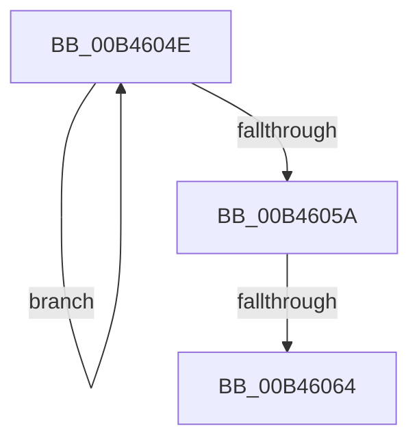

# sub_00B4604E

- RVA: `0x00B4604E`–`0x00B4607B` (길이 `45` bytes)
- VA: `0x0000000140B4604E`
- 실행 섹션: `PAGE`
- PDB 이름 있음: `아니요`; PDB Function 태그: `아니요`
- unwind 정보 RVA: `0x000B85CC`
- 디코드: `10`개 명령, `45/45` bytes 표시
- 미해석 바이트: `0` (있으면 어셈블리에 `.byte`로 보존)

> 이 문서는 커널 이미지의 기계어와 PDB 기호를 분석해 생성했습니다. 4번과 5번은 함수 원형과 자료형을 바이너리 사용 방식에서 추정한 C 해석이며 원본 소스 복구 결과는 아닙니다.

## 1. Dependencies

- 직접 호출 지점: **1**; 고유 호출 대상: **1**
- 직접 호출자로 확인된 함수: **0**
- RIP 상대 이미지 참조: **0**

### Outgoing calls
- `0x00B46070` → [ExFreePoolWithTag](../../poolcode/B8/ExFreePoolWithTag_function_00B82870.md) (function, `0x00B82870`)

### Direct callers
- 이 함수 시작 RVA로 연결되는 직접 call은 확인되지 않았습니다. 간접 호출은 완전히 역산할 수 없습니다.

### Static image references
- 디코드된 RIP-relative 메모리 참조가 없습니다.

## 2. Other-region calls and transfers

- 다른 실행 섹션으로 향하는 call: **1**
  - `0x00B46070` → [ExFreePoolWithTag](../../poolcode/B8/ExFreePoolWithTag_function_00B82870.md) (`PAGE` → `POOLCODE`)
- call이 아닌 외부 분기/꼬리 이동: **2**
  - `0x00B4605E` → [PoFxAbandonDevice + 0x9C](../A8/PoFxAbandonDevice_function_00A8AB64.md) (`tail-transfer`)
  - `0x00B46076` → [PoFxAbandonDevice + 0x9C](../A8/PoFxAbandonDevice_function_00A8AB64.md) (`tail-transfer`)

## 3. Assembly (complete function range)

```asm
00B4604E  8B C8                           mov ecx, eax
00B46050  F0 0F B1 8B 28 01 00 00         lock cmpxchg dword ptr [rbx + 0x128], ecx
00B46058  75 F4                           jne 0x140b4604e
00B4605A  0F BA E0 0D                     bt eax, 0xd
00B4605E  0F 82 9C 4B F4 FF               jb 0x140a8ac00
00B46064  48 8B 8B 88 00 00 00            mov rcx, qword ptr [rbx + 0x88]
00B4606B  BA 50 46 58 4D                  mov edx, 0x4d584650
00B46070  E8 FB C7 03 00                  call 0x140b82870
00B46075  90                              nop
00B46076  E9 85 4B F4 FF                  jmp 0x140a8ac00
```

## 4. C-style interpretation (structured pseudocode)

```c
__int64 __fastcall sub_00B4604E(void)
{
    __int64 result;

    if (condition_is_not_equal) goto loc_00B4604E;
    result = ExFreePoolWithTag(*(unsigned __int64 *)(v_rbx + 136), (unsigned int)(0x4D584650ULL), a3, a4);
}
```

## 5. (Beta) C Style

```c
void sub_00B4604E(void)
{
    int64_t result;

    if (condition_is_not_equal) goto loc_00B4604E;
    result = ExFreePoolWithTag(*(uint64_t *)(local_rbx + 0x88), (uint32_t)(0x4D584650ULL), a3, a4);
}
```

## 6. Execution-region graph

[열기: 2D/3D 그래프와 함수 탐색 컨트롤 패널](../../../control-panel.html?section=page&rva=0x00B4604E&view=graph)

- 2D 그래프는 위에서 아래로 흐르고, 3D 그래프는 빈 공간을 드래그해 회전합니다. Shift+드래그는 이동, 휠은 확대·축소, 함수 노드 선택은 대상 보고서 이동입니다.

### Static fallback


