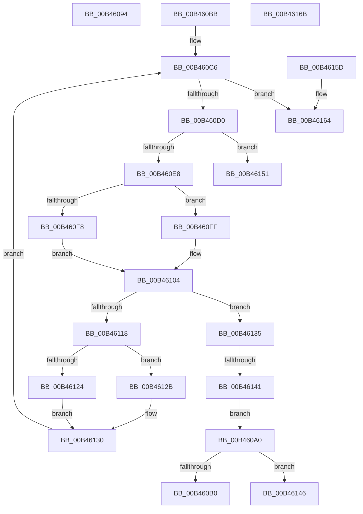

# sub_00B46094

- RVA: `0x00B46094`–`0x00B46176` (길이 `226` bytes)
- VA: `0x0000000140B46094`
- 실행 섹션: `PAGE`
- PDB 이름 있음: `아니요`; PDB Function 태그: `아니요`
- unwind 정보 RVA: `0x000B86E0`
- 디코드: `62`개 명령, `226/226` bytes 표시
- 미해석 바이트: `0` (있으면 어셈블리에 `.byte`로 보존)

> 이 문서는 커널 이미지의 기계어와 PDB 기호를 분석해 생성했습니다. 4번과 5번은 함수 원형과 자료형을 바이너리 사용 방식에서 추정한 C 해석이며 원본 소스 복구 결과는 아닙니다.

## 1. Dependencies

- 직접 호출 지점: **11**; 고유 호출 대상: **6**
- 직접 호출자로 확인된 함수: **0**
- RIP 상대 이미지 참조: **0**

### Outgoing calls
- `0x00B46094` → [HvpReleaseCellPaged](../85/HvpReleaseCellPaged_function_00855F40.md) (function, `0x00855F40`)
- `0x00B460B0` → [HvpReleaseCellFlat](../85/HvpReleaseCellFlat_function_0085CC20.md) (function, `0x0085CC20`)
- `0x00B460BB` → [HvpGetCellPaged](../85/HvpGetCellPaged_function_00854CB0.md) (function, `0x00854CB0`)
- `0x00B460DD` → [HvpMarkCellDirty](../85/HvpMarkCellDirty_function_00858080.md) (function, `0x00858080`)
- `0x00B460F8` → [HvpGetCellFlat](../85/HvpGetCellFlat_function_00854C60.md) (function, `0x00854C60`)
- `0x00B460FF` → [HvpGetCellPaged](../85/HvpGetCellPaged_function_00854CB0.md) (function, `0x00854CB0`)
- `0x00B4610D` → [CmpMarkValueDataDirty](../84/CmpMarkValueDataDirty_function_0084B910.md) (function, `0x0084B910`)
- `0x00B46124` → [HvpReleaseCellFlat](../85/HvpReleaseCellFlat_function_0085CC20.md) (function, `0x0085CC20`)
- `0x00B4612B` → [HvpReleaseCellPaged](../85/HvpReleaseCellPaged_function_00855F40.md) (function, `0x00855F40`)
- `0x00B46146` → [HvpReleaseCellPaged](../85/HvpReleaseCellPaged_function_00855F40.md) (function, `0x00855F40`)
- `0x00B4616B` → [HvpReleaseCellPaged](../85/HvpReleaseCellPaged_function_00855F40.md) (function, `0x00855F40`)

### Direct callers
- 이 함수 시작 RVA로 연결되는 직접 call은 확인되지 않았습니다. 간접 호출은 완전히 역산할 수 없습니다.

### Static image references
- 디코드된 RIP-relative 메모리 참조가 없습니다.

## 2. Other-region calls and transfers

- 다른 실행 섹션으로 향하는 call: **0**
- call이 아닌 외부 분기/꼬리 이동: **7**
  - `0x00B4609B` → [CmpMarkKeyValuesDirty + 0x14C](../A8/CmpMarkKeyValuesDirty_function_00A8B4C8.md) (`tail-transfer`)
  - `0x00B460B6` → [CmpMarkKeyValuesDirty + 0xE1](../A8/CmpMarkKeyValuesDirty_function_00A8B4C8.md) (`tail-transfer`)
  - `0x00B4613B` → [CmpMarkKeyValuesDirty + 0xE1](../A8/CmpMarkKeyValuesDirty_function_00A8B4C8.md) (`tail-transfer`)
  - `0x00B4614C` → [CmpMarkKeyValuesDirty + 0xE1](../A8/CmpMarkKeyValuesDirty_function_00A8B4C8.md) (`tail-transfer`)
  - `0x00B46158` → [CmpMarkKeyValuesDirty + 0xE1](../A8/CmpMarkKeyValuesDirty_function_00A8B4C8.md) (`tail-transfer`)
  - `0x00B46166` → [CmpMarkKeyValuesDirty + 0xE1](../A8/CmpMarkKeyValuesDirty_function_00A8B4C8.md) (`tail-transfer`)
  - `0x00B46171` → [CmpMarkKeyValuesDirty + 0xEA](../A8/CmpMarkKeyValuesDirty_function_00A8B4C8.md) (`tail-transfer`)

## 3. Assembly (complete function range)

```asm
00B46094  E8 A7 FE D0 FF                  call 0x140855f40
00B46099  33 FF                           xor edi, edi
00B4609B  E9 74 55 F4 FF                  jmp 0x140a8b614
00B460A0  48 8D 55 58                     lea rdx, [rbp + 0x58]
00B460A4  F6 07 01                        test byte ptr [rdi], 1
00B460A7  48 8B CB                        mov rcx, rbx
00B460AA  0F 84 96 00 00 00               je 0x140b46146
00B460B0  E8 6B 6B D1 FF                  call 0x14085cc20
00B460B5  90                              nop
00B460B6  E9 EE 54 F4 FF                  jmp 0x140a8b5a9
00B460BB  E8 F0 EB D0 FF                  call 0x140854cb0
00B460C0  4C 8B F0                        mov r14, rax
00B460C3  45 33 E4                        xor r12d, r12d
00B460C6  45 3B 67 24                     cmp r12d, dword ptr [r15 + 0x24]
00B460CA  0F 83 94 00 00 00               jae 0x140b46164
00B460D0  43 8B 14 A6                     mov edx, dword ptr [r14 + r12*4]
00B460D4  45 33 C9                        xor r9d, r9d
00B460D7  45 33 C0                        xor r8d, r8d
00B460DA  48 8B CB                        mov rcx, rbx
00B460DD  E8 9E 1F D1 FF                  call 0x140858080
00B460E2  8B F0                           mov esi, eax
00B460E4  85 C0                           test eax, eax
00B460E6  78 69                           js 0x140b46151
00B460E8  F6 07 01                        test byte ptr [rdi], 1
00B460EB  4C 8D 45 58                     lea r8, [rbp + 0x58]
00B460EF  43 8B 14 A6                     mov edx, dword ptr [r14 + r12*4]
00B460F3  48 8B CB                        mov rcx, rbx
00B460F6  74 07                           je 0x140b460ff
00B460F8  E8 63 EB D0 FF                  call 0x140854c60
00B460FD  EB 05                           jmp 0x140b46104
00B460FF  E8 AC EB D0 FF                  call 0x140854cb0
00B46104  48 8B D0                        mov rdx, rax
00B46107  48 8B CB                        mov rcx, rbx
00B4610A  4C 8B E8                        mov r13, rax
00B4610D  E8 FE 57 D0 FF                  call 0x14084b910
00B46112  8B F0                           mov esi, eax
00B46114  85 C0                           test eax, eax
00B46116  78 1D                           js 0x140b46135
00B46118  F6 07 01                        test byte ptr [rdi], 1
00B4611B  48 8D 55 58                     lea rdx, [rbp + 0x58]
00B4611F  48 8B CB                        mov rcx, rbx
00B46122  74 07                           je 0x140b4612b
00B46124  E8 F7 6A D1 FF                  call 0x14085cc20
00B46129  EB 05                           jmp 0x140b46130
00B4612B  E8 10 FE D0 FF                  call 0x140855f40
00B46130  41 FF C4                        inc r12d
00B46133  EB 91                           jmp 0x140b460c6
00B46135  4D 8B FE                        mov r15, r14
00B46138  4D 85 ED                        test r13, r13
00B4613B  0F 84 68 54 F4 FF               je 0x140a8b5a9
00B46141  E9 5A FF FF FF                  jmp 0x140b460a0
00B46146  E8 F5 FD D0 FF                  call 0x140855f40
00B4614B  90                              nop
00B4614C  E9 58 54 F4 FF                  jmp 0x140a8b5a9
00B46151  48 8D BB 8C 00 00 00            lea rdi, [rbx + 0x8c]
00B46158  E9 4C 54 F4 FF                  jmp 0x140a8b5a9
00B4615D  48 8D BB 8C 00 00 00            lea rdi, [rbx + 0x8c]
00B46164  33 F6                           xor esi, esi
00B46166  E9 3E 54 F4 FF                  jmp 0x140a8b5a9
00B4616B  E8 D0 FD D0 FF                  call 0x140855f40
00B46170  90                              nop
00B46171  E9 3C 54 F4 FF                  jmp 0x140a8b5b2
```

## 4. C-style interpretation (structured pseudocode)

```c
__int64 __fastcall sub_00B46094(__int64 a1, __int64 a2, int a3, int a4)
{
    __int64 result;
    __int64 v_rdi;

    result = HvpReleaseCellPaged(a1, a2, a3, a4);
    v_rdi = 0;
}
```

## 5. (Beta) C Style

```c
int64_t sub_00B46094(int64_t Arg1, int64_t Arg2, int32_t Arg3, int32_t Arg4)
{
    int64_t result;
    int64_t local_rdi;

    result = HvpReleaseCellPaged(Arg1, Arg2, Arg3, Arg4);
    local_rdi = 0;
}
```

## 6. Execution-region graph

[열기: 2D/3D 그래프와 함수 탐색 컨트롤 패널](../../../control-panel.html?section=page&rva=0x00B46094&view=graph)

- 2D 그래프는 위에서 아래로 흐르고, 3D 그래프는 빈 공간을 드래그해 회전합니다. Shift+드래그는 이동, 휠은 확대·축소, 함수 노드 선택은 대상 보고서 이동입니다.

### Static fallback


