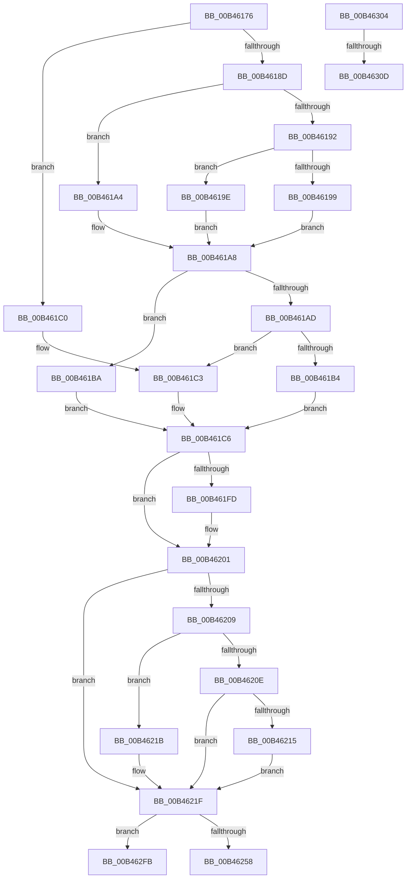

# sub_00B46176

- RVA: `0x00B46176`–`0x00B46363` (길이 `493` bytes)
- VA: `0x0000000140B46176`
- 실행 섹션: `PAGE`
- PDB 이름 있음: `아니요`; PDB Function 태그: `아니요`
- unwind 정보 RVA: `0x000B8710`
- 디코드: `120`개 명령, `493/493` bytes 표시
- 미해석 바이트: `0` (있으면 어셈블리에 `.byte`로 보존)

> 이 문서는 커널 이미지의 기계어와 PDB 기호를 분석해 생성했습니다. 4번과 5번은 함수 원형과 자료형을 바이너리 사용 방식에서 추정한 C 해석이며 원본 소스 복구 결과는 아닙니다.

## 1. Dependencies

- 직접 호출 지점: **4**; 고유 호출 대상: **4**
- 직접 호출자로 확인된 함수: **0**
- RIP 상대 이미지 참조: **0**

### Outgoing calls
- `0x00B461EE` → [SeExamineSacl](../97/SeExamineSacl_function_00973A30.md) (function, `0x00973A30`)
- `0x00B4623F` → [SeExamineGlobalSacl](../97/SeExamineGlobalSacl_function_00973C98.md) (function, `0x00973C98`)
- `0x00B462E1` → [SepAdtOpenObjectAuditAlarm](../91/SepAdtOpenObjectAuditAlarm_function_0091F23C.md) (function, `0x0091F23C`)
- `0x00B46358` → [SepAdtPrivilegeObjectAuditAlarm](../86/SepAdtPrivilegeObjectAuditAlarm_function_0086E3F0.md) (function, `0x0086E3F0`)

### Direct callers
- 이 함수 시작 RVA로 연결되는 직접 call은 확인되지 않았습니다. 간접 호출은 완전히 역산할 수 없습니다.

### Static image references
- 디코드된 RIP-relative 메모리 참조가 없습니다.

## 2. Other-region calls and transfers

- 다른 실행 섹션으로 향하는 call: **0**
- call이 아닌 외부 분기/꼬리 이동: **4**
  - `0x00B462F6` → [SeOpenObjectAuditAlarmForNonObObject + 0x6F](../A8/SeOpenObjectAuditAlarmForNonObObject_function_00A8B680.md) (`tail-transfer`)
  - `0x00B462FF` → [SeOpenObjectAuditAlarmForNonObObject + 0x8F](../A8/SeOpenObjectAuditAlarmForNonObObject_function_00A8B680.md) (`tail-transfer`)
  - `0x00B46307` → [SeOpenObjectAuditAlarmForNonObObject + 0x73](../A8/SeOpenObjectAuditAlarmForNonObObject_function_00A8B680.md) (`tail-transfer`)
  - `0x00B4635E` → [SeOpenObjectAuditAlarmForNonObObject + 0x73](../A8/SeOpenObjectAuditAlarmForNonObObject_function_00A8B680.md) (`tail-transfer`)

## 3. Assembly (complete function range)

```asm
00B46176  48 8B 5D 67                     mov rbx, qword ptr [rbp + 0x67]
00B4617A  BA 00 80 00 00                  mov edx, 0x8000
00B4617F  0F B7 43 02                     movzx eax, word ptr [rbx + 2]
00B46183  0F B7 C8                        movzx ecx, ax
00B46186  66 23 CA                        and cx, dx
00B46189  A8 10                           test al, 0x10
00B4618B  74 33                           je 0x140b461c0
00B4618D  66 85 C9                        test cx, cx
00B46190  74 12                           je 0x140b461a4
00B46192  8B 43 0C                        mov eax, dword ptr [rbx + 0xc]
00B46195  85 C0                           test eax, eax
00B46197  75 05                           jne 0x140b4619e
00B46199  49 8B D1                        mov rdx, r9
00B4619C  EB 0A                           jmp 0x140b461a8
00B4619E  48 8D 14 03                     lea rdx, [rbx + rax]
00B461A2  EB 04                           jmp 0x140b461a8
00B461A4  48 8B 53 18                     mov rdx, qword ptr [rbx + 0x18]
00B461A8  66 85 C9                        test cx, cx
00B461AB  74 0D                           je 0x140b461ba
00B461AD  8B 43 0C                        mov eax, dword ptr [rbx + 0xc]
00B461B0  85 C0                           test eax, eax
00B461B2  74 0F                           je 0x140b461c3
00B461B4  48 8D 0C 03                     lea rcx, [rbx + rax]
00B461B8  EB 0C                           jmp 0x140b461c6
00B461BA  48 8B 4B 18                     mov rcx, qword ptr [rbx + 0x18]
00B461BE  EB 06                           jmp 0x140b461c6
00B461C0  49 8B D1                        mov rdx, r9
00B461C3  49 8B C9                        mov rcx, r9
00B461C6  44 8B 75 77                     mov r14d, dword ptr [rbp + 0x77]
00B461CA  48 8D 45 F7                     lea rax, [rbp - 9]
00B461CE  44 8B 7D 7F                     mov r15d, dword ptr [rbp + 0x7f]
00B461D2  45 0B F7                        or r14d, r15d
00B461D5  48 89 44 24 30                  mov qword ptr [rsp + 0x30], rax
00B461DA  45 8B CE                        mov r9d, r14d
00B461DD  48 8D 85 8F 00 00 00            lea rax, [rbp + 0x8f]
00B461E4  48 89 44 24 28                  mov qword ptr [rsp + 0x28], rax
00B461E9  40 88 74 24 20                  mov byte ptr [rsp + 0x20], sil
00B461EE  E8 3D D8 E2 FF                  call 0x140973a30
00B461F3  4C 8B 07                        mov r8, qword ptr [rdi]
00B461F6  33 D2                           xor edx, edx
00B461F8  4D 85 C0                        test r8, r8
00B461FB  75 04                           jne 0x140b46201
00B461FD  4C 8B 47 10                     mov r8, qword ptr [rdi + 0x10]
00B46201  0F B7 43 02                     movzx eax, word ptr [rbx + 2]
00B46205  A8 10                           test al, 0x10
00B46207  74 16                           je 0x140b4621f
00B46209  66 85 C0                        test ax, ax
00B4620C  79 0D                           jns 0x140b4621b
00B4620E  8B 43 0C                        mov eax, dword ptr [rbx + 0xc]
00B46211  85 C0                           test eax, eax
00B46213  74 0A                           je 0x140b4621f
00B46215  48 8D 14 03                     lea rdx, [rbx + rax]
00B46219  EB 04                           jmp 0x140b4621f
00B4621B  48 8B 53 18                     mov rdx, qword ptr [rbx + 0x18]
00B4621F  48 8D 45 F7                     lea rax, [rbp - 9]
00B46223  45 8B CE                        mov r9d, r14d
00B46226  48 89 44 24 30                  mov qword ptr [rsp + 0x30], rax
00B4622B  49 8B CD                        mov rcx, r13
00B4622E  48 8D 85 8F 00 00 00            lea rax, [rbp + 0x8f]
00B46235  48 89 44 24 28                  mov qword ptr [rsp + 0x28], rax
00B4623A  40 88 74 24 20                  mov byte ptr [rsp + 0x20], sil
00B4623F  E8 54 DA E2 FF                  call 0x140973c98
00B46244  4C 8B 75 57                     mov r14, qword ptr [rbp + 0x57]
00B46248  45 33 C9                        xor r9d, r9d
00B4624B  44 38 8D 8F 00 00 00            cmp byte ptr [rbp + 0x8f], r9b
00B46252  0F 84 A3 00 00 00               je 0x140b462fb
00B46258  65 48 8B 04 25 88 01 00 00      mov rax, qword ptr gs:[0x188]
00B46261  41 8D 49 77                     lea ecx, [r9 + 0x77]
00B46265  4C 89 8C 24 90 00 00 00         mov qword ptr [rsp + 0x90], r9
00B4626D  4C 8D 45 4F                     lea r8, [rbp + 0x4f]
00B46271  4C 89 8C 24 88 00 00 00         mov qword ptr [rsp + 0x88], r9
00B46279  49 8B D5                        mov rdx, r13
00B4627C  4C 89 8C 24 80 00 00 00         mov qword ptr [rsp + 0x80], r9
00B46284  48 8B 80 B8 00 00 00            mov rax, qword ptr [rax + 0xb8]
00B4628B  44 89 4C 24 78                  mov dword ptr [rsp + 0x78], r9d
00B46290  4C 89 4C 24 70                  mov qword ptr [rsp + 0x70], r9
00B46295  4D 8B CE                        mov r9, r14
00B46298  C7 44 24 68 02 00 00 00         mov dword ptr [rsp + 0x68], 2
00B462A0  48 8B 80 D0 01 00 00            mov rax, qword ptr [rax + 0x1d0]
00B462A7  48 89 44 24 60                  mov qword ptr [rsp + 0x60], rax
00B462AC  8B 45 77                        mov eax, dword ptr [rbp + 0x77]
00B462AF  40 88 74 24 58                  mov byte ptr [rsp + 0x58], sil
00B462B4  4C 89 64 24 50                  mov qword ptr [rsp + 0x50], r12
00B462B9  44 89 7C 24 48                  mov dword ptr [rsp + 0x48], r15d
00B462BE  89 44 24 40                     mov dword ptr [rsp + 0x40], eax
00B462C2  48 8B 47 10                     mov rax, qword ptr [rdi + 0x10]
00B462C6  48 89 44 24 38                  mov qword ptr [rsp + 0x38], rax
00B462CB  48 8B 07                        mov rax, qword ptr [rdi]
00B462CE  48 89 44 24 30                  mov qword ptr [rsp + 0x30], rax
00B462D3  48 89 5C 24 28                  mov qword ptr [rsp + 0x28], rbx
00B462D8  48 8B 5D 5F                     mov rbx, qword ptr [rbp + 0x5f]
00B462DC  48 89 5C 24 20                  mov qword ptr [rsp + 0x20], rbx
00B462E1  E8 56 8F DD FF                  call 0x14091f23c
00B462E6  48 8B 85 97 00 00 00            mov rax, qword ptr [rbp + 0x97]
00B462ED  C6 00 01                        mov byte ptr [rax], 1
00B462F0  8A 85 8F 00 00 00               mov al, byte ptr [rbp + 0x8f]
00B462F6  E9 F4 53 F4 FF                  jmp 0x140a8b6ef
00B462FB  48 8B 5D 5F                     mov rbx, qword ptr [rbp + 0x5f]
00B462FF  E9 0B 54 F4 FF                  jmp 0x140a8b70f
00B46304  40 84 F6                        test sil, sil
00B46307  0F 84 E6 53 F4 FF               je 0x140a8b6f3
00B4630D  65 48 8B 04 25 88 01 00 00      mov rax, qword ptr gs:[0x188]
00B46316  4C 8B C3                        mov r8, rbx
00B46319  8B 4D 77                        mov ecx, dword ptr [rbp + 0x77]
00B4631C  49 8B D6                        mov rdx, r14
00B4631F  4C 8B 4D 4F                     mov r9, qword ptr [rbp + 0x4f]
00B46323  40 88 74 24 48                  mov byte ptr [rsp + 0x48], sil
00B46328  48 8B 80 B8 00 00 00            mov rax, qword ptr [rax + 0xb8]
00B4632F  4C 89 64 24 40                  mov qword ptr [rsp + 0x40], r12
00B46334  89 4C 24 38                     mov dword ptr [rsp + 0x38], ecx
00B46338  49 8B CD                        mov rcx, r13
00B4633B  48 8B 80 D0 01 00 00            mov rax, qword ptr [rax + 0x1d0]
00B46342  48 89 44 24 30                  mov qword ptr [rsp + 0x30], rax
00B46347  48 8B 47 10                     mov rax, qword ptr [rdi + 0x10]
00B4634B  48 89 44 24 28                  mov qword ptr [rsp + 0x28], rax
00B46350  48 8B 07                        mov rax, qword ptr [rdi]
00B46353  48 89 44 24 20                  mov qword ptr [rsp + 0x20], rax
00B46358  E8 93 80 D2 FF                  call 0x14086e3f0
00B4635D  90                              nop
00B4635E  E9 90 53 F4 FF                  jmp 0x140a8b6f3
```

## 4. C-style interpretation (structured pseudocode)

```c
__int64 __fastcall sub_00B46176(__int64 a1, __int64 a2, __int64 a3, __int64 a4)
{
    __int64 result;
    __int64 v_r14;
    unsigned __int8 v_stack_p20;
    unsigned __int64 v_stack_p28;
    unsigned __int64 v_stack_p30;
    unsigned __int64 v_stack_p38;
    unsigned int v_stack_p40;
    unsigned int v_stack_p48;
    unsigned __int64 v_stack_p50;
    unsigned __int8 v_stack_p58;
    unsigned __int64 v_stack_p60;
    unsigned int v_stack_p68;
    unsigned __int64 v_stack_p70;
    unsigned int v_stack_p78;
    unsigned __int64 v_stack_p80;
    unsigned __int64 v_stack_p88;
    unsigned __int64 v_stack_p90;

    a1 = (unsigned __int16)(((unsigned __int16)(*(unsigned __int16 *)(*(unsigned __int64 *)(v_rbp + 103) + 2))) & ((unsigned __int16)((unsigned int)(0x8000ULL))));
    if ((((unsigned __int8)(*(unsigned __int16 *)(*(unsigned __int64 *)(v_rbp + 103) + 2))) & (16)) == 0) goto loc_00B461C0;
    if ((unsigned __int16)(a1) == 0) goto loc_00B461A4;
    if ((unsigned int)((unsigned int)(*(unsigned int *)(*(unsigned __int64 *)(v_rbp + 103) + 12))) != 0) goto loc_00B4619E;
    goto loc_00B461A8;
loc_00B4619E:
    goto loc_00B461A8;
loc_00B461A4:
loc_00B461A8:
    if ((unsigned __int16)(a1) == 0) goto loc_00B461BA;
    if ((unsigned int)((unsigned int)(*(unsigned int *)(*(unsigned __int64 *)(v_rbp + 103) + 12))) == 0) goto loc_00B461C3;
    goto loc_00B461C6;
loc_00B461BA:
    goto loc_00B461C6;
loc_00B461C0:
loc_00B461C3:
loc_00B461C6:
    v_r14 = (unsigned int)(((unsigned int)(*(unsigned int *)(v_rbp + 119))) | ((unsigned int)((unsigned int)(*(unsigned int *)(v_rbp + 127)))));
    v_stack_p30 = v_rbp - 9;
    v_stack_p28 = v_rbp + 143;
    v_stack_p20 = (unsigned __int8)(v_rsi);
    result = SeExamineSacl(a4, a4, a3, (unsigned int)((unsigned int)(v_r14)));
    a2 = 0;
    if (*(unsigned __int64 *)(v_rdi) == 0) {
        a3 = *(unsigned __int64 *)(v_rdi + 16);
    }
    if ((((unsigned __int8)(*(unsigned __int16 *)(*(unsigned __int64 *)(v_rbp + 103) + 2))) & (16)) == 0) goto loc_00B4621F;
    if (!sign_flag) goto loc_00B4621B;
    if ((unsigned int)((unsigned int)(*(unsigned int *)(*(unsigned __int64 *)(v_rbp + 103) + 12))) == 0) goto loc_00B4621F;
    goto loc_00B4621F;
loc_00B4621B:
loc_00B4621F:
    v_stack_p30 = v_rbp - 9;
    v_stack_p28 = v_rbp + 143;
    v_stack_p20 = (unsigned __int8)(v_rsi);
    result = SeExamineGlobalSacl(v_r13, *(unsigned __int64 *)(*(unsigned __int64 *)(v_rbp + 103) + 24), a3, (unsigned int)((unsigned int)(v_r14)));
    a4 = 0;
    if ((*(unsigned __int8 *)(v_rbp + 143)) == 0) goto loc_00B462FB;
    v_stack_p90 = 0;
    v_stack_p88 = 0;
    v_stack_p80 = 0;
    v_stack_p78 = 0;
    v_stack_p70 = 0;
    v_stack_p68 = 2;
    v_stack_p60 = *(unsigned __int64 *)(*(unsigned __int64 *)(*(unsigned __int64 *)(gs_base + (0 + 392)) + 184) + 464);
    v_stack_p58 = (unsigned __int8)(v_rsi);
    v_stack_p50 = v_r12;
    v_stack_p48 = (unsigned int)((unsigned int)(*(unsigned int *)(v_rbp + 127)));
    v_stack_p40 = (unsigned int)((unsigned int)(*(unsigned int *)(v_rbp + 119)));
    v_stack_p38 = *(unsigned __int64 *)(v_rdi + 16);
    v_stack_p30 = *(unsigned __int64 *)(v_rdi);
    v_stack_p28 = *(unsigned __int64 *)(v_rbp + 103);
    v_stack_p20 = *(unsigned __int64 *)(v_rbp + 95);
    result = SepAdtOpenObjectAuditAlarm(a4 + 119, v_r13, v_rbp + 79, *(unsigned __int64 *)(v_rbp + 87));
    *(unsigned __int8 *)(*(unsigned __int64 *)(v_rbp + 151)) = 1;
loc_00B462FB:
}
```

## 5. (Beta) C Style

```c
int64_t sub_00B46176(int64_t Arg1, int64_t Arg2, int64_t Arg3, int64_t Arg4)
{
    int64_t result;
    int64_t local_r14;
    uint8_t v_stack_p20;
    uint64_t v_stack_p28;
    uint64_t v_stack_p30;
    uint64_t v_stack_p38;
    uint32_t v_stack_p40;
    uint32_t v_stack_p48;
    uint64_t v_stack_p50;
    uint8_t v_stack_p58;
    uint64_t v_stack_p60;
    uint32_t v_stack_p68;
    uint64_t v_stack_p70;
    uint32_t v_stack_p78;
    uint64_t v_stack_p80;
    uint64_t v_stack_p88;
    uint64_t v_stack_p90;

    Arg1 = (uint16_t)(((uint16_t)(*(uint16_t *)(*(uint64_t *)(local_rbp + 0x67) + 0x2))) & ((uint16_t)((uint32_t)(0x8000ULL))));
    if ((((uint8_t)(*(uint16_t *)(*(uint64_t *)(local_rbp + 0x67) + 0x2))) & (16)) == 0) goto loc_00B461C0;
    if ((uint16_t)(Arg1) == 0) goto loc_00B461A4;
    if ((uint32_t)((uint32_t)(*(uint32_t *)(*(uint64_t *)(local_rbp + 0x67) + 0xC))) != 0) goto loc_00B4619E;
    goto loc_00B461A8;
loc_00B4619E:
    goto loc_00B461A8;
loc_00B461A4:
loc_00B461A8:
    if ((uint16_t)(Arg1) == 0) goto loc_00B461BA;
    if ((uint32_t)((uint32_t)(*(uint32_t *)(*(uint64_t *)(local_rbp + 0x67) + 0xC))) == 0) goto loc_00B461C3;
    goto loc_00B461C6;
loc_00B461BA:
    goto loc_00B461C6;
loc_00B461C0:
loc_00B461C3:
loc_00B461C6:
    local_r14 = (uint32_t)(((uint32_t)(*(uint32_t *)(local_rbp + 0x77))) | ((uint32_t)((uint32_t)(*(uint32_t *)(local_rbp + 0x7F)))));
    v_stack_p30 = local_rbp - 9;
    v_stack_p28 = local_rbp + 143;
    v_stack_p20 = (uint8_t)(local_rsi);
    result = SeExamineSacl(Arg4, Arg4, Arg3, (uint32_t)((uint32_t)(local_r14)));
    Arg2 = 0;
    if (*(uint64_t *)(local_rdi) == 0) {
        Arg3 = *(uint64_t *)(local_rdi + 0x10);
    }
    if ((((uint8_t)(*(uint16_t *)(*(uint64_t *)(local_rbp + 0x67) + 0x2))) & (16)) == 0) goto loc_00B4621F;
    if (!sign_flag) goto loc_00B4621B;
    if ((uint32_t)((uint32_t)(*(uint32_t *)(*(uint64_t *)(local_rbp + 0x67) + 0xC))) == 0) goto loc_00B4621F;
    goto loc_00B4621F;
loc_00B4621B:
loc_00B4621F:
    v_stack_p30 = local_rbp - 9;
    v_stack_p28 = local_rbp + 143;
    v_stack_p20 = (uint8_t)(local_rsi);
    result = SeExamineGlobalSacl(local_r13, *(uint64_t *)(*(uint64_t *)(local_rbp + 0x67) + 0x18), Arg3, (uint32_t)((uint32_t)(local_r14)));
    Arg4 = 0;
    if ((*(uint8_t *)(local_rbp + 0x8F)) == 0) goto loc_00B462FB;
    v_stack_p90 = 0;
    v_stack_p88 = 0;
    v_stack_p80 = 0;
    v_stack_p78 = 0;
    v_stack_p70 = 0;
    v_stack_p68 = 2;
    v_stack_p60 = *(uint64_t *)(*(uint64_t *)(*(uint64_t *)(gs_base + (0 + 0x188)) + 0xB8) + 0x1D0);
    v_stack_p58 = (uint8_t)(local_rsi);
    v_stack_p50 = local_r12;
    v_stack_p48 = (uint32_t)((uint32_t)(*(uint32_t *)(local_rbp + 0x7F)));
    v_stack_p40 = (uint32_t)((uint32_t)(*(uint32_t *)(local_rbp + 0x77)));
    v_stack_p38 = *(uint64_t *)(local_rdi + 0x10);
    v_stack_p30 = *(uint64_t *)(local_rdi);
    v_stack_p28 = *(uint64_t *)(local_rbp + 0x67);
    v_stack_p20 = *(uint64_t *)(local_rbp + 0x5F);
    result = SepAdtOpenObjectAuditAlarm(Arg4 + 119, local_r13, local_rbp + 79, *(uint64_t *)(local_rbp + 0x57));
    *(uint8_t *)(*(uint64_t *)(local_rbp + 0x97)) = 1;
loc_00B462FB:
}
```

## 6. Execution-region graph

[열기: 2D/3D 그래프와 함수 탐색 컨트롤 패널](../../../control-panel.html?section=page&rva=0x00B46176&view=graph)

- 2D 그래프는 위에서 아래로 흐르고, 3D 그래프는 빈 공간을 드래그해 회전합니다. Shift+드래그는 이동, 휠은 확대·축소, 함수 노드 선택은 대상 보고서 이동입니다.

### Static fallback


