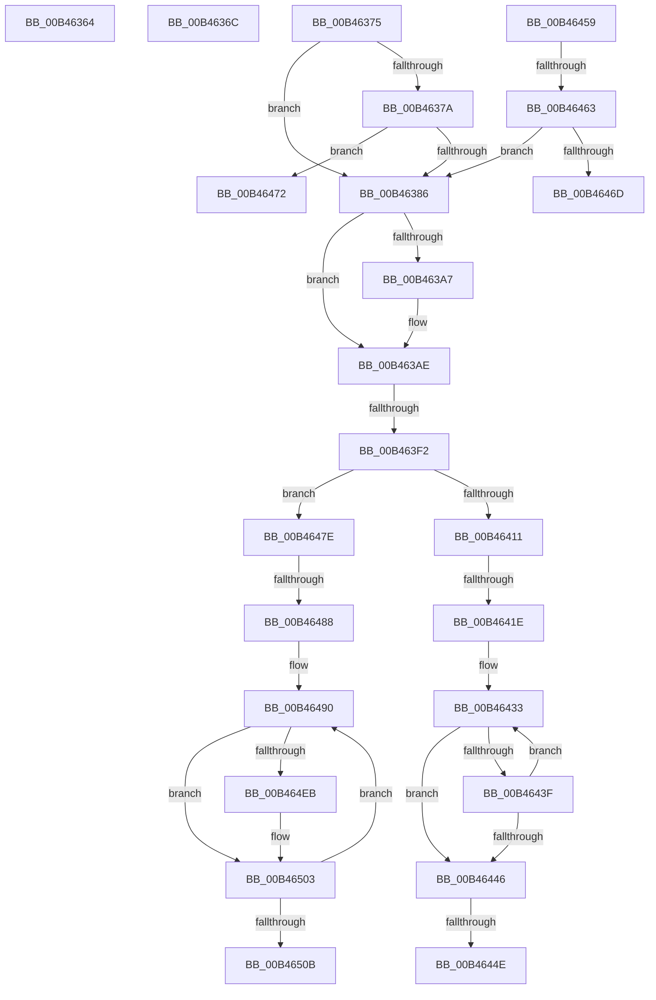

# sub_00B46364

- RVA: `0x00B46364`–`0x00B46510` (길이 `428` bytes)
- VA: `0x0000000140B46364`
- 실행 섹션: `PAGE`
- PDB 이름 있음: `아니요`; PDB Function 태그: `아니요`
- unwind 정보 RVA: `0x000B87EC`
- 디코드: `99`개 명령, `428/428` bytes 표시
- 미해석 바이트: `0` (있으면 어셈블리에 `.byte`로 보존)

> 이 문서는 커널 이미지의 기계어와 PDB 기호를 분석해 생성했습니다. 4번과 5번은 함수 원형과 자료형을 바이너리 사용 방식에서 추정한 C 해석이며 원본 소스 복구 결과는 아닙니다.

## 1. Dependencies

- 직접 호출 지점: **12**; 고유 호출 대상: **6**
- 직접 호출자로 확인된 함수: **0**
- RIP 상대 이미지 참조: **8**

### Outgoing calls
- `0x00B463AE` → [RtlStringCchPrintfW](../../text/48/RtlStringCchPrintfW_function_00482D5C.md) (function, `0x00482D5C`)
- `0x00B463BB` → [RtlInitUnicodeString](../../text/42/RtlInitUnicodeString_function_0042A780.md) (function, `0x0042A780`)
- `0x00B463D5` → [RtlStringCchPrintfA](../../text/59/RtlStringCchPrintfA_function_00596BC8.md) (function, `0x00596BC8`)
- `0x00B463E3` → [IopCreateUnicodeFromAnsiBuffer](../../text/59/IopCreateUnicodeFromAnsiBuffer_function_00596AEC.md) (function, `0x00596AEC`)
- `0x00B463FB` → [IoCreateSymbolicLink](../A3/IoCreateSymbolicLink_function_00A33760.md) (function, `0x00A33760`)
- `0x00B46405` → [RtlFreeAnsiString](../9C/RtlFreeAnsiString_function_009C0800.md) (function, `0x009C0800`)
- `0x00B464AB` → [RtlStringCchPrintfW](../../text/48/RtlStringCchPrintfW_function_00482D5C.md) (function, `0x00482D5C`)
- `0x00B464B8` → [RtlInitUnicodeString](../../text/42/RtlInitUnicodeString_function_0042A780.md) (function, `0x0042A780`)
- `0x00B464D4` → [RtlStringCchPrintfA](../../text/59/RtlStringCchPrintfA_function_00596BC8.md) (function, `0x00596BC8`)
- `0x00B464E2` → [IopCreateUnicodeFromAnsiBuffer](../../text/59/IopCreateUnicodeFromAnsiBuffer_function_00596AEC.md) (function, `0x00596AEC`)
- `0x00B464F4` → [IoCreateSymbolicLink](../A3/IoCreateSymbolicLink_function_00A33760.md) (function, `0x00A33760`)
- `0x00B464FE` → [RtlFreeAnsiString](../9C/RtlFreeAnsiString_function_009C0800.md) (function, `0x009C0800`)

### Direct callers
- 이 함수 시작 RVA로 연결되는 직접 call은 확인되지 않았습니다. 간접 호출은 완전히 역산할 수 없습니다.

### Static image references
- `0x00B46393` → RVA `0x00AFC670` (` ?? ::NNGAKEGL::`string'`; read)
- `0x00B463A7` → RVA `0x00AFC630` (` ?? ::NNGAKEGL::`string'`; read)
- `0x00B463C4` → RVA `0x00AFC6F0` (` ?? ::NNGAKEGL::`string'`; read)
- `0x00B46411` → RVA `0x00FC41A0` (`.data`; read)
- `0x00B4641E` → RVA `0x00FC6B20` (`ALMOSTRO`; read)
- `0x00B46472` → RVA `0x00FD9C58` (`PAGEDATA`; read)
- `0x00B46494` → RVA `0x00AFC6B0` (` ?? ::NNGAKEGL::`string'`; read)
- `0x00B464C4` → RVA `0x00AFC690` (` ?? ::NNGAKEGL::`string'`; read)

## 2. Other-region calls and transfers

- 다른 실행 섹션으로 향하는 call: **8**
  - `0x00B463AE` → [RtlStringCchPrintfW](../../text/48/RtlStringCchPrintfW_function_00482D5C.md) (`PAGE` → `.text`)
  - `0x00B463BB` → [RtlInitUnicodeString](../../text/42/RtlInitUnicodeString_function_0042A780.md) (`PAGE` → `.text`)
  - `0x00B463D5` → [RtlStringCchPrintfA](../../text/59/RtlStringCchPrintfA_function_00596BC8.md) (`PAGE` → `.text`)
  - `0x00B463E3` → [IopCreateUnicodeFromAnsiBuffer](../../text/59/IopCreateUnicodeFromAnsiBuffer_function_00596AEC.md) (`PAGE` → `.text`)
  - `0x00B464AB` → [RtlStringCchPrintfW](../../text/48/RtlStringCchPrintfW_function_00482D5C.md) (`PAGE` → `.text`)
  - `0x00B464B8` → [RtlInitUnicodeString](../../text/42/RtlInitUnicodeString_function_0042A780.md) (`PAGE` → `.text`)
  - `0x00B464D4` → [RtlStringCchPrintfA](../../text/59/RtlStringCchPrintfA_function_00596BC8.md) (`PAGE` → `.text`)
  - `0x00B464E2` → [IopCreateUnicodeFromAnsiBuffer](../../text/59/IopCreateUnicodeFromAnsiBuffer_function_00596AEC.md) (`PAGE` → `.text`)
- call이 아닌 외부 분기/꼬리 이동: **11**
  - `0x00B46367` → [IopCreateArcName + 0x26C](../A8/IopCreateArcName_function_00A8D580.md) (`tail-transfer`)
  - `0x00B46370` → [IopCreateArcName + 0x26A](../A8/IopCreateArcName_function_00A8D580.md) (`tail-transfer`)
  - `0x00B463EC` → [IopCreateArcName + 0x293](../A8/IopCreateArcName_function_00A8D580.md) (`tail-transfer`)
  - `0x00B46418` → [IopCreateArcName + 0x293](../A8/IopCreateArcName_function_00A8D580.md) (`tail-transfer`)
  - `0x00B46448` → [IopCreateArcName + 0x293](../A8/IopCreateArcName_function_00A8D580.md) (`tail-transfer`)
  - `0x00B46454` → [IopCreateArcName + 0x293](../A8/IopCreateArcName_function_00A8D580.md) (`tail-transfer`)
  - `0x00B4645D` → [IopCreateArcName + 0x289](../A8/IopCreateArcName_function_00A8D580.md) (`tail-transfer`)
  - `0x00B4646D` → [IopCreateArcName + 0x289](../A8/IopCreateArcName_function_00A8D580.md) (`tail-transfer`)
  - `0x00B46479` → [IopCreateArcName + 0x289](../A8/IopCreateArcName_function_00A8D580.md) (`tail-transfer`)
  - `0x00B46482` → [IopCreateArcName + 0x293](../A8/IopCreateArcName_function_00A8D580.md) (`tail-transfer`)
  - `0x00B4650B` → [IopCreateArcName + 0x293](../A8/IopCreateArcName_function_00A8D580.md) (`tail-transfer`)

## 3. Assembly (complete function range)

```asm
00B46364  41 8A DD                        mov bl, r13b
00B46367  E9 80 74 F4 FF                  jmp 0x140a8d7ec
00B4636C  44 8B 7E 0C                     mov r15d, dword ptr [rsi + 0xc]
00B46370  E9 75 74 F4 FF                  jmp 0x140a8d7ea
00B46375  44 39 2E                        cmp dword ptr [rsi], r13d
00B46378  75 0C                           jne 0x140b46386
00B4637A  8B 46 0C                        mov eax, dword ptr [rsi + 0xc]
00B4637D  39 47 20                        cmp dword ptr [rdi + 0x20], eax
00B46380  0F 85 EC 00 00 00               jne 0x140b46472
00B46386  4C 89 77 40                     mov qword ptr [rdi + 0x40], r14
00B4638A  48 8D 4D 10                     lea rcx, [rbp + 0x10]
00B4638E  41 83 7E 48 02                  cmp dword ptr [r14 + 0x48], 2
00B46393  4C 8D 05 D6 62 FB FF            lea r8, [rip - 0x49d2a]
00B4639A  44 8B 4D BC                     mov r9d, dword ptr [rbp - 0x44]
00B4639E  BB 40 00 00 00                  mov ebx, 0x40
00B463A3  8B D3                           mov edx, ebx
00B463A5  74 07                           je 0x140b463ae
00B463A7  4C 8D 05 82 62 FB FF            lea r8, [rip - 0x49d7e]
00B463AE  E8 A9 C9 93 FF                  call 0x140482d5c
00B463B3  48 8D 55 10                     lea rdx, [rbp + 0x10]
00B463B7  48 8D 4D 90                     lea rcx, [rbp - 0x70]
00B463BB  E8 C0 43 8E FF                  call 0x14042a780
00B463C0  4C 8B 7F 18                     mov r15, qword ptr [rdi + 0x18]
00B463C4  4C 8D 05 25 63 FB FF            lea r8, [rip - 0x49cdb]
00B463CB  4D 8B CF                        mov r9, r15
00B463CE  48 8D 4D D0                     lea rcx, [rbp - 0x30]
00B463D2  48 8B D3                        mov rdx, rbx
00B463D5  E8 EE 07 A5 FF                  call 0x140596bc8
00B463DA  48 8D 55 D0                     lea rdx, [rbp - 0x30]
00B463DE  48 8D 4C 24 78                  lea rcx, [rsp + 0x78]
00B463E3  E8 04 07 A5 FF                  call 0x140596aec
00B463E8  8B D8                           mov ebx, eax
00B463EA  85 C0                           test eax, eax
00B463EC  0F 88 21 74 F4 FF               js 0x140a8d813
00B463F2  48 8D 55 90                     lea rdx, [rbp - 0x70]
00B463F6  48 8D 4C 24 78                  lea rcx, [rsp + 0x78]
00B463FB  E8 60 D3 EE FF                  call 0x140a33760
00B46400  48 8D 4C 24 78                  lea rcx, [rsp + 0x78]
00B46405  E8 F6 A3 E7 FF                  call 0x1409c0800
00B4640A  41 83 7E 48 02                  cmp dword ptr [r14 + 0x48], 2
00B4640F  75 6D                           jne 0x140b4647e
00B46411  83 3D 88 DD 47 00 02            cmp dword ptr [rip + 0x47dd88], 2
00B46418  0F 83 F5 73 F4 FF               jae 0x140a8d813
00B4641E  48 8B 05 FB 06 48 00            mov rax, qword ptr [rip + 0x4806fb]
00B46425  48 8B 4F 18                     mov rcx, qword ptr [rdi + 0x18]
00B46429  4C 8B 80 B8 00 00 00            mov r8, qword ptr [rax + 0xb8]
00B46430  4C 2B C1                        sub r8, rcx
00B46433  0F B6 01                        movzx eax, byte ptr [rcx]
00B46436  42 0F B6 14 01                  movzx edx, byte ptr [rcx + r8]
00B4643B  2B C2                           sub eax, edx
00B4643D  75 07                           jne 0x140b46446
00B4643F  48 FF C1                        inc rcx
00B46442  85 D2                           test edx, edx
00B46444  75 ED                           jne 0x140b46433
00B46446  85 C0                           test eax, eax
00B46448  0F 85 C5 73 F4 FF               jne 0x140a8d813
00B4644E  41 0F BA 6E 30 08               bts dword ptr [r14 + 0x30], 8
00B46454  E9 BA 73 F4 FF                  jmp 0x140a8d813
00B46459  44 38 6F 24                     cmp byte ptr [rdi + 0x24], r13b
00B4645D  0F 85 A6 73 F4 FF               jne 0x140a8d809
00B46463  44 39 7F 20                     cmp dword ptr [rdi + 0x20], r15d
00B46467  0F 84 19 FF FF FF               je 0x140b46386
00B4646D  E9 97 73 F4 FF                  jmp 0x140a8d809
00B46472  48 8D 05 DF 37 49 00            lea rax, [rip + 0x4937df]
00B46479  E9 8B 73 F4 FF                  jmp 0x140a8d809
00B4647E  44 39 6E 04                     cmp dword ptr [rsi + 4], r13d
00B46482  0F 86 8B 73 F4 FF               jbe 0x140a8d813
00B46488  41 8B DD                        mov ebx, r13d
00B4648B  BF 01 00 00 00                  mov edi, 1
00B46490  44 8B 4D BC                     mov r9d, dword ptr [rbp - 0x44]
00B46494  4C 8D 05 15 62 FB FF            lea r8, [rip - 0x49deb]
00B4649B  BA 40 00 00 00                  mov edx, 0x40
00B464A0  89 7C 24 20                     mov dword ptr [rsp + 0x20], edi
00B464A4  48 8D 4D 10                     lea rcx, [rbp + 0x10]
00B464A8  44 8B F7                        mov r14d, edi
00B464AB  E8 AC C8 93 FF                  call 0x140482d5c
00B464B0  48 8D 55 10                     lea rdx, [rbp + 0x10]
00B464B4  48 8D 4D 90                     lea rcx, [rbp - 0x70]
00B464B8  E8 C3 42 8E FF                  call 0x14042a780
00B464BD  4D 8B CF                        mov r9, r15
00B464C0  89 7C 24 20                     mov dword ptr [rsp + 0x20], edi
00B464C4  4C 8D 05 C5 61 FB FF            lea r8, [rip - 0x49e3b]
00B464CB  BA 40 00 00 00                  mov edx, 0x40
00B464D0  48 8D 4D D0                     lea rcx, [rbp - 0x30]
00B464D4  E8 EF 06 A5 FF                  call 0x140596bc8
00B464D9  48 8D 55 D0                     lea rdx, [rbp - 0x30]
00B464DD  48 8D 4C 24 78                  lea rcx, [rsp + 0x78]
00B464E2  E8 05 06 A5 FF                  call 0x140596aec
00B464E7  85 C0                           test eax, eax
00B464E9  78 18                           js 0x140b46503
00B464EB  48 8D 55 90                     lea rdx, [rbp - 0x70]
00B464EF  48 8D 4C 24 78                  lea rcx, [rsp + 0x78]
00B464F4  E8 67 D2 EE FF                  call 0x140a33760
00B464F9  48 8D 4C 24 78                  lea rcx, [rsp + 0x78]
00B464FE  E8 FD A2 E7 FF                  call 0x1409c0800
00B46503  FF C7                           inc edi
00B46505  44 3B 76 04                     cmp r14d, dword ptr [rsi + 4]
00B46509  72 85                           jb 0x140b46490
00B4650B  E9 03 73 F4 FF                  jmp 0x140a8d813
```

## 4. C-style interpretation (structured pseudocode)

```c
__int64 __fastcall sub_00B46364(void)
{
    unsigned int v_stack_p20;
    unsigned __int64 v_stack_p78;
}
```

## 5. (Beta) C Style

```c
void sub_00B46364(void)
{
    uint32_t v_stack_p20;
    uint64_t v_stack_p78;
}
```

## 6. Execution-region graph

[열기: 2D/3D 그래프와 함수 탐색 컨트롤 패널](../../../control-panel.html?section=page&rva=0x00B46364&view=graph)

- 2D 그래프는 위에서 아래로 흐르고, 3D 그래프는 빈 공간을 드래그해 회전합니다. Shift+드래그는 이동, 휠은 확대·축소, 함수 노드 선택은 대상 보고서 이동입니다.

### Static fallback


