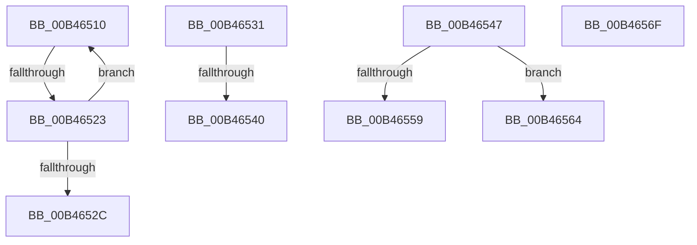

# sub_00B46510

- RVA: `0x00B46510`–`0x00B4657A` (길이 `106` bytes)
- VA: `0x0000000140B46510`
- 실행 섹션: `PAGE`
- PDB 이름 있음: `아니요`; PDB Function 태그: `아니요`
- unwind 정보 RVA: `0x000B89FC`
- 디코드: `27`개 명령, `106/106` bytes 표시
- 미해석 바이트: `0` (있으면 어셈블리에 `.byte`로 보존)

> 이 문서는 커널 이미지의 기계어와 PDB 기호를 분석해 생성했습니다. 4번과 5번은 함수 원형과 자료형을 바이너리 사용 방식에서 추정한 C 해석이며 원본 소스 복구 결과는 아닙니다.

## 1. Dependencies

- 직접 호출 지점: **3**; 고유 호출 대상: **2**
- 직접 호출자로 확인된 함수: **0**
- RIP 상대 이미지 참조: **0**

### Outgoing calls
- `0x00B46559` → [HvpReleaseCellFlat](../85/HvpReleaseCellFlat_function_0085CC20.md) (function, `0x0085CC20`)
- `0x00B46564` → [HvpReleaseCellPaged](../85/HvpReleaseCellPaged_function_00855F40.md) (function, `0x00855F40`)
- `0x00B4656F` → [HvpReleaseCellPaged](../85/HvpReleaseCellPaged_function_00855F40.md) (function, `0x00855F40`)

### Direct callers
- 이 함수 시작 RVA로 연결되는 직접 call은 확인되지 않았습니다. 간접 호출은 완전히 역산할 수 없습니다.

### Static image references
- 디코드된 RIP-relative 메모리 참조가 없습니다.

## 2. Other-region calls and transfers

- 다른 실행 섹션으로 향하는 call: **0**
- call이 아닌 외부 분기/꼬리 이동: **7**
  - `0x00B4651D` → [CmQueryMultipleValueForLayeredKey + 0x15E](../A8/CmQueryMultipleValueForLayeredKey_function_00A8DE80.md) (`tail-transfer`)
  - `0x00B4652C` → [CmQueryMultipleValueForLayeredKey + 0x15E](../A8/CmQueryMultipleValueForLayeredKey_function_00A8DE80.md) (`tail-transfer`)
  - `0x00B4653A` → [CmQueryMultipleValueForLayeredKey + 0x3F1](../A8/CmQueryMultipleValueForLayeredKey_function_00A8DE80.md) (`tail-transfer`)
  - `0x00B46542` → [CmQueryMultipleValueForLayeredKey + 0x3F1](../A8/CmQueryMultipleValueForLayeredKey_function_00A8DE80.md) (`tail-transfer`)
  - `0x00B4655F` → [CmQueryMultipleValueForLayeredKey + 0xBE](../A8/CmQueryMultipleValueForLayeredKey_function_00A8DE80.md) (`tail-transfer`)
  - `0x00B4656A` → [CmQueryMultipleValueForLayeredKey + 0xBE](../A8/CmQueryMultipleValueForLayeredKey_function_00A8DE80.md) (`tail-transfer`)
  - `0x00B46575` → [CmQueryMultipleValueForLayeredKey + 0xC7](../A8/CmQueryMultipleValueForLayeredKey_function_00A8DE80.md) (`tail-transfer`)

## 3. Assembly (complete function range)

```asm
00B46510  0F B7 C1                        movzx eax, cx
00B46513  48 FF C8                        dec rax
00B46516  48 D1 E8                        shr rax, 1
00B46519  66 39 1C 42                     cmp word ptr [rdx + rax*2], bx
00B4651D  0F 85 BB 7A F4 FF               jne 0x140a8dfde
00B46523  66 83 E9 02                     sub cx, 2
00B46527  66 89 0F                        mov word ptr [rdi], cx
00B4652A  75 E4                           jne 0x140b46510
00B4652C  E9 AD 7A F4 FF                  jmp 0x140a8dfde
00B46531  38 5C 24 41                     cmp byte ptr [rsp + 0x41], bl
00B46535  BF 05 00 00 80                  mov edi, 0x80000005
00B4653A  0F 85 31 7D F4 FF               jne 0x140a8e271
00B46540  8B FB                           mov edi, ebx
00B46542  E9 2A 7D F4 FF                  jmp 0x140a8e271
00B46547  49 8B 4D 20                     mov rcx, qword ptr [r13 + 0x20]
00B4654B  48 8D 54 24 60                  lea rdx, [rsp + 0x60]
00B46550  F6 81 8C 00 00 00 01            test byte ptr [rcx + 0x8c], 1
00B46557  74 0B                           je 0x140b46564
00B46559  E8 C2 66 D1 FF                  call 0x14085cc20
00B4655E  90                              nop
00B4655F  E9 DA 79 F4 FF                  jmp 0x140a8df3e
00B46564  E8 D7 F9 D0 FF                  call 0x140855f40
00B46569  90                              nop
00B4656A  E9 CF 79 F4 FF                  jmp 0x140a8df3e
00B4656F  E8 CC F9 D0 FF                  call 0x140855f40
00B46574  90                              nop
00B46575  E9 CD 79 F4 FF                  jmp 0x140a8df47
```

## 4. C-style interpretation (structured pseudocode)

```c
__int64 __fastcall sub_00B46510(unsigned __int16 a1, __int64 a2)
{
    __int64 result;
    unsigned __int8 v_stack_p41;
    unsigned __int64 v_stack_p60;

    result = (a1) - 1;
    result = (result) >> (1);
    a1 = (unsigned __int16)((a1) - (2));
    *(unsigned __int16 *)(v_rdi) = a1;
    if (condition_is_not_equal) goto loc_00B46510;
}
```

## 5. (Beta) C Style

```c
int64_t sub_00B46510(uint16_t Arg1, void *Arg2)
{
    uint8_t *arg2 = (uint8_t *)Arg2;

    int64_t result;
    uint8_t v_stack_p41;
    uint64_t v_stack_p60;

    result = (Arg1) - 1;
    result = (result) >> (1);
    Arg1 = (uint16_t)((Arg1) - (2));
    *(uint16_t *)(local_rdi) = Arg1;
    if (condition_is_not_equal) goto loc_00B46510;
}
```

### 관측된 메모리 오프셋

구조체 형식이 확인되지 않은 접근은 인자 기준의 오프셋으로만 기록했습니다.

| 기준 인자 | 오프셋 표현 | 폭 (bit) | 접근 |
|---|---:|---:|---|
| `Arg2` | `+ 0x0 + rax*2` | `16` | `R` |

## 6. Execution-region graph

[열기: 2D/3D 그래프와 함수 탐색 컨트롤 패널](../../../control-panel.html?section=page&rva=0x00B46510&view=graph)

- 2D 그래프는 위에서 아래로 흐르고, 3D 그래프는 빈 공간을 드래그해 회전합니다. Shift+드래그는 이동, 휠은 확대·축소, 함수 노드 선택은 대상 보고서 이동입니다.

### Static fallback


