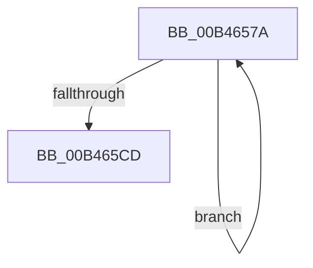

# sub_00B4657A

- RVA: `0x00B4657A`–`0x00B465D2` (길이 `88` bytes)
- VA: `0x0000000140B4657A`
- 실행 섹션: `PAGE`
- PDB 이름 있음: `아니요`; PDB Function 태그: `아니요`
- unwind 정보 RVA: `0x000B8A0C`
- 디코드: `22`개 명령, `88/88` bytes 표시
- 미해석 바이트: `0` (있으면 어셈블리에 `.byte`로 보존)

> 이 문서는 커널 이미지의 기계어와 PDB 기호를 분석해 생성했습니다. 4번과 5번은 함수 원형과 자료형을 바이너리 사용 방식에서 추정한 C 해석이며 원본 소스 복구 결과는 아닙니다.

## 1. Dependencies

- 직접 호출 지점: **4**; 고유 호출 대상: **4**
- 직접 호출자로 확인된 함수: **0**
- RIP 상대 이미지 참조: **1**

### Outgoing calls
- `0x00B465A1` → [guard_dispatch_icall](../../text/6B/guard_dispatch_icall_function_006BAAD0.md) (function, `0x006BAAD0`)
- `0x00B465AA` → [ObfDereferenceObject](../../text/2F/ObfDereferenceObject_function_002F9350.md) (function, `0x002F9350`)
- `0x00B465B4` → [ExFreePoolWithTag](../../poolcode/B8/ExFreePoolWithTag_function_00B82870.md) (function, `0x00B82870`)
- `0x00B465C0` → [IopInterlockedRemoveHeadList](../../text/4B/IopInterlockedRemoveHeadList_function_004B4FB0.md) (function, `0x004B4FB0`)

### Direct callers
- 이 함수 시작 RVA로 연결되는 직접 call은 확인되지 않았습니다. 간접 호출은 완전히 역산할 수 없습니다.

### Static image references
- `0x00B465B9` → RVA `0x00F8D230` (`.data`; read)

## 2. Other-region calls and transfers

- 다른 실행 섹션으로 향하는 call: **4**
  - `0x00B465A1` → [guard_dispatch_icall](../../text/6B/guard_dispatch_icall_function_006BAAD0.md) (`PAGE` → `.text`)
  - `0x00B465AA` → [ObfDereferenceObject](../../text/2F/ObfDereferenceObject_function_002F9350.md) (`PAGE` → `.text`)
  - `0x00B465B4` → [ExFreePoolWithTag](../../poolcode/B8/ExFreePoolWithTag_function_00B82870.md) (`PAGE` → `POOLCODE`)
  - `0x00B465C0` → [IopInterlockedRemoveHeadList](../../text/4B/IopInterlockedRemoveHeadList_function_004B4FB0.md) (`PAGE` → `.text`)
- call이 아닌 외부 분기/꼬리 이동: **1**
  - `0x00B465CD` → [IopCallDriverReinitializationRoutines + 0x50](../A8/IopCallDriverReinitializationRoutines_function_00A8E39C.md) (`tail-transfer`)

## 3. Assembly (complete function range)

```asm
00B4657A  48 8B 47 10                     mov rax, qword ptr [rdi + 0x10]
00B4657E  48 8B 48 30                     mov rcx, qword ptr [rax + 0x30]
00B46582  FF 41 10                        inc dword ptr [rcx + 0x10]
00B46585  48 8B 47 10                     mov rax, qword ptr [rdi + 0x10]
00B46589  83 60 10 F7                     and dword ptr [rax + 0x10], 0xfffffff7
00B4658D  48 8B 4F 10                     mov rcx, qword ptr [rdi + 0x10]
00B46591  48 8B 47 18                     mov rax, qword ptr [rdi + 0x18]
00B46595  48 8B 57 20                     mov rdx, qword ptr [rdi + 0x20]
00B46599  4C 8B 41 30                     mov r8, qword ptr [rcx + 0x30]
00B4659D  45 8B 40 10                     mov r8d, dword ptr [r8 + 0x10]
00B465A1  E8 2A 45 B7 FF                  call 0x1406baad0
00B465A6  48 8B 4F 10                     mov rcx, qword ptr [rdi + 0x10]
00B465AA  E8 A1 2D 7B FF                  call 0x1402f9350
00B465AF  33 D2                           xor edx, edx
00B465B1  48 8B CF                        mov rcx, rdi
00B465B4  E8 B7 C2 03 00                  call 0x140b82870
00B465B9  48 8D 0D 70 6C 44 00            lea rcx, [rip + 0x446c70]
00B465C0  E8 EB E9 96 FF                  call 0x1404b4fb0
00B465C5  48 8B F8                        mov rdi, rax
00B465C8  48 85 C0                        test rax, rax
00B465CB  75 AD                           jne 0x140b4657a
00B465CD  E9 1A 7E F4 FF                  jmp 0x140a8e3ec
```

## 4. C-style interpretation (structured pseudocode)

```c
__int64 __fastcall sub_00B4657A(void)
{
    __int64 result;

    result = guard_dispatch_icall(*(unsigned __int64 *)(v_rdi + 16), *(unsigned __int64 *)(v_rdi + 32), (unsigned int)(*(unsigned int *)(*(unsigned __int64 *)(*(unsigned __int64 *)(v_rdi + 16) + 48) + 16)), a4);
    result = ObfDereferenceObject(*(unsigned __int64 *)(v_rdi + 16), *(unsigned __int64 *)(v_rdi + 32), (unsigned int)(*(unsigned int *)(*(unsigned __int64 *)(*(unsigned __int64 *)(v_rdi + 16) + 48) + 16)), a4);
    a2 = 0;
    result = ExFreePoolWithTag(v_rdi, a2, (unsigned int)(*(unsigned int *)(*(unsigned __int64 *)(*(unsigned __int64 *)(v_rdi + 16) + 48) + 16)), a4);
    result = IopInterlockedRemoveHeadList(v_rip + 4484208, a2, (unsigned int)(*(unsigned int *)(*(unsigned __int64 *)(*(unsigned __int64 *)(v_rdi + 16) + 48) + 16)), a4);
    if (result != 0) goto loc_00B4657A;
}
```

## 5. (Beta) C Style

```c
void sub_00B4657A(void)
{
    int64_t result;

    result = guard_dispatch_icall(*(uint64_t *)(local_rdi + 0x10), *(uint64_t *)(local_rdi + 0x20), (uint32_t)(*(uint32_t *)(*(uint64_t *)(*(uint64_t *)(local_rdi + 0x10) + 0x30) + 0x10)), a4);
    result = ObfDereferenceObject(*(uint64_t *)(local_rdi + 0x10), *(uint64_t *)(local_rdi + 0x20), (uint32_t)(*(uint32_t *)(*(uint64_t *)(*(uint64_t *)(local_rdi + 0x10) + 0x30) + 0x10)), a4);
    a2 = 0;
    result = ExFreePoolWithTag(local_rdi, a2, (uint32_t)(*(uint32_t *)(*(uint64_t *)(*(uint64_t *)(local_rdi + 0x10) + 0x30) + 0x10)), a4);
    result = IopInterlockedRemoveHeadList(v_rip + 4484208, a2, (uint32_t)(*(uint32_t *)(*(uint64_t *)(*(uint64_t *)(local_rdi + 0x10) + 0x30) + 0x10)), a4);
    if (result != 0) goto loc_00B4657A;
}
```

## 6. Execution-region graph

[열기: 2D/3D 그래프와 함수 탐색 컨트롤 패널](../../../control-panel.html?section=page&rva=0x00B4657A&view=graph)

- 2D 그래프는 위에서 아래로 흐르고, 3D 그래프는 빈 공간을 드래그해 회전합니다. Shift+드래그는 이동, 휠은 확대·축소, 함수 노드 선택은 대상 보고서 이동입니다.

### Static fallback


