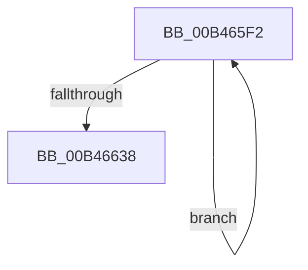

# sub_00B465F2

- RVA: `0x00B465F2`–`0x00B46641` (길이 `79` bytes)
- VA: `0x0000000140B465F2`
- 실행 섹션: `PAGE`
- PDB 이름 있음: `아니요`; PDB Function 태그: `아니요`
- unwind 정보 RVA: `0x000B8A90`
- 디코드: `17`개 명령, `79/79` bytes 표시
- 미해석 바이트: `0` (있으면 어셈블리에 `.byte`로 보존)

> 이 문서는 커널 이미지의 기계어와 PDB 기호를 분석해 생성했습니다. 4번과 5번은 함수 원형과 자료형을 바이너리 사용 방식에서 추정한 C 해석이며 원본 소스 복구 결과는 아닙니다.

## 1. Dependencies

- 직접 호출 지점: **4**; 고유 호출 대상: **4**
- 직접 호출자로 확인된 함수: **0**
- RIP 상대 이미지 참조: **2**

### Outgoing calls
- `0x00B465F9` → [ExReleaseFastMutex](../../text/25/ExReleaseFastMutex_function_002519C0.md) (function, `0x002519C0`)
- `0x00B46612` → [KeWaitForSingleObject](../../text/20/KeWaitForSingleObject_function_0020E6B0.md) (function, `0x0020E6B0`)
- `0x00B4661E` → [KeResetEvent](../../text/24/KeResetEvent_function_00248350.md) (function, `0x00248350`)
- `0x00B4662A` → [ExAcquireFastMutex](../../text/20/ExAcquireFastMutex_function_0020E5A0.md) (function, `0x0020E5A0`)

### Direct callers
- 이 함수 시작 RVA로 연결되는 직접 call은 확인되지 않았습니다. 간접 호출은 완전히 역산할 수 없습니다.

### Static image references
- `0x00B465F2` → RVA `0x00F0DF40` (`.data`; read)
- `0x00B46609` → RVA `0x00F0DFA0` (`.data`; read)

## 2. Other-region calls and transfers

- 다른 실행 섹션으로 향하는 call: **4**
  - `0x00B465F9` → [ExReleaseFastMutex](../../text/25/ExReleaseFastMutex_function_002519C0.md) (`PAGE` → `.text`)
  - `0x00B46612` → [KeWaitForSingleObject](../../text/20/KeWaitForSingleObject_function_0020E6B0.md) (`PAGE` → `.text`)
  - `0x00B4661E` → [KeResetEvent](../../text/24/KeResetEvent_function_00248350.md) (`PAGE` → `.text`)
  - `0x00B4662A` → [ExAcquireFastMutex](../../text/20/ExAcquireFastMutex_function_0020E5A0.md) (`PAGE` → `.text`)
- call이 아닌 외부 분기/꼬리 이동: **1**
  - `0x00B4663C` → [PoUnregisterPowerSettingCallback + 0x83](../A8/PoUnregisterPowerSettingCallback_function_00A8E940.md) (`tail-transfer`)

## 3. Assembly (complete function range)

```asm
00B465F2  48 8D 0D 47 79 3C 00            lea rcx, [rip + 0x3c7947]
00B465F9  E8 C2 B3 70 FF                  call 0x1402519c0
00B465FE  45 33 C9                        xor r9d, r9d
00B46601  48 89 7C 24 20                  mov qword ptr [rsp + 0x20], rdi
00B46606  45 33 C0                        xor r8d, r8d
00B46609  48 8D 0D 90 79 3C 00            lea rcx, [rip + 0x3c7990]
00B46610  33 D2                           xor edx, edx
00B46612  E8 99 80 6C FF                  call 0x14020e6b0
00B46617  48 8D 0D 82 79 3C 00            lea rcx, [rip + 0x3c7982]
00B4661E  E8 2D 1D 70 FF                  call 0x140248350
00B46623  48 8D 0D 16 79 3C 00            lea rcx, [rip + 0x3c7916]
00B4662A  E8 71 7F 6C FF                  call 0x14020e5a0
00B4662F  48 8B 43 18                     mov rax, qword ptr [rbx + 0x18]
00B46633  48 85 C0                        test rax, rax
00B46636  75 BA                           jne 0x140b465f2
00B46638  40 88 7B 21                     mov byte ptr [rbx + 0x21], dil
00B4663C  E9 82 83 F4 FF                  jmp 0x140a8e9c3
```

## 4. C-style interpretation (structured pseudocode)

```c
__int64 __fastcall sub_00B465F2(__int64 a1, int a2, int a3, int a4)
{
    __int64 result;
    unsigned __int64 v_stack_p20;

    result = ExReleaseFastMutex(v_rip + 3963207, a2, a3, a4);
    a4 = 0;
    v_stack_p20 = v_rdi;
    a3 = 0;
    a2 = 0;
    result = KeWaitForSingleObject(v_rip + 3963280, a2, a3, a4);
    result = KeResetEvent(v_rip + 3963266, a2, a3, a4);
    result = ExAcquireFastMutex(v_rip + 3963158, a2, a3, a4);
    if (*(unsigned __int64 *)(v_rbx + 24) != 0) goto loc_00B465F2;
    *(unsigned __int8 *)(v_rbx + 33) = (unsigned __int8)(v_rdi);
}
```

## 5. (Beta) C Style

```c
int64_t sub_00B465F2(int64_t Arg1, int32_t Arg2, int32_t Arg3, int32_t Arg4)
{
    int64_t result;
    uint64_t v_stack_p20;

    result = ExReleaseFastMutex(v_rip + 3963207, Arg2, Arg3, Arg4);
    Arg4 = 0;
    v_stack_p20 = local_rdi;
    Arg3 = 0;
    Arg2 = 0;
    result = KeWaitForSingleObject(v_rip + 3963280, Arg2, Arg3, Arg4);
    result = KeResetEvent(v_rip + 3963266, Arg2, Arg3, Arg4);
    result = ExAcquireFastMutex(v_rip + 3963158, Arg2, Arg3, Arg4);
    if (*(uint64_t *)(local_rbx + 0x18) != 0) goto loc_00B465F2;
    *(uint8_t *)(local_rbx + 0x21) = (uint8_t)(local_rdi);
}
```

## 6. Execution-region graph

[열기: 2D/3D 그래프와 함수 탐색 컨트롤 패널](../../../control-panel.html?section=page&rva=0x00B465F2&view=graph)

- 2D 그래프는 위에서 아래로 흐르고, 3D 그래프는 빈 공간을 드래그해 회전합니다. Shift+드래그는 이동, 휠은 확대·축소, 함수 노드 선택은 대상 보고서 이동입니다.

### Static fallback


