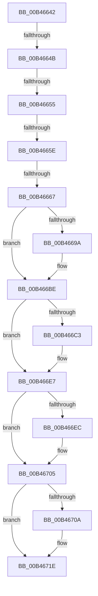

# sub_00B46642

- RVA: `0x00B46642`–`0x00B46725` (길이 `227` bytes)
- VA: `0x0000000140B46642`
- 실행 섹션: `PAGE`
- PDB 이름 있음: `아니요`; PDB Function 태그: `아니요`
- unwind 정보 RVA: `0x000B8ADC`
- 디코드: `54`개 명령, `227/227` bytes 표시
- 미해석 바이트: `0` (있으면 어셈블리에 `.byte`로 보존)

> 이 문서는 커널 이미지의 기계어와 PDB 기호를 분석해 생성했습니다. 4번과 5번은 함수 원형과 자료형을 바이너리 사용 방식에서 추정한 C 해석이며 원본 소스 복구 결과는 아닙니다.

## 1. Dependencies

- 직접 호출 지점: **5**; 고유 호출 대상: **1**
- 직접 호출자로 확인된 함수: **0**
- RIP 상대 이미지 참조: **0**

### Outgoing calls
- `0x00B46673` → [memcpy](../../text/6C/memcpy_function_006C6840.md) (function, `0x006C6840`)
- `0x00B466B5` → [memcpy](../../text/6C/memcpy_function_006C6840.md) (function, `0x006C6840`)
- `0x00B466DE` → [memcpy](../../text/6C/memcpy_function_006C6840.md) (function, `0x006C6840`)
- `0x00B466FC` → [memcpy](../../text/6C/memcpy_function_006C6840.md) (function, `0x006C6840`)
- `0x00B46715` → [memcpy](../../text/6C/memcpy_function_006C6840.md) (function, `0x006C6840`)

### Direct callers
- 이 함수 시작 RVA로 연결되는 직접 call은 확인되지 않았습니다. 간접 호출은 완전히 역산할 수 없습니다.

### Static image references
- 디코드된 RIP-relative 메모리 참조가 없습니다.

## 2. Other-region calls and transfers

- 다른 실행 섹션으로 향하는 call: **5**
  - `0x00B46673` → [memcpy](../../text/6C/memcpy_function_006C6840.md) (`PAGE` → `.text`)
  - `0x00B466B5` → [memcpy](../../text/6C/memcpy_function_006C6840.md) (`PAGE` → `.text`)
  - `0x00B466DE` → [memcpy](../../text/6C/memcpy_function_006C6840.md) (`PAGE` → `.text`)
  - `0x00B466FC` → [memcpy](../../text/6C/memcpy_function_006C6840.md) (`PAGE` → `.text`)
  - `0x00B46715` → [memcpy](../../text/6C/memcpy_function_006C6840.md) (`PAGE` → `.text`)
- call이 아닌 외부 분기/꼬리 이동: **5**
  - `0x00B46645` → [RtlSelfRelativeToAbsoluteSD + 0x8C](../A8/RtlSelfRelativeToAbsoluteSD_function_00A8EAF0.md) (`tail-transfer`)
  - `0x00B4664F` → [RtlSelfRelativeToAbsoluteSD + 0x8C](../A8/RtlSelfRelativeToAbsoluteSD_function_00A8EAF0.md) (`tail-transfer`)
  - `0x00B46658` → [RtlSelfRelativeToAbsoluteSD + 0x8C](../A8/RtlSelfRelativeToAbsoluteSD_function_00A8EAF0.md) (`tail-transfer`)
  - `0x00B46661` → [RtlSelfRelativeToAbsoluteSD + 0x8C](../A8/RtlSelfRelativeToAbsoluteSD_function_00A8EAF0.md) (`tail-transfer`)
  - `0x00B46720` → [RtlSelfRelativeToAbsoluteSD + 0xA9](../A8/RtlSelfRelativeToAbsoluteSD_function_00A8EAF0.md) (`tail-transfer`)

## 3. Assembly (complete function range)

```asm
00B46642  45 3B 03                        cmp r8d, dword ptr [r11]
00B46645  0F 87 31 85 F4 FF               ja 0x140a8eb7c
00B4664B  41 3B 14 24                     cmp edx, dword ptr [r12]
00B4664F  0F 87 27 85 F4 FF               ja 0x140a8eb7c
00B46655  41 3B 07                        cmp eax, dword ptr [r15]
00B46658  0F 87 1E 85 F4 FF               ja 0x140a8eb7c
00B4665E  45 3B 0A                        cmp r9d, dword ptr [r10]
00B46661  0F 87 15 85 F4 FF               ja 0x140a8eb7c
00B46667  48 8B D1                        mov rdx, rcx
00B4666A  41 B8 14 00 00 00               mov r8d, 0x14
00B46670  49 8B CE                        mov rcx, r14
00B46673  E8 C8 01 B8 FF                  call 0x1406c6840
00B46678  45 33 FF                        xor r15d, r15d
00B4667B  B8 FF 7F 00 00                  mov eax, 0x7fff
00B46680  66 41 21 46 02                  and word ptr [r14 + 2], ax
00B46685  4D 89 7E 08                     mov qword ptr [r14 + 8], r15
00B46689  4D 89 7E 10                     mov qword ptr [r14 + 0x10], r15
00B4668D  4D 89 7E 18                     mov qword ptr [r14 + 0x18], r15
00B46691  4D 89 7E 20                     mov qword ptr [r14 + 0x20], r15
00B46695  48 85 DB                        test rbx, rbx
00B46698  74 24                           je 0x140b466be
00B4669A  44 0F B6 43 01                  movzx r8d, byte ptr [rbx + 1]
00B4669F  48 8B D3                        mov rdx, rbx
00B466A2  48 8B 9C 24 88 00 00 00         mov rbx, qword ptr [rsp + 0x88]
00B466AA  48 8B CB                        mov rcx, rbx
00B466AD  4E 8D 04 85 08 00 00 00         lea r8, [r8*4 + 8]
00B466B5  E8 86 01 B8 FF                  call 0x1406c6840
00B466BA  49 89 5E 08                     mov qword ptr [r14 + 8], rbx
00B466BE  48 85 ED                        test rbp, rbp
00B466C1  74 24                           je 0x140b466e7
00B466C3  44 0F B6 45 01                  movzx r8d, byte ptr [rbp + 1]
00B466C8  48 8B D5                        mov rdx, rbp
00B466CB  48 8B 9C 24 98 00 00 00         mov rbx, qword ptr [rsp + 0x98]
00B466D3  48 8B CB                        mov rcx, rbx
00B466D6  4E 8D 04 85 08 00 00 00         lea r8, [r8*4 + 8]
00B466DE  E8 5D 01 B8 FF                  call 0x1406c6840
00B466E3  49 89 5E 10                     mov qword ptr [r14 + 0x10], rbx
00B466E7  48 85 F6                        test rsi, rsi
00B466EA  74 19                           je 0x140b46705
00B466EC  48 8B 5C 24 78                  mov rbx, qword ptr [rsp + 0x78]
00B466F1  48 8B D6                        mov rdx, rsi
00B466F4  44 0F B7 46 02                  movzx r8d, word ptr [rsi + 2]
00B466F9  48 8B CB                        mov rcx, rbx
00B466FC  E8 3F 01 B8 FF                  call 0x1406c6840
00B46701  49 89 5E 18                     mov qword ptr [r14 + 0x18], rbx
00B46705  48 85 FF                        test rdi, rdi
00B46708  74 14                           je 0x140b4671e
00B4670A  44 0F B7 47 02                  movzx r8d, word ptr [rdi + 2]
00B4670F  48 8B D7                        mov rdx, rdi
00B46712  49 8B CD                        mov rcx, r13
00B46715  E8 26 01 B8 FF                  call 0x1406c6840
00B4671A  4D 89 6E 20                     mov qword ptr [r14 + 0x20], r13
00B4671E  33 C0                           xor eax, eax
00B46720  E9 74 84 F4 FF                  jmp 0x140a8eb99
```

## 4. C-style interpretation (structured pseudocode)

```c
__int64 __fastcall sub_00B46642(__int64 a1, int a2, int a3, int a4, __int64 a5, __int64 a6, __int64 a7, __int64 a8, __int64 a9, __int64 a10, __int64 a11, __int64 a12, __int64 a13, __int64 a14, __int64 a15, __int64 a16, __int64 a17, __int64 a18, __int64 a19)
{
    __int64 result;
    __int64 v_r15;
    __int64 v_rbx;

    result = memcpy(v_r14, a1, 20, a4);
    v_r15 = 0;
    *(unsigned __int64 *)(v_r14 + 8) = 0;
    *(unsigned __int64 *)(v_r14 + 16) = 0;
    *(unsigned __int64 *)(v_r14 + 24) = 0;
    *(unsigned __int64 *)(v_r14 + 32) = 0;
    result = (unsigned int)(0x7FFFULL);
    if (v_rbx != 0) {
        a3 = *(unsigned __int8 *)(v_rbx + 1);
        a2 = v_rbx;
        v_rbx = a17;
        a1 = v_rbx;
        a3 = a3 * 4 + 8;
        result = memcpy(a1, a2, a3, a4);
        *(unsigned __int64 *)(v_r14 + 8) = v_rbx;
    }
    if (v_rbp != 0) {
        a3 = *(unsigned __int8 *)(v_rbp + 1);
        a2 = v_rbp;
        v_rbx = a19;
        a1 = v_rbx;
        a3 = a3 * 4 + 8;
        result = memcpy(a1, a2, a3, a4);
        *(unsigned __int64 *)(v_r14 + 16) = v_rbx;
    }
    if (v_rsi != 0) {
        v_rbx = a15;
        a2 = v_rsi;
        a3 = *(unsigned __int16 *)(v_rsi + 2);
        a1 = v_rbx;
        result = memcpy(a1, a2, a3, a4);
        *(unsigned __int64 *)(v_r14 + 24) = v_rbx;
    }
    if (v_rdi != 0) {
        a3 = *(unsigned __int16 *)(v_rdi + 2);
        a2 = v_rdi;
        a1 = v_r13;
        result = memcpy(a1, a2, a3, a4);
        *(unsigned __int64 *)(v_r14 + 32) = v_r13;
    }
    result = 0;
}
```

## 5. (Beta) C Style

```c
int64_t sub_00B46642(int64_t Arg1, int32_t Arg2, int32_t Arg3, int32_t Arg4, uint64_t Arg5, uint64_t Arg6, uint64_t Arg7, uint64_t Arg8, uint64_t Arg9, uint64_t Arg10, uint64_t Arg11, uint64_t Arg12, uint64_t Arg13, uint64_t Arg14, int64_t Arg15, uint64_t Arg16, int64_t Arg17, uint64_t Arg18, int64_t Arg19)
{
    int64_t result;
    int64_t local_r15;
    int64_t local_rbx;

    result = memcpy(local_r14, Arg1, 20, Arg4);
    local_r15 = 0;
    *(uint64_t *)(local_r14 + 0x8) = 0;
    *(uint64_t *)(local_r14 + 0x10) = 0;
    *(uint64_t *)(local_r14 + 0x18) = 0;
    *(uint64_t *)(local_r14 + 0x20) = 0;
    result = (uint32_t)(0x7FFFULL);
    if (local_rbx != 0) {
        Arg3 = *(uint8_t *)(local_rbx + 0x1);
        Arg2 = local_rbx;
        local_rbx = Arg17;
        Arg1 = local_rbx;
        Arg3 = Arg3 * 4 + 8;
        result = memcpy(Arg1, Arg2, Arg3, Arg4);
        *(uint64_t *)(local_r14 + 0x8) = local_rbx;
    }
    if (local_rbp != 0) {
        Arg3 = *(uint8_t *)(local_rbp + 0x1);
        Arg2 = local_rbp;
        local_rbx = Arg19;
        Arg1 = local_rbx;
        Arg3 = Arg3 * 4 + 8;
        result = memcpy(Arg1, Arg2, Arg3, Arg4);
        *(uint64_t *)(local_r14 + 0x10) = local_rbx;
    }
    if (local_rsi != 0) {
        local_rbx = Arg15;
        Arg2 = local_rsi;
        Arg3 = *(uint16_t *)(local_rsi + 0x2);
        Arg1 = local_rbx;
        result = memcpy(Arg1, Arg2, Arg3, Arg4);
        *(uint64_t *)(local_r14 + 0x18) = local_rbx;
    }
    if (local_rdi != 0) {
        Arg3 = *(uint16_t *)(local_rdi + 0x2);
        Arg2 = local_rdi;
        Arg1 = local_r13;
        result = memcpy(Arg1, Arg2, Arg3, Arg4);
        *(uint64_t *)(local_r14 + 0x20) = local_r13;
    }
    result = 0;
}
```

## 6. Execution-region graph

[열기: 2D/3D 그래프와 함수 탐색 컨트롤 패널](../../../control-panel.html?section=page&rva=0x00B46642&view=graph)

- 2D 그래프는 위에서 아래로 흐르고, 3D 그래프는 빈 공간을 드래그해 회전합니다. Shift+드래그는 이동, 휠은 확대·축소, 함수 노드 선택은 대상 보고서 이동입니다.

### Static fallback


