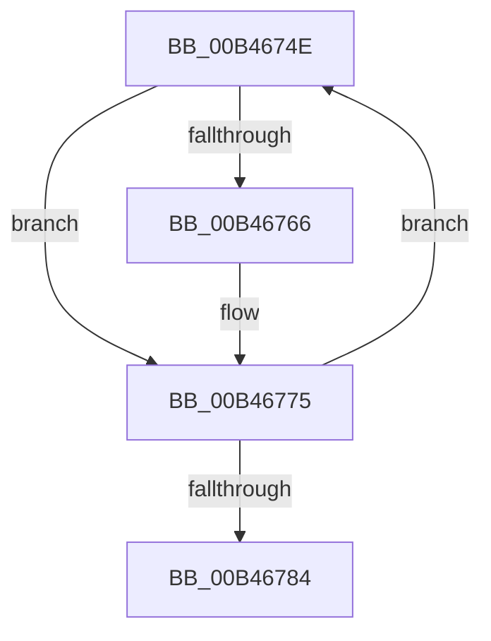

# sub_00B4674E

- RVA: `0x00B4674E`–`0x00B467A6` (길이 `88` bytes)
- VA: `0x0000000140B4674E`
- 실행 섹션: `PAGE`
- PDB 이름 있음: `아니요`; PDB Function 태그: `아니요`
- unwind 정보 RVA: `0x000B8DE4`
- 디코드: `22`개 명령, `88/88` bytes 표시
- 미해석 바이트: `0` (있으면 어셈블리에 `.byte`로 보존)

> 이 문서는 커널 이미지의 기계어와 PDB 기호를 분석해 생성했습니다. 4번과 5번은 함수 원형과 자료형을 바이너리 사용 방식에서 추정한 C 해석이며 원본 소스 복구 결과는 아닙니다.

## 1. Dependencies

- 직접 호출 지점: **0**; 고유 호출 대상: **0**
- 직접 호출자로 확인된 함수: **0**
- RIP 상대 이미지 참조: **0**

### Outgoing calls
- 직접 디코드된 call 명령이 없습니다.

### Direct callers
- 이 함수 시작 RVA로 연결되는 직접 call은 확인되지 않았습니다. 간접 호출은 완전히 역산할 수 없습니다.

### Static image references
- 디코드된 RIP-relative 메모리 참조가 없습니다.

## 2. Other-region calls and transfers

- 다른 실행 섹션으로 향하는 call: **0**
- call이 아닌 외부 분기/꼬리 이동: **1**
  - `0x00B467A1` → [PpmEventTraceProcessorPerformanceDomainRundown + 0x21A](../A8/PpmEventTraceProcessorPerformanceDomainRundown_function_00A8FCC4.md) (`tail-transfer`)

## 3. Assembly (complete function range)

```asm
00B4674E  4C 8B 8E 38 01 00 00            mov r9, qword ptr [rsi + 0x138]
00B46755  0F B7 CA                        movzx ecx, dx
00B46758  48 69 C1 A8 04 00 00            imul rax, rcx, 0x4a8
00B4675F  46 39 6C 08 10                  cmp dword ptr [rax + r9 + 0x10], r13d
00B46764  75 0F                           jne 0x140b46775
00B46766  42 8B 44 08 14                  mov eax, dword ptr [rax + r9 + 0x14]
00B4676B  41 8B C8                        mov ecx, r8d
00B4676E  45 03 C5                        add r8d, r13d
00B46771  41 89 04 8E                     mov dword ptr [r14 + rcx*4], eax
00B46775  66 41 03 D5                     add dx, r13w
00B46779  0F B7 C2                        movzx eax, dx
00B4677C  3B 86 28 01 00 00               cmp eax, dword ptr [rsi + 0x128]
00B46782  72 CA                           jb 0x140b4674e
00B46784  8B 44 24 34                     mov eax, dword ptr [rsp + 0x34]
00B46788  8B CB                           mov ecx, ebx
00B4678A  48 03 C9                        add rcx, rcx
00B4678D  C1 E0 02                        shl eax, 2
00B46790  41 03 DD                        add ebx, r13d
00B46793  4C 89 74 CC 40                  mov qword ptr [rsp + rcx*8 + 0x40], r14
00B46798  89 44 CC 48                     mov dword ptr [rsp + rcx*8 + 0x48], eax
00B4679C  44 89 64 CC 4C                  mov dword ptr [rsp + rcx*8 + 0x4c], r12d
00B467A1  E9 38 97 F4 FF                  jmp 0x140a8fede
```

## 4. C-style interpretation (structured pseudocode)

```c
__int64 __fastcall sub_00B4674E(__int64 a1, unsigned __int16 a2, int a3)
{
    __int64 result;
    __int64 v_rbx;
    unsigned int v_stack_p34;

    result = (result) * (a2);
    if ((*(unsigned int *)(result + *(unsigned __int64 *)(v_rsi + 312) * 1 + 16)) == ((unsigned int)(v_r13))) {
        result = *(unsigned int *)(result + *(unsigned __int64 *)(v_rsi + 312) * 1 + 20);
        a1 = a3;
        a3 = (unsigned int)((a3) + ((unsigned int)(v_r13)));
        *(unsigned int *)(v_r14 + a1 * 4) = (unsigned int)(result);
    }
    a2 = (unsigned __int16)((a2) + ((unsigned __int16)(v_r13)));
    if (a2 < (*(unsigned int *)(v_rsi + 296))) goto loc_00B4674E;
    a1 = ((unsigned int)((unsigned int)(v_rbx))) + ((unsigned int)((unsigned int)(v_rbx)));
    result = (unsigned int)(((unsigned int)(v_stack_p34)) << (2));
    v_rbx = (unsigned int)((v_rbx) + ((unsigned int)(v_r13)));
    *(unsigned __int64 *)(v_rsp + a1 * 8 + 64) = v_r14;
    *(unsigned int *)(v_rsp + a1 * 8 + 72) = (unsigned int)(result);
    *(unsigned int *)(v_rsp + a1 * 8 + 76) = (unsigned int)(v_r12);
}
```

## 5. (Beta) C Style

```c
int64_t sub_00B4674E(int64_t Arg1, uint16_t Arg2, int32_t Arg3)
{
    int64_t result;
    int64_t local_rbx;
    uint32_t v_stack_p34;

    result = (result) * (Arg2);
    if ((*(uint32_t *)(result + *(uint64_t *)(local_rsi + 0x138) * 1 + 0x10)) == ((uint32_t)(local_r13))) {
        result = *(uint32_t *)(result + *(uint64_t *)(local_rsi + 0x138) * 1 + 0x14);
        Arg1 = Arg3;
        Arg3 = (uint32_t)((Arg3) + ((uint32_t)(local_r13)));
        *(uint32_t *)(local_r14 + Arg1 * 4) = (uint32_t)(result);
    }
    Arg2 = (uint16_t)((Arg2) + ((uint16_t)(local_r13)));
    if (Arg2 < (*(uint32_t *)(local_rsi + 0x128))) goto loc_00B4674E;
    Arg1 = ((uint32_t)((uint32_t)(local_rbx))) + ((uint32_t)((uint32_t)(local_rbx)));
    result = (uint32_t)(((uint32_t)(v_stack_p34)) << (2));
    local_rbx = (uint32_t)((local_rbx) + ((uint32_t)(local_r13)));
    *(uint64_t *)(local_rsp + Arg1 * 8 + 0x40) = local_r14;
    *(uint32_t *)(local_rsp + Arg1 * 8 + 0x48) = (uint32_t)(result);
    *(uint32_t *)(local_rsp + Arg1 * 8 + 0x4C) = (uint32_t)(local_r12);
}
```

## 6. Execution-region graph

[열기: 2D/3D 그래프와 함수 탐색 컨트롤 패널](../../../control-panel.html?section=page&rva=0x00B4674E&view=graph)

- 2D 그래프는 위에서 아래로 흐르고, 3D 그래프는 빈 공간을 드래그해 회전합니다. Shift+드래그는 이동, 휠은 확대·축소, 함수 노드 선택은 대상 보고서 이동입니다.

### Static fallback


