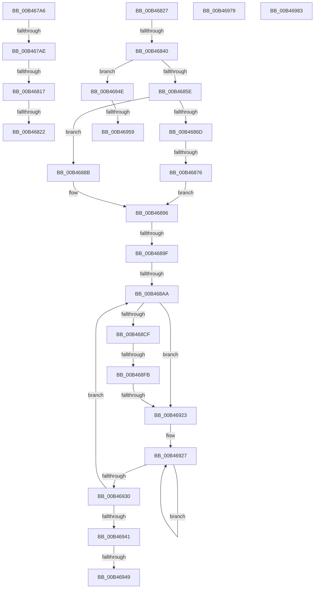

# sub_00B467A6

- RVA: `0x00B467A6`–`0x00B46996` (길이 `496` bytes)
- VA: `0x0000000140B467A6`
- 실행 섹션: `PAGE`
- PDB 이름 있음: `아니요`; PDB Function 태그: `아니요`
- unwind 정보 RVA: `0x000B8E80`
- 디코드: `121`개 명령, `496/496` bytes 표시
- 미해석 바이트: `0` (있으면 어셈블리에 `.byte`로 보존)

> 이 문서는 커널 이미지의 기계어와 PDB 기호를 분석해 생성했습니다. 4번과 5번은 함수 원형과 자료형을 바이너리 사용 방식에서 추정한 C 해석이며 원본 소스 복구 결과는 아닙니다.

## 1. Dependencies

- 직접 호출 지점: **9**; 고유 호출 대상: **9**
- 직접 호출자로 확인된 함수: **0**
- RIP 상대 이미지 참조: **2**

### Outgoing calls
- `0x00B467F9` → [_CmGetMatchingFilteredDeviceInterfaceList](../A0/_CmGetMatchingFilteredDeviceInterfaceList_function_00A09610.md) (function, `0x00A09610`)
- `0x00B46805` → [ZwClose](../../text/6A/ZwClose_function_006AD2B0.md) (function, `0x006AD2B0`)
- `0x00B46833` → [PiDevCfgParseVariableName](../../text/42/PiDevCfgParseVariableName_function_0042A6CC.md) (function, `0x0042A6CC`)
- `0x00B4684F` → [PiDevCfgResolveVariable](../A8/PiDevCfgResolveVariable_function_00A81AB8.md) (function, `0x00A81AB8`)
- `0x00B468B1` → [RtlInitUnicodeString](../../text/42/RtlInitUnicodeString_function_0042A780.md) (function, `0x0042A780`)
- `0x00B468C2` → [PiDevCfgParseInterfaceKeyName](../../text/4B/PiDevCfgParseInterfaceKeyName_function_004BB1CC.md) (function, `0x004BB1CC`)
- `0x00B468EC` → [IopRegisterDeviceInterface](../95/IopRegisterDeviceInterface_function_009501B0.md) (function, `0x009501B0`)
- `0x00B46908` → [PiDevCfgConfigureDeviceInterface](../96/PiDevCfgConfigureDeviceInterface_function_00963C18.md) (function, `0x00963C18`)
- `0x00B46916` → [ExFreePoolWithTag](../../poolcode/B8/ExFreePoolWithTag_function_00B82870.md) (function, `0x00B82870`)

### Direct callers
- 이 함수 시작 RVA로 연결되는 직접 call은 확인되지 않았습니다. 간접 호출은 완전히 역산할 수 없습니다.

### Static image references
- `0x00B467B6` → RVA `0x00E66398` (`.data`; read)
- `0x00B467E6` → RVA `0x005A7D30` (`PiDevCfgConfigureDeviceInterfaceCallback`; read)

## 2. Other-region calls and transfers

- 다른 실행 섹션으로 향하는 call: **5**
  - `0x00B46805` → [ZwClose](../../text/6A/ZwClose_function_006AD2B0.md) (`PAGE` → `.text`)
  - `0x00B46833` → [PiDevCfgParseVariableName](../../text/42/PiDevCfgParseVariableName_function_0042A6CC.md) (`PAGE` → `.text`)
  - `0x00B468B1` → [RtlInitUnicodeString](../../text/42/RtlInitUnicodeString_function_0042A780.md) (`PAGE` → `.text`)
  - `0x00B468C2` → [PiDevCfgParseInterfaceKeyName](../../text/4B/PiDevCfgParseInterfaceKeyName_function_004BB1CC.md) (`PAGE` → `.text`)
  - `0x00B46916` → [ExFreePoolWithTag](../../poolcode/B8/ExFreePoolWithTag_function_00B82870.md) (`PAGE` → `POOLCODE`)
- call이 아닌 외부 분기/꼬리 이동: **16**
  - `0x00B467A8` → [PiDevCfgConfigureDeviceInterfaces + 0xC2](../A9/PiDevCfgConfigureDeviceInterfaces_function_00A90060.md) (`tail-transfer`)
  - `0x00B46811` → [PiDevCfgConfigureDeviceInterfaces + 0xD0](../A9/PiDevCfgConfigureDeviceInterfaces_function_00A90060.md) (`tail-transfer`)
  - `0x00B4681C` → [PiDevCfgConfigureDeviceInterfaces + 0xD0](../A9/PiDevCfgConfigureDeviceInterfaces_function_00A90060.md) (`tail-transfer`)
  - `0x00B46822` → [PiDevCfgConfigureDeviceInterfaces + 0x165](../A9/PiDevCfgConfigureDeviceInterfaces_function_00A90060.md) (`tail-transfer`)
  - `0x00B4683A` → [PiDevCfgConfigureDeviceInterfaces + 0x254](../A9/PiDevCfgConfigureDeviceInterfaces_function_00A90060.md) (`tail-transfer`)
  - `0x00B46870` → [PiDevCfgConfigureDeviceInterfaces + 0x29F](../A9/PiDevCfgConfigureDeviceInterfaces_function_00A90060.md) (`tail-transfer`)
  - `0x00B46899` → [PiDevCfgConfigureDeviceInterfaces + 0x263](../A9/PiDevCfgConfigureDeviceInterfaces_function_00A90060.md) (`tail-transfer`)
  - `0x00B468A4` → [PiDevCfgConfigureDeviceInterfaces + 0x29F](../A9/PiDevCfgConfigureDeviceInterfaces_function_00A90060.md) (`tail-transfer`)
  - `0x00B468F5` → [PiDevCfgConfigureDeviceInterfaces + 0x311](../A9/PiDevCfgConfigureDeviceInterfaces_function_00A90060.md) (`tail-transfer`)
  - `0x00B4691D` → [PiDevCfgConfigureDeviceInterfaces + 0x311](../A9/PiDevCfgConfigureDeviceInterfaces_function_00A90060.md) (`tail-transfer`)
  - `0x00B46943` → [PiDevCfgConfigureDeviceInterfaces + 0x311](../A9/PiDevCfgConfigureDeviceInterfaces_function_00A90060.md) (`tail-transfer`)
  - `0x00B46949` → [PiDevCfgConfigureDeviceInterfaces + 0x29F](../A9/PiDevCfgConfigureDeviceInterfaces_function_00A90060.md) (`tail-transfer`)
  - `0x00B46953` → [PiDevCfgConfigureDeviceInterfaces + 0x29F](../A9/PiDevCfgConfigureDeviceInterfaces_function_00A90060.md) (`tail-transfer`)
  - `0x00B46974` → [PiDevCfgConfigureDeviceInterfaces + 0x263](../A9/PiDevCfgConfigureDeviceInterfaces_function_00A90060.md) (`tail-transfer`)
  - `0x00B4697E` → [PiDevCfgConfigureDeviceInterfaces + 0x298](../A9/PiDevCfgConfigureDeviceInterfaces_function_00A90060.md) (`tail-transfer`)
  - `0x00B46991` → [PiDevCfgConfigureDeviceInterfaces + 0x311](../A9/PiDevCfgConfigureDeviceInterfaces_function_00A90060.md) (`tail-transfer`)

## 3. Assembly (complete function range)

```asm
00B467A6  85 C0                           test eax, eax
00B467A8  0F 88 74 99 F4 FF               js 0x140a90122
00B467AE  48 8B 44 24 50                  mov rax, qword ptr [rsp + 0x50]
00B467B3  45 33 C9                        xor r9d, r9d
00B467B6  48 8B 0D DB FB 31 00            mov rcx, qword ptr [rip + 0x31fbdb]
00B467BD  4C 8B C7                        mov r8, rdi
00B467C0  89 74 24 48                     mov dword ptr [rsp + 0x48], esi
00B467C4  33 D2                           xor edx, edx
00B467C6  48 89 45 F0                     mov qword ptr [rbp - 0x10], rax
00B467CA  48 8D 44 24 60                  lea rax, [rsp + 0x60]
00B467CF  48 89 44 24 40                  mov qword ptr [rsp + 0x40], rax
00B467D4  48 8D 45 F0                     lea rax, [rbp - 0x10]
00B467D8  89 74 24 38                     mov dword ptr [rsp + 0x38], esi
00B467DC  48 89 74 24 30                  mov qword ptr [rsp + 0x30], rsi
00B467E1  48 89 44 24 28                  mov qword ptr [rsp + 0x28], rax
00B467E6  48 8D 05 43 15 A6 FF            lea rax, [rip - 0x59eabd]
00B467ED  48 89 44 24 20                  mov qword ptr [rsp + 0x20], rax
00B467F2  4C 89 65 F8                     mov qword ptr [rbp - 8], r12
00B467F6  89 75 00                        mov dword ptr [rbp], esi
00B467F9  E8 12 2E EC FF                  call 0x140a09610
00B467FE  48 8B 4C 24 50                  mov rcx, qword ptr [rsp + 0x50]
00B46803  8B D8                           mov ebx, eax
00B46805  E8 A6 6A B6 FF                  call 0x1406ad2b0
00B4680A  48 89 74 24 50                  mov qword ptr [rsp + 0x50], rsi
00B4680F  85 DB                           test ebx, ebx
00B46811  0F 88 19 99 F4 FF               js 0x140a90130
00B46817  8B 5D 00                        mov ebx, dword ptr [rbp]
00B4681A  85 DB                           test ebx, ebx
00B4681C  0F 88 0E 99 F4 FF               js 0x140a90130
00B46822  E9 9E 99 F4 FF                  jmp 0x140a901c5
00B46827  48 8B 4D E8                     mov rcx, qword ptr [rbp - 0x18]
00B4682B  4C 8D 45 90                     lea r8, [rbp - 0x70]
00B4682F  48 8D 55 10                     lea rdx, [rbp + 0x10]
00B46833  E8 94 3E 8E FF                  call 0x14042a6cc
00B46838  84 C0                           test al, al
00B4683A  0F 84 74 9A F4 FF               je 0x140a902b4
00B46840  48 8B 55 18                     mov rdx, qword ptr [rbp + 0x18]
00B46844  4C 8D 45 90                     lea r8, [rbp - 0x70]
00B46848  49 8B CC                        mov rcx, r12
00B4684B  48 89 75 90                     mov qword ptr [rbp - 0x70], rsi
00B4684F  E8 64 B2 F3 FF                  call 0x140a81ab8
00B46854  8B D8                           mov ebx, eax
00B46856  85 C0                           test eax, eax
00B46858  0F 88 F0 00 00 00               js 0x140b4694e
00B4685E  48 8B 4D 90                     mov rcx, qword ptr [rbp - 0x70]
00B46862  8B 51 20                        mov edx, dword ptr [rcx + 0x20]
00B46865  8D 42 FF                        lea eax, [rdx - 1]
00B46868  83 F8 01                        cmp eax, 1
00B4686B  76 1E                           jbe 0x140b4688b
00B4686D  83 FA 07                        cmp edx, 7
00B46870  0F 85 89 9A F4 FF               jne 0x140a902ff
00B46876  48 8B 79 28                     mov rdi, qword ptr [rcx + 0x28]
00B4687A  0F B7 4C 24 72                  movzx ecx, word ptr [rsp + 0x72]
00B4687F  48 8B 74 24 78                  mov rsi, qword ptr [rsp + 0x78]
00B46884  0F B7 44 24 70                  movzx eax, word ptr [rsp + 0x70]
00B46889  EB 0B                           jmp 0x140b46896
00B4688B  48 8B 71 28                     mov rsi, qword ptr [rcx + 0x28]
00B4688F  0F B7 49 24                     movzx ecx, word ptr [rcx + 0x24]
00B46893  8D 41 FE                        lea eax, [rcx - 2]
00B46896  48 85 FF                        test rdi, rdi
00B46899  0F 84 24 9A F4 FF               je 0x140a902c3
00B4689F  33 F6                           xor esi, esi
00B468A1  66 39 37                        cmp word ptr [rdi], si
00B468A4  0F 84 55 9A F4 FF               je 0x140a902ff
00B468AA  48 8B D7                        mov rdx, rdi
00B468AD  48 8D 4D 80                     lea rcx, [rbp - 0x80]
00B468B1  E8 CA 3E 8E FF                  call 0x14042a780
00B468B6  4C 8D 45 98                     lea r8, [rbp - 0x68]
00B468BA  48 8D 55 20                     lea rdx, [rbp + 0x20]
00B468BE  48 8D 4D 80                     lea rcx, [rbp - 0x80]
00B468C2  E8 05 49 97 FF                  call 0x1404bb1cc
00B468C7  4C 8B 75 98                     mov r14, qword ptr [rbp - 0x68]
00B468CB  84 C0                           test al, al
00B468CD  74 54                           je 0x140b46923
00B468CF  48 8B 4D D0                     mov rcx, qword ptr [rbp - 0x30]
00B468D3  48 8D 44 24 58                  lea rax, [rsp + 0x58]
00B468D8  48 89 74 24 28                  mov qword ptr [rsp + 0x28], rsi
00B468DD  48 8D 55 20                     lea rdx, [rbp + 0x20]
00B468E1  41 B1 01                        mov r9b, 1
00B468E4  48 89 44 24 20                  mov qword ptr [rsp + 0x20], rax
00B468E9  4D 8B C6                        mov r8, r14
00B468EC  E8 BF 98 E0 FF                  call 0x1409501b0
00B468F1  8B D8                           mov ebx, eax
00B468F3  85 C0                           test eax, eax
00B468F5  0F 88 76 9A F4 FF               js 0x140a90371
00B468FB  48 8B 54 24 50                  mov rdx, qword ptr [rsp + 0x50]
00B46900  4D 8B C4                        mov r8, r12
00B46903  48 8B 4C 24 58                  mov rcx, qword ptr [rsp + 0x58]
00B46908  E8 0B D3 E1 FF                  call 0x140963c18
00B4690D  48 8B 4C 24 58                  mov rcx, qword ptr [rsp + 0x58]
00B46912  33 D2                           xor edx, edx
00B46914  8B D8                           mov ebx, eax
00B46916  E8 55 BF 03 00                  call 0x140b82870
00B4691B  85 DB                           test ebx, ebx
00B4691D  0F 88 4E 9A F4 FF               js 0x140a90371
00B46923  48 83 C8 FF                     or rax, 0xffffffffffffffff
00B46927  48 FF C0                        inc rax
00B4692A  66 39 34 47                     cmp word ptr [rdi + rax*2], si
00B4692E  75 F7                           jne 0x140b46927
00B46930  48 8D 3C 47                     lea rdi, [rdi + rax*2]
00B46934  48 83 C7 02                     add rdi, 2
00B46938  66 39 37                        cmp word ptr [rdi], si
00B4693B  0F 85 69 FF FF FF               jne 0x140b468aa
00B46941  85 DB                           test ebx, ebx
00B46943  0F 88 28 9A F4 FF               js 0x140a90371
00B46949  E9 B1 99 F4 FF                  jmp 0x140a902ff
00B4694E  3D 34 00 00 C0                  cmp eax, 0xc0000034
00B46953  0F 85 A6 99 F4 FF               jne 0x140a902ff
00B46959  0F 28 4D 10                     movaps xmm1, xmmword ptr [rbp + 0x10]
00B4695D  66 0F 6F C1                     movdqa xmm0, xmm1
00B46961  66 0F 7E C8                     movd eax, xmm1
00B46965  66 0F 73 D8 08                  psrldq xmm0, 8
00B4696A  66 48 0F 7E C6                  movq rsi, xmm0
00B4696F  66 0F C5 C9 01                  pextrw ecx, xmm1, 1
00B46974  E9 4A 99 F4 FF                  jmp 0x140a902c3
00B46979  B8 01 00 00 C0                  mov eax, 0xc0000001
00B4697E  E9 75 99 F4 FF                  jmp 0x140a902f8
00B46983  81 FB 05 00 00 80               cmp ebx, 0x80000005
00B46989  B8 33 00 00 C0                  mov eax, 0xc0000033
00B4698E  0F 44 D8                        cmove ebx, eax
00B46991  E9 DB 99 F4 FF                  jmp 0x140a90371
```

## 4. C-style interpretation (structured pseudocode)

```c
__int64 __fastcall sub_00B467A6(__int64 a1, int a2, __int64 a3, int a4, __int64 a5, __int64 a6, __int64 a7, __int64 a8, __int64 a9, __int64 a10, __int64 a11, __int64 a12)
{
    __int64 result;
    unsigned __int64 v_stack_p20;
    unsigned __int64 v_stack_p28;
    unsigned __int64 v_stack_p30;
    unsigned int v_stack_p38;
    unsigned __int64 v_stack_p40;
    unsigned int v_stack_p48;
    unsigned __int64 v_stack_p50;
    unsigned __int64 v_stack_p58;
    unsigned __int16 v_stack_p70;
    unsigned __int16 v_stack_p72;
    unsigned __int64 v_stack_p78;

    a4 = 0;
    v_stack_p48 = (unsigned int)(v_rsi);
    a2 = 0;
    *(unsigned __int64 *)(v_rbp - 16) = a10;
    v_stack_p40 = a12;
    v_stack_p38 = (unsigned int)(v_rsi);
    v_stack_p30 = v_rsi;
    v_stack_p28 = v_rbp - 16;
    v_stack_p20 = v_rip - 5892797;
    *(unsigned __int64 *)(v_rbp - 8) = v_r12;
    *(unsigned int *)(v_rbp) = (unsigned int)(v_rsi);
    result = _CmGetMatchingFilteredDeviceInterfaceList(*(unsigned __int64 *)(v_rip + 3275739), a2, v_rdi, a4);
    result = ZwClose(a10, a2, v_rdi, a4);
    v_stack_p50 = v_rsi;
}
```

## 5. (Beta) C Style

```c
int64_t sub_00B467A6(int64_t Arg1, int32_t Arg2, int64_t Arg3, int32_t Arg4, uint64_t Arg5, uint64_t Arg6, uint64_t Arg7, uint64_t Arg8, uint64_t Arg9, int64_t Arg10, uint64_t Arg11, int64_t Arg12)
{
    int64_t result;
    uint64_t v_stack_p20;
    uint64_t v_stack_p28;
    uint64_t v_stack_p30;
    uint32_t v_stack_p38;
    uint64_t v_stack_p40;
    uint32_t v_stack_p48;
    uint64_t v_stack_p50;
    uint64_t v_stack_p58;
    uint16_t v_stack_p70;
    uint16_t v_stack_p72;
    uint64_t v_stack_p78;

    Arg4 = 0;
    v_stack_p48 = (uint32_t)(local_rsi);
    Arg2 = 0;
    *(uint64_t *)(local_rbp - 0x10) = Arg10;
    v_stack_p40 = Arg12;
    v_stack_p38 = (uint32_t)(local_rsi);
    v_stack_p30 = local_rsi;
    v_stack_p28 = local_rbp - 16;
    v_stack_p20 = v_rip - 5892797;
    *(uint64_t *)(local_rbp - 0x8) = local_r12;
    *(uint32_t *)(local_rbp) = (uint32_t)(local_rsi);
    result = _CmGetMatchingFilteredDeviceInterfaceList(*(uint64_t *)(v_rip + 0x31FBDB), Arg2, local_rdi, Arg4);
    result = ZwClose(Arg10, Arg2, local_rdi, Arg4);
    v_stack_p50 = local_rsi;
}
```

## 6. Execution-region graph

[열기: 2D/3D 그래프와 함수 탐색 컨트롤 패널](../../../control-panel.html?section=page&rva=0x00B467A6&view=graph)

- 2D 그래프는 위에서 아래로 흐르고, 3D 그래프는 빈 공간을 드래그해 회전합니다. Shift+드래그는 이동, 휠은 확대·축소, 함수 노드 선택은 대상 보고서 이동입니다.

### Static fallback


