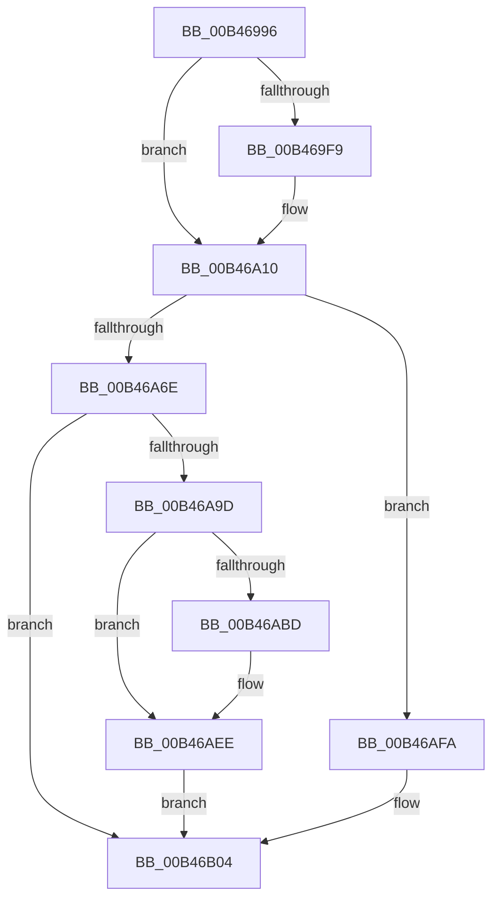

# sub_00B46996

- RVA: `0x00B46996`–`0x00B46B1A` (길이 `388` bytes)
- VA: `0x0000000140B46996`
- 실행 섹션: `PAGE`
- PDB 이름 있음: `아니요`; PDB Function 태그: `아니요`
- unwind 정보 RVA: `0x000B8F30`
- 디코드: `83`개 명령, `388/388` bytes 표시
- 미해석 바이트: `0` (있으면 어셈블리에 `.byte`로 보존)

> 이 문서는 커널 이미지의 기계어와 PDB 기호를 분석해 생성했습니다. 4번과 5번은 함수 원형과 자료형을 바이너리 사용 방식에서 추정한 C 해석이며 원본 소스 복구 결과는 아닙니다.

## 1. Dependencies

- 직접 호출 지점: **16**; 고유 호출 대상: **9**
- 직접 호출자로 확인된 함수: **0**
- RIP 상대 이미지 참조: **6**

### Outgoing calls
- `0x00B46996` → [RtlCopyUnicodeString](../../text/3F/RtlCopyUnicodeString_function_003FEF30.md) (function, `0x003FEF30`)
- `0x00B469A7` → [RtlInitUnicodeString](../../text/42/RtlInitUnicodeString_function_0042A780.md) (function, `0x0042A780`)
- `0x00B469B6` → [RtlAppendUnicodeStringToString](../../text/40/RtlAppendUnicodeStringToString_function_0040FA50.md) (function, `0x0040FA50`)
- `0x00B469C3` → [RtlAppendUnicodeStringToString](../../text/40/RtlAppendUnicodeStringToString_function_0040FA50.md) (function, `0x0040FA50`)
- `0x00B469D4` → [RtlInitUnicodeString](../../text/42/RtlInitUnicodeString_function_0042A780.md) (function, `0x0042A780`)
- `0x00B469E3` → [RtlAppendUnicodeStringToString](../../text/40/RtlAppendUnicodeStringToString_function_0040FA50.md) (function, `0x0040FA50`)
- `0x00B46A36` → [RtlStringCchPrintfW](../../text/48/RtlStringCchPrintfW_function_00482D5C.md) (function, `0x00482D5C`)
- `0x00B46A44` → [RtlInitUnicodeString](../../text/42/RtlInitUnicodeString_function_0042A780.md) (function, `0x0042A780`)
- `0x00B46A55` → [RtlInitUnicodeString](../../text/42/RtlInitUnicodeString_function_0042A780.md) (function, `0x0042A780`)
- `0x00B46A94` → [IopOpenRegistryKey](../A8/IopOpenRegistryKey_function_00A8F200.md) (function, `0x00A8F200`)
- `0x00B46AB4` → [IopOpenRegistryKey](../A8/IopOpenRegistryKey_function_00A8F200.md) (function, `0x00A8F200`)
- `0x00B46ADF` → [ZwSetValueKey](../../text/6A/ZwSetValueKey_function_006ADCD0.md) (function, `0x006ADCD0`)
- `0x00B46AE9` → [ZwClose](../../text/6A/ZwClose_function_006AD2B0.md) (function, `0x006AD2B0`)
- `0x00B46AF3` → [ZwClose](../../text/6A/ZwClose_function_006AD2B0.md) (function, `0x006AD2B0`)
- `0x00B46AFF` → [IopBootLogToFile](../71/IopBootLogToFile_function_0071AD54.md) (function, `0x0071AD54`)
- `0x00B46B0F` → [ExReleaseResourceLite](../../text/25/ExReleaseResourceLite_function_0025FA10.md) (function, `0x0025FA10`)

### Direct callers
- 이 함수 시작 RVA로 연결되는 직접 call은 확인되지 않았습니다. 간접 호출은 완전히 역산할 수 없습니다.

### Static image references
- `0x00B4699B` → RVA `0x00AFCA30` (` ?? ::NNGAKEGL::`string'`; read)
- `0x00B469C8` → RVA `0x00AFCA20` (` ?? ::NNGAKEGL::`string'`; read)
- `0x00B46A10` → RVA `0x00FD8028` (`PAGEDATA`; read)
- `0x00B46A17` → RVA `0x00AFCAE0` (` ?? ::NNGAKEGL::`string'`; read)
- `0x00B46A49` → RVA `0x00AFCAD0` (` ?? ::NNGAKEGL::`string'`; read)
- `0x00B46A81` → RVA `0x00FDA0C8` (`PAGEDATA`; read)

## 2. Other-region calls and transfers

- 다른 실행 섹션으로 향하는 call: **13**
  - `0x00B46996` → [RtlCopyUnicodeString](../../text/3F/RtlCopyUnicodeString_function_003FEF30.md) (`PAGE` → `.text`)
  - `0x00B469A7` → [RtlInitUnicodeString](../../text/42/RtlInitUnicodeString_function_0042A780.md) (`PAGE` → `.text`)
  - `0x00B469B6` → [RtlAppendUnicodeStringToString](../../text/40/RtlAppendUnicodeStringToString_function_0040FA50.md) (`PAGE` → `.text`)
  - `0x00B469C3` → [RtlAppendUnicodeStringToString](../../text/40/RtlAppendUnicodeStringToString_function_0040FA50.md) (`PAGE` → `.text`)
  - `0x00B469D4` → [RtlInitUnicodeString](../../text/42/RtlInitUnicodeString_function_0042A780.md) (`PAGE` → `.text`)
  - `0x00B469E3` → [RtlAppendUnicodeStringToString](../../text/40/RtlAppendUnicodeStringToString_function_0040FA50.md) (`PAGE` → `.text`)
  - `0x00B46A36` → [RtlStringCchPrintfW](../../text/48/RtlStringCchPrintfW_function_00482D5C.md) (`PAGE` → `.text`)
  - `0x00B46A44` → [RtlInitUnicodeString](../../text/42/RtlInitUnicodeString_function_0042A780.md) (`PAGE` → `.text`)
  - `0x00B46A55` → [RtlInitUnicodeString](../../text/42/RtlInitUnicodeString_function_0042A780.md) (`PAGE` → `.text`)
  - `0x00B46ADF` → [ZwSetValueKey](../../text/6A/ZwSetValueKey_function_006ADCD0.md) (`PAGE` → `.text`)
  - `0x00B46AE9` → [ZwClose](../../text/6A/ZwClose_function_006AD2B0.md) (`PAGE` → `.text`)
  - `0x00B46AF3` → [ZwClose](../../text/6A/ZwClose_function_006AD2B0.md) (`PAGE` → `.text`)
  - `0x00B46B0F` → [ExReleaseResourceLite](../../text/25/ExReleaseResourceLite_function_0025FA10.md) (`PAGE` → `.text`)
- call이 아닌 외부 분기/꼬리 이동: **1**
  - `0x00B46B15` → [IopBootLog + 0x76](../A9/IopBootLog_function_00A90998.md) (`tail-transfer`)

## 3. Assembly (complete function range)

```asm
00B46996  E8 95 85 8B FF                  call 0x1403fef30
00B4699B  48 8D 15 8E 60 FB FF            lea rdx, [rip - 0x49f72]
00B469A2  48 8D 4C 24 40                  lea rcx, [rsp + 0x40]
00B469A7  E8 D4 3D 8E FF                  call 0x14042a780
00B469AC  48 8D 54 24 40                  lea rdx, [rsp + 0x40]
00B469B1  48 8D 4C 24 30                  lea rcx, [rsp + 0x30]
00B469B6  E8 95 90 8C FF                  call 0x14040fa50
00B469BB  48 8B D7                        mov rdx, rdi
00B469BE  48 8D 4C 24 30                  lea rcx, [rsp + 0x30]
00B469C3  E8 88 90 8C FF                  call 0x14040fa50
00B469C8  48 8D 15 51 60 FB FF            lea rdx, [rip - 0x49faf]
00B469CF  48 8D 4C 24 50                  lea rcx, [rsp + 0x50]
00B469D4  E8 A7 3D 8E FF                  call 0x14042a780
00B469D9  48 8D 54 24 50                  lea rdx, [rsp + 0x50]
00B469DE  48 8D 4C 24 30                  lea rcx, [rsp + 0x30]
00B469E3  E8 68 90 8C FF                  call 0x14040fa50
00B469E8  0F B7 5C 24 30                  movzx ebx, word ptr [rsp + 0x30]
00B469ED  48 8B 7C 24 38                  mov rdi, qword ptr [rsp + 0x38]
00B469F2  66 3B 5C 24 32                  cmp bx, word ptr [rsp + 0x32]
00B469F7  75 17                           jne 0x140b46a10
00B469F9  B8 FE FF 00 00                  mov eax, 0xfffe
00B469FE  66 03 D8                        add bx, ax
00B46A01  0F B7 C3                        movzx eax, bx
00B46A04  48 D1 E8                        shr rax, 1
00B46A07  66 89 5C 24 30                  mov word ptr [rsp + 0x30], bx
00B46A0C  66 89 34 47                     mov word ptr [rdi + rax*2], si
00B46A10  48 8B 0D 11 16 49 00            mov rcx, qword ptr [rip + 0x491611]
00B46A17  4C 8D 05 C2 60 FB FF            lea r8, [rip - 0x49f3e]
00B46A1E  49 8B D6                        mov rdx, r14
00B46A21  44 8B 89 A8 00 00 00            mov r9d, dword ptr [rcx + 0xa8]
00B46A28  41 8D 41 01                     lea eax, [r9 + 1]
00B46A2C  89 81 A8 00 00 00               mov dword ptr [rcx + 0xa8], eax
00B46A32  48 8D 4D 80                     lea rcx, [rbp - 0x80]
00B46A36  E8 21 C3 93 FF                  call 0x140482d5c
00B46A3B  48 8D 55 80                     lea rdx, [rbp - 0x80]
00B46A3F  48 8D 4C 24 60                  lea rcx, [rsp + 0x60]
00B46A44  E8 37 3D 8E FF                  call 0x14042a780
00B46A49  48 8D 15 80 60 FB FF            lea rdx, [rip - 0x49f80]
00B46A50  48 8D 4C 24 70                  lea rcx, [rsp + 0x70]
00B46A55  E8 26 3D 8E FF                  call 0x14042a780
00B46A5A  48 8B 05 C7 15 49 00            mov rax, qword ptr [rip + 0x4915c7]
00B46A61  40 38 B0 AC 00 00 00            cmp byte ptr [rax + 0xac], sil
00B46A68  0F 85 8C 00 00 00               jne 0x140b46afa
00B46A6E  41 BE 3F 00 0F 00               mov r14d, 0xf003f
00B46A74  48 89 74 24 40                  mov qword ptr [rsp + 0x40], rsi
00B46A79  45 8B CE                        mov r9d, r14d
00B46A7C  48 89 74 24 30                  mov qword ptr [rsp + 0x30], rsi
00B46A81  4C 8D 05 40 36 49 00            lea r8, [rip + 0x493640]
00B46A88  C6 44 24 20 01                  mov byte ptr [rsp + 0x20], 1
00B46A8D  33 D2                           xor edx, edx
00B46A8F  48 8D 4C 24 30                  lea rcx, [rsp + 0x30]
00B46A94  E8 67 87 F4 FF                  call 0x140a8f200
00B46A99  85 C0                           test eax, eax
00B46A9B  78 67                           js 0x140b46b04
00B46A9D  48 8B 54 24 30                  mov rdx, qword ptr [rsp + 0x30]
00B46AA2  4C 8D 44 24 60                  lea r8, [rsp + 0x60]
00B46AA7  45 8B CE                        mov r9d, r14d
00B46AAA  C6 44 24 20 01                  mov byte ptr [rsp + 0x20], 1
00B46AAF  48 8D 4C 24 40                  lea rcx, [rsp + 0x40]
00B46AB4  E8 47 87 F4 FF                  call 0x140a8f200
00B46AB9  85 C0                           test eax, eax
00B46ABB  78 31                           js 0x140b46aee
00B46ABD  48 8B 4C 24 40                  mov rcx, qword ptr [rsp + 0x40]
00B46AC2  48 8D 54 24 70                  lea rdx, [rsp + 0x70]
00B46AC7  0F B7 C3                        movzx eax, bx
00B46ACA  41 B9 01 00 00 00               mov r9d, 1
00B46AD0  83 C0 02                        add eax, 2
00B46AD3  45 33 C0                        xor r8d, r8d
00B46AD6  89 44 24 28                     mov dword ptr [rsp + 0x28], eax
00B46ADA  48 89 7C 24 20                  mov qword ptr [rsp + 0x20], rdi
00B46ADF  E8 EC 71 B6 FF                  call 0x1406adcd0
00B46AE4  48 8B 4C 24 40                  mov rcx, qword ptr [rsp + 0x40]
00B46AE9  E8 C2 67 B6 FF                  call 0x1406ad2b0
00B46AEE  48 8B 4C 24 30                  mov rcx, qword ptr [rsp + 0x30]
00B46AF3  E8 B8 67 B6 FF                  call 0x1406ad2b0
00B46AF8  EB 0A                           jmp 0x140b46b04
00B46AFA  48 8D 4C 24 30                  lea rcx, [rsp + 0x30]
00B46AFF  E8 50 42 BD FF                  call 0x14071ad54
00B46B04  48 8B 0D 1D 15 49 00            mov rcx, qword ptr [rip + 0x49151d]
00B46B0B  48 83 C1 40                     add rcx, 0x40
00B46B0F  E8 FC 8E 71 FF                  call 0x14025fa10
00B46B14  90                              nop
00B46B15  E9 F4 9E F4 FF                  jmp 0x140a90a0e
```

## 4. C-style interpretation (structured pseudocode)

```c
__int64 __fastcall sub_00B46996(__int64 a1, __int64 a2, __int64 a3, __int64 a4, __int64 a5, unsigned __int16 a6, __int64 a7, __int64 a8, __int64 a9, __int64 a10, __int64 a11, __int64 a12, __int64 a13, __int64 a14)
{
    __int64 result;
    __int64 v_rbx;
    unsigned __int8 v_stack_p20;
    unsigned int v_stack_p28;
    unsigned __int16 v_stack_p30;
    unsigned __int16 v_stack_p32;
    unsigned __int64 v_stack_p40;

    result = RtlCopyUnicodeString(a1, a2, a3, a4);
    result = RtlInitUnicodeString(a8, v_rip - 302962, a3, a4);
    result = RtlAppendUnicodeStringToString(a6, a8, a3, a4);
    result = RtlAppendUnicodeStringToString(a6, v_rdi, a3, a4);
    result = RtlInitUnicodeString(a10, v_rip - 303023, a3, a4);
    result = RtlAppendUnicodeStringToString(a6, a10, a3, a4);
    v_rbx = a6;
    if (a6 == v_stack_p32) {
        result = 0xFFFEULL;
        v_rbx = (unsigned __int16)((a6) + ((unsigned __int16)(result)));
        result = (unsigned __int16)(v_rbx);
        result = (result) >> (1);
        v_stack_p30 = (unsigned __int16)(v_rbx);
        *(unsigned __int16 *)(a7 + result * 2) = (unsigned __int16)(v_rsi);
    }
    *(unsigned int *)(*(unsigned __int64 *)(v_rip + 4789777) + 168) = (unsigned int)((unsigned int)(*(unsigned int *)(*(unsigned __int64 *)(v_rip + 4789777) + 168)) + 1);
    result = RtlStringCchPrintfW(v_rbp - 128, v_r14, v_rip - 302910, (unsigned int)(*(unsigned int *)(*(unsigned __int64 *)(v_rip + 4789777) + 168)));
    result = RtlInitUnicodeString(a12, v_rbp - 128, v_rip - 302910, (unsigned int)(*(unsigned int *)(*(unsigned __int64 *)(v_rip + 4789777) + 168)));
    result = RtlInitUnicodeString(a14, v_rip - 302976, v_rip - 302910, (unsigned int)(*(unsigned int *)(*(unsigned __int64 *)(v_rip + 4789777) + 168)));
    if ((*(unsigned __int8 *)(*(unsigned __int64 *)(v_rip + 4789703) + 172)) != ((unsigned __int8)(v_rsi))) goto loc_00B46AFA;
    v_stack_p40 = v_rsi;
    v_stack_p30 = v_rsi;
    v_stack_p20 = 1;
    a2 = 0;
    result = IopOpenRegistryKey(a6, a2, v_rip + 4798016, (unsigned int)((unsigned int)((unsigned int)(0xF003FULL))));
    if (sign_flag) goto loc_00B46B04;
    v_stack_p20 = 1;
    result = IopOpenRegistryKey(a8, a6, a12, (unsigned int)((unsigned int)((unsigned int)(0xF003FULL))));
    if (!(sign_flag)) {
        a1 = a8;
        a2 = a14;
        result = (unsigned __int16)(v_rbx);
        a4 = 1;
        result = (unsigned int)((result) + (2));
        a3 = 0;
        v_stack_p28 = (unsigned int)(result);
        v_stack_p20 = a7;
        result = ZwSetValueKey(a1, a2, a3, a4);
        a1 = a8;
        result = ZwClose(a1, a2, a3, a4);
    }
    result = ZwClose(a6, a2, a3, a4);
    goto loc_00B46B04;
loc_00B46AFA:
    result = IopBootLogToFile(a6, a2, a3, a4);
loc_00B46B04:
    a1 = (*(unsigned __int64 *)(v_rip + 4789533)) + (64);
    result = ExReleaseResourceLite(a1, a2, a3, a4);
}
```

## 5. (Beta) C Style

```c
int64_t sub_00B46996(int64_t Arg1, int64_t Arg2, int64_t Arg3, int64_t Arg4, uint64_t Arg5, uint16_t Arg6, void *Arg7, int64_t Arg8, uint64_t Arg9, int64_t Arg10, uint64_t Arg11, int64_t Arg12, uint64_t Arg13, int64_t Arg14)
{
    uint8_t *arg7 = (uint8_t *)Arg7;

    int64_t result;
    int64_t local_rbx;
    uint8_t v_stack_p20;
    uint32_t v_stack_p28;
    uint16_t v_stack_p30;
    uint16_t v_stack_p32;
    uint64_t v_stack_p40;

    result = RtlCopyUnicodeString(Arg1, Arg2, Arg3, Arg4);
    result = RtlInitUnicodeString(Arg8, v_rip - 302962, Arg3, Arg4);
    result = RtlAppendUnicodeStringToString(Arg6, Arg8, Arg3, Arg4);
    result = RtlAppendUnicodeStringToString(Arg6, local_rdi, Arg3, Arg4);
    result = RtlInitUnicodeString(Arg10, v_rip - 303023, Arg3, Arg4);
    result = RtlAppendUnicodeStringToString(Arg6, Arg10, Arg3, Arg4);
    local_rbx = Arg6;
    if (Arg6 == v_stack_p32) {
        result = 0xFFFEULL;
        local_rbx = (uint16_t)((Arg6) + ((uint16_t)(result)));
        result = (uint16_t)(local_rbx);
        result = (result) >> (1);
        v_stack_p30 = (uint16_t)(local_rbx);
        *(uint16_t *)(arg7 + result * 2) = (uint16_t)(local_rsi);
    }
    *(uint32_t *)(*(uint64_t *)(v_rip + 0x491611) + 0xA8) = (uint32_t)((uint32_t)(*(uint32_t *)(*(uint64_t *)(v_rip + 0x491611) + 0xA8)) + 1);
    result = RtlStringCchPrintfW(local_rbp - 128, local_r14, v_rip - 302910, (uint32_t)(*(uint32_t *)(*(uint64_t *)(v_rip + 0x491611) + 0xA8)));
    result = RtlInitUnicodeString(Arg12, local_rbp - 128, v_rip - 302910, (uint32_t)(*(uint32_t *)(*(uint64_t *)(v_rip + 0x491611) + 0xA8)));
    result = RtlInitUnicodeString(Arg14, v_rip - 302976, v_rip - 302910, (uint32_t)(*(uint32_t *)(*(uint64_t *)(v_rip + 0x491611) + 0xA8)));
    if ((*(uint8_t *)(*(uint64_t *)(v_rip + 0x4915C7) + 0xAC)) != ((uint8_t)(local_rsi))) goto loc_00B46AFA;
    v_stack_p40 = local_rsi;
    v_stack_p30 = local_rsi;
    v_stack_p20 = 1;
    Arg2 = 0;
    result = IopOpenRegistryKey(Arg6, Arg2, v_rip + 4798016, (uint32_t)((uint32_t)((uint32_t)(0xF003FULL))));
    if (sign_flag) goto loc_00B46B04;
    v_stack_p20 = 1;
    result = IopOpenRegistryKey(Arg8, Arg6, Arg12, (uint32_t)((uint32_t)((uint32_t)(0xF003FULL))));
    if (!(sign_flag)) {
        Arg1 = Arg8;
        Arg2 = Arg14;
        result = (uint16_t)(local_rbx);
        Arg4 = 1;
        result = (uint32_t)((result) + (2));
        Arg3 = 0;
        v_stack_p28 = (uint32_t)(result);
        v_stack_p20 = Arg7;
        result = ZwSetValueKey(Arg1, Arg2, Arg3, Arg4);
        Arg1 = Arg8;
        result = ZwClose(Arg1, Arg2, Arg3, Arg4);
    }
    result = ZwClose(Arg6, Arg2, Arg3, Arg4);
    goto loc_00B46B04;
loc_00B46AFA:
    result = IopBootLogToFile(Arg6, Arg2, Arg3, Arg4);
loc_00B46B04:
    Arg1 = (*(uint64_t *)(v_rip + 0x49151D)) + (64);
    result = ExReleaseResourceLite(Arg1, Arg2, Arg3, Arg4);
}
```

### 관측된 메모리 오프셋

구조체 형식이 확인되지 않은 접근은 인자 기준의 오프셋으로만 기록했습니다.

| 기준 인자 | 오프셋 표현 | 폭 (bit) | 접근 |
|---|---:|---:|---|
| `Arg7` | `+ 0x0 + rax*2` | `16` | `W` |

## 6. Execution-region graph

[열기: 2D/3D 그래프와 함수 탐색 컨트롤 패널](../../../control-panel.html?section=page&rva=0x00B46996&view=graph)

- 2D 그래프는 위에서 아래로 흐르고, 3D 그래프는 빈 공간을 드래그해 회전합니다. Shift+드래그는 이동, 휠은 확대·축소, 함수 노드 선택은 대상 보고서 이동입니다.

### Static fallback


