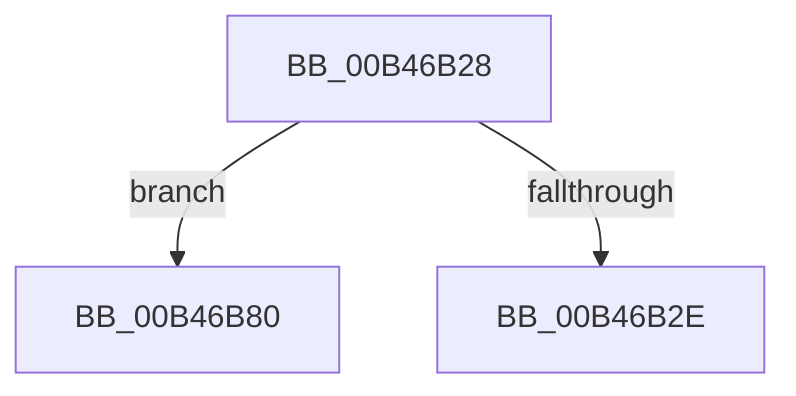

# sub_00B46B28

- RVA: `0x00B46B28`–`0x00B46B8A` (길이 `98` bytes)
- VA: `0x0000000140B46B28`
- 실행 섹션: `PAGE`
- PDB 이름 있음: `아니요`; PDB Function 태그: `아니요`
- unwind 정보 RVA: `0x000B90A4`
- 디코드: `19`개 명령, `98/98` bytes 표시
- 미해석 바이트: `0` (있으면 어셈블리에 `.byte`로 보존)

> 이 문서는 커널 이미지의 기계어와 PDB 기호를 분석해 생성했습니다. 4번과 5번은 함수 원형과 자료형을 바이너리 사용 방식에서 추정한 C 해석이며 원본 소스 복구 결과는 아닙니다.

## 1. Dependencies

- 직접 호출 지점: **0**; 고유 호출 대상: **0**
- 직접 호출자로 확인된 함수: **0**
- RIP 상대 이미지 참조: **0**

### Outgoing calls
- 직접 디코드된 call 명령이 없습니다.

### Direct callers
- 이 함수 시작 RVA로 연결되는 직접 call은 확인되지 않았습니다. 간접 호출은 완전히 역산할 수 없습니다.

### Static image references
- 디코드된 RIP-relative 메모리 참조가 없습니다.

## 2. Other-region calls and transfers

- 다른 실행 섹션으로 향하는 call: **0**
- call이 아닌 외부 분기/꼬리 이동: **2**
  - `0x00B46B7B` → [PopFanReadFanNoiseInfo + 0x124](../A9/PopFanReadFanNoiseInfo_function_00A91138.md) (`tail-transfer`)
  - `0x00B46B85` → [PopFanReadFanNoiseInfo + 0x9A](../A9/PopFanReadFanNoiseInfo_function_00A91138.md) (`tail-transfer`)

## 3. Assembly (complete function range)

```asm
00B46B28  41 83 FC 58                     cmp r12d, 0x58
00B46B2C  75 52                           jne 0x140b46b80
00B46B2E  8B 87 80 00 00 00               mov eax, dword ptr [rdi + 0x80]
00B46B34  41 89 06                        mov dword ptr [r14], eax
00B46B37  0F 10 87 84 00 00 00            movups xmm0, xmmword ptr [rdi + 0x84]
00B46B3E  41 0F 11 46 04                  movups xmmword ptr [r14 + 4], xmm0
00B46B43  0F 10 8F 94 00 00 00            movups xmm1, xmmword ptr [rdi + 0x94]
00B46B4A  41 0F 11 4E 14                  movups xmmword ptr [r14 + 0x14], xmm1
00B46B4F  0F 10 87 A4 00 00 00            movups xmm0, xmmword ptr [rdi + 0xa4]
00B46B56  41 0F 11 46 24                  movups xmmword ptr [r14 + 0x24], xmm0
00B46B5B  0F 10 8F B4 00 00 00            movups xmm1, xmmword ptr [rdi + 0xb4]
00B46B62  41 0F 11 4E 34                  movups xmmword ptr [r14 + 0x34], xmm1
00B46B67  8B 87 C4 00 00 00               mov eax, dword ptr [rdi + 0xc4]
00B46B6D  41 89 46 44                     mov dword ptr [r14 + 0x44], eax
00B46B71  0F 10 47 70                     movups xmm0, xmmword ptr [rdi + 0x70]
00B46B75  F3 41 0F 7F 46 48               movdqu xmmword ptr [r14 + 0x48], xmm0
00B46B7B  E9 DC A6 F4 FF                  jmp 0x140a9125c
00B46B80  BB 0D 00 00 C0                  mov ebx, 0xc000000d
00B46B85  E9 48 A6 F4 FF                  jmp 0x140a911d2
```

## 4. C-style interpretation (structured pseudocode)

```c
__int64 __fastcall sub_00B46B28(void)
{
    if (((unsigned int)(v_r12)) != 88) goto loc_00B46B80;
    *(unsigned int *)(v_r14) = (unsigned int)((unsigned int)(*(unsigned int *)(v_rdi + 128)));
    *(unsigned __int64 *)(v_r14 + 4) = v_xmm0;
    *(unsigned __int64 *)(v_r14 + 20) = v_xmm1;
    *(unsigned __int64 *)(v_r14 + 36) = v_xmm0;
    *(unsigned __int64 *)(v_r14 + 52) = v_xmm1;
    *(unsigned int *)(v_r14 + 68) = (unsigned int)((unsigned int)(*(unsigned int *)(v_rdi + 196)));
    *(unsigned __int64 *)(v_r14 + 72) = v_xmm0;
loc_00B46B80:
}
```

## 5. (Beta) C Style

```c
void sub_00B46B28(void)
{
    if (((uint32_t)(local_r12)) != 88) goto loc_00B46B80;
    *(uint32_t *)(local_r14) = (uint32_t)((uint32_t)(*(uint32_t *)(local_rdi + 0x80)));
    *(uint64_t *)(local_r14 + 0x4) = v_xmm0;
    *(uint64_t *)(local_r14 + 0x14) = v_xmm1;
    *(uint64_t *)(local_r14 + 0x24) = v_xmm0;
    *(uint64_t *)(local_r14 + 0x34) = v_xmm1;
    *(uint32_t *)(local_r14 + 0x44) = (uint32_t)((uint32_t)(*(uint32_t *)(local_rdi + 0xC4)));
    *(uint64_t *)(local_r14 + 0x48) = v_xmm0;
loc_00B46B80:
}
```

## 6. Execution-region graph

[열기: 2D/3D 그래프와 함수 탐색 컨트롤 패널](../../../control-panel.html?section=page&rva=0x00B46B28&view=graph)

- 2D 그래프는 위에서 아래로 흐르고, 3D 그래프는 빈 공간을 드래그해 회전합니다. Shift+드래그는 이동, 휠은 확대·축소, 함수 노드 선택은 대상 보고서 이동입니다.

### Static fallback


