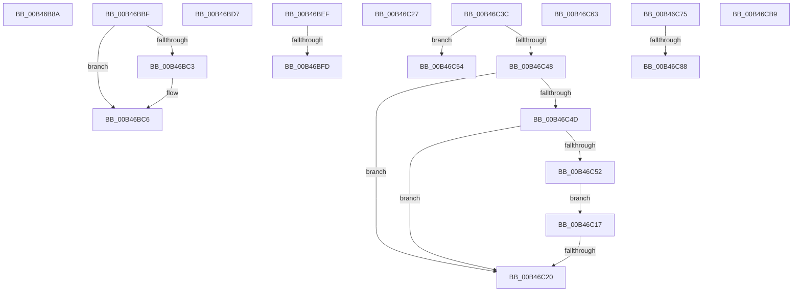

# sub_00B46B8A

- RVA: `0x00B46B8A`–`0x00B46CEE` (길이 `356` bytes)
- VA: `0x0000000140B46B8A`
- 실행 섹션: `PAGE`
- PDB 이름 있음: `아니요`; PDB Function 태그: `아니요`
- unwind 정보 RVA: `0x000B90E4`
- 디코드: `95`개 명령, `356/356` bytes 표시
- 미해석 바이트: `0` (있으면 어셈블리에 `.byte`로 보존)

> 이 문서는 커널 이미지의 기계어와 PDB 기호를 분석해 생성했습니다. 4번과 5번은 함수 원형과 자료형을 바이너리 사용 방식에서 추정한 C 해석이며 원본 소스 복구 결과는 아닙니다.

## 1. Dependencies

- 직접 호출 지점: **8**; 고유 호출 대상: **7**
- 직접 호출자로 확인된 함수: **0**
- RIP 상대 이미지 참조: **0**

### Outgoing calls
- `0x00B46BB4` → [HalpQueryInterface](../AC/HalpQueryInterface_function_00AC68E0.md) (function, `0x00AC68E0`)
- `0x00B46BCC` → [HalpPassIrpFromFdoToPdo](../../text/4E/HalpPassIrpFromFdoToPdo_function_004E15F4.md) (function, `0x004E15F4`)
- `0x00B46BFD` → [HalpInitializeLateSystemActions](../../text/53/HalpInitializeLateSystemActions_function_0053D97C.md) (function, `0x0053D97C`)
- `0x00B46C0C` → [HalpInitSystemHelper](../../pagelk/B5/HalpInitSystemHelper_function_00B5B738.md) (function, `0x00B5B738`)
- `0x00B46C31` → [HalpQueryIdPdo](../70/HalpQueryIdPdo_function_007085D0.md) (function, `0x007085D0`)
- `0x00B46C58` → [HalpQueryAcpiResourceRequirements](../70/HalpQueryAcpiResourceRequirements_function_0070BE28.md) (function, `0x0070BE28`)
- `0x00B46C6A` → [HalpQueryResources](../70/HalpQueryResources_function_007086B0.md) (function, `0x007086B0`)
- `0x00B46CE3` → [HalpQueryInterface](../AC/HalpQueryInterface_function_00AC68E0.md) (function, `0x00AC68E0`)

### Direct callers
- 이 함수 시작 RVA로 연결되는 직접 call은 확인되지 않았습니다. 간접 호출은 완전히 역산할 수 없습니다.

### Static image references
- 디코드된 RIP-relative 메모리 참조가 없습니다.

## 2. Other-region calls and transfers

- 다른 실행 섹션으로 향하는 call: **3**
  - `0x00B46BCC` → [HalpPassIrpFromFdoToPdo](../../text/4E/HalpPassIrpFromFdoToPdo_function_004E15F4.md) (`PAGE` → `.text`)
  - `0x00B46BFD` → [HalpInitializeLateSystemActions](../../text/53/HalpInitializeLateSystemActions_function_0053D97C.md) (`PAGE` → `.text`)
  - `0x00B46C0C` → [HalpInitSystemHelper](../../pagelk/B5/HalpInitSystemHelper_function_00B5B738.md) (`PAGE` → `PAGELK`)
- call이 아닌 외부 분기/꼬리 이동: **13**
  - `0x00B46BBA` → [HalpDispatchPnp + 0xC2](../A9/HalpDispatchPnp_function_00A912C0.md) (`tail-transfer`)
  - `0x00B46BD2` → [HalpDispatchPnp + 0x6A](../A9/HalpDispatchPnp_function_00A912C0.md) (`tail-transfer`)
  - `0x00B46BEA` → [HalpDispatchPnp + 0x52](../A9/HalpDispatchPnp_function_00A912C0.md) (`tail-transfer`)
  - `0x00B46BF7` → [HalpDispatchPnp + 0x85](../A9/HalpDispatchPnp_function_00A912C0.md) (`tail-transfer`)
  - `0x00B46C12` → [HalpDispatchPnp + 0x85](../A9/HalpDispatchPnp_function_00A912C0.md) (`tail-transfer`)
  - `0x00B46C1A` → [HalpDispatchPnp + 0x5B](../A9/HalpDispatchPnp_function_00A912C0.md) (`tail-transfer`)
  - `0x00B46C22` → [HalpDispatchPnp + 0x85](../A9/HalpDispatchPnp_function_00A912C0.md) (`tail-transfer`)
  - `0x00B46C37` → [HalpDispatchPnp + 0x50](../A9/HalpDispatchPnp_function_00A912C0.md) (`tail-transfer`)
  - `0x00B46C5E` → [HalpDispatchPnp + 0x50](../A9/HalpDispatchPnp_function_00A912C0.md) (`tail-transfer`)
  - `0x00B46C70` → [HalpDispatchPnp + 0x50](../A9/HalpDispatchPnp_function_00A912C0.md) (`tail-transfer`)
  - `0x00B46C82` → [HalpDispatchPnp + 0x5B](../A9/HalpDispatchPnp_function_00A912C0.md) (`tail-transfer`)
  - `0x00B46CB4` → [HalpDispatchPnp + 0x52](../A9/HalpDispatchPnp_function_00A912C0.md) (`tail-transfer`)
  - `0x00B46CE9` → [HalpDispatchPnp + 0x50](../A9/HalpDispatchPnp_function_00A912C0.md) (`tail-transfer`)

## 3. Assembly (complete function range)

```asm
00B46B8A  0F B7 4A 10                     movzx ecx, word ptr [rdx + 0x10]
00B46B8E  48 8D 47 38                     lea rax, [rdi + 0x38]
00B46B92  4C 8B 4A 20                     mov r9, qword ptr [rdx + 0x20]
00B46B96  44 0F B7 42 12                  movzx r8d, word ptr [rdx + 0x12]
00B46B9B  48 89 44 24 30                  mov qword ptr [rsp + 0x30], rax
00B46BA0  48 8B 42 18                     mov rax, qword ptr [rdx + 0x18]
00B46BA4  48 8B 52 08                     mov rdx, qword ptr [rdx + 8]
00B46BA8  48 89 44 24 28                  mov qword ptr [rsp + 0x28], rax
00B46BAD  89 4C 24 20                     mov dword ptr [rsp + 0x20], ecx
00B46BB1  48 8B CE                        mov rcx, rsi
00B46BB4  E8 27 FD F7 FF                  call 0x140ac68e0
00B46BB9  90                              nop
00B46BBA  E9 C3 A7 F4 FF                  jmp 0x140a91382
00B46BBF  3B D9                           cmp ebx, ecx
00B46BC1  74 03                           je 0x140b46bc6
00B46BC3  89 5F 30                        mov dword ptr [rdi + 0x30], ebx
00B46BC6  48 8B D7                        mov rdx, rdi
00B46BC9  48 8B CE                        mov rcx, rsi
00B46BCC  E8 23 AA 99 FF                  call 0x1404e15f4
00B46BD1  90                              nop
00B46BD2  E9 53 A7 F4 FF                  jmp 0x140a9132a
00B46BD7  41 8B 40 20                     mov eax, dword ptr [r8 + 0x20]
00B46BDB  2D 84 00 00 00                  sub eax, 0x84
00B46BE0  F7 D8                           neg eax
00B46BE2  1B DB                           sbb ebx, ebx
00B46BE4  81 E3 01 00 00 C0               and ebx, 0xc0000001
00B46BEA  E9 23 A7 F4 FF                  jmp 0x140a91312
00B46BEF  41 81 78 20 81 00 00 00         cmp dword ptr [r8 + 0x20], 0x81
00B46BF7  0F 85 48 A7 F4 FF               jne 0x140a91345
00B46BFD  E8 7A 6D 9F FF                  call 0x14053d97c
00B46C02  45 33 C0                        xor r8d, r8d
00B46C05  41 8D 50 1A                     lea edx, [r8 + 0x1a]
00B46C09  8D 4A FF                        lea ecx, [rdx - 1]
00B46C0C  E8 27 4B 01 00                  call 0x140b5b738
00B46C11  90                              nop
00B46C12  E9 2E A7 F4 FF                  jmp 0x140a91345
00B46C17  83 F9 01                        cmp ecx, 1
00B46C1A  0F 85 FB A6 F4 FF               jne 0x140a9131b
00B46C20  33 DB                           xor ebx, ebx
00B46C22  E9 1E A7 F4 FF                  jmp 0x140a91345
00B46C27  8B 52 08                        mov edx, dword ptr [rdx + 8]
00B46C2A  4C 8D 47 38                     lea r8, [rdi + 0x38]
00B46C2E  48 8B CE                        mov rcx, rsi
00B46C31  E8 9A 19 BC FF                  call 0x1407085d0
00B46C36  90                              nop
00B46C37  E9 D4 A6 F4 FF                  jmp 0x140a91310
00B46C3C  41 8B 48 20                     mov ecx, dword ptr [r8 + 0x20]
00B46C40  81 E9 81 00 00 00               sub ecx, 0x81
00B46C46  74 0C                           je 0x140b46c54
00B46C48  83 E9 01                        sub ecx, 1
00B46C4B  74 D3                           je 0x140b46c20
00B46C4D  83 E9 01                        sub ecx, 1
00B46C50  74 CE                           je 0x140b46c20
00B46C52  EB C3                           jmp 0x140b46c17
00B46C54  48 8D 4F 38                     lea rcx, [rdi + 0x38]
00B46C58  E8 CB 51 BC FF                  call 0x14070be28
00B46C5D  90                              nop
00B46C5E  E9 AD A6 F4 FF                  jmp 0x140a91310
00B46C63  48 8D 57 38                     lea rdx, [rdi + 0x38]
00B46C67  48 8B CE                        mov rcx, rsi
00B46C6A  E8 41 1A BC FF                  call 0x1407086b0
00B46C6F  90                              nop
00B46C70  E9 9B A6 F4 FF                  jmp 0x140a91310
00B46C75  48 8B 4A 08                     mov rcx, qword ptr [rdx + 8]
00B46C79  BA 01 00 00 00                  mov edx, 1
00B46C7E  66 39 51 02                     cmp word ptr [rcx + 2], dx
00B46C82  0F 85 93 A6 F4 FF               jne 0x140a9131b
00B46C88  8B 41 04                        mov eax, dword ptr [rcx + 4]
00B46C8B  25 C3 FE FF FF                  and eax, 0xfffffec3
00B46C90  89 51 14                        mov dword ptr [rcx + 0x14], edx
00B46C93  41 0B C1                        or eax, r9d
00B46C96  89 41 04                        mov dword ptr [rcx + 4], eax
00B46C99  83 C8 FF                        or eax, 0xffffffff
00B46C9C  33 DB                           xor ebx, ebx
00B46C9E  89 41 08                        mov dword ptr [rcx + 8], eax
00B46CA1  89 41 0C                        mov dword ptr [rcx + 0xc], eax
00B46CA4  8D 42 03                        lea eax, [rdx + 3]
00B46CA7  89 41 24                        mov dword ptr [rcx + 0x24], eax
00B46CAA  89 41 28                        mov dword ptr [rcx + 0x28], eax
00B46CAD  48 89 59 34                     mov qword ptr [rcx + 0x34], rbx
00B46CB1  89 59 3C                        mov dword ptr [rcx + 0x3c], ebx
00B46CB4  E9 59 A6 F4 FF                  jmp 0x140a91312
00B46CB9  0F B7 4A 10                     movzx ecx, word ptr [rdx + 0x10]
00B46CBD  48 8D 47 38                     lea rax, [rdi + 0x38]
00B46CC1  4C 8B 4A 20                     mov r9, qword ptr [rdx + 0x20]
00B46CC5  44 0F B7 42 12                  movzx r8d, word ptr [rdx + 0x12]
00B46CCA  48 89 44 24 30                  mov qword ptr [rsp + 0x30], rax
00B46CCF  48 8B 42 18                     mov rax, qword ptr [rdx + 0x18]
00B46CD3  48 8B 52 08                     mov rdx, qword ptr [rdx + 8]
00B46CD7  48 89 44 24 28                  mov qword ptr [rsp + 0x28], rax
00B46CDC  89 4C 24 20                     mov dword ptr [rsp + 0x20], ecx
00B46CE0  48 8B CE                        mov rcx, rsi
00B46CE3  E8 F8 FB F7 FF                  call 0x140ac68e0
00B46CE8  90                              nop
00B46CE9  E9 22 A6 F4 FF                  jmp 0x140a91310
```

## 4. C-style interpretation (structured pseudocode)

```c
__int64 __fastcall sub_00B46B8A(__int64 a1, __int64 a2)
{
    __int64 result;
    unsigned int v_stack_p20;
    unsigned __int64 v_stack_p28;
    unsigned __int64 v_stack_p30;

    v_stack_p30 = v_rdi + 56;
    v_stack_p28 = *(unsigned __int64 *)(a2 + 24);
    v_stack_p20 = (unsigned int)(*(unsigned __int16 *)(a2 + 16));
    result = HalpQueryInterface(v_rsi, *(unsigned __int64 *)(a2 + 8), *(unsigned __int16 *)(a2 + 18), *(unsigned __int64 *)(a2 + 32));
}
```

## 5. (Beta) C Style

```c
int64_t sub_00B46B8A(int64_t Arg1, void *Arg2)
{
    uint8_t *arg2 = (uint8_t *)Arg2;

    int64_t result;
    uint32_t v_stack_p20;
    uint64_t v_stack_p28;
    uint64_t v_stack_p30;

    v_stack_p30 = local_rdi + 56;
    v_stack_p28 = *(uint64_t *)(arg2 + 0x18);
    v_stack_p20 = (uint32_t)(*(uint16_t *)(arg2 + 0x10));
    result = HalpQueryInterface(local_rsi, *(uint64_t *)(arg2 + 0x8), *(uint16_t *)(arg2 + 0x12), *(uint64_t *)(arg2 + 0x20));
}
```

### 관측된 메모리 오프셋

구조체 형식이 확인되지 않은 접근은 인자 기준의 오프셋으로만 기록했습니다.

| 기준 인자 | 오프셋 표현 | 폭 (bit) | 접근 |
|---|---:|---:|---|
| `Arg2` | `+ 0x8` | `64` | `R` |
| `Arg2` | `+ 0x10` | `16` | `R` |
| `Arg2` | `+ 0x12` | `16` | `R` |
| `Arg2` | `+ 0x18` | `64` | `R` |
| `Arg2` | `+ 0x20` | `64` | `R` |

## 6. Execution-region graph

[열기: 2D/3D 그래프와 함수 탐색 컨트롤 패널](../../../control-panel.html?section=page&rva=0x00B46B8A&view=graph)

- 2D 그래프는 위에서 아래로 흐르고, 3D 그래프는 빈 공간을 드래그해 회전합니다. Shift+드래그는 이동, 휠은 확대·축소, 함수 노드 선택은 대상 보고서 이동입니다.

### Static fallback


