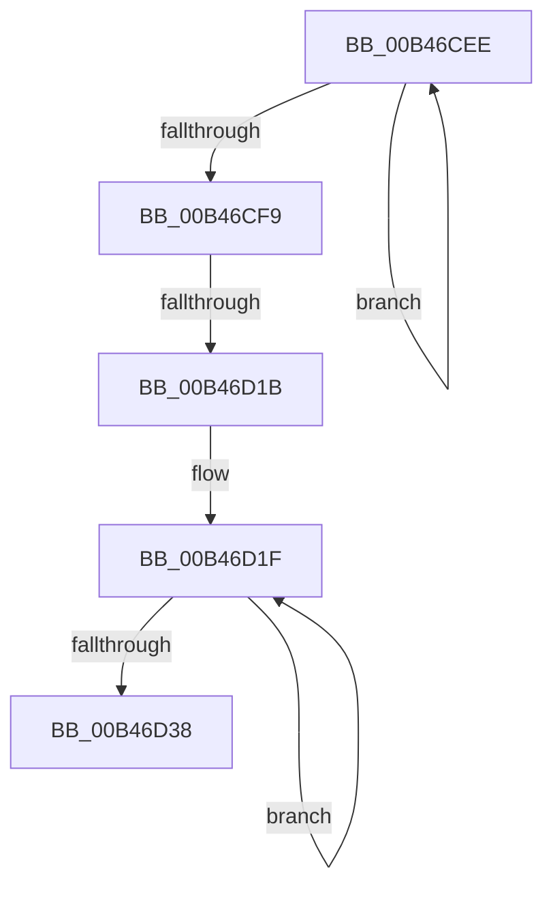

# sub_00B46CEE

- RVA: `0x00B46CEE`–`0x00B46D42` (길이 `84` bytes)
- VA: `0x0000000140B46CEE`
- 실행 섹션: `PAGE`
- PDB 이름 있음: `아니요`; PDB Function 태그: `아니요`
- unwind 정보 RVA: `0x000B910C`
- 디코드: `24`개 명령, `84/84` bytes 표시
- 미해석 바이트: `0` (있으면 어셈블리에 `.byte`로 보존)

> 이 문서는 커널 이미지의 기계어와 PDB 기호를 분석해 생성했습니다. 4번과 5번은 함수 원형과 자료형을 바이너리 사용 방식에서 추정한 C 해석이며 원본 소스 복구 결과는 아닙니다.

## 1. Dependencies

- 직접 호출 지점: **2**; 고유 호출 대상: **2**
- 직접 호출자로 확인된 함수: **0**
- RIP 상대 이미지 참조: **0**

### Outgoing calls
- `0x00B46D0A` → [ExAllocatePool2](../../poolcode/B8/ExAllocatePool2_function_00B820F0.md) (function, `0x00B820F0`)
- `0x00B46D28` → [ObfReferenceObject](../../text/20/ObfReferenceObject_function_0020FA20.md) (function, `0x0020FA20`)

### Direct callers
- 이 함수 시작 RVA로 연결되는 직접 call은 확인되지 않았습니다. 간접 호출은 완전히 역산할 수 없습니다.

### Static image references
- 디코드된 RIP-relative 메모리 참조가 없습니다.

## 2. Other-region calls and transfers

- 다른 실행 섹션으로 향하는 call: **2**
  - `0x00B46D0A` → [ExAllocatePool2](../../poolcode/B8/ExAllocatePool2_function_00B820F0.md) (`PAGE` → `POOLCODE`)
  - `0x00B46D28` → [ObfReferenceObject](../../text/20/ObfReferenceObject_function_0020FA20.md) (`PAGE` → `.text`)
- call이 아닌 외부 분기/꼬리 이동: **2**
  - `0x00B46D15` → [HalpQueryDeviceRelations + 0x72](../A9/HalpQueryDeviceRelations_function_00A91420.md) (`tail-transfer`)
  - `0x00B46D3D` → [HalpQueryDeviceRelations + 0x39](../A9/HalpQueryDeviceRelations_function_00A91420.md) (`tail-transfer`)

## 3. Assembly (complete function range)

```asm
00B46CEE  48 8B 40 08                     mov rax, qword ptr [rax + 8]
00B46CF2  FF C7                           inc edi
00B46CF4  48 85 C0                        test rax, rax
00B46CF7  75 F5                           jne 0x140b46cee
00B46CF9  8B D7                           mov edx, edi
00B46CFB  B9 00 01 00 00                  mov ecx, 0x100
00B46D00  48 C1 E2 04                     shl rdx, 4
00B46D04  41 B8 48 61 6C 70               mov r8d, 0x706c6148
00B46D0A  E8 E1 B3 03 00                  call 0x140b820f0
00B46D0F  48 8B F0                        mov rsi, rax
00B46D12  48 85 C0                        test rax, rax
00B46D15  0F 84 77 A7 F4 FF               je 0x140a91492
00B46D1B  89 38                           mov dword ptr [rax], edi
00B46D1D  33 FF                           xor edi, edi
00B46D1F  48 8B 4B 10                     mov rcx, qword ptr [rbx + 0x10]
00B46D23  48 89 4C FE 08                  mov qword ptr [rsi + rdi*8 + 8], rcx
00B46D28  E8 F3 8C 6C FF                  call 0x14020fa20
00B46D2D  48 8B 5B 08                     mov rbx, qword ptr [rbx + 8]
00B46D31  FF C7                           inc edi
00B46D33  48 85 DB                        test rbx, rbx
00B46D36  75 E7                           jne 0x140b46d1f
00B46D38  49 89 36                        mov qword ptr [r14], rsi
00B46D3B  33 C0                           xor eax, eax
00B46D3D  E9 17 A7 F4 FF                  jmp 0x140a91459
```

## 4. C-style interpretation (structured pseudocode)

```c
__int64 __fastcall sub_00B46CEE(void)
{
    __int64 result;
    __int64 v_rdi;

    v_rdi = (unsigned int)((v_rdi) + 1);
    if (*(unsigned __int64 *)(result + 8) != 0) goto loc_00B46CEE;
    a2 = ((unsigned int)((unsigned int)(v_rdi))) << (4);
    result = ExAllocatePool2(256, a2, (unsigned int)(0x706C6148ULL), a4);
    *(unsigned int *)(result) = (unsigned int)(v_rdi);
    v_rdi = 0;
loc_00B46D1F:
    *(unsigned __int64 *)(result + v_rdi * 8 + 8) = *(unsigned __int64 *)(v_rbx + 16);
    result = ObfReferenceObject(*(unsigned __int64 *)(v_rbx + 16), a2, (unsigned int)(0x706C6148ULL), a4);
    v_rdi = (unsigned int)((v_rdi) + 1);
    if (*(unsigned __int64 *)(v_rbx + 8) != 0) goto loc_00B46D1F;
    *(unsigned __int64 *)(v_r14) = result;
    result = 0;
}
```

## 5. (Beta) C Style

```c
void sub_00B46CEE(void)
{
    int64_t result;
    int64_t local_rdi;

    local_rdi = (uint32_t)((local_rdi) + 1);
    if (*(uint64_t *)(result + 0x8) != 0) goto loc_00B46CEE;
    a2 = ((uint32_t)((uint32_t)(local_rdi))) << (4);
    result = ExAllocatePool2(256, a2, (uint32_t)(0x706C6148ULL), a4);
    *(uint32_t *)(result) = (uint32_t)(local_rdi);
    local_rdi = 0;
loc_00B46D1F:
    *(uint64_t *)(result + local_rdi * 8 + 0x8) = *(uint64_t *)(local_rbx + 0x10);
    result = ObfReferenceObject(*(uint64_t *)(local_rbx + 0x10), a2, (uint32_t)(0x706C6148ULL), a4);
    local_rdi = (uint32_t)((local_rdi) + 1);
    if (*(uint64_t *)(local_rbx + 0x8) != 0) goto loc_00B46D1F;
    *(uint64_t *)(local_r14) = result;
    result = 0;
}
```

## 6. Execution-region graph

[열기: 2D/3D 그래프와 함수 탐색 컨트롤 패널](../../../control-panel.html?section=page&rva=0x00B46CEE&view=graph)

- 2D 그래프는 위에서 아래로 흐르고, 3D 그래프는 빈 공간을 드래그해 회전합니다. Shift+드래그는 이동, 휠은 확대·축소, 함수 노드 선택은 대상 보고서 이동입니다.

### Static fallback


