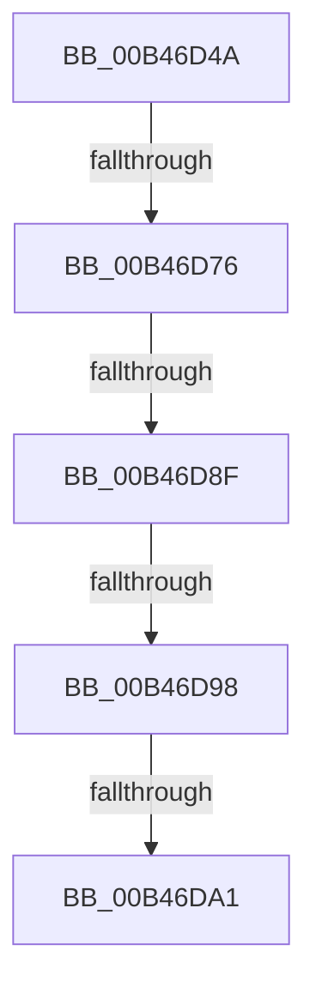

# sub_00B46D4A

- RVA: `0x00B46D4A`–`0x00B46DAB` (길이 `97` bytes)
- VA: `0x0000000140B46D4A`
- 실행 섹션: `PAGE`
- PDB 이름 있음: `아니요`; PDB Function 태그: `아니요`
- unwind 정보 RVA: `0x000B9160`
- 디코드: `26`개 명령, `97/97` bytes 표시
- 미해석 바이트: `0` (있으면 어셈블리에 `.byte`로 보존)

> 이 문서는 커널 이미지의 기계어와 PDB 기호를 분석해 생성했습니다. 4번과 5번은 함수 원형과 자료형을 바이너리 사용 방식에서 추정한 C 해석이며 원본 소스 복구 결과는 아닙니다.

## 1. Dependencies

- 직접 호출 지점: **3**; 고유 호출 대상: **2**
- 직접 호출자로 확인된 함수: **0**
- RIP 상대 이미지 참조: **0**

### Outgoing calls
- `0x00B46D4F` → [SdbpGetNextTagId](../95/SdbpGetNextTagId_function_0095D740.md) (function, `0x0095D740`)
- `0x00B46D5B` → [SdbGetTagFromTagID](../95/SdbGetTagFromTagID_function_0095E3C0.md) (function, `0x0095E3C0`)
- `0x00B46D68` → [SdbGetTagFromTagID](../95/SdbGetTagFromTagID_function_0095E3C0.md) (function, `0x0095E3C0`)

### Direct callers
- 이 함수 시작 RVA로 연결되는 직접 call은 확인되지 않았습니다. 간접 호출은 완전히 역산할 수 없습니다.

### Static image references
- 디코드된 RIP-relative 메모리 참조가 없습니다.

## 2. Other-region calls and transfers

- 다른 실행 섹션으로 향하는 call: **0**
- call이 아닌 외부 분기/꼬리 이동: **5**
  - `0x00B46D70` → [SdbpGetNextIndexedRecord + 0x75](../A9/SdbpGetNextIndexedRecord_function_00A91608.md) (`tail-transfer`)
  - `0x00B46D89` → [SdbpGetNextIndexedRecord + 0x75](../A9/SdbpGetNextIndexedRecord_function_00A91608.md) (`tail-transfer`)
  - `0x00B46D92` → [SdbpGetNextIndexedRecord + 0x75](../A9/SdbpGetNextIndexedRecord_function_00A91608.md) (`tail-transfer`)
  - `0x00B46D9B` → [SdbpGetNextIndexedRecord + 0x75](../A9/SdbpGetNextIndexedRecord_function_00A91608.md) (`tail-transfer`)
  - `0x00B46DA6` → [SdbpGetNextIndexedRecord + 0x77](../A9/SdbpGetNextIndexedRecord_function_00A91608.md) (`tail-transfer`)

## 3. Assembly (complete function range)

```asm
00B46D4A  8B D6                           mov edx, esi
00B46D4C  48 8B CD                        mov rcx, rbp
00B46D4F  E8 EC 69 E1 FF                  call 0x14095d740
00B46D54  8B D6                           mov edx, esi
00B46D56  48 8B CD                        mov rcx, rbp
00B46D59  8B F8                           mov edi, eax
00B46D5B  E8 60 76 E1 FF                  call 0x14095e3c0
00B46D60  8B D7                           mov edx, edi
00B46D62  48 8B CD                        mov rcx, rbp
00B46D65  0F B7 F0                        movzx esi, ax
00B46D68  E8 53 76 E1 FF                  call 0x14095e3c0
00B46D6D  66 85 C0                        test ax, ax
00B46D70  0F 84 07 A9 F4 FF               je 0x140a9167d
00B46D76  BA 00 F0 00 00                  mov edx, 0xf000
00B46D7B  0F B7 C8                        movzx ecx, ax
00B46D7E  66 23 CA                        and cx, dx
00B46D81  BA 00 70 00 00                  mov edx, 0x7000
00B46D86  66 3B CA                        cmp cx, dx
00B46D89  0F 85 EE A8 F4 FF               jne 0x140a9167d
00B46D8F  66 3B C6                        cmp ax, si
00B46D92  0F 85 E5 A8 F4 FF               jne 0x140a9167d
00B46D98  3B 7B 08                        cmp edi, dword ptr [rbx + 8]
00B46D9B  0F 84 DC A8 F4 FF               je 0x140a9167d
00B46DA1  89 7B 04                        mov dword ptr [rbx + 4], edi
00B46DA4  8B C7                           mov eax, edi
00B46DA6  E9 D4 A8 F4 FF                  jmp 0x140a9167f
```

## 4. C-style interpretation (structured pseudocode)

```c
__int64 __fastcall sub_00B46D4A(void)
{
    __int64 result;

    result = SdbpGetNextTagId(v_rbp, (unsigned int)((unsigned int)(v_rsi)), a3, a4);
    result = SdbGetTagFromTagID(v_rbp, (unsigned int)((unsigned int)(v_rsi)), a3, a4);
    result = SdbGetTagFromTagID(v_rbp, (unsigned int)((unsigned int)((unsigned int)((unsigned int)(result)))), a3, a4);
    a1 = (unsigned __int16)(((unsigned __int16)(result)) & ((unsigned __int16)((unsigned int)(0xF000ULL))));
    *(unsigned int *)(v_rbx + 4) = (unsigned int)((unsigned int)((unsigned int)(result)));
}
```

## 5. (Beta) C Style

```c
void sub_00B46D4A(void)
{
    int64_t result;

    result = SdbpGetNextTagId(local_rbp, (uint32_t)((uint32_t)(local_rsi)), a3, a4);
    result = SdbGetTagFromTagID(local_rbp, (uint32_t)((uint32_t)(local_rsi)), a3, a4);
    result = SdbGetTagFromTagID(local_rbp, (uint32_t)((uint32_t)((uint32_t)((uint32_t)(result)))), a3, a4);
    a1 = (uint16_t)(((uint16_t)(result)) & ((uint16_t)((uint32_t)(0xF000ULL))));
    *(uint32_t *)(local_rbx + 0x4) = (uint32_t)((uint32_t)((uint32_t)(result)));
}
```

## 6. Execution-region graph

[열기: 2D/3D 그래프와 함수 탐색 컨트롤 패널](../../../control-panel.html?section=page&rva=0x00B46D4A&view=graph)

- 2D 그래프는 위에서 아래로 흐르고, 3D 그래프는 빈 공간을 드래그해 회전합니다. Shift+드래그는 이동, 휠은 확대·축소, 함수 노드 선택은 대상 보고서 이동입니다.

### Static fallback


