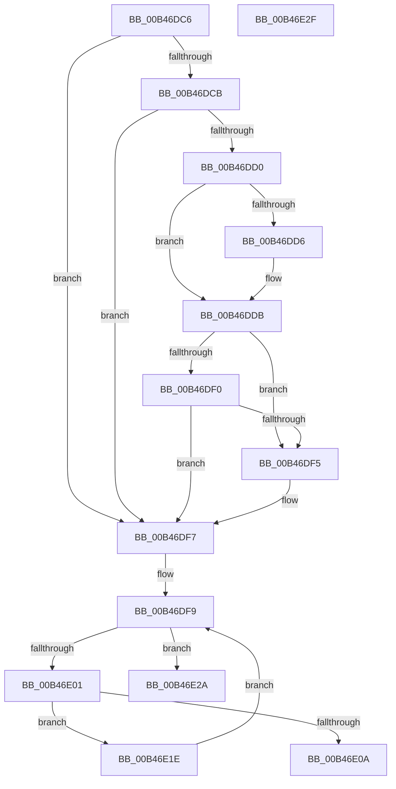

# sub_00B46DC6

- RVA: `0x00B46DC6`–`0x00B46E44` (길이 `126` bytes)
- VA: `0x0000000140B46DC6`
- 실행 섹션: `PAGE`
- PDB 이름 있음: `아니요`; PDB Function 태그: `아니요`
- unwind 정보 RVA: `0x000B9220`
- 디코드: `37`개 명령, `126/126` bytes 표시
- 미해석 바이트: `0` (있으면 어셈블리에 `.byte`로 보존)

> 이 문서는 커널 이미지의 기계어와 PDB 기호를 분석해 생성했습니다. 4번과 5번은 함수 원형과 자료형을 바이너리 사용 방식에서 추정한 C 해석이며 원본 소스 복구 결과는 아닙니다.

## 1. Dependencies

- 직접 호출 지점: **3**; 고유 호출 대상: **2**
- 직접 호출자로 확인된 함수: **0**
- RIP 상대 이미지 참조: **0**

### Outgoing calls
- `0x00B46DD6` → [ExRaiseDatatypeMisalignment](../89/ExRaiseDatatypeMisalignment_function_00899FD0.md) (function, `0x00899FD0`)
- `0x00B46E0F` → [ExFreePoolWithTag](../../poolcode/B8/ExFreePoolWithTag_function_00B82870.md) (function, `0x00B82870`)
- `0x00B46E38` → [ExFreePoolWithTag](../../poolcode/B8/ExFreePoolWithTag_function_00B82870.md) (function, `0x00B82870`)

### Direct callers
- 이 함수 시작 RVA로 연결되는 직접 call은 확인되지 않았습니다. 간접 호출은 완전히 역산할 수 없습니다.

### Static image references
- 디코드된 RIP-relative 메모리 참조가 없습니다.

## 2. Other-region calls and transfers

- 다른 실행 섹션으로 향하는 call: **2**
  - `0x00B46E0F` → [ExFreePoolWithTag](../../poolcode/B8/ExFreePoolWithTag_function_00B82870.md) (`PAGE` → `POOLCODE`)
  - `0x00B46E38` → [ExFreePoolWithTag](../../poolcode/B8/ExFreePoolWithTag_function_00B82870.md) (`PAGE` → `POOLCODE`)
- call이 아닌 외부 분기/꼬리 이동: **3**
  - `0x00B46E19` → [NtSetBootEntryOrder + 0xC5](../A9/NtSetBootEntryOrder_function_00A91930.md) (`tail-transfer`)
  - `0x00B46E2A` → [NtSetBootEntryOrder + 0x61](../A9/NtSetBootEntryOrder_function_00A91930.md) (`tail-transfer`)
  - `0x00B46E3F` → [NtSetBootEntryOrder + 0xC5](../A9/NtSetBootEntryOrder_function_00A91930.md) (`tail-transfer`)

## 3. Assembly (complete function range)

```asm
00B46DC6  45 84 F6                        test r14b, r14b
00B46DC9  74 2C                           je 0x140b46df7
00B46DCB  45 85 FF                        test r15d, r15d
00B46DCE  74 27                           je 0x140b46df7
00B46DD0  40 F6 C6 03                     test sil, 3
00B46DD4  74 05                           je 0x140b46ddb
00B46DD6  E8 F5 31 D5 FF                  call 0x140899fd0
00B46DDB  41 8B CF                        mov ecx, r15d
00B46DDE  48 03 CE                        add rcx, rsi
00B46DE1  48 B8 00 00 FF FF FF 7F 00 00   movabs rax, 0x7fffffff0000
00B46DEB  48 3B C8                        cmp rcx, rax
00B46DEE  77 05                           ja 0x140b46df5
00B46DF0  48 3B CE                        cmp rcx, rsi
00B46DF3  73 02                           jae 0x140b46df7
00B46DF5  8A 00                           mov al, byte ptr [rax]
00B46DF7  33 C9                           xor ecx, ecx
00B46DF9  89 4C 24 34                     mov dword ptr [rsp + 0x34], ecx
00B46DFD  3B CB                           cmp ecx, ebx
00B46DFF  73 29                           jae 0x140b46e2a
00B46E01  81 3C 8E FF FF 00 00            cmp dword ptr [rsi + rcx*4], 0xffff
00B46E08  76 14                           jbe 0x140b46e1e
00B46E0A  33 D2                           xor edx, edx
00B46E0C  48 8B CF                        mov rcx, rdi
00B46E0F  E8 5C BA 03 00                  call 0x140b82870
00B46E14  B8 0D 00 00 C0                  mov eax, 0xc000000d
00B46E19  E9 D7 AB F4 FF                  jmp 0x140a919f5
00B46E1E  0F B7 04 8E                     movzx eax, word ptr [rsi + rcx*4]
00B46E22  66 89 04 4F                     mov word ptr [rdi + rcx*2], ax
00B46E26  FF C1                           inc ecx
00B46E28  EB CF                           jmp 0x140b46df9
00B46E2A  E9 62 AB F4 FF                  jmp 0x140a91991
00B46E2F  8B D8                           mov ebx, eax
00B46E31  33 D2                           xor edx, edx
00B46E33  48 8B 4C 24 70                  mov rcx, qword ptr [rsp + 0x70]
00B46E38  E8 33 BA 03 00                  call 0x140b82870
00B46E3D  8B C3                           mov eax, ebx
00B46E3F  E9 B1 AB F4 FF                  jmp 0x140a919f5
```

## 4. C-style interpretation (structured pseudocode)

```c
__int64 __fastcall sub_00B46DC6(__int64 a1, int a2)
{
    __int64 result;
    unsigned int v_stack_p34;
    unsigned __int64 v_stack_p70;

    if ((unsigned __int8)(v_r14) == 0) goto loc_00B46DF7;
    if ((unsigned int)(v_r15) == 0) goto loc_00B46DF7;
    if ((((unsigned __int8)(v_rsi)) & (3)) != 0) {
        result = ExRaiseDatatypeMisalignment(a1, a2, a3, a4);
    }
    a1 = ((unsigned int)((unsigned int)(v_r15))) + (v_rsi);
    if (a1 > result) goto loc_00B46DF5;
    if (a1 < v_rsi) {
        result = *(unsigned __int8 *)(result);
    }
    a1 = 0;
loc_00B46DF9:
    v_stack_p34 = 0;
    if (0 >= ((unsigned int)(v_rbx))) goto loc_00B46E2A;
    if ((*(unsigned int *)(v_rsi + a1 * 4)) <= 0xFFFFULL) goto loc_00B46E1E;
    a2 = 0;
    result = ExFreePoolWithTag(v_rdi, a2, a3, a4);
loc_00B46E1E:
    *(unsigned __int16 *)(v_rdi + v_rdi * 2) = (unsigned __int16)(*(unsigned __int16 *)(v_rsi + v_rdi * 4));
    a1 = (unsigned int)((v_rdi) + 1);
    goto loc_00B46DF9;
loc_00B46E2A:
}
```

## 5. (Beta) C Style

```c
int64_t sub_00B46DC6(int64_t Arg1, int32_t Arg2)
{
    int64_t result;
    uint32_t v_stack_p34;
    uint64_t v_stack_p70;

    if ((uint8_t)(local_r14) == 0) goto loc_00B46DF7;
    if ((uint32_t)(local_r15) == 0) goto loc_00B46DF7;
    if ((((uint8_t)(local_rsi)) & (3)) != 0) {
        result = ExRaiseDatatypeMisalignment(Arg1, Arg2, a3, a4);
    }
    Arg1 = ((uint32_t)((uint32_t)(local_r15))) + (local_rsi);
    if (Arg1 > result) goto loc_00B46DF5;
    if (Arg1 < local_rsi) {
        result = *(uint8_t *)(result);
    }
    Arg1 = 0;
loc_00B46DF9:
    v_stack_p34 = 0;
    if (0 >= ((uint32_t)(local_rbx))) goto loc_00B46E2A;
    if ((*(uint32_t *)(local_rsi + Arg1 * 4)) <= 0xFFFFULL) goto loc_00B46E1E;
    Arg2 = 0;
    result = ExFreePoolWithTag(local_rdi, Arg2, a3, a4);
loc_00B46E1E:
    *(uint16_t *)(local_rdi + local_rdi * 2) = (uint16_t)(*(uint16_t *)(local_rsi + local_rdi * 4));
    Arg1 = (uint32_t)((local_rdi) + 1);
    goto loc_00B46DF9;
loc_00B46E2A:
}
```

## 6. Execution-region graph

[열기: 2D/3D 그래프와 함수 탐색 컨트롤 패널](../../../control-panel.html?section=page&rva=0x00B46DC6&view=graph)

- 2D 그래프는 위에서 아래로 흐르고, 3D 그래프는 빈 공간을 드래그해 회전합니다. Shift+드래그는 이동, 휠은 확대·축소, 함수 노드 선택은 대상 보고서 이동입니다.

### Static fallback


