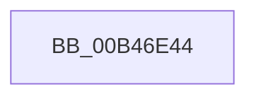

# sub_00B46E44

- RVA: `0x00B46E44`–`0x00B46ECE` (길이 `138` bytes)
- VA: `0x0000000140B46E44`
- 실행 섹션: `PAGE`
- PDB 이름 있음: `아니요`; PDB Function 태그: `아니요`
- unwind 정보 RVA: `0x000B9254`
- 디코드: `32`개 명령, `138/138` bytes 표시
- 미해석 바이트: `0` (있으면 어셈블리에 `.byte`로 보존)

> 이 문서는 커널 이미지의 기계어와 PDB 기호를 분석해 생성했습니다. 4번과 5번은 함수 원형과 자료형을 바이너리 사용 방식에서 추정한 C 해석이며 원본 소스 복구 결과는 아닙니다.

## 1. Dependencies

- 직접 호출 지점: **2**; 고유 호출 대상: **2**
- 직접 호출자로 확인된 함수: **0**
- RIP 상대 이미지 참조: **2**

### Outgoing calls
- `0x00B46E4B` → [tlgCreate1Sz_wchar_t](../../text/42/tlgCreate1Sz_wchar_t_function_00426198.md) (function, `0x00426198`)
- `0x00B46EC3` → [tlgWriteTransfer_EtwWriteTransfer](../../text/42/tlgWriteTransfer_EtwWriteTransfer_function_004260E0.md) (function, `0x004260E0`)

### Direct callers
- 이 함수 시작 RVA로 연결되는 직접 call은 확인되지 않았습니다. 간접 호출은 완전히 역산할 수 없습니다.

### Static image references
- `0x00B46E5D` → RVA `0x00046B56` (`.rdata`; read)
- `0x00B46E98` → RVA `0x00E06ED8` (`.data`; read)

## 2. Other-region calls and transfers

- 다른 실행 섹션으로 향하는 call: **2**
  - `0x00B46E4B` → [tlgCreate1Sz_wchar_t](../../text/42/tlgCreate1Sz_wchar_t_function_00426198.md) (`PAGE` → `.text`)
  - `0x00B46EC3` → [tlgWriteTransfer_EtwWriteTransfer](../../text/42/tlgWriteTransfer_EtwWriteTransfer_function_004260E0.md) (`PAGE` → `.text`)
- call이 아닌 외부 분기/꼬리 이동: **1**
  - `0x00B46EC9` → [IoSetEnvironmentVariableEx + 0x66](../A9/IoSetEnvironmentVariableEx_function_00A91A84.md) (`tail-transfer`)

## 3. Assembly (complete function range)

```asm
00B46E44  48 8B D6                        mov rdx, rsi
00B46E47  48 8D 4D BF                     lea rcx, [rbp - 0x41]
00B46E4B  E8 48 F3 8D FF                  call 0x140426198
00B46E50  83 65 DB 00                     and dword ptr [rbp - 0x25], 0
00B46E54  48 8D 44 24 40                  lea rax, [rsp + 0x40]
00B46E59  83 65 EB 00                     and dword ptr [rbp - 0x15], 0
00B46E5D  48 8D 15 F2 FC 4F FF            lea rdx, [rip - 0xb0030e]
00B46E64  83 65 FB 00                     and dword ptr [rbp - 5], 0
00B46E68  B9 04 00 00 00                  mov ecx, 4
00B46E6D  83 65 0B 00                     and dword ptr [rbp + 0xb], 0
00B46E71  45 33 C9                        xor r9d, r9d
00B46E74  48 89 45 DF                     mov qword ptr [rbp - 0x21], rax
00B46E78  45 33 C0                        xor r8d, r8d
00B46E7B  48 8D 45 87                     lea rax, [rbp - 0x79]
00B46E7F  89 4D E7                        mov dword ptr [rbp - 0x19], ecx
00B46E82  48 89 45 EF                     mov qword ptr [rbp - 0x11], rax
00B46E86  48 8D 45 8F                     lea rax, [rbp - 0x71]
00B46E8A  48 89 45 FF                     mov qword ptr [rbp - 1], rax
00B46E8E  48 8D 45 9F                     lea rax, [rbp - 0x61]
00B46E92  89 4D F7                        mov dword ptr [rbp - 9], ecx
00B46E95  89 4D 07                        mov dword ptr [rbp + 7], ecx
00B46E98  48 8D 0D 39 00 2C 00            lea rcx, [rip + 0x2c0039]
00B46E9F  48 89 44 24 28                  mov qword ptr [rsp + 0x28], rax
00B46EA4  C7 44 24 20 07 00 00 00         mov dword ptr [rsp + 0x20], 7
00B46EAC  4C 89 75 CF                     mov qword ptr [rbp - 0x31], r14
00B46EB0  C7 45 D7 10 00 00 00            mov dword ptr [rbp - 0x29], 0x10
00B46EB7  44 89 7C 24 40                  mov dword ptr [rsp + 0x40], r15d
00B46EBC  44 89 65 87                     mov dword ptr [rbp - 0x79], r12d
00B46EC0  89 5D 8F                        mov dword ptr [rbp - 0x71], ebx
00B46EC3  E8 18 F2 8D FF                  call 0x1404260e0
00B46EC8  90                              nop
00B46EC9  E9 1C AC F4 FF                  jmp 0x140a91aea
```

## 4. C-style interpretation (structured pseudocode)

```c
__int64 __fastcall sub_00B46E44(__int64 a1, __int64 a2, int a3, int a4, __int64 a5, __int64 a6, __int64 a7, __int64 a8)
{
    __int64 result;
    unsigned int v_stack_p20;
    unsigned __int64 v_stack_p28;
    unsigned int v_stack_p40;

    result = tlgCreate1Sz_wchar_t(v_rbp - 65, v_rsi, a3, a4);
    a4 = 0;
    *(unsigned __int64 *)(v_rbp - 33) = a8;
    a3 = 0;
    *(unsigned int *)(v_rbp - 25) = 4;
    *(unsigned __int64 *)(v_rbp - 17) = v_rbp - 121;
    *(unsigned __int64 *)(v_rbp - 1) = v_rbp - 113;
    *(unsigned int *)(v_rbp - 9) = 4;
    *(unsigned int *)(v_rbp + 7) = 4;
    v_stack_p28 = v_rbp - 97;
    v_stack_p20 = 7;
    *(unsigned __int64 *)(v_rbp - 49) = v_r14;
    *(unsigned int *)(v_rbp - 41) = 16;
    v_stack_p40 = (unsigned int)(v_r15);
    *(unsigned int *)(v_rbp - 121) = (unsigned int)(v_r12);
    *(unsigned int *)(v_rbp - 113) = (unsigned int)(v_rbx);
    result = tlgWriteTransfer_EtwWriteTransfer(v_rip + 2883641, v_rip - 11535118, a3, a4);
}
```

## 5. (Beta) C Style

```c
int64_t sub_00B46E44(int64_t Arg1, int64_t Arg2, int32_t Arg3, int32_t Arg4, uint64_t Arg5, uint64_t Arg6, uint64_t Arg7, int64_t Arg8)
{
    int64_t result;
    uint32_t v_stack_p20;
    uint64_t v_stack_p28;
    uint32_t v_stack_p40;

    result = tlgCreate1Sz_wchar_t(local_rbp - 65, local_rsi, Arg3, Arg4);
    Arg4 = 0;
    *(uint64_t *)(local_rbp - 0x21) = Arg8;
    Arg3 = 0;
    *(uint32_t *)(local_rbp - 0x19) = 4;
    *(uint64_t *)(local_rbp - 0x11) = local_rbp - 121;
    *(uint64_t *)(local_rbp - 0x1) = local_rbp - 113;
    *(uint32_t *)(local_rbp - 0x9) = 4;
    *(uint32_t *)(local_rbp + 0x7) = 4;
    v_stack_p28 = local_rbp - 97;
    v_stack_p20 = 7;
    *(uint64_t *)(local_rbp - 0x31) = local_r14;
    *(uint32_t *)(local_rbp - 0x29) = 16;
    v_stack_p40 = (uint32_t)(local_r15);
    *(uint32_t *)(local_rbp - 0x79) = (uint32_t)(local_r12);
    *(uint32_t *)(local_rbp - 0x71) = (uint32_t)(local_rbx);
    result = tlgWriteTransfer_EtwWriteTransfer(v_rip + 2883641, v_rip - 11535118, Arg3, Arg4);
}
```

## 6. Execution-region graph

[열기: 2D/3D 그래프와 함수 탐색 컨트롤 패널](../../../control-panel.html?section=page&rva=0x00B46E44&view=graph)

- 2D 그래프는 위에서 아래로 흐르고, 3D 그래프는 빈 공간을 드래그해 회전합니다. Shift+드래그는 이동, 휠은 확대·축소, 함수 노드 선택은 대상 보고서 이동입니다.

### Static fallback


