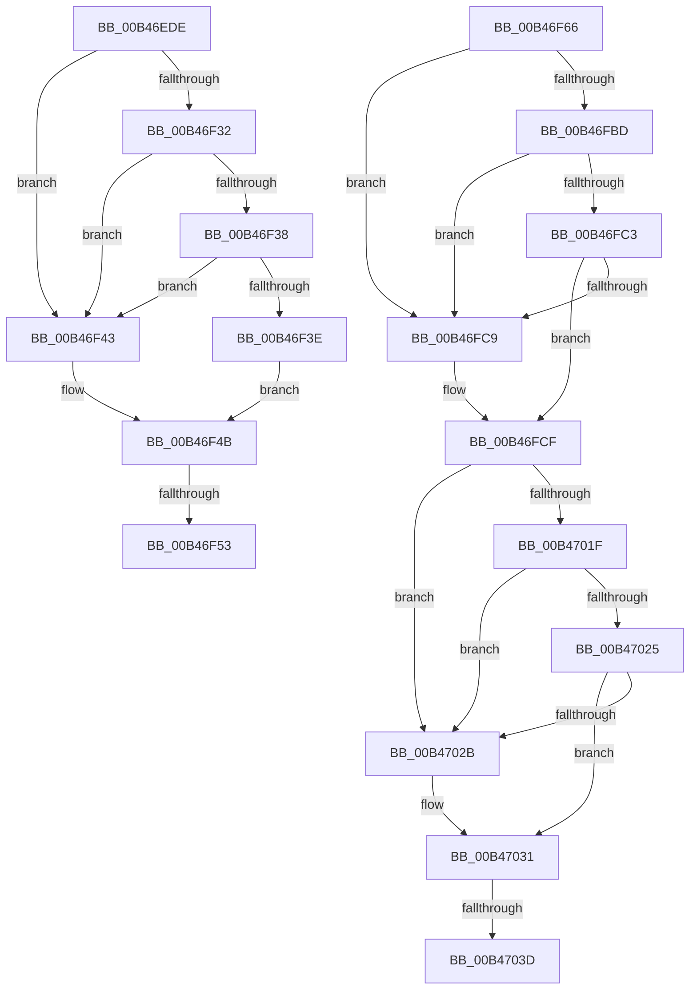

# sub_00B46EDE

- RVA: `0x00B46EDE`–`0x00B47098` (길이 `442` bytes)
- VA: `0x0000000140B46EDE`
- 실행 섹션: `PAGE`
- PDB 이름 있음: `아니요`; PDB Function 태그: `아니요`
- unwind 정보 RVA: `0x000B92AC`
- 디코드: `96`개 명령, `442/442` bytes 표시
- 미해석 바이트: `0` (있으면 어셈블리에 `.byte`로 보존)

> 이 문서는 커널 이미지의 기계어와 PDB 기호를 분석해 생성했습니다. 4번과 5번은 함수 원형과 자료형을 바이너리 사용 방식에서 추정한 C 해석이며 원본 소스 복구 결과는 아닙니다.

## 1. Dependencies

- 직접 호출 지점: **5**; 고유 호출 대상: **3**
- 직접 호출자로 확인된 함수: **0**
- RIP 상대 이미지 참조: **4**

### Outgoing calls
- `0x00B46F29` → [PnpGetObjectProperty](../8E/PnpGetObjectProperty_function_008E2180.md) (function, `0x008E2180`)
- `0x00B46FB4` → [PnpGetObjectProperty](../8E/PnpGetObjectProperty_function_008E2180.md) (function, `0x008E2180`)
- `0x00B47016` → [PnpGetObjectProperty](../8E/PnpGetObjectProperty_function_008E2180.md) (function, `0x008E2180`)
- `0x00B47044` → [PiDrvDbSetupNodeHive](../74/PiDrvDbSetupNodeHive_function_00743884.md) (function, `0x00743884`)
- `0x00B4708D` → [PnpSetObjectProperty](../8F/PnpSetObjectProperty_function_008F66E8.md) (function, `0x008F66E8`)

### Direct callers
- 이 함수 시작 RVA로 연결되는 직접 call은 확인되지 않았습니다. 간접 호출은 완전히 역산할 수 없습니다.

### Static image references
- `0x00B46EF4` → RVA `0x00E66398` (`.data`; read)
- `0x00B46F17` → RVA `0x00021820` (`.rdata`; read)
- `0x00B46FA2` → RVA `0x000235F8` (`.rdata`; read)
- `0x00B46FDB` → RVA `0x00022BC8` (`.rdata`; read)

## 2. Other-region calls and transfers

- 다른 실행 섹션으로 향하는 call: **0**
- call이 아닌 외부 분기/꼬리 이동: **4**
  - `0x00B46F4D` → [PiDrvDbLoadNodeWorkerCallback + 0x10A](../A9/PiDrvDbLoadNodeWorkerCallback_function_00A91D40.md) (`tail-transfer`)
  - `0x00B46F61` → [PiDrvDbLoadNodeWorkerCallback + 0x10A](../A9/PiDrvDbLoadNodeWorkerCallback_function_00A91D40.md) (`tail-transfer`)
  - `0x00B47037` → [PiDrvDbLoadNodeWorkerCallback + 0x11D](../A9/PiDrvDbLoadNodeWorkerCallback_function_00A91D40.md) (`tail-transfer`)
  - `0x00B47093` → [PiDrvDbLoadNodeWorkerCallback + 0x11D](../A9/PiDrvDbLoadNodeWorkerCallback_function_00A91D40.md) (`tail-transfer`)

## 3. Assembly (complete function range)

```asm
00B46EDE  83 64 24 50 00                  and dword ptr [rsp + 0x50], 0
00B46EE3  48 8D 45 40                     lea rax, [rbp + 0x40]
00B46EE7  4D 8B 0F                        mov r9, qword ptr [r15]
00B46EEA  41 B8 07 00 00 00               mov r8d, 7
00B46EF0  48 8B 53 18                     mov rdx, qword ptr [rbx + 0x18]
00B46EF4  48 8B 0D 9D F4 31 00            mov rcx, qword ptr [rip + 0x31f49d]
00B46EFB  48 89 44 24 48                  mov qword ptr [rsp + 0x48], rax
00B46F00  48 8D 45 48                     lea rax, [rbp + 0x48]
00B46F04  44 89 74 24 40                  mov dword ptr [rsp + 0x40], r14d
00B46F09  48 89 44 24 38                  mov qword ptr [rsp + 0x38], rax
00B46F0E  48 8D 45 38                     lea rax, [rbp + 0x38]
00B46F12  48 89 44 24 30                  mov qword ptr [rsp + 0x30], rax
00B46F17  48 8D 05 02 A9 4D FF            lea rax, [rip - 0xb256fe]
00B46F1E  48 89 44 24 28                  mov qword ptr [rsp + 0x28], rax
00B46F23  48 83 64 24 20 00               and qword ptr [rsp + 0x20], 0
00B46F29  E8 52 B2 D9 FF                  call 0x1408e2180
00B46F2E  85 C0                           test eax, eax
00B46F30  78 11                           js 0x140b46f43
00B46F32  83 7D 38 07                     cmp dword ptr [rbp + 0x38], 7
00B46F36  75 0B                           jne 0x140b46f43
00B46F38  44 39 75 40                     cmp dword ptr [rbp + 0x40], r14d
00B46F3C  75 05                           jne 0x140b46f43
00B46F3E  8B 45 48                        mov eax, dword ptr [rbp + 0x48]
00B46F41  EB 08                           jmp 0x140b46f4b
00B46F43  B8 C0 D4 01 00                  mov eax, 0x1d4c0
00B46F48  89 45 48                        mov dword ptr [rbp + 0x48], eax
00B46F4B  3B C7                           cmp eax, edi
00B46F4D  0F 84 F7 AE F4 FF               je 0x140a91e4a
00B46F53  48 69 C8 F0 D8 FF FF            imul rcx, rax, -0x2710
00B46F5A  48 89 8B E0 01 00 00            mov qword ptr [rbx + 0x1e0], rcx
00B46F61  E9 E4 AE F4 FF                  jmp 0x140a91e4a
00B46F66  83 64 24 50 00                  and dword ptr [rsp + 0x50], 0
00B46F6B  48 8D 45 40                     lea rax, [rbp + 0x40]
00B46F6F  4D 8B 0F                        mov r9, qword ptr [r15]
00B46F72  48 8D B3 EC 01 00 00            lea rsi, [rbx + 0x1ec]
00B46F79  48 8B 53 18                     mov rdx, qword ptr [rbx + 0x18]
00B46F7D  41 B8 07 00 00 00               mov r8d, 7
00B46F83  48 8B 0D 0E F4 31 00            mov rcx, qword ptr [rip + 0x31f40e]
00B46F8A  48 89 44 24 48                  mov qword ptr [rsp + 0x48], rax
00B46F8F  48 8D 45 38                     lea rax, [rbp + 0x38]
00B46F93  44 89 74 24 40                  mov dword ptr [rsp + 0x40], r14d
00B46F98  48 89 74 24 38                  mov qword ptr [rsp + 0x38], rsi
00B46F9D  48 89 44 24 30                  mov qword ptr [rsp + 0x30], rax
00B46FA2  48 8D 05 4F C6 4D FF            lea rax, [rip - 0xb239b1]
00B46FA9  48 89 44 24 28                  mov qword ptr [rsp + 0x28], rax
00B46FAE  48 83 64 24 20 00               and qword ptr [rsp + 0x20], 0
00B46FB4  E8 C7 B1 D9 FF                  call 0x1408e2180
00B46FB9  85 C0                           test eax, eax
00B46FBB  78 0C                           js 0x140b46fc9
00B46FBD  83 7D 38 07                     cmp dword ptr [rbp + 0x38], 7
00B46FC1  75 06                           jne 0x140b46fc9
00B46FC3  44 39 75 40                     cmp dword ptr [rbp + 0x40], r14d
00B46FC7  74 06                           je 0x140b46fcf
00B46FC9  C7 06 33 00 00 00               mov dword ptr [rsi], 0x33
00B46FCF  83 64 24 50 00                  and dword ptr [rsp + 0x50], 0
00B46FD4  48 8D 45 40                     lea rax, [rbp + 0x40]
00B46FD8  4D 8B 0F                        mov r9, qword ptr [r15]
00B46FDB  48 8D 35 E6 BB 4D FF            lea rsi, [rip - 0xb2441a]
00B46FE2  48 8B 53 18                     mov rdx, qword ptr [rbx + 0x18]
00B46FE6  41 B8 07 00 00 00               mov r8d, 7
00B46FEC  48 8B 0D A5 F3 31 00            mov rcx, qword ptr [rip + 0x31f3a5]
00B46FF3  48 89 44 24 48                  mov qword ptr [rsp + 0x48], rax
00B46FF8  48 8D 45 38                     lea rax, [rbp + 0x38]
00B46FFC  44 89 74 24 40                  mov dword ptr [rsp + 0x40], r14d
00B47001  48 89 7C 24 38                  mov qword ptr [rsp + 0x38], rdi
00B47006  48 89 44 24 30                  mov qword ptr [rsp + 0x30], rax
00B4700B  48 89 74 24 28                  mov qword ptr [rsp + 0x28], rsi
00B47010  48 83 64 24 20 00               and qword ptr [rsp + 0x20], 0
00B47016  E8 65 B1 D9 FF                  call 0x1408e2180
00B4701B  85 C0                           test eax, eax
00B4701D  78 0C                           js 0x140b4702b
00B4701F  83 7D 38 18                     cmp dword ptr [rbp + 0x38], 0x18
00B47023  75 06                           jne 0x140b4702b
00B47025  44 39 75 40                     cmp dword ptr [rbp + 0x40], r14d
00B47029  74 06                           je 0x140b47031
00B4702B  C7 07 03 01 00 00               mov dword ptr [rdi], 0x103
00B47031  81 3F 03 01 00 00               cmp dword ptr [rdi], 0x103
00B47037  0F 85 20 AE F4 FF               jne 0x140a91e5d
00B4703D  48 8B 53 18                     mov rdx, qword ptr [rbx + 0x18]
00B47041  48 8B CB                        mov rcx, rbx
00B47044  E8 3B C8 BF FF                  call 0x140743884
00B47049  83 64 24 48 00                  and dword ptr [rsp + 0x48], 0
00B4704E  41 B8 07 00 00 00               mov r8d, 7
00B47054  4C 8B 4B 48                     mov r9, qword ptr [rbx + 0x48]
00B47058  48 8B 53 18                     mov rdx, qword ptr [rbx + 0x18]
00B4705C  44 89 74 24 40                  mov dword ptr [rsp + 0x40], r14d
00B47061  89 83 F0 01 00 00               mov dword ptr [rbx + 0x1f0], eax
00B47067  48 8D 83 F0 01 00 00            lea rax, [rbx + 0x1f0]
00B4706E  48 8B 0D 23 F3 31 00            mov rcx, qword ptr [rip + 0x31f323]
00B47075  48 89 44 24 38                  mov qword ptr [rsp + 0x38], rax
00B4707A  C7 44 24 30 18 00 00 00         mov dword ptr [rsp + 0x30], 0x18
00B47082  48 89 74 24 28                  mov qword ptr [rsp + 0x28], rsi
00B47087  48 83 64 24 20 00               and qword ptr [rsp + 0x20], 0
00B4708D  E8 56 F6 DA FF                  call 0x1408f66e8
00B47092  90                              nop
00B47093  E9 C5 AD F4 FF                  jmp 0x140a91e5d
```

## 4. C-style interpretation (structured pseudocode)

```c
__int64 __fastcall sub_00B46EDE(__int64 a1, __int64 a2, __int64 a3, __int64 a4, __int64 a5, __int64 a6, __int64 a7, __int64 a8, __int64 a9, unsigned int a10)
{
    __int64 result;
    unsigned __int64 v_stack_p20;
    unsigned __int64 v_stack_p28;
    unsigned __int64 v_stack_p30;
    unsigned __int64 v_stack_p38;
    unsigned int v_stack_p40;
    unsigned __int64 v_stack_p48;
    unsigned int v_stack_p50;

    v_stack_p48 = v_rbp + 64;
    v_stack_p40 = (unsigned int)(v_r14);
    v_stack_p38 = v_rbp + 72;
    v_stack_p30 = v_rbp + 56;
    v_stack_p28 = v_rip - 11687678;
    result = PnpGetObjectProperty(*(unsigned __int64 *)(v_rip + 3273885), *(unsigned __int64 *)(v_rbx + 24), 7, *(unsigned __int64 *)(v_r15));
    if (sign_flag) goto loc_00B46F43;
    if ((*(unsigned int *)(v_rbp + 56)) != 7) goto loc_00B46F43;
    if ((*(unsigned int *)(v_rbp + 64)) != ((unsigned int)(v_r14))) goto loc_00B46F43;
    goto loc_00B46F4B;
loc_00B46F43:
    *(unsigned int *)(v_rbp + 72) = (unsigned int)((unsigned int)(0x1D4C0ULL));
loc_00B46F4B:
    a1 = (*(unsigned __int64 *)(v_rip + 3273885)) * ((unsigned int)(0x1D4C0ULL));
    *(unsigned __int64 *)(v_rbx + 480) = a1;
}
```

## 5. (Beta) C Style

```c
int64_t sub_00B46EDE(int64_t Arg1, int64_t Arg2, int64_t Arg3, int64_t Arg4, uint64_t Arg5, uint64_t Arg6, uint64_t Arg7, uint64_t Arg8, uint64_t Arg9, uint32_t Arg10)
{
    int64_t result;
    uint64_t v_stack_p20;
    uint64_t v_stack_p28;
    uint64_t v_stack_p30;
    uint64_t v_stack_p38;
    uint32_t v_stack_p40;
    uint64_t v_stack_p48;
    uint32_t v_stack_p50;

    v_stack_p48 = local_rbp + 64;
    v_stack_p40 = (uint32_t)(local_r14);
    v_stack_p38 = local_rbp + 72;
    v_stack_p30 = local_rbp + 56;
    v_stack_p28 = v_rip - 11687678;
    result = PnpGetObjectProperty(*(uint64_t *)(v_rip + 0x31F49D), *(uint64_t *)(local_rbx + 0x18), 7, *(uint64_t *)(local_r15));
    if (sign_flag) goto loc_00B46F43;
    if ((*(uint32_t *)(local_rbp + 0x38)) != 7) goto loc_00B46F43;
    if ((*(uint32_t *)(local_rbp + 0x40)) != ((uint32_t)(local_r14))) goto loc_00B46F43;
    goto loc_00B46F4B;
loc_00B46F43:
    *(uint32_t *)(local_rbp + 0x48) = (uint32_t)((uint32_t)(0x1D4C0ULL));
loc_00B46F4B:
    Arg1 = (*(uint64_t *)(v_rip + 0x31F49D)) * ((uint32_t)(0x1D4C0ULL));
    *(uint64_t *)(local_rbx + 0x1E0) = Arg1;
}
```

## 6. Execution-region graph

[열기: 2D/3D 그래프와 함수 탐색 컨트롤 패널](../../../control-panel.html?section=page&rva=0x00B46EDE&view=graph)

- 2D 그래프는 위에서 아래로 흐르고, 3D 그래프는 빈 공간을 드래그해 회전합니다. Shift+드래그는 이동, 휠은 확대·축소, 함수 노드 선택은 대상 보고서 이동입니다.

### Static fallback


