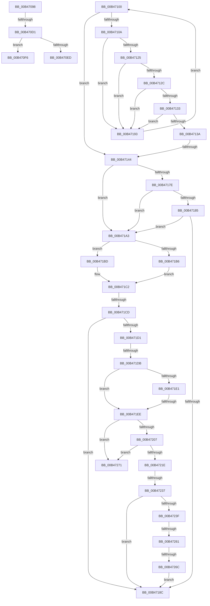

# sub_00B47098

- RVA: `0x00B47098`–`0x00B4727B` (길이 `483` bytes)
- VA: `0x0000000140B47098`
- 실행 섹션: `PAGE`
- PDB 이름 있음: `아니요`; PDB Function 태그: `아니요`
- unwind 정보 RVA: `0x000B92F8`
- 디코드: `128`개 명령, `483/483` bytes 표시
- 미해석 바이트: `0` (있으면 어셈블리에 `.byte`로 보존)

> 이 문서는 커널 이미지의 기계어와 PDB 기호를 분석해 생성했습니다. 4번과 5번은 함수 원형과 자료형을 바이너리 사용 방식에서 추정한 C 해석이며 원본 소스 복구 결과는 아닙니다.

## 1. Dependencies

- 직접 호출 지점: **11**; 고유 호출 대상: **8**
- 직접 호출자로 확인된 함수: **0**
- RIP 상대 이미지 참조: **0**

### Outgoing calls
- `0x00B470BF` → [CmGetDeviceRegKeyPath](../99/CmGetDeviceRegKeyPath_function_00990CC0.md) (function, `0x00990CC0`)
- `0x00B470D6` → [ExFreePoolWithTag](../../poolcode/B8/ExFreePoolWithTag_function_00B82870.md) (function, `0x00B82870`)
- `0x00B4711C` → [_CmDeleteDeviceRegKey](../A0/_CmDeleteDeviceRegKey_function_00A09A2C.md) (function, `0x00A09A2C`)
- `0x00B4714B` → [CmDeleteDeviceMappedPropertyForAllDriverKeyRegValues](../AB/CmDeleteDeviceMappedPropertyForAllDriverKeyRegValues_function_00AB0218.md) (function, `0x00AB0218`)
- `0x00B47175` → [CmSetDeviceRegProp](../8F/CmSetDeviceRegProp_function_008FD68C.md) (function, `0x008FD68C`)
- `0x00B471B6` → [PnpCtxRegDeleteTree](../96/PnpCtxRegDeleteTree_function_00965CC8.md) (function, `0x00965CC8`)
- `0x00B471BD` → [PnpCtxRegDeleteKey](../96/PnpCtxRegDeleteKey_function_00965EC8.md) (function, `0x00965EC8`)
- `0x00B471FA` → [wcsrchr](../../text/50/wcsrchr_function_00501E50.md) (function, `0x00501E50`)
- `0x00B47211` → [wcsrchr](../../text/50/wcsrchr_function_00501E50.md) (function, `0x00501E50`)
- `0x00B47227` → [PnpCtxRegDeleteKey](../96/PnpCtxRegDeleteKey_function_00965EC8.md) (function, `0x00965EC8`)
- `0x00B4724C` → [PnpCtxRegDeleteKey](../96/PnpCtxRegDeleteKey_function_00965EC8.md) (function, `0x00965EC8`)

### Direct callers
- 이 함수 시작 RVA로 연결되는 직접 call은 확인되지 않았습니다. 간접 호출은 완전히 역산할 수 없습니다.

### Static image references
- 디코드된 RIP-relative 메모리 참조가 없습니다.

## 2. Other-region calls and transfers

- 다른 실행 섹션으로 향하는 call: **3**
  - `0x00B470D6` → [ExFreePoolWithTag](../../poolcode/B8/ExFreePoolWithTag_function_00B82870.md) (`PAGE` → `POOLCODE`)
  - `0x00B471FA` → [wcsrchr](../../text/50/wcsrchr_function_00501E50.md) (`PAGE` → `.text`)
  - `0x00B47211` → [wcsrchr](../../text/50/wcsrchr_function_00501E50.md) (`PAGE` → `.text`)
- call이 아닌 외부 분기/꼬리 이동: **12**
  - `0x00B470CB` → [_CmDeleteDeviceRegKeyWorker + 0xF1](../A9/_CmDeleteDeviceRegKeyWorker_function_00A9200C.md) (`tail-transfer`)
  - `0x00B470F1` → [_CmDeleteDeviceRegKeyWorker + 0x81](../A9/_CmDeleteDeviceRegKeyWorker_function_00A9200C.md) (`tail-transfer`)
  - `0x00B470FB` → [_CmDeleteDeviceRegKeyWorker + 0xA4](../A9/_CmDeleteDeviceRegKeyWorker_function_00A9200C.md) (`tail-transfer`)
  - `0x00B4713E` → [_CmDeleteDeviceRegKeyWorker + 0xA4](../A9/_CmDeleteDeviceRegKeyWorker_function_00A9200C.md) (`tail-transfer`)
  - `0x00B4718E` → [_CmDeleteDeviceRegKeyWorker + 0xA4](../A9/_CmDeleteDeviceRegKeyWorker_function_00A9200C.md) (`tail-transfer`)
  - `0x00B471C7` → [_CmDeleteDeviceRegKeyWorker + 0xA4](../A9/_CmDeleteDeviceRegKeyWorker_function_00A9200C.md) (`tail-transfer`)
  - `0x00B471D5` → [_CmDeleteDeviceRegKeyWorker + 0xA4](../A9/_CmDeleteDeviceRegKeyWorker_function_00A9200C.md) (`tail-transfer`)
  - `0x00B471E8` → [_CmDeleteDeviceRegKeyWorker + 0xA4](../A9/_CmDeleteDeviceRegKeyWorker_function_00A9200C.md) (`tail-transfer`)
  - `0x00B47231` → [_CmDeleteDeviceRegKeyWorker + 0xA4](../A9/_CmDeleteDeviceRegKeyWorker_function_00A9200C.md) (`tail-transfer`)
  - `0x00B4725B` → [_CmDeleteDeviceRegKeyWorker + 0xA4](../A9/_CmDeleteDeviceRegKeyWorker_function_00A9200C.md) (`tail-transfer`)
  - `0x00B47266` → [_CmDeleteDeviceRegKeyWorker + 0xA4](../A9/_CmDeleteDeviceRegKeyWorker_function_00A9200C.md) (`tail-transfer`)
  - `0x00B47276` → [_CmDeleteDeviceRegKeyWorker + 0xA4](../A9/_CmDeleteDeviceRegKeyWorker_function_00A9200C.md) (`tail-transfer`)

## 3. Assembly (complete function range)

```asm
00B47098  8B CF                           mov ecx, edi
00B4709A  48 8D 45 C0                     lea rax, [rbp - 0x40]
00B4709E  48 89 44 24 38                  mov qword ptr [rsp + 0x38], rax
00B470A3  45 8B CD                        mov r9d, r13d
00B470A6  D1 E9                           shr ecx, 1
00B470A8  45 8B C6                        mov r8d, r14d
00B470AB  89 4C 24 30                     mov dword ptr [rsp + 0x30], ecx
00B470AF  48 8B D3                        mov rdx, rbx
00B470B2  48 89 74 24 28                  mov qword ptr [rsp + 0x28], rsi
00B470B7  49 8B CF                        mov rcx, r15
00B470BA  C6 44 24 20 00                  mov byte ptr [rsp + 0x20], 0
00B470BF  E8 FC 9B E4 FF                  call 0x140990cc0
00B470C4  8B D8                           mov ebx, eax
00B470C6  3D 23 00 00 C0                  cmp eax, 0xc0000023
00B470CB  0F 85 2C B0 F4 FF               jne 0x140a920fd
00B470D1  33 D2                           xor edx, edx
00B470D3  48 8B CE                        mov rcx, rsi
00B470D6  E8 95 B7 03 00                  call 0x140b82870
00B470DB  8B 7D C0                        mov edi, dword ptr [rbp - 0x40]
00B470DE  33 F6                           xor esi, esi
00B470E0  48 03 FF                        add rdi, rdi
00B470E3  B8 FF FF FF FF                  mov eax, 0xffffffff
00B470E8  48 3B F8                        cmp rdi, rax
00B470EB  77 09                           ja 0x140b470f6
00B470ED  48 8B 5D D0                     mov rbx, qword ptr [rbp - 0x30]
00B470F1  E9 97 AF F4 FF                  jmp 0x140a9208d
00B470F6  BB 95 00 00 C0                  mov ebx, 0xc0000095
00B470FB  E9 B0 AF F4 FF                  jmp 0x140a920b0
00B47100  48 89 45 C8                     mov qword ptr [rbp - 0x38], rax
00B47104  41 83 FD 03                     cmp r13d, 3
00B47108  73 3A                           jae 0x140b47144
00B4710A  44 8B 00                        mov r8d, dword ptr [rax]
00B4710D  45 33 C9                        xor r9d, r9d
00B47110  48 8B 55 D0                     mov rdx, qword ptr [rbp - 0x30]
00B47114  49 8B CF                        mov rcx, r15
00B47117  C6 44 24 20 01                  mov byte ptr [rsp + 0x20], 1
00B4711C  E8 0B 29 EC FF                  call 0x140a09a2c
00B47121  85 C0                           test eax, eax
00B47123  74 6E                           je 0x140b47193
00B47125  3D 34 00 00 C0                  cmp eax, 0xc0000034
00B4712A  74 67                           je 0x140b47193
00B4712C  3D 0D 00 00 C0                  cmp eax, 0xc000000d
00B47131  74 60                           je 0x140b47193
00B47133  3D BB 00 00 C0                  cmp eax, 0xc00000bb
00B47138  74 59                           je 0x140b47193
00B4713A  8B D8                           mov ebx, eax
00B4713C  85 C0                           test eax, eax
00B4713E  0F 88 6C AF F4 FF               js 0x140a920b0
00B47144  48 8B 55 D0                     mov rdx, qword ptr [rbp - 0x30]
00B47148  49 8B CF                        mov rcx, r15
00B4714B  E8 C8 90 F6 FF                  call 0x140ab0218
00B47150  48 8B 55 D0                     mov rdx, qword ptr [rbp - 0x30]
00B47154  33 C0                           xor eax, eax
00B47156  89 44 24 38                     mov dword ptr [rsp + 0x38], eax
00B4715A  45 33 C0                        xor r8d, r8d
00B4715D  89 44 24 30                     mov dword ptr [rsp + 0x30], eax
00B47161  49 8B CF                        mov rcx, r15
00B47164  48 89 44 24 28                  mov qword ptr [rsp + 0x28], rax
00B47169  44 8D 48 0A                     lea r9d, [rax + 0xa]
00B4716D  C7 44 24 20 01 00 00 00         mov dword ptr [rsp + 0x20], 1
00B47175  E8 12 65 DB FF                  call 0x1408fd68c
00B4717A  85 C0                           test eax, eax
00B4717C  74 25                           je 0x140b471a3
00B4717E  3D 25 02 00 C0                  cmp eax, 0xc0000225
00B47183  74 1E                           je 0x140b471a3
00B47185  3D 0E 00 00 C0                  cmp eax, 0xc000000e
00B4718A  74 17                           je 0x140b471a3
00B4718C  8B D8                           mov ebx, eax
00B4718E  E9 1D AF F4 FF                  jmp 0x140a920b0
00B47193  48 8B 45 C8                     mov rax, qword ptr [rbp - 0x38]
00B47197  41 FF C5                        inc r13d
00B4719A  48 83 C0 04                     add rax, 4
00B4719E  E9 5D FF FF FF                  jmp 0x140b47100
00B471A3  44 8B 6D C0                     mov r13d, dword ptr [rbp - 0x40]
00B471A7  80 7D 60 00                     cmp byte ptr [rbp + 0x60], 0
00B471AB  4C 8B C7                        mov r8, rdi
00B471AE  49 8B D4                        mov rdx, r12
00B471B1  49 8B CF                        mov rcx, r15
00B471B4  74 07                           je 0x140b471bd
00B471B6  E8 0D EB E1 FF                  call 0x140965cc8
00B471BB  EB 05                           jmp 0x140b471c2
00B471BD  E8 06 ED E1 FF                  call 0x140965ec8
00B471C2  3D 7C 01 00 C0                  cmp eax, 0xc000017c
00B471C7  0F 84 E3 AE F4 FF               je 0x140a920b0
00B471CD  85 C0                           test eax, eax
00B471CF  78 BB                           js 0x140b4718c
00B471D1  41 83 FD 12                     cmp r13d, 0x12
00B471D5  0F 84 D5 AE F4 FF               je 0x140a920b0
00B471DB  41 83 FD 11                     cmp r13d, 0x11
00B471DF  75 0D                           jne 0x140b471ee
00B471E1  41 F7 C6 00 0F 00 00            test r14d, 0xf00
00B471E8  0F 84 C2 AE F4 FF               je 0x140a920b0
00B471EE  41 BE 5C 00 00 00               mov r14d, 0x5c
00B471F4  48 8B CF                        mov rcx, rdi
00B471F7  41 8B D6                        mov edx, r14d
00B471FA  E8 51 AC 9B FF                  call 0x140501e50
00B471FF  45 33 ED                        xor r13d, r13d
00B47202  48 85 C0                        test rax, rax
00B47205  74 6A                           je 0x140b47271
00B47207  41 8B D6                        mov edx, r14d
00B4720A  66 44 89 28                     mov word ptr [rax], r13w
00B4720E  48 8B CF                        mov rcx, rdi
00B47211  E8 3A AC 9B FF                  call 0x140501e50
00B47216  4C 8B F0                        mov r14, rax
00B47219  48 85 C0                        test rax, rax
00B4721C  74 53                           je 0x140b47271
00B4721E  4C 8B C7                        mov r8, rdi
00B47221  49 8B D4                        mov rdx, r12
00B47224  49 8B CF                        mov rcx, r15
00B47227  E8 9C EC E1 FF                  call 0x140965ec8
00B4722C  3D 21 01 00 C0                  cmp eax, 0xc0000121
00B47231  0F 84 79 AE F4 FF               je 0x140a920b0
00B47237  85 C0                           test eax, eax
00B47239  0F 88 4D FF FF FF               js 0x140b4718c
00B4723F  4C 8B C7                        mov r8, rdi
00B47242  66 45 89 2E                     mov word ptr [r14], r13w
00B47246  49 8B D4                        mov rdx, r12
00B47249  49 8B CF                        mov rcx, r15
00B4724C  E8 77 EC E1 FF                  call 0x140965ec8
00B47251  BA 00 00 00 80                  mov edx, 0x80000000
00B47256  8D 0C 10                        lea ecx, [rax + rdx]
00B47259  85 CA                           test edx, ecx
00B4725B  0F 85 4F AE F4 FF               jne 0x140a920b0
00B47261  3D 21 01 00 C0                  cmp eax, 0xc0000121
00B47266  0F 84 44 AE F4 FF               je 0x140a920b0
00B4726C  E9 1B FF FF FF                  jmp 0x140b4718c
00B47271  BB E5 00 00 C0                  mov ebx, 0xc00000e5
00B47276  E9 35 AE F4 FF                  jmp 0x140a920b0
```

## 4. C-style interpretation (structured pseudocode)

```c
__int64 __fastcall sub_00B47098(void)
{
    __int64 result;
    __int64 v_rdi;
    __int64 v_rsi;
    unsigned __int8 v_stack_p20;
    unsigned __int64 v_stack_p28;
    unsigned int v_stack_p30;
    unsigned __int64 v_stack_p38;

    v_stack_p38 = v_rbp - 64;
    a1 = (unsigned int)(((unsigned int)((unsigned int)(v_rdi))) >> (1));
    v_stack_p30 = (unsigned int)(a1);
    v_stack_p28 = v_rsi;
    v_stack_p20 = 0;
    result = CmGetDeviceRegKeyPath(v_r15, v_rbx, (unsigned int)((unsigned int)(v_r14)), (unsigned int)((unsigned int)(v_r13)));
    a2 = 0;
    result = ExFreePoolWithTag(v_rsi, a2, (unsigned int)((unsigned int)(v_r14)), (unsigned int)((unsigned int)(v_r13)));
    v_rsi = 0;
    v_rdi = ((unsigned int)(*(unsigned int *)(v_rbp - 64))) + ((unsigned int)(*(unsigned int *)(v_rbp - 64)));
    if (v_rdi > ((unsigned int)(0xFFFFFFFFULL))) goto loc_00B470F6;
loc_00B470F6:
}
```

## 5. (Beta) C Style

```c
void sub_00B47098(void)
{
    int64_t result;
    int64_t local_rdi;
    int64_t local_rsi;
    uint8_t v_stack_p20;
    uint64_t v_stack_p28;
    uint32_t v_stack_p30;
    uint64_t v_stack_p38;

    v_stack_p38 = local_rbp - 64;
    a1 = (uint32_t)(((uint32_t)((uint32_t)(local_rdi))) >> (1));
    v_stack_p30 = (uint32_t)(a1);
    v_stack_p28 = local_rsi;
    v_stack_p20 = 0;
    result = CmGetDeviceRegKeyPath(local_r15, local_rbx, (uint32_t)((uint32_t)(local_r14)), (uint32_t)((uint32_t)(local_r13)));
    a2 = 0;
    result = ExFreePoolWithTag(local_rsi, a2, (uint32_t)((uint32_t)(local_r14)), (uint32_t)((uint32_t)(local_r13)));
    local_rsi = 0;
    local_rdi = ((uint32_t)(*(uint32_t *)(local_rbp - 0x40))) + ((uint32_t)(*(uint32_t *)(local_rbp - 0x40)));
    if (local_rdi > ((uint32_t)(0xFFFFFFFFULL))) goto loc_00B470F6;
loc_00B470F6:
}
```

## 6. Execution-region graph

[열기: 2D/3D 그래프와 함수 탐색 컨트롤 패널](../../../control-panel.html?section=page&rva=0x00B47098&view=graph)

- 2D 그래프는 위에서 아래로 흐르고, 3D 그래프는 빈 공간을 드래그해 회전합니다. Shift+드래그는 이동, 휠은 확대·축소, 함수 노드 선택은 대상 보고서 이동입니다.

### Static fallback


