# sub_00B47284

- RVA: `0x00B47284`–`0x00B4742A` (길이 `422` bytes)
- VA: `0x0000000140B47284`
- 실행 섹션: `PAGE`
- PDB 이름 있음: `아니요`; PDB Function 태그: `아니요`
- unwind 정보 RVA: `0x000B9418`
- 디코드: `113`개 명령, `422/422` bytes 표시
- 미해석 바이트: `0` (있으면 어셈블리에 `.byte`로 보존)

> 이 문서는 커널 이미지의 기계어와 PDB 기호를 분석해 생성했습니다. 4번과 5번은 함수 원형과 자료형을 바이너리 사용 방식에서 추정한 C 해석이며 원본 소스 복구 결과는 아닙니다.

## 1. Dependencies

- 직접 호출 지점: **9**; 고유 호출 대상: **8**
- 직접 호출자로 확인된 함수: **0**
- RIP 상대 이미지 참조: **0**

### Outgoing calls
- `0x00B4728A` → [PsGetServerSiloGlobals](../../text/22/PsGetServerSiloGlobals_function_002250A0.md) (function, `0x002250A0`)
- `0x00B472B4` → [KeAbPreAcquire](../../text/21/KeAbPreAcquire_function_00210230.md) (function, `0x00210230`)
- `0x00B472CD` → [ExfAcquirePushLockExclusiveEx](../../text/20/ExfAcquirePushLockExclusiveEx_function_0020FC90.md) (function, `0x0020FC90`)
- `0x00B473C6` → [ExfTryToWakePushLock](../../text/26/ExfTryToWakePushLock_function_00265DD0.md) (function, `0x00265DD0`)
- `0x00B473CE` → [KeAbPostRelease](../../text/2E/KeAbPostRelease_function_002E1600.md) (function, `0x002E1600`)
- `0x00B473D3` → [KeLeaveGuardedRegion](../../text/2E/KeLeaveGuardedRegion_function_002E2C40.md) (function, `0x002E2C40`)
- `0x00B473E7` → [ObpDeleteDeviceMap](../74/ObpDeleteDeviceMap_function_0074F2F0.md) (function, `0x0074F2F0`)
- `0x00B473FF` → [ObDereferenceDeviceMap](../96/ObDereferenceDeviceMap_function_0096D0E8.md) (function, `0x0096D0E8`)
- `0x00B4741E` → [ObDereferenceDeviceMap](../96/ObDereferenceDeviceMap_function_0096D0E8.md) (function, `0x0096D0E8`)

### Direct callers
- 이 함수 시작 RVA로 연결되는 직접 call은 확인되지 않았습니다. 간접 호출은 완전히 역산할 수 없습니다.

### Static image references
- 디코드된 RIP-relative 메모리 참조가 없습니다.

## 2. Other-region calls and transfers

- 다른 실행 섹션으로 향하는 call: **6**
  - `0x00B4728A` → [PsGetServerSiloGlobals](../../text/22/PsGetServerSiloGlobals_function_002250A0.md) (`PAGE` → `.text`)
  - `0x00B472B4` → [KeAbPreAcquire](../../text/21/KeAbPreAcquire_function_00210230.md) (`PAGE` → `.text`)
  - `0x00B472CD` → [ExfAcquirePushLockExclusiveEx](../../text/20/ExfAcquirePushLockExclusiveEx_function_0020FC90.md) (`PAGE` → `.text`)
  - `0x00B473C6` → [ExfTryToWakePushLock](../../text/26/ExfTryToWakePushLock_function_00265DD0.md) (`PAGE` → `.text`)
  - `0x00B473CE` → [KeAbPostRelease](../../text/2E/KeAbPostRelease_function_002E1600.md) (`PAGE` → `.text`)
  - `0x00B473D3` → [KeLeaveGuardedRegion](../../text/2E/KeLeaveGuardedRegion_function_002E2C40.md) (`PAGE` → `.text`)
- call이 아닌 외부 분기/꼬리 이동: **1**
  - `0x00B47425` → [ObpSetDeviceMap + 0xE5](../A9/ObpSetDeviceMap_function_00A925D0.md) (`tail-transfer`)

## 3. Assembly (complete function range)

```asm
00B47284  48 8B CD                        mov rcx, rbp
00B47287  4D 8B F4                        mov r14, r12
00B4728A  E8 11 DE 6D FF                  call 0x1402250a0
00B4728F  65 48 8B 0C 25 88 01 00 00      mov rcx, qword ptr gs:[0x188]
00B47298  4C 8B E0                        mov r12, rax
00B4729B  48 83 C8 FF                     or rax, 0xffffffffffffffff
00B4729F  45 33 C0                        xor r8d, r8d
00B472A2  33 D2                           xor edx, edx
00B472A4  66 01 81 E6 01 00 00            add word ptr [rcx + 0x1e6], ax
00B472AB  49 8D 74 24 78                  lea rsi, [r12 + 0x78]
00B472B0  48 8B CE                        mov rcx, rsi
00B472B3  90                              nop
00B472B4  E8 77 8F 6C FF                  call 0x140210230
00B472B9  F0 48 0F BA 2E 00               lock bts qword ptr [rsi], 0
00B472BF  48 8B E8                        mov rbp, rax
00B472C2  73 0E                           jae 0x140b472d2
00B472C4  4C 8B C6                        mov r8, rsi
00B472C7  48 8B D0                        mov rdx, rax
00B472CA  48 8B CE                        mov rcx, rsi
00B472CD  E8 BE 89 6C FF                  call 0x14020fc90
00B472D2  48 85 ED                        test rbp, rbp
00B472D5  74 04                           je 0x140b472db
00B472D7  C6 45 0A 01                     mov byte ptr [rbp + 0xa], 1
00B472DB  48 8B 44 24 40                  mov rax, qword ptr [rsp + 0x40]
00B472E0  41 B8 10 00 00 00               mov r8d, 0x10
00B472E6  48 8D 90 30 01 00 00            lea rdx, [rax + 0x130]
00B472ED  48 8B 0A                        mov rcx, qword ptr [rdx]
00B472F0  45 8D 48 FE                     lea r9d, [r8 - 2]
00B472F4  48 85 C9                        test rcx, rcx
00B472F7  74 1F                           je 0x140b47318
00B472F9  4C 8B F7                        mov r14, rdi
00B472FC  41 8D 40 F1                     lea eax, [r8 - 0xf]
00B47300  48 8B F9                        mov rdi, rcx
00B47303  F0 48 0F C1 81 F0 00 00 00      lock xadd qword ptr [rcx + 0xf0], rax
00B4730C  48 85 C0                        test rax, rax
00B4730F  7F 71                           jg 0x140b47382
00B47311  41 8B C9                        mov ecx, r9d
00B47314  CD 29                           int 0x29
00B47316  EB 6A                           jmp 0x140b47382
00B47318  F6 84 24 90 00 00 00 01         test byte ptr [rsp + 0x90], 1
00B47320  74 23                           je 0x140b47345
00B47322  49 8B C0                        mov rax, r8
00B47325  F0 48 0F C1 87 F0 00 00 00      lock xadd qword ptr [rdi + 0xf0], rax
00B4732E  48 85 C0                        test rax, rax
00B47331  7F 05                           jg 0x140b47338
00B47333  49 8B C9                        mov rcx, r9
00B47336  CD 29                           int 0x29
00B47338  48 8D 47 0F                     lea rax, [rdi + 0xf]
00B4733C  49 89 04 24                     mov qword ptr [r12], rax
00B47340  48 8B 44 24 40                  mov rax, qword ptr [rsp + 0x40]
00B47345  F6 84 24 90 00 00 00 02         test byte ptr [rsp + 0x90], 2
00B4734D  48 89 3A                        mov qword ptr [rdx], rdi
00B47350  74 30                           je 0x140b47382
00B47352  49 8B 14 24                     mov rdx, qword ptr [r12]
00B47356  48 83 E2 F0                     and rdx, 0xfffffffffffffff0
00B4735A  48 8B 0A                        mov rcx, qword ptr [rdx]
00B4735D  48 3B C1                        cmp rax, rcx
00B47360  74 20                           je 0x140b47382
00B47362  48 89 4F 08                     mov qword ptr [rdi + 8], rcx
00B47366  B8 01 00 00 00                  mov eax, 1
00B4736B  F0 48 0F C1 82 F0 00 00 00      lock xadd qword ptr [rdx + 0xf0], rax
00B47374  48 85 C0                        test rax, rax
00B47377  7F 05                           jg 0x140b4737e
00B47379  49 8B C9                        mov rcx, r9
00B4737C  CD 29                           int 0x29
00B4737E  48 89 57 18                     mov qword ptr [rdi + 0x18], rdx
00B47382  4D 85 ED                        test r13, r13
00B47385  74 2D                           je 0x140b473b4
00B47387  F0 4C 0F C1 87 F0 00 00 00      lock xadd qword ptr [rdi + 0xf0], r8
00B47390  4D 85 C0                        test r8, r8
00B47393  7F 05                           jg 0x140b4739a
00B47395  49 8B C9                        mov rcx, r9
00B47398  CD 29                           int 0x29
00B4739A  48 8B CF                        mov rcx, rdi
00B4739D  48 8B C7                        mov rax, rdi
00B473A0  48 83 C9 0F                     or rcx, 0xf
00B473A4  48 F7 D8                        neg rax
00B473A7  48 1B DB                        sbb rbx, rbx
00B473AA  48 23 D9                        and rbx, rcx
00B473AD  49 87 9D 18 03 00 00            xchg qword ptr [r13 + 0x318], rbx
00B473B4  48 83 C8 FF                     or rax, 0xffffffffffffffff
00B473B8  F0 48 0F C1 06                  lock xadd qword ptr [rsi], rax
00B473BD  24 06                           and al, 6
00B473BF  3C 02                           cmp al, 2
00B473C1  75 08                           jne 0x140b473cb
00B473C3  48 8B CE                        mov rcx, rsi
00B473C6  E8 05 EA 71 FF                  call 0x140265dd0
00B473CB  48 8B CE                        mov rcx, rsi
00B473CE  E8 2D A2 79 FF                  call 0x1402e1600
00B473D3  E8 68 B8 79 FF                  call 0x1402e2c40
00B473D8  4D 85 F6                        test r14, r14
00B473DB  74 0F                           je 0x140b473ec
00B473DD  49 FF 8E F0 00 00 00            dec qword ptr [r14 + 0xf0]
00B473E4  49 8B CE                        mov rcx, r14
00B473E7  E8 04 7F C0 FF                  call 0x14074f2f0
00B473EC  48 85 DB                        test rbx, rbx
00B473EF  74 13                           je 0x140b47404
00B473F1  8B D3                           mov edx, ebx
00B473F3  48 83 E3 F0                     and rbx, 0xfffffffffffffff0
00B473F7  83 E2 0F                        and edx, 0xf
00B473FA  48 8B CB                        mov rcx, rbx
00B473FD  FF C2                           inc edx
00B473FF  E8 E4 5C E2 FF                  call 0x14096d0e8
00B47404  48 8B 84 24 98 00 00 00         mov rax, qword ptr [rsp + 0x98]
00B4740C  48 85 C0                        test rax, rax
00B4740F  74 05                           je 0x140b47416
00B47411  48 89 38                        mov qword ptr [rax], rdi
00B47414  EB 0D                           jmp 0x140b47423
00B47416  BA 01 00 00 00                  mov edx, 1
00B4741B  48 8B CF                        mov rcx, rdi
00B4741E  E8 C5 5C E2 FF                  call 0x14096d0e8
00B47423  33 C0                           xor eax, eax
00B47425  E9 8B B2 F4 FF                  jmp 0x140a926b5
```

## 4. C-style interpretation (structured pseudocode)

```c
__int64 __fastcall sub_00B47284(__int64 a1, int a2, int a3, __int64 a4, __int64 a5, __int64 a6, __int64 a7, __int64 a8, __int64 a9, __int64 a10, __int64 a11, __int64 a12, __int64 a13, __int64 a14, __int64 a15, __int64 a16, __int64 a17, unsigned __int8 a18, __int64 a19)
{
    __int64 result;
    __int64 v_rbx;

    result = PsGetServerSiloGlobals(v_rbp, a2, a3, a4);
    result = (result) | (-1);
    a3 = 0;
    a2 = 0;
    result = KeAbPreAcquire(result + 120, a2, a3, a4);
    if (!(condition_is_above_or_equal)) {
        a3 = result + 120;
        a2 = result;
        a1 = result + 120;
        result = ExfAcquirePushLockExclusiveEx(a1, a2, a3, a4);
    }
    if (result != 0) {
        *(unsigned __int8 *)(result + 10) = 1;
    }
    if (*(unsigned __int64 *)(a8 + 304) == 0) goto loc_00B47318;
    if (condition_is_greater) goto loc_00B47382;
    goto loc_00B47382;
loc_00B47318:
    if (((a18) & (1)) == 0) goto loc_00B47345;
    if (!(condition_is_greater)) {
        a1 = 16 - 2;
    }
    *(unsigned __int64 *)(result) = *(unsigned __int64 *)(a8 + 304) + 15;
loc_00B47345:
    *(unsigned __int64 *)(a8 + 304) = *(unsigned __int64 *)(a8 + 304);
    if (((a18) & (2)) == 0) goto loc_00B47382;
    a2 = (*(unsigned __int64 *)(result)) & (-16);
    if (a8 == (*(unsigned __int64 *)(a2))) goto loc_00B47382;
    *(unsigned __int64 *)(*(unsigned __int64 *)(a8 + 304) + 8) = *(unsigned __int64 *)(a2);
    if (!(condition_is_greater)) {
        a1 = 16 - 2;
    }
    *(unsigned __int64 *)(*(unsigned __int64 *)(a8 + 304) + 24) = a2;
loc_00B47382:
    if (v_r13 == 0) goto loc_00B473B4;
    if (!(condition_is_greater)) {
        a1 = 16 - 2;
    }
    a1 = (*(unsigned __int64 *)(a8 + 304)) | (15);
    result = -(*(unsigned __int64 *)(a8 + 304));
    v_rbx = (v_rbx) & (a1);
loc_00B473B4:
    result = (result) | (-1);
    result = (unsigned __int8)((result) & (6));
    if (((unsigned __int8)(result)) == 2) {
        a1 = result + 120;
        result = ExfTryToWakePushLock(a1, a2, 16, 16 - 2);
    }
    result = KeAbPostRelease(result + 120, a2, 16, 16 - 2);
    result = KeLeaveGuardedRegion(result + 120, a2, 16, 16 - 2);
    if (v_rdi != 0) {
        a1 = v_rdi;
        result = ObpDeleteDeviceMap(a1, a2, 16, 16 - 2);
    }
    if (v_rbx != 0) {
        a2 = (unsigned int)(v_rbx);
        v_rbx = (v_rbx) & (-16);
        a2 = (unsigned int)((a2) & (15));
        a1 = v_rbx;
        a2 = (unsigned int)((a2) + 1);
        result = ObDereferenceDeviceMap(a1, a2, 16, 16 - 2);
    }
    if (a19 == 0) goto loc_00B47416;
    *(unsigned __int64 *)(a19) = *(unsigned __int64 *)(a8 + 304);
    goto loc_00B47423;
loc_00B47416:
    result = ObDereferenceDeviceMap(*(unsigned __int64 *)(a8 + 304), 1, 16, 16 - 2);
loc_00B47423:
    result = 0;
}
```

## 5. (Beta) C Style

```c
int64_t sub_00B47284(int64_t Arg1, int32_t Arg2, int32_t Arg3, int64_t Arg4, uint64_t Arg5, uint64_t Arg6, uint64_t Arg7, void *Arg8, uint64_t Arg9, uint64_t Arg10, uint64_t Arg11, uint64_t Arg12, uint64_t Arg13, uint64_t Arg14, uint64_t Arg15, uint64_t Arg16, uint64_t Arg17, uint8_t Arg18, int64_t Arg19)
{
    uint8_t *arg8 = (uint8_t *)Arg8;

    int64_t result;
    int64_t local_rbx;

    result = PsGetServerSiloGlobals(local_rbp, Arg2, Arg3, Arg4);
    result = (result) | (-1);
    Arg3 = 0;
    Arg2 = 0;
    result = KeAbPreAcquire(result + 120, Arg2, Arg3, Arg4);
    if (!(condition_is_above_or_equal)) {
        Arg3 = result + 120;
        Arg2 = result;
        Arg1 = result + 120;
        result = ExfAcquirePushLockExclusiveEx(Arg1, Arg2, Arg3, Arg4);
    }
    if (result != 0) {
        *(uint8_t *)(result + 0xA) = 1;
    }
    if (*(uint64_t *)(arg8 + 0x130) == 0) goto loc_00B47318;
    if (condition_is_greater) goto loc_00B47382;
    goto loc_00B47382;
loc_00B47318:
    if (((Arg18) & (1)) == 0) goto loc_00B47345;
    if (!(condition_is_greater)) {
        Arg1 = 16 - 2;
    }
    *(uint64_t *)(result) = *(uint64_t *)(arg8 + 0x130) + 15;
loc_00B47345:
    *(uint64_t *)(arg8 + 0x130) = *(uint64_t *)(arg8 + 0x130);
    if (((Arg18) & (2)) == 0) goto loc_00B47382;
    Arg2 = (*(uint64_t *)(result)) & (-16);
    if (Arg8 == (*(uint64_t *)(Arg2))) goto loc_00B47382;
    *(uint64_t *)(*(uint64_t *)(arg8 + 0x130) + 0x8) = *(uint64_t *)(Arg2);
    if (!(condition_is_greater)) {
        Arg1 = 16 - 2;
    }
    *(uint64_t *)(*(uint64_t *)(arg8 + 0x130) + 0x18) = Arg2;
loc_00B47382:
    if (local_r13 == 0) goto loc_00B473B4;
    if (!(condition_is_greater)) {
        Arg1 = 16 - 2;
    }
    Arg1 = (*(uint64_t *)(arg8 + 0x130)) | (15);
    result = -(*(uint64_t *)(arg8 + 0x130));
    local_rbx = (local_rbx) & (Arg1);
loc_00B473B4:
    result = (result) | (-1);
    result = (uint8_t)((result) & (6));
    if (((uint8_t)(result)) == 2) {
        Arg1 = result + 120;
        result = ExfTryToWakePushLock(Arg1, Arg2, 16, 16 - 2);
    }
    result = KeAbPostRelease(result + 120, Arg2, 16, 16 - 2);
    result = KeLeaveGuardedRegion(result + 120, Arg2, 16, 16 - 2);
    if (local_rdi != 0) {
        Arg1 = local_rdi;
        result = ObpDeleteDeviceMap(Arg1, Arg2, 16, 16 - 2);
    }
    if (local_rbx != 0) {
        Arg2 = (uint32_t)(local_rbx);
        local_rbx = (local_rbx) & (-16);
        Arg2 = (uint32_t)((Arg2) & (15));
        Arg1 = local_rbx;
        Arg2 = (uint32_t)((Arg2) + 1);
        result = ObDereferenceDeviceMap(Arg1, Arg2, 16, 16 - 2);
    }
    if (Arg19 == 0) goto loc_00B47416;
    *(uint64_t *)(Arg19) = *(uint64_t *)(arg8 + 0x130);
    goto loc_00B47423;
loc_00B47416:
    result = ObDereferenceDeviceMap(*(uint64_t *)(arg8 + 0x130), 1, 16, 16 - 2);
loc_00B47423:
    result = 0;
}
```

### 관측된 메모리 오프셋

구조체 형식이 확인되지 않은 접근은 인자 기준의 오프셋으로만 기록했습니다.

| 기준 인자 | 오프셋 표현 | 폭 (bit) | 접근 |
|---|---:|---:|---|
| `Arg8` | `+ 0x0` | `64` | `R` |
| `Arg8` | `+ 0x0` | `64` | `W` |
| `Arg8` | `+ 0x130` | `64` | `R` |

## 6. Execution-region graph

[열기: 2D/3D 그래프와 함수 탐색 컨트롤 패널](../../../control-panel.html?section=page&rva=0x00B47284&view=graph)

- 2D 그래프는 위에서 아래로 흐르고, 3D 그래프는 빈 공간을 드래그해 회전합니다. Shift+드래그는 이동, 휠은 확대·축소, 함수 노드 선택은 대상 보고서 이동입니다.

### Static fallback

```mermaid
flowchart TD
  bb_00B47284[BB_00B47284]
  bb_00B472C4[BB_00B472C4]
  bb_00B472D2[BB_00B472D2]
  bb_00B472D7[BB_00B472D7]
  bb_00B472DB[BB_00B472DB]
  bb_00B472F9[BB_00B472F9]
  bb_00B47311[BB_00B47311]
  bb_00B47318[BB_00B47318]
  bb_00B47322[BB_00B47322]
  bb_00B47333[BB_00B47333]
  bb_00B47338[BB_00B47338]
  bb_00B47345[BB_00B47345]
  bb_00B47352[BB_00B47352]
  bb_00B47362[BB_00B47362]
  bb_00B47379[BB_00B47379]
  bb_00B4737E[BB_00B4737E]
  bb_00B47382[BB_00B47382]
  bb_00B47387[BB_00B47387]
  bb_00B47395[BB_00B47395]
  bb_00B4739A[BB_00B4739A]
  bb_00B473B4[BB_00B473B4]
  bb_00B473C3[BB_00B473C3]
  bb_00B473CB[BB_00B473CB]
  bb_00B473DD[BB_00B473DD]
  bb_00B473EC[BB_00B473EC]
  bb_00B473F1[BB_00B473F1]
  bb_00B47404[BB_00B47404]
  bb_00B47411[BB_00B47411]
  bb_00B47416[BB_00B47416]
  bb_00B47423[BB_00B47423]
  bb_00B47284 -->|branch| bb_00B472D2
  bb_00B47284 -->|fallthrough| bb_00B472C4
  bb_00B472C4 -->|flow| bb_00B472D2
  bb_00B472D2 -->|branch| bb_00B472DB
  bb_00B472D2 -->|fallthrough| bb_00B472D7
  bb_00B472D7 -->|flow| bb_00B472DB
  bb_00B472DB -->|branch| bb_00B47318
  bb_00B472DB -->|fallthrough| bb_00B472F9
  bb_00B472F9 -->|branch| bb_00B47382
  bb_00B472F9 -->|fallthrough| bb_00B47311
  bb_00B47311 -->|branch| bb_00B47382
  bb_00B47318 -->|branch| bb_00B47345
  bb_00B47318 -->|fallthrough| bb_00B47322
  bb_00B47322 -->|branch| bb_00B47338
  bb_00B47322 -->|fallthrough| bb_00B47333
  bb_00B47333 -->|flow| bb_00B47338
  bb_00B47338 -->|flow| bb_00B47345
  bb_00B47345 -->|branch| bb_00B47382
  bb_00B47345 -->|fallthrough| bb_00B47352
  bb_00B47352 -->|branch| bb_00B47382
  bb_00B47352 -->|fallthrough| bb_00B47362
  bb_00B47362 -->|branch| bb_00B4737E
  bb_00B47362 -->|fallthrough| bb_00B47379
  bb_00B47379 -->|flow| bb_00B4737E
  bb_00B4737E -->|flow| bb_00B47382
  bb_00B47382 -->|branch| bb_00B473B4
  bb_00B47382 -->|fallthrough| bb_00B47387
  bb_00B47387 -->|branch| bb_00B4739A
  bb_00B47387 -->|fallthrough| bb_00B47395
  bb_00B47395 -->|flow| bb_00B4739A
  bb_00B4739A -->|flow| bb_00B473B4
  bb_00B473B4 -->|branch| bb_00B473CB
  bb_00B473B4 -->|fallthrough| bb_00B473C3
  bb_00B473C3 -->|flow| bb_00B473CB
  bb_00B473CB -->|branch| bb_00B473EC
  bb_00B473CB -->|fallthrough| bb_00B473DD
  bb_00B473DD -->|flow| bb_00B473EC
  bb_00B473EC -->|branch| bb_00B47404
  bb_00B473EC -->|fallthrough| bb_00B473F1
  bb_00B473F1 -->|flow| bb_00B47404
  bb_00B47404 -->|branch| bb_00B47416
  bb_00B47404 -->|fallthrough| bb_00B47411
  bb_00B47411 -->|branch| bb_00B47423
  bb_00B47416 -->|flow| bb_00B47423
```


