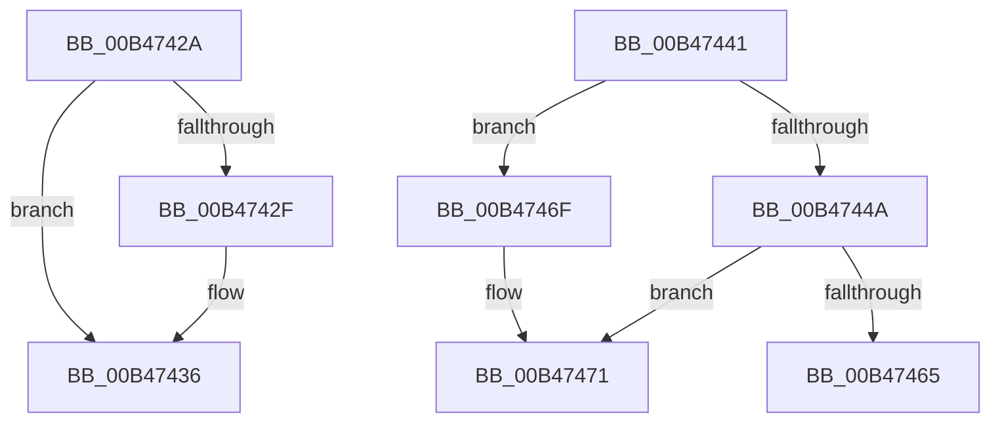

# sub_00B4742A

- RVA: `0x00B4742A`–`0x00B47492` (길이 `104` bytes)
- VA: `0x0000000140B4742A`
- 실행 섹션: `PAGE`
- PDB 이름 있음: `아니요`; PDB Function 태그: `아니요`
- unwind 정보 RVA: `0x000B95C0`
- 디코드: `24`개 명령, `104/104` bytes 표시
- 미해석 바이트: `0` (있으면 어셈블리에 `.byte`로 보존)

> 이 문서는 커널 이미지의 기계어와 PDB 기호를 분석해 생성했습니다. 4번과 5번은 함수 원형과 자료형을 바이너리 사용 방식에서 추정한 C 해석이며 원본 소스 복구 결과는 아닙니다.

## 1. Dependencies

- 직접 호출 지점: **2**; 고유 호출 대상: **2**
- 직접 호출자로 확인된 함수: **0**
- RIP 상대 이미지 참조: **2**

### Outgoing calls
- `0x00B47436` → [KiInitializeTimer2Data](../../text/5C/KiInitializeTimer2Data_function_005C65B0.md) (function, `0x005C65B0`)
- `0x00B47458` → [ExAllocatePool2](../../poolcode/B8/ExAllocatePool2_function_00B820F0.md) (function, `0x00B820F0`)

### Direct callers
- 이 함수 시작 RVA로 연결되는 직접 call은 확인되지 않았습니다. 간접 호출은 완전히 역산할 수 없습니다.

### Static image references
- `0x00B4742F` → RVA `0x00FC5030` (`ALMOSTRO`; read/write)
- `0x00B47441` → RVA `0x00FC5030` (`ALMOSTRO`; read)

## 2. Other-region calls and transfers

- 다른 실행 섹션으로 향하는 call: **2**
  - `0x00B47436` → [KiInitializeTimer2Data](../../text/5C/KiInitializeTimer2Data_function_005C65B0.md) (`PAGE` → `.text`)
  - `0x00B47458` → [ExAllocatePool2](../../poolcode/B8/ExAllocatePool2_function_00B820F0.md) (`PAGE` → `POOLCODE`)
- call이 아닌 외부 분기/꼬리 이동: **3**
  - `0x00B4743C` → [KeInitializeTimerTable + 0x1C](../A9/KeInitializeTimerTable_function_00A9471C.md) (`tail-transfer`)
  - `0x00B4746A` → [KeInitializeTimerTable + 0xBD](../A9/KeInitializeTimerTable_function_00A9471C.md) (`tail-transfer`)
  - `0x00B4748D` → [KeInitializeTimerTable + 0x3B](../A9/KeInitializeTimerTable_function_00A9471C.md) (`tail-transfer`)

## 3. Assembly (complete function range)

```asm
00B4742A  83 F8 01                        cmp eax, 1
00B4742D  74 07                           je 0x140b47436
00B4742F  83 25 FA DB 47 00 00            and dword ptr [rip + 0x47dbfa], 0
00B47436  E8 75 F1 A7 FF                  call 0x1405c65b0
00B4743B  90                              nop
00B4743C  E9 F7 D2 F4 FF                  jmp 0x140a94738
00B47441  83 3D E8 DB 47 00 00            cmp dword ptr [rip + 0x47dbe8], 0
00B47448  75 25                           jne 0x140b4746f
00B4744A  41 B8 4B 65 54 62               mov r8d, 0x6254654b
00B47450  48 8B D7                        mov rdx, rdi
00B47453  B9 48 00 00 00                  mov ecx, 0x48
00B47458  E8 93 AC 03 00                  call 0x140b820f0
00B4745D  48 8B D0                        mov rdx, rax
00B47460  48 85 C0                        test rax, rax
00B47463  75 0C                           jne 0x140b47471
00B47465  B8 9A 00 00 C0                  mov eax, 0xc000009a
00B4746A  E9 6A D3 F4 FF                  jmp 0x140a947d9
00B4746F  33 D2                           xor edx, edx
00B47471  0F B6 8B D0 00 00 00            movzx ecx, byte ptr [rbx + 0xd0]
00B47478  48 8D 04 FD 00 00 00 00         lea rax, [rdi*8]
00B47480  48 03 C9                        add rcx, rcx
00B47483  48 89 44 CD 00                  mov qword ptr [rbp + rcx*8], rax
00B47488  48 89 54 CD 08                  mov qword ptr [rbp + rcx*8 + 8], rdx
00B4748D  E9 C5 D2 F4 FF                  jmp 0x140a94757
```

## 4. C-style interpretation (structured pseudocode)

```c
__int64 __fastcall sub_00B4742A(void)
{
    __int64 result;

    if (((unsigned int)(result)) != 1) {
    }
    result = KiInitializeTimer2Data(a1, a2, a3, a4);
}
```

## 5. (Beta) C Style

```c
void sub_00B4742A(void)
{
    int64_t result;

    if (((uint32_t)(result)) != 1) {
    }
    result = KiInitializeTimer2Data(a1, a2, a3, a4);
}
```

## 6. Execution-region graph

[열기: 2D/3D 그래프와 함수 탐색 컨트롤 패널](../../../control-panel.html?section=page&rva=0x00B4742A&view=graph)

- 2D 그래프는 위에서 아래로 흐르고, 3D 그래프는 빈 공간을 드래그해 회전합니다. Shift+드래그는 이동, 휠은 확대·축소, 함수 노드 선택은 대상 보고서 이동입니다.

### Static fallback


